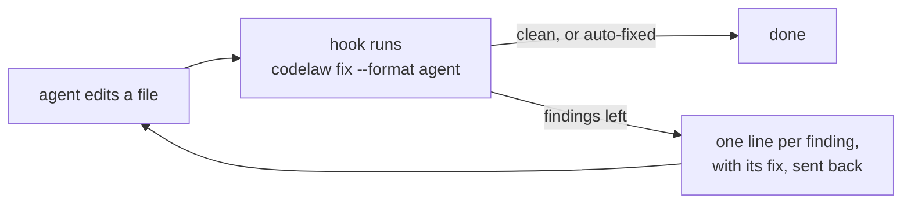

# codelaw

<div align="center">

**One linter for your whole repo. Rules are Markdown files that your team, your CI and your AI agents can all read.**

JavaScript · TypeScript · React · Stencil · Python · JSON · YAML · TOML · Markdown · CSS · HTML


[Quickstart](#quickstart) · [Rule packs](#rule-packs) · [Write a rule](#write-your-own-rule-in-one-markdown-file) · [AI agents](#use-it-with-ai-coding-agents) · [Roadmap](#roadmap) · [FAQ](#faq)

</div>

---

## Before, while and after the AI writes

**codelaw: your rules, before, while and after the AI writes.**

| | what the agent gets | where it stands |
|---|---|---|
| **Before** | it asks what applies to this file and gets the rules for it | ✅ today: the MCP tool `rules_for_path` (or `codelaw rules --for <path>`), and the skills `codelaw init --agents` installs. Narrowing that list to the few rules a task needs (`brief_for_task`) is in design, tracked in [W-05](work/open/W-05-write-time-guidance.md) |
| **While** | every edit is checked before it reaches disk; a bad line is refused with the reason and the fix | 🧪 **in design**: `codelaw hook --pre`, tracked in [W-05](work/open/W-05-write-time-guidance.md) |
| **After** | anything that slips through is fixed on save, in the hook and in CI | ✅ today: `codelaw hook`, `codelaw check`, `codelaw fix`, and fix-on-save in the editor extension |

*no AI inside codelaw — the same verdict on every machine, with or without an agent* ([SR-LAW-5](records/0007_LAW-5-no-model-in-the-engine.md)).

---

> [!IMPORTANT]
> **codelaw is a preview.** 0.1.0 is on npm, with the rules in the five packs of that release; the pack layout below, and PyPI, come with 0.2.0. The linter, the fixer, the formatter, the MCP server, the language server and all eleven rule packs work today if you build from source. The editor extension's Marketplace listing comes later. [Roadmap](#roadmap) lists what is built and what is not.

## In plain words

- Every project has rules: "don't use `var`", "no bare `except:`", "exports go at the bottom".
- Today those rules live in five tools with five config files, and only humans read the docs.
- **codelaw puts every rule in one small Markdown file.** The file says what the rule wants, shows good and bad code, and tells the tool how to fix it.
- One command checks your whole repo, fixes what it safely can, and tells you exactly what to do about the rest.
- A person, a CI job and an AI coding assistant get **the same answer**, because no AI runs inside codelaw.

---

## Why codelaw

| | |
|---|---|
| 🧰 **One tool, nine languages** | JS, TS, Python, JSON, YAML, TOML, Markdown, CSS and HTML, from one binary in one run. A Python-only repo doesn't need Node, and a JS-only repo doesn't need Python. |
| 📝 **A rule is a Markdown file** | Front matter for metadata, one fenced block for the matcher and fix, and `Do` / `Don't` examples. People read it, agents read it, and the engine runs it. |
| 🧪 **The docs are the tests** | `codelaw test` runs every rule against its own examples, so a rule's docs can't drift from what it does. |
| 🔧 **Every finding comes with a fix** | `auto` fixes apply themselves, `suggest` fixes come as a reviewable diff, and `manual` findings list the exact steps. No rule just says "this is wrong". |
| 🧱 **Fixes can restructure code** | Fix primitives move and regroup code, for example gathering every `export` into one block at the end of the file. A plain node-for-node replace can't do that. |
| 🔁 **Deterministic** | Same files and config in, same output out, with or without an AI agent. Every fix is re-parsed and checked before it's written, and a fix that would break the file is rolled back. |
| 🤖 **Built for AI coding agents** | `--format agent` gives one line per finding with its fix, ready to feed back to an agent after every edit. |
| 📦 **Standard rules included** | 440 rules reimplemented from ESLint, typescript-eslint, Ruff, stylelint, html-validate and markdownlint, so your team's own rules sit on top of a familiar base. |

---

## See it

A TypeScript file and a Python file with a few common mistakes:

```console
$ codelaw check

app/main.py
  1:1  error  Import one module per `import` statement  py/multiple-imports-on-one-line [auto]
  1:8  error  `os` is imported but never used  py/unused-import [suggest]
  1:12  error  `sys` is imported but never used  py/unused-import [suggest]
  3:17  error  A mutable default is created once and shared by every call; default to `None` and create it in the body  py/no-mutable-default [suggest]
  6:5  error  A bare `except:` also catches `KeyboardInterrupt` and `SystemExit`; name the exceptions  py/no-bare-except [suggest]
  8:8  error  Compare with `None` using `is`, not `==`  py/none-comparison [suggest]

src/math.ts
  4:1  error  Use `let` or `const` instead of `var`  js/no-var [suggest]
  5:5  error  Nothing equals NaN, not even NaN; use Number.isNaN(x)  js/use-isnan [manual]
      1. Replace x === NaN or x == NaN with Number.isNaN(x).
      2. Replace x !== NaN or x != NaN with !Number.isNaN(x).

✖ 8 problems (8 errors, 0 warnings, 0 infos) · 1 auto fix with `codelaw fix` · 6 suggestions with `codelaw fix --unsafe` · 4 files checked
```

Apply the fixes, including the suggestions you have reviewed. `--dry-run` shows what would change without writing:

```console
$ codelaw fix --unsafe
fixed app/main.py (py/multiple-imports-on-one-line ×1, py/no-bare-except ×1, py/no-mutable-default ×1, py/none-comparison ×1, py/unused-import ×2)
fixed src/math.ts (js/no-var ×1, js/prefer-const ×1)

src/math.ts
  5:5  error  Nothing equals NaN, not even NaN; use Number.isNaN(x)  js/use-isnan [manual]
      1. Replace x === NaN or x == NaN with Number.isNaN(x).
      2. Replace x !== NaN or x != NaN with !Number.isNaN(x).

✖ 1 problem (1 error, 0 warnings, 0 infos) · 2 files fixed · 4 files checked
```

Seven findings fixed themselves. The one left says exactly what to do. Here is `app/main.py` before and after:

<table>
<tr><th>before</th><th>after <code>codelaw fix --unsafe</code></th></tr>
<tr><td>

```python
import os, sys

def greet(names=[]):
    try:
        print("hi")
    except:
        pass
    if names == None:
        return
```

</td><td>

```python

def greet(names=None):
    if names is None:
        names = []
    try:
        print("hi")
    except Exception:
        pass
    if names is None:
        return
```

</td></tr>
</table>

---

## Quickstart

### Today: build from source

You need a Rust toolchain (1.97 or newer).

```bash
# 1. Build and install the codelaw binary
git clone https://github.com/arpitarya/codelaw.git
cargo install --path codelaw/crates/codelaw-cli

# 2. In your project: write codelaw.toml, .codelaw/rules/ and the .gitignore line
cd your-project
codelaw init --no-install

# 3. Until the packs are published, link them from the clone:
#    the npm packs into node_modules/, the PyPI-only ones where a Python install would put them
mkdir -p node_modules/@codelaw .codelaw-packs
for p in js ts react node stencil html css data tanstack-query redux-toolkit; do
  ln -s "$OLDPWD/codelaw/packs/$p" "node_modules/@codelaw/rules-$p"
done
for p in python; do
  ln -s "$OLDPWD/codelaw/packs/$p" ".codelaw-packs/codelaw_rules_$p"
done
export CODELAW_SITE_PACKAGES="$PWD/.codelaw-packs"

# 4. Opt in to the preview rules, then run
echo 'preview = true' >> codelaw.toml
codelaw check
```

- **`init` detects your languages** and writes the matching `recommended` presets into `codelaw.toml`.
- **Every rule is `preview` in 0.1.0**, so `preview = true` is needed until rules are promoted to stable.
- **Step 3 is temporary.** codelaw only reads the linked folders, so it works in any repo, Python-only included, and neither Node nor Python is run. `CODELAW_SITE_PACKAGES` is where codelaw looks for the PyPI packs, as an activated `.venv` would tell it. Add `node_modules/` and `.codelaw-packs/` to `.gitignore`.

### After the first release

Planned for the first release, and not published yet:

```bash
npx codelaw init      # Node projects: installs @codelaw/rules-* as dev dependencies
uvx codelaw init      # Python projects: installs codelaw-rules-* with your package manager
```

The npm and PyPI packages will be the same engine and give byte-identical output.

---

## Rule packs

Eleven first-party packs: ten on npm as `@codelaw/rules-<pack>`, six on PyPI as `codelaw-rules-<pack>`. A pack on both registries holds the same files on both.

<!-- docs-sync:packs -->

| pack | npm | PyPI | rules | presets | reimplemented from |
|---|---|---|---|---|---|
| [`js`](packs/js/README.md) | ✅ | ✅ | 72 | `js/recommended` · `js/typescript` · `js/conventions` · `js/project` | ESLint 10 recommended (all 64), and the four core rules typescript-eslint switches on for TypeScript |
| [`ts`](packs/ts/README.md) | ✅ | — | 21 | `ts/recommended` · `ts/conventions` | typescript-eslint 8 recommended (all 20) |
| [`react`](packs/react/README.md) | ✅ | ✅ | 21 | `react/recommended` · `react/conventions` | eslint-plugin-react, react-hooks |
| [`node`](packs/node/README.md) | ✅ | — | 10 | `node/recommended` | eslint-plugin-n |
| [`stencil`](packs/stencil/README.md) | ✅ | — | 18 | `stencil/recommended` · `stencil/conventions` | @stencil/eslint-plugin |
| [`python`](packs/python/README.md) | — | ✅ | 99 | `py/recommended` · `py/conventions` · `py/project` | Ruff 0.17's default `E4`/`E7`/`E9`/`F`, every stable flake8-bugbear rule, isort `I001`, `RUF022` |
| [`html`](packs/html/README.md) | ✅ | ✅ | 72 | `html/recommended` · `html/a11y` · `html/document` · `html/conventions` | html-validate 11 recommended, a11y and document |
| [`css`](packs/css/README.md) | ✅ | ✅ | 71 | `css/recommended` · `css/standard` · `css/conventions` · `css/project` | stylelint-config-recommended 18 (all 41), stylelint-config-standard 40 |
| [`data`](packs/data/README.md) | ✅ | ✅ | 37 | `data/recommended` · `md/recommended` · `data/package-json` · `data/tsconfig` · `data/pyproject` · `data/github-actions` · `data/conventions` | markdownlint 0.42, plus JSON/YAML/TOML correctness checks |
| [`tanstack-query`](packs/tanstack-query/README.md) | ✅ | — | 7 | `tanstack-query/recommended` | @tanstack/eslint-plugin-query 5 recommended (all 7) |
| [`redux-toolkit`](packs/redux-toolkit/README.md) | ✅ | — | 12 | `redux-toolkit/recommended` | codelaw's own, from the Redux Style Guide's Priority A and B rules |

<!-- /docs-sync:packs -->

- **Reimplemented, not wrapped.** Each rule is written fresh in codelaw's format, and its `ported_from:` field names the original. You don't need ESLint, Ruff or stylelint installed.
- **Differences are written down.** Each pack's README lists where a port behaves differently from the original, and which rules weren't ported and why.
- **Layout rules are left out on purpose.** Indentation, spacing and quotes are the formatter's job (`codelaw format`).
- **3,949 example checks, all green.** `codelaw test packs/<pack>` runs them.
- **`*/conventions` presets are opt-in**: house-style rules such as `js/exports-at-end` and `py/no-print`.
- **`*/project` presets are opt-in too**: the rules that read the whole repo, `graph/no-unused-exports` (`js/project`, `py/project`) and `graph/no-unused-css-classes` (`css/project`). `codelaw graph why-unused <symbol>` says why a finding held.
- **The counts on this page are checked.** `python3 scripts/docs-sync.py --check` fails CI when a pack's rules, presets or fix classes and this page disagree.

### Fix classes across all 440 rules

<!-- docs-sync:fix-classes -->

| class | rules | what happens |
|---|---|---|
| `auto` | 69 | `codelaw fix` applies it. It's safe and meaning-preserving. |
| `suggest` | 71 | `codelaw fix --unsafe` applies it. Review the diff, because it can change behaviour. |
| `manual` | 300 | The finding lists numbered steps, for a person or an agent to follow. |

<!-- /docs-sync:fix-classes -->

---

## Write your own rule in one Markdown file

```bash
codelaw new-rule acme/no-console-log --lang typescript,tsx
```

Fill in the file it writes, `.codelaw/rules/acme/no-console-log.md`:

````markdown
---
id: acme/no-console-log
title: "Log through the app logger, not console.log"
languages: [typescript, tsx]
fix: auto
stability: preview
since: 0.1.0
---

Application code logs with `logger.info(…)`, never `console.log(…)`.

**Why:** the logger adds levels and request ids, and is silenced in tests.

```codelaw
match:
  pattern: console.log($$$ARGS)
message: "Use `logger.info` instead of `console.log`"
fix: "logger.info($$$ARGS)"
```

## Examples

### TypeScript

#### Don't

```ts
console.log("user", id);
```

#### Do

```ts
logger.info("user", id);
```
````

Then test it against its own examples:

```console
$ codelaw test acme/no-console-log
✔ acme/no-console-log  12 checks · local

1 rules · 12 checks · 0 failed
```

- **Local rules are picked up automatically** from `.codelaw/rules/<namespace>/<name>.md`, with no plugin build or publish step.
- **`codelaw test` checks more than the examples:** every `Don't` must fire and fix to its `Do`, every `Do` must pass, and every fix must be a fixpoint.
- **`codelaw tree`** shows the syntax tree the matcher sees: `codelaw tree -e 'console.log(1)' --lang typescript`.
- **`codelaw rules lint`** checks rule files against the template.
- **Matchers use ast-grep's pattern syntax** (`pattern`, `kind`, `has`, `inside`, `not`, `any`, …), plus codelaw's fix primitives for moving code: `strip-export-keyword`, `collect-into-block` and others. The full format is [SR-RULE-FORMAT](records/0112_rule-format.md).

---

## Configure

`codelaw.toml` at the repo root. The same keys also work as `[tool.codelaw]` in `pyproject.toml` or `"codelaw"` in `package.json`.

```toml
extends = [
  "codelaw:js/recommended",
  "codelaw:js/typescript",      # the core rules typescript-eslint switches on
  "codelaw:ts/recommended",     # @codelaw/rules-ts, on npm
  "codelaw:py/recommended",     # codelaw-rules-python, on PyPI
  "codelaw:js/conventions",     # opt-in house style
]
preview = true                  # every rule is preview in 0.1.0

[rules]
"js/use-isnan" = "warn"         # change a severity, or "off"

[[overrides]]
files = ["src/legacy/**"]
rules = { "ts/no-unused-vars" = "off" }
```

- **Validation is strict.** An unknown key stops the run and names the valid ones (`unknown key 'disable'; valid keys are 'files', 'exclude', 'rules'`).
- **Monorepos:** a nested `codelaw.toml` inherits from the root and overrides it.
- **Team packs:** `extends` also takes `npm:<package>`, `pypi:<distribution>` and `path:<folder>`.
- **Full reference:** [SR-CONFIG](records/0110_config.md).

---

## Use it with AI coding agents

codelaw is built around one idea: **asking the agent to follow your rules is a hope, but checking its work after every edit is a guarantee.**



<details>
<summary><b>ASCII version</b></summary>

```text
   agent edits a file --> hook: codelaw fix --format agent --> clean / auto-fixed --> done
                                       |
                                       +--> findings left --> one line each, with its fix --> back to the agent
```

</details>

**Works today with Claude Code.** Add this to `.claude/settings.json`:

```json
{
  "hooks": {
    "PostToolUse": [
      {
        "matcher": "Edit|Write|MultiEdit",
        "hooks": [
          {
            "type": "command",
            "command": "jq -r '.tool_input.file_path' | xargs codelaw fix --format agent 1>&2 || exit 2"
          }
        ]
      }
    ]
  }
}
```

- **`auto` fixes are applied silently**, so the file on disk is already correct.
- **What's left goes back to the agent** (exit code 2), one line per finding with its fix:

  ```text
  src/math.ts:8:5 js/use-isnan Nothing equals NaN, not even NaN; use Number.isNaN(x) — fix: manual — Replace x === NaN or x == NaN with Number.isNaN(x). …
  ```

- **The same command works in any agent with post-edit hooks** (Codex, Copilot, Kiro), and in pre-commit and CI.
- **`codelaw mcp`** lets an agent ask `rules_for_path` *before* writing, and `format_snippet` for the exact bytes `fix` would write.
- **`codelaw hook`** is that recipe built in: it reads the agent's hook payload on stdin, fixes, and returns what is left. `codelaw init --agents claude,codex,copilot,kiro,cowork` installs the hooks and writes each agent's instruction files from the rules; `codelaw sync-agents` rewrites them when the rules change, and `--check` reports drift ([SR-AGENT-SURFACES](records/0102_agent-surfaces.md)).

---

## Commands

<!-- docs-sync:commands -->

| command | what it does |
|---|---|
| `codelaw check [paths]` | Report every finding with its fix. `--format text\|json\|sarif\|agent`, `--max-warnings N`, `--lang`, `--rule`, `--timings`; `--no-adapters` skips the installed oxlint, Ruff, stylelint and html-validate |
| `codelaw fix [paths]` | Apply `auto` fixes, format, then report what's left. `--unsafe` adds `suggest` fixes; `--dry-run` writes nothing; `--trace` shows each pass |
| `codelaw format [paths]` | Format every file: Prettier-style JS/TS/JSON/CSS/HTML/YAML/Markdown, Black-style Python, taplo-style TOML. `--check` and `--diff` change nothing |
| `codelaw mcp` · `codelaw lsp` | The MCP server for agents and the language server for editors, from the same binary |
| `codelaw init` | Detect languages and write `codelaw.toml`, `.codelaw/rules/` and the `.gitignore` line. `--no-install` prints the pack install commands instead of running them; `--registry npm\|pypi`; `--agents` writes the agent hooks and files |
| `codelaw config` | `--print` every resolved value and where it came from; `--schema` prints the config's JSON Schema; `--for <file>` resolves for one file |
| `codelaw rules` | List active rules. `--for <file>` shows the ones that apply to that file. `rules lint` checks rule files |
| `codelaw explain <id>` | What a rule requires, why, and how to fix it |
| `codelaw test [rule\|folder] [--corpus <dir>]` | Run rules against their own examples; `--corpus` also runs them over real code |
| `codelaw new-rule <ns/name>` | Write a rule file from the template |
| `codelaw tree <file>` | Show the syntax tree the engine sees |
| `codelaw match <id> <file>` | Which clause of a rule matched or failed, and what it captured. `--explain` shows every candidate node |
| `codelaw graph refs\|why-unused <symbol>` | Query the project graph: every use of a symbol, or why `graph/no-unused-exports` held |
| `codelaw baseline add\|prune\|check` | Grandfather a rule's existing findings with a deadline, lower the counts, or fail when the baseline got looser ([SR-BASELINE](records/0104_baseline-and-deprecations.md)) |
| `codelaw deprecate <symbol>` | Deprecate a symbol: write the registry entry and baseline every current use, for `graph/no-deprecated-usage` |
| `codelaw hook [paths]` | Check and fix the files an agent just edited; what is left goes back to it |
| `codelaw sync-agents` | Write every agent's instruction files from the rules and skills; `--check` reports drift |
| `codelaw daemon start\|stop\|status` | An opt-in warm process that `--prefer-warm` runs use; the output is the same |
| `codelaw cache stats\|clean` | Inspect or clear the content-addressed cache in `.codelaw/cache/` |
| `codelaw bench` | Time every performance-budgeted operation on a generated 10,000-file workload; `--budgets perf/budgets.toml` fails on a budget that's been set ([L8](records/0010_LAW-8-performance-budgets.md)) |

<!-- /docs-sync:commands -->

**Exit codes:** `0` clean · `1` findings remain · `2` config or rule error.

---

## Is codelaw for you?

**Choose codelaw when:**

- your repo mixes front end, Python and config files, and you want **one** tool, one config and one report;
- your team has conventions no off-the-shelf rule covers, and you want to write them **without building a plugin**;
- AI agents write some of your code, and you want their output checked **deterministically**, every time.

**Stay with what you have, for now, when:**

- you need **type-aware** rules, such as floating promises or `no-unsafe-*`. tree-sitter has no type information, so these stay with typescript-eslint, pyright or mypy;
- you need **byte-for-byte Prettier output** for HTML or Markdown. codelaw's formatter matches Prettier on every JS, TS and JSON file measured, but on only 62 % of HTML files and 42 % of Markdown files ([SR-FORMATTER](records/0105_formatter.md));
- you need a **stable, published** tool in production CI. 0.1.0 is a preview.

---

## Roadmap

<!-- docs-sync:roadmap -->

| | feature | record | state |
|---|---|---|---|
| ✅ | Engine: nine languages, one binary, parse once, cache | [SR-ARCHITECTURE](records/0108_architecture.md) | built |
| ✅ | `check`, `fix`, `format`, `test`, `rules`, `explain`, `tree`, `match`, `config`, `new-rule`, `init`, `cache` | [SR-CLI-MCP](records/0115_cli-and-mcp.md) | built |
| ✅ | Eleven rule packs: 440 rules | [SR-RULE-PACKS](records/0101_rule-packs.md) | built, `preview` |
| ✅ | `--format agent`, `--format json` and `--format sarif`; `--timings` | [SR-CLI-MCP](records/0115_cli-and-mcp.md) | built |
| ✅ | npm package (`npx codelaw`) | [SR-PACKAGES](records/0107_packages.md) | 0.1.0 published, five packs |
| 🔜 | PyPI package (`uvx codelaw`) and the per-registry pack layout of 0.2.0 on both registries | [SR-PACKAGES](records/0107_packages.md) | next |
| ✅ | Formatter (`codelaw format`, and the last step of `fix`): Prettier-style JS/TS/JSON, Black-style Python | [SR-FORMATTER](records/0105_formatter.md) | built |
| ✅ | MCP server (`codelaw mcp`) | [SR-CLI-MCP](records/0115_cli-and-mcp.md) | built |
| ✅ | Language server (`codelaw lsp`): diagnostics, quick fixes, formatting | [SR-EDITOR](records/0114_editor.md) | built; the VS Code extension is built, not published |
| ✅ | Agent hooks (`codelaw hook`), `init --agents`, `sync-agents` | [SR-AGENT-SURFACES](records/0102_agent-surfaces.md) | built |
| ✅ | Project-wide rules (`graph/no-unused-exports`, `graph/no-unused-css-classes`, the `node/no-*-import` rules) | [SR-PROJECT-GRAPH](records/0103_project-graph.md) | built, `preview` |
| ✅ | Baselines and deprecations (`baseline`, `deprecate`) | [SR-BASELINE](records/0104_baseline-and-deprecations.md) | built |
| ✅ | External linters as adapters (oxlint, Ruff, stylelint, html-validate) and the warm `daemon` | [SR-ARCHITECTURE](records/0108_architecture.md) | built |
| 🔜 | Promotion to `stable`: the pinned corpus and its CI job | [SR-RULE-AUTHORING](records/0113_rule-authoring.md) | designed |

<!-- /docs-sync:roadmap -->

The design for each item is a record in [`records/`](records/README.md); the open work is [`work/OPEN-WORK.md`](work/OPEN-WORK.md).

---

## FAQ

**Does codelaw use AI?**
No. The engine has no model and makes no network calls. Agents are one more caller of the same deterministic engine ([L5](records/0007_LAW-5-no-model-in-the-engine.md)).

**Do I need ESLint, Ruff or stylelint installed?**
No. The pack rules are reimplemented natively in codelaw.

**Will a fix ever break my code?**
Fixes run in passes until nothing more changes, up to ten passes. After each pass the file is re-parsed, and a fix that would introduce a syntax error is rolled back. Fixes that could change behaviour are `suggest`, and they only apply with `--unsafe`.

**Why is every rule `preview`?**
A rule becomes stable after it has been run over real third-party code and compared with the tool it was ported from. The packs have had those corpus runs by hand; `codelaw test --corpus <dir>` now runs one, but the pinned corpus and the CI job that promotes a rule are not built yet.

**Can I use it in a Python-only repo without Node?**
Yes. Nothing in codelaw runs Node or Python. Once released, the PyPI package will be a self-contained binary.

---

## Contributing

Bug reports, false positives and rule requests are welcome. See [CONTRIBUTING.md](CONTRIBUTING.md).

- **A false positive?** Open an issue with the smallest snippet that triggers it.
- **Security issue?** See [SECURITY.md](SECURITY.md). Please don't open a public issue.
- **How the project is run:** every design decision is a record in [`records/`](records/README.md), and [`docs/DESIGN.md`](docs/DESIGN.md) is the original proposal.

## Licence

**MIT** — see [LICENSE](LICENSE). It covers the engine, the repo and every package, the rule packs included (each carries its own copy). Every dependency is free, open source and permissively licensed, and nothing paid or copyleft is used ([L2](records/0004_LAW-2-foss-dependencies.md)).

## Acknowledgements

codelaw's rule packs follow the documented behaviour of [ESLint](https://eslint.org), [typescript-eslint](https://typescript-eslint.io), [Ruff](https://docs.astral.sh/ruff/), [stylelint](https://stylelint.io), [html-validate](https://html-validate.org) and [markdownlint](https://github.com/DavidAnson/markdownlint). Its matcher is built on [ast-grep](https://ast-grep.github.io) and [tree-sitter](https://tree-sitter.github.io).
