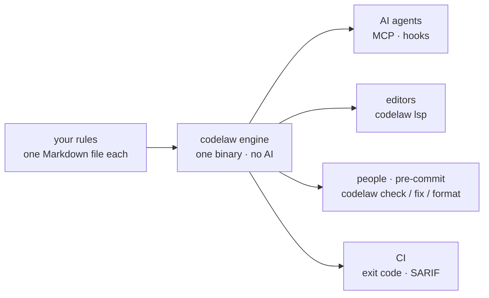

# codelaw

<div align="center">

**The linter and formatter for code written by people — and by AI.**

**Your rules, before, while and after the AI writes. The same rules with no AI at all.**

JavaScript · TypeScript · React · Stencil · Python · JSON · YAML · TOML · Markdown · CSS · HTML


[The story](#the-story) · [Four moments](#one-set-of-rules-four-moments) · [vs ESLint, Prettier, Biome](#if-you-know-eslint-and-prettier--or-biome--you-know-codelaw) · [See it](#see-it) · [Rule packs](#rule-packs) · [Get started](#get-started) · [**Usage guide**](USAGE.md) · [Roadmap](#roadmap) · [FAQ](#faq)

</div>

---

## The story

**It's Tuesday morning. An AI agent opened a pull request overnight.** It compiles, the tests pass, and it breaks four of your team's rules.

- **It used `var` and `== None`.** Your linters flagged both in CI, twenty minutes later, and the agent went round again.
- **It put an `export` in the middle of a file.** That is your team's convention. No linter knows it, so you write the same review comment for the fortieth time.
- **It left a bare `except:` in the Python service.** That half of the repo has its own linter, its own config and its own CI step.
- **Your `CLAUDE.md` said all of this.** The agent read it. Reading is not following.

Your rules live in five tools, five config files and one wiki page — and only some of those places can say no.

**codelaw puts every rule in one Markdown file that people, CI and AI agents all read, and one engine that enforces it.** The agent gets the rules before it writes, is checked while it writes, and is fixed after. Your editor, your pre-commit hook and your CI run the very same check — with no AI anywhere in it.

---

## One set of rules, four moments

| moment | what happens | where it stands |
|---|---|---|
| **Before** the AI writes | it asks what applies to this file and gets the rules for it | ✅ today: the MCP tool `rules_for_path` (or `codelaw rules --for <path>`), and the skills `codelaw init --agents` installs. Narrowing that list to the few rules a task needs (`brief_for_task`) is in design, tracked in [W-05](work/open/W-05-write-time-guidance.md) |
| **While** the AI writes | every edit is checked before it reaches disk; a bad line is refused with the reason and the fix | 🧪 **in design**: `codelaw hook --pre`, tracked in [W-05](work/open/W-05-write-time-guidance.md) |
| **After** the AI writes | anything that slips through is fixed on save, in the hook and in CI | ✅ today: `codelaw hook`, `codelaw check`, `codelaw fix`, and fix-on-save in the editor extension |
| **Without AI** | a person, an editor, a pre-commit hook or a CI job runs `check`, `fix` and `format` — the way you run ESLint and Prettier, or Biome | ✅ today: the CLI, `codelaw lsp`, `--format sarif` for code scanning |

*no AI inside codelaw — the same verdict on every machine, with or without an agent* ([SR-LAW-5](records/0007_LAW-5-no-model-in-the-engine.md)).



<details>
<summary><b>ASCII version</b></summary>

```text
   your rules (one .md each) --> codelaw engine (one binary, no AI) --+--> AI agents   (MCP, hooks)
                                                                       +--> editors     (codelaw lsp)
                                                                       +--> people, pre-commit (check / fix / format)
                                                                       +--> CI          (exit code, SARIF)
```

</details>

Every door gets the same answer, because they all call the same engine.

---

> [!IMPORTANT]
> **codelaw is a preview.** 0.2.0 is on npm — the engine, the eight platform binaries and all ten npm packs below; on PyPI, two of the six packs are up and the rest, with `codelaw` itself, follow within days. The linter, the fixer, the formatter, the MCP server, the language server and all fifteen rule packs work today if you build from source. The editor extension's Marketplace listing comes later. [Roadmap](#roadmap) lists what is built and what is not.

---

## If you know ESLint and Prettier — or Biome — you know codelaw

**The moves are the ones you already make:** a config file at the root, `check` to report, `fix` to repair, `format` to lay out, fix-on-save in the editor, a non-zero exit in CI. Like Biome, it is one Rust binary that is both the linter and the formatter.

**What changes is where the rules live and who can use them:**

| | the usual stack | codelaw |
|---|---|---|
| **Tools** | ESLint, Prettier, Ruff, stylelint, markdownlint, … | one binary |
| **Config** | one file per tool | one `codelaw.toml` (or `[tool.codelaw]` in `pyproject.toml`, `"codelaw"` in `package.json`) |
| **Languages in one run** | one family per tool | nine: JS, TS, Python, JSON, YAML, TOML, Markdown, CSS, HTML |
| **Your team's own rule** | code against a plugin API, where the tool has one | one Markdown file in `.codelaw/rules/`: pattern, message, fix, examples |
| **What a finding gives you** | a message, sometimes a fix | always a way out: an automatic fix, a diff to review, or numbered steps |
| **A rule's documentation** | kept apart from the code that runs it | the rule file itself, tested against its own examples |
| **AI agents** | read your instructions file | ask codelaw for the rules, and are checked after every edit |

You keep the rules you know: **441 rules are reimplemented from ESLint, typescript-eslint, Ruff, stylelint, html-validate and markdownlint**, and none of those tools needs to be installed.

**A warning on your laptop, an error in CI** — one config, no second file for the pipeline. codelaw runs the `ci` profile when `CI` is set, `local` otherwise, and an AI agent's hook runs `ci`, so an agent never leaves behind what CI would fail. A glob can be told never to fail the run, or never to warn ([usage guide](USAGE.md#warn-on-a-laptop-fail-in-ci)):

```toml
[profiles.local.rules]
"js/no-console"  = "warn"
"js/no-debugger" = "warn"

[profiles.ci.rules]
"js/no-console"  = "error"
"js/no-debugger" = "error"

[[overrides]]                      # never fails the run
files = ["scripts/**"]
remap = { error = "warn" }
```

---

## See it

A TypeScript file and a Python file with a few common mistakes:

```console
$ codelaw check

app/main.py
  1:1  error  Import one module per `import` statement  py/multiple-imports-on-one-line [auto]
  1:8  error  `os` is imported but never used  py/unused-import [suggest]
  1:12  error  `sys` is imported but never used  py/unused-import [suggest]
  3:17  error  A mutable default is created once and shared by every call; default to `None` and create it in the body  py/no-mutable-default [suggest]
  6:5  error  A bare `except:` also catches `KeyboardInterrupt` and `SystemExit`; name the exceptions  py/no-bare-except [suggest]
  8:8  error  Compare with `None` using `is`, not `==`  py/none-comparison [suggest]

src/math.ts
  4:1  error  Use `let` or `const` instead of `var`  js/no-var [suggest]
  5:5  error  Nothing equals NaN, not even NaN; use Number.isNaN(x)  js/use-isnan [manual]
      1. Replace x === NaN or x == NaN with Number.isNaN(x).
      2. Replace x !== NaN or x != NaN with !Number.isNaN(x).

✖ 8 problems (8 errors, 0 warnings, 0 infos) · 1 auto fix with `codelaw fix` · 6 suggestions with `codelaw fix --unsafe` · 4 files checked
```

Apply the fixes, including the suggestions you have reviewed. `--dry-run` shows what would change without writing:

```console
$ codelaw fix --unsafe
fixed app/main.py (py/multiple-imports-on-one-line ×1, py/no-bare-except ×1, py/no-mutable-default ×1, py/none-comparison ×1, py/unused-import ×2)
fixed src/math.ts (js/no-var ×1, js/prefer-const ×1)

src/math.ts
  5:5  error  Nothing equals NaN, not even NaN; use Number.isNaN(x)  js/use-isnan [manual]
      1. Replace x === NaN or x == NaN with Number.isNaN(x).
      2. Replace x !== NaN or x != NaN with !Number.isNaN(x).

✖ 1 problem (1 error, 0 warnings, 0 infos) · 2 files fixed · 4 files checked
```

Seven findings fixed themselves. The one left says exactly what to do. Here is `app/main.py` before and after:

<table>
<tr><th>before</th><th>after <code>codelaw fix --unsafe</code></th></tr>
<tr><td>

```python
import os, sys

def greet(names=[]):
    try:
        print("hi")
    except:
        pass
    if names == None:
        return
```

</td><td>

```python

def greet(names=None):
    if names is None:
        names = []
    try:
        print("hi")
    except Exception:
        pass
    if names is None:
        return
```

</td></tr>
</table>

---

## Why teams pick codelaw

| | |
|---|---|
| 🧰 **One tool, nine languages** | JS, TS, Python, JSON, YAML, TOML, Markdown, CSS and HTML, from one binary in one run. A Python-only repo doesn't need Node, and a JS-only repo doesn't need Python. |
| 📝 **A rule is a Markdown file** | Front matter for metadata, one fenced block for the matcher and fix, and `Do` / `Don't` examples. People read it, agents read it, and the engine runs it. |
| 🧪 **The docs are the tests** | `codelaw test` runs every rule against its own examples, so a rule's docs can't drift from what it does. |
| 🔧 **Every finding comes with a fix** | `auto` fixes apply themselves, `suggest` fixes come as a reviewable diff, and `manual` findings list the exact steps. No rule just says "this is wrong". |
| 🧱 **Fixes can restructure code** | Fix primitives move and regroup code, for example gathering every `export` into one block at the end of the file. A plain node-for-node replace can't do that. |
| 🔁 **Deterministic** | Same files and config in, same output out, with or without an AI agent. Every fix is re-parsed and checked before it's written, and a fix that would break the file is rolled back. |
| 🤖 **Built for AI coding agents** | `--format agent` gives one line per finding with its fix, ready to feed back to an agent after every edit. |
| 📦 **Standard rules included** | 460 rules reimplemented from ESLint, typescript-eslint, Ruff, stylelint, html-validate and markdownlint, so your team's own rules sit on top of a familiar base. |

**For the person who owns the codebase:** the review comment you keep writing becomes a rule file, once. From then on a person, a CI job and every AI agent get the same answer — and the answer can be audited, because it is a file in your repo and not a model's opinion.

---

## Rule packs

Fifteen first-party packs: thirteen on npm as `@codelaw/rules-<pack>`, nine on PyPI as `codelaw-rules-<pack>`. A pack on both registries holds the same files on both.

<!-- docs-sync:packs -->

| pack | npm | PyPI | rules | presets | reimplemented from |
|---|---|---|---|---|---|
| [`js`](packs/js/README.md) | ✅ | ✅ | 73 | `js/recommended` · `js/typescript` · `js/conventions` · `js/project` | ESLint 10 recommended (all 64, plus `no-console` at `warn`), and the four core rules typescript-eslint switches on for TypeScript |
| [`ts`](packs/ts/README.md) | ✅ | — | 21 | `ts/recommended` · `ts/conventions` | typescript-eslint 8 recommended (all 20) |
| [`react`](packs/react/README.md) | ✅ | ✅ | 32 | `react/recommended` · `react/conventions` | eslint-plugin-react, react-hooks, @eslint-react |
| [`node`](packs/node/README.md) | ✅ | — | 10 | `node/recommended` | eslint-plugin-n |
| [`stencil`](packs/stencil/README.md) | ✅ | — | 18 | `stencil/recommended` · `stencil/conventions` | @stencil/eslint-plugin |
| [`python`](packs/python/README.md) | — | ✅ | 99 | `py/recommended` · `py/conventions` · `py/project` | Ruff 0.17's default `E4`/`E7`/`E9`/`F`, every stable flake8-bugbear rule, isort `I001`, `RUF022` |
| [`html`](packs/html/README.md) | ✅ | ✅ | 72 | `html/recommended` · `html/a11y` · `html/document` · `html/conventions` · `html/security` | html-validate 11 recommended, a11y and document |
| [`css`](packs/css/README.md) | ✅ | ✅ | 71 | `css/recommended` · `css/standard` · `css/conventions` · `css/project` | stylelint-config-recommended 18 (all 41), stylelint-config-standard 40 |
| [`data`](packs/data/README.md) | ✅ | ✅ | 39 | `data/recommended` · `md/recommended` · `data/package-json` · `data/tsconfig` · `data/pyproject` · `data/github-actions` · `data/conventions` | markdownlint 0.42, plus JSON/YAML/TOML correctness checks |
| [`tanstack-query`](packs/tanstack-query/README.md) | ✅ | — | 13 | `tanstack-query/recommended` | @tanstack/eslint-plugin-query 5 recommended (all 7), and 6 rules from TanStack Query v5's guides |
| [`redux-toolkit`](packs/redux-toolkit/README.md) | ✅ | — | 12 | `redux-toolkit/recommended` | codelaw's own, from the Redux Style Guide's Priority A and B rules |
| [`security-js`](packs/security-js/README.md) | ✅ | ✅ | 0 | `sec-js/recommended` · `sec-js/strict` | a scaffold: the rules are W-54 (eslint-plugin-security, CodeQL and OWASP ideas), mapped to CWE and OWASP 2025 |
| [`security-ts`](packs/security-ts/README.md) | ✅ | — | 0 | `sec-ts/recommended` · `sec-ts/strict` | a scaffold: extends `security-js`; its TypeScript-only rules are W-55 |
| [`security-html`](packs/security-html/README.md) | ✅ | ✅ | 0 | `sec-html/recommended` · `sec-html/strict` | a scaffold: extends `html/security`; its rules are W-56 |
| [`security-python`](packs/security-python/README.md) | — | ✅ | 0 | `sec-py/recommended` · `sec-py/strict` | a scaffold: the rules are W-57 (Bandit, Ruff `S`, Django, Flask, FastAPI) |

<!-- /docs-sync:packs -->

- **Reimplemented, not wrapped.** Each rule is written fresh in codelaw's format, and its `ported_from:` field names the original. You don't need ESLint, Ruff or stylelint installed.
- **Differences are written down.** Each pack's README lists where a port behaves differently from the original, and which rules weren't ported and why.
- **Layout rules are left out on purpose.** Indentation, spacing and quotes are the formatter's job (`codelaw format`).
- **3,949 example checks, all green.** `codelaw test packs/<pack>` runs them.
- **`*/conventions` presets are opt-in**: house-style rules such as `js/exports-at-end` and `py/no-print`.
- **`*/project` presets are opt-in too**: the rules that read the whole repo, `graph/no-unused-exports` (`js/project`, `py/project`) and `graph/no-unused-css-classes` (`css/project`). `codelaw graph why-unused <symbol>` says why a finding held.
- **The counts on this page are checked.** `python3 scripts/docs-sync.py --check` fails CI when a pack's rules, presets or fix classes and this page disagree.

### Fix classes across all 460 rules

<!-- docs-sync:fix-classes -->

| class | rules | what happens |
|---|---|---|
| `auto` | 70 | `codelaw fix` applies it. It's safe and meaning-preserving. |
| `suggest` | 77 | `codelaw fix --unsafe` applies it. Review the diff, because it can change behaviour. |
| `manual` | 313 | The finding lists numbered steps, for a person or an agent to follow. |

<!-- /docs-sync:fix-classes -->

---

## A rule is one Markdown file

Your convention, written once — people read it, agents read it, the engine runs it:

````markdown
---
id: acme/no-console-log
title: "Log through the app logger, not console.log"
languages: [typescript, tsx]
fix: auto
stability: preview
since: 0.1.0
---

Application code logs with `logger.info(…)`, never `console.log(…)`.

**Why:** the logger adds levels and request ids, and is silenced in tests.

```codelaw
match:
  pattern: console.log($$$ARGS)
message: "Use `logger.info` instead of `console.log`"
fix: "logger.info($$$ARGS)"
```

## Examples

### TypeScript

#### Don't

```ts
console.log("user", id);
```

#### Do

```ts
logger.info("user", id);
```
````

Then test it against its own examples:

```console
$ codelaw test acme/no-console-log
✔ acme/no-console-log  12 checks · local

1 rules · 12 checks · 0 failed
```

- **No plugin to build or publish:** a file in `.codelaw/rules/<namespace>/` is picked up on the next run.
- **The examples are the tests:** every `Don't` must fire and fix to its `Do`.
- **The full workflow** — `new-rule`, `test`, `tree`, `rules lint` — is in the [usage guide](USAGE.md#write-your-own-rules).

---

## Get started

**Three steps: install, `codelaw init`, `codelaw check`.**

- **Install.** Until 0.2.0 is on both registries, the full rule set is built from source; the [usage guide](USAGE.md#install) has the exact commands.
- **`codelaw init`** detects your languages and writes `codelaw.toml` with the matching presets.
- **`codelaw check`** reports every finding with its fix; **`codelaw fix`** applies the safe ones and formats.
- **With an AI agent:** `codelaw init --agents claude,codex,copilot,kiro,cowork` installs the hooks and instruction files ([usage guide](USAGE.md#with-ai-agents)).

**→ [The usage guide](USAGE.md)**: install, configure, write rules, wire up agents, editors, pre-commit and CI, and every command.

---

## Is codelaw for you?

**Built for codebases where people and AI write side by side:** years of human code, and an agent adding to it, held to the same rules.

**The more of your code an agent writes, the more you need rules it can't skip.** Good docs and search help an agent get it right the first time; a check is what proves it did.

**Choose codelaw when:**

- your repo mixes front end, Python and config files, and you want **one** tool, one config and one report;
- your team has conventions no off-the-shelf rule covers, and you want to write them **without building a plugin**;
- AI agents write some of your code, and you want their output checked **deterministically**, every time.

**Stay with what you have, for now, when:**

- you need **type-aware** rules, such as floating promises or `no-unsafe-*`. tree-sitter has no type information, so these stay with typescript-eslint, pyright or mypy;
- you need **byte-for-byte Prettier output** for HTML or Markdown. codelaw's formatter matches Prettier on every JS, TS and JSON file measured, but on only 62 % of HTML files and 42 % of Markdown files ([SR-FORMATTER](records/0105_formatter.md));
- you need a **stable, published** tool in production CI. 0.1.0 is a preview.

---

## Roadmap

<!-- docs-sync:roadmap -->

| | feature | record | state |
|---|---|---|---|
| ✅ | Engine: nine languages, one binary, parse once, cache | [SR-ARCHITECTURE](records/0108_architecture.md) | built |
| ✅ | `check`, `fix`, `format`, `test`, `rules`, `explain`, `tree`, `match`, `config`, `new-rule`, `init`, `cache` | [SR-CLI-MCP](records/0115_cli-and-mcp.md) | built |
| ✅ | Fifteen rule packs: 460 rules | [SR-RULE-PACKS](records/0101_rule-packs.md) | built, `preview` |
| ✅ | `--format agent`, `--format json` and `--format sarif`; `--timings` | [SR-CLI-MCP](records/0115_cli-and-mcp.md) | built |
| ✅ | npm package (`npx codelaw`) | [SR-PACKAGES](records/0107_packages.md) | 0.2.0 published from CI with provenance, ten packs |
| 🔜 | PyPI package (`uvx codelaw`) | [SR-PACKAGES](records/0107_packages.md) | 0.2.0: `codelaw-rules-css` and `-data` up; the other four packs and `codelaw` next (W-38) |
| ✅ | Formatter (`codelaw format`, and the last step of `fix`): Prettier-style JS/TS/JSON, Black-style Python | [SR-FORMATTER](records/0105_formatter.md) | built |
| ✅ | MCP server (`codelaw mcp`) | [SR-CLI-MCP](records/0115_cli-and-mcp.md) | built |
| ✅ | Language server (`codelaw lsp`): diagnostics, quick fixes, formatting | [SR-EDITOR](records/0114_editor.md) | built; the VS Code extension is built, not published |
| ✅ | Agent hooks (`codelaw hook`), `init --agents`, `sync-agents` | [SR-AGENT-SURFACES](records/0102_agent-surfaces.md) | built |
| ✅ | Project-wide rules (`graph/no-unused-exports`, `graph/no-unused-css-classes`, the `node/no-*-import` rules) | [SR-PROJECT-GRAPH](records/0103_project-graph.md) | built, `preview` |
| ✅ | Baselines and deprecations (`baseline`, `deprecate`) | [SR-BASELINE](records/0104_baseline-and-deprecations.md) | built |
| ✅ | External linters as adapters (oxlint, Ruff, stylelint, html-validate) and the warm `daemon` | [SR-ARCHITECTURE](records/0108_architecture.md) | built |
| 🔜 | Promotion to `stable`: the pinned corpus and its CI job | [SR-RULE-AUTHORING](records/0113_rule-authoring.md) | designed |

<!-- /docs-sync:roadmap -->

The design for each item is a record in [`records/`](records/README.md); the open work is [`work/OPEN-WORK.md`](work/OPEN-WORK.md).

---

## FAQ

**How is codelaw different from ESLint and Prettier, or Biome?**
It does the same jobs — lint, fix, format — for nine languages from one binary and one config. The difference is the rule: a Markdown file your team writes without a plugin, that always carries a fix, and that an AI agent can ask for before it writes.

**Does it work without AI?**
Yes, completely. The CLI, the editor extension, pre-commit and CI need no agent at all. Agents are one more caller of the same engine.

**Does codelaw use AI?**
No. The engine has no model and makes no network calls. Agents are one more caller of the same deterministic engine ([L5](records/0007_LAW-5-no-model-in-the-engine.md)).

**Do I need ESLint, Ruff or stylelint installed?**
No. The pack rules are reimplemented natively in codelaw.

**Will a fix ever break my code?**
Fixes run in passes until nothing more changes, up to ten passes. After each pass the file is re-parsed, and a fix that would introduce a syntax error is rolled back. Fixes that could change behaviour are `suggest`, and they only apply with `--unsafe`.

**Why is every rule `preview`?**
A rule becomes stable after it has been run over real third-party code and compared with the tool it was ported from. The packs have had those corpus runs by hand; `codelaw test --corpus <dir>` now runs one, but the pinned corpus and the CI job that promotes a rule are not built yet.

**Can I use it in a Python-only repo without Node?**
Yes. Nothing in codelaw runs Node or Python. Once released, the PyPI package will be a self-contained binary.

---

## Contributing

Bug reports, false positives and rule requests are welcome. See [CONTRIBUTING.md](CONTRIBUTING.md).

- **A false positive?** Open an issue with the smallest snippet that triggers it.
- **Security issue?** See [SECURITY.md](SECURITY.md). Please don't open a public issue.
- **How the project is run:** every design decision is a record in [`records/`](records/README.md), and [`docs/DESIGN.md`](docs/DESIGN.md) is the original proposal.

## Licence

**MIT** — see [LICENSE](LICENSE). It covers the engine, the repo and every package, the rule packs included (each carries its own copy). Every dependency is free, open source and permissively licensed, and nothing paid or copyleft is used ([L2](records/0004_LAW-2-foss-dependencies.md)).

## Acknowledgements

codelaw's rule packs follow the documented behaviour of [ESLint](https://eslint.org), [typescript-eslint](https://typescript-eslint.io), [Ruff](https://docs.astral.sh/ruff/), [stylelint](https://stylelint.io), [html-validate](https://html-validate.org) and [markdownlint](https://github.com/DavidAnson/markdownlint). Its matcher is built on [ast-grep](https://ast-grep.github.io) and [tree-sitter](https://tree-sitter.github.io).
