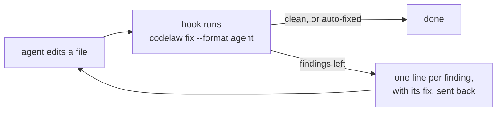

# Using codelaw

**The how-to.** What codelaw is, and why: the [README](README.md).

[Install](#install) · [First run](#your-first-run) · [Configure](#configure) · [Write your own rules](#write-your-own-rules) · [With AI agents](#with-ai-agents) · [Without AI](#without-ai-editor-pre-commit-ci) · [Commands](#commands)

---

## Install

### Today: build from source

You need a Rust toolchain (1.97 or newer).

```bash
# 1. Build and install the codelaw binary
git clone https://github.com/arpitarya/codelaw.git
cargo install --path codelaw/crates/codelaw-cli

# 2. In your project: write codelaw.toml, .codelaw/rules/ and the .gitignore line
cd your-project
codelaw init --no-install

# 3. Until the packs are published, link them from the clone:
#    the npm packs into node_modules/, the PyPI-only ones where a Python install would put them
mkdir -p node_modules/@codelaw .codelaw-packs
for p in js ts react node stencil html css data tanstack-query redux-toolkit security-js security-ts security-html; do
  ln -s "$OLDPWD/codelaw/packs/$p" "node_modules/@codelaw/rules-$p"
done
for p in python security-python; do
  ln -s "$OLDPWD/codelaw/packs/$p" ".codelaw-packs/codelaw_rules_${p//-/_}"
done
export CODELAW_SITE_PACKAGES="$PWD/.codelaw-packs"

# 4. Opt in to the preview rules, then run
echo 'preview = true' >> codelaw.toml
codelaw check
```

- **`init` detects your languages** and writes the matching `recommended` presets into `codelaw.toml`.
- **Every rule is `preview` in 0.1.0**, so `preview = true` is needed until rules are promoted to stable.
- **Step 3 is temporary.** codelaw only reads the linked folders, so it works in any repo, Python-only included, and neither Node nor Python is run. `CODELAW_SITE_PACKAGES` is where codelaw looks for the PyPI packs, as an activated `.venv` would tell it. Add `node_modules/` and `.codelaw-packs/` to `.gitignore`.

### After the first release

Planned for the first release, and not published yet:

```bash
npx codelaw init      # Node projects: installs @codelaw/rules-* as dev dependencies
uvx codelaw init      # Python projects: installs codelaw-rules-* with your package manager
```

The npm and PyPI packages will be the same engine and give byte-identical output.

---

## Your first run

```bash
codelaw check                 # every finding, each with its fix
codelaw fix --dry-run         # what the safe fixes would change; writes nothing
codelaw fix                   # apply the auto fixes, then format
codelaw fix --unsafe          # also apply the suggest fixes — review the diff
codelaw format --check        # is every file formatted?
codelaw explain js/use-isnan  # what a rule wants, why, and how to fix it
```

- **`auto` fixes** are safe and meaning-preserving; **`suggest` fixes** can change behaviour, so they wait for `--unsafe`; **`manual` findings** list numbered steps.
- **Every fix is re-parsed** before it is written; a fix that would break the file is rolled back.

---

## Configure

`codelaw.toml` at the repo root. The same keys also work as `[tool.codelaw]` in `pyproject.toml` or `"codelaw"` in `package.json`.

```toml
extends = [
  "codelaw:js/recommended",
  "codelaw:js/typescript",      # the core rules typescript-eslint switches on
  "codelaw:ts/recommended",     # @codelaw/rules-ts, on npm
  "codelaw:py/recommended",     # codelaw-rules-python, on PyPI
  "codelaw:js/conventions",     # opt-in house style
]
preview = true                  # every rule is preview in 0.1.0

[rules]
"js/use-isnan" = "warn"         # change a severity, or "off"

[[overrides]]
files = ["src/legacy/**"]
rules = { "ts/no-unused-vars" = "off" }
```

- **Validation is strict.** An unknown key stops the run and names the valid ones (`unknown key 'disable'; valid keys are 'files', 'exclude', 'rules', 'remap'`).
- **Monorepos:** a nested `codelaw.toml` inherits from the root and overrides it.
- **Team packs:** `extends` also takes `npm:<package>`, `pypi:<distribution>` and `path:<folder>`.
- **Full reference:** [SR-CONFIG](records/0110_config.md).

### Warn on a laptop, fail in CI

A **profile** is a named set of `rules` and `overrides` laid over the config. codelaw runs the `ci` profile when the `CI` environment variable is set (and not `false` or `0`), `local` otherwise; `--profile <name>` or `CODELAW_PROFILE` picks one by name. `codelaw hook` and the MCP server run `ci` — an agent gets CI's verdict — and the editor runs `local`.

```toml
[profiles.local.rules]
"js/no-console"  = "warn"
"js/no-debugger" = "warn"

[profiles.ci.rules]
"js/no-console"  = "error"
"js/no-debugger" = "error"
```

```bash
codelaw check                 # profile local (default): a console.log is a warning, exit 0
CI=true codelaw check         # profile ci (CI=true): the same line is an error, exit 1
codelaw check --profile ci    # a pipeline that doesn't set CI (some Jenkins setups)
```

When the config defines a profile, every report opens with the one in use (`profile ci (CI=true)`), and `codelaw config --print` names it with its source.

### Globs that never error, or never warn

`remap` on an `[[overrides]]` entry maps each severity of a finding in those files to another, or to `off`. It applies last — after the baseline — and never to codelaw's own `codelaw/*` diagnostics.

```toml
[[overrides]]                      # never fails the run
files = ["scripts/**"]
remap = { error = "warn" }

[[overrides]]                      # silent
files = ["**/*.generated.ts"]
remap = { error = "off", warn = "off", info = "off" }

[[overrides]]                      # strict: no warnings, only errors
files = ["src/payments/**"]
remap = { warn = "error" }
```

### Size limits

The `size` presets are opt-in (in no `recommended`): `codelaw:html/size` and `codelaw:css/size` turn on a line limit per file. HTML and CSS have no prior art in stylelint, html-validate or Biome, so the defaults are codelaw's own. The stylesheet limit covers `.css` and, as those languages arrive, SCSS and CSS Modules; a `<style>` or `<script>` inside a page is part of that page's count, never a file of its own.

| rule | default | options |
|---|---|---|
| `html/max-lines` | 400 | `max`, `skip_blank_lines` (true), `skip_comments` (true, `<!-- -->`), `skip_embedded` (false: lines inside `<script>` and `<style>`) |
| `css/max-lines` | 300 | `max`, `skip_blank_lines` (true), `skip_comments` (true, `/* */` and SCSS `//`), `skip_imports` (false: `@import`, `@use`, `@forward`) |

```toml
extends = ["codelaw:html/size", "codelaw:css/size"]

[rules]
"css/max-lines" = { severity = "warn", options = { max = 200, skip_imports = true } }
```

A line holding code and a comment counts as code. A finding names the first line over the limit and carries the count: `412 lines (max 300; blank lines and comments not counted)`. The fix is manual: split the file.

---

## Write your own rules

```bash
codelaw new-rule acme/no-console-log --lang typescript,tsx   # write the file from the template
codelaw test acme/no-console-log                             # run it against its own examples
```

The rule file itself is shown in the [README](README.md#a-rule-is-one-markdown-file).

- **Local rules are picked up automatically** from `.codelaw/rules/<namespace>/<name>.md`, with no plugin build or publish step.
- **`codelaw test` checks more than the examples:** every `Don't` must fire and fix to its `Do`, every `Do` must pass, and every fix must be a fixpoint.
- **`codelaw tree`** shows the syntax tree the matcher sees: `codelaw tree -e 'console.log(1)' --lang typescript`.
- **`codelaw rules lint`** checks rule files against the template.
- **Matchers use ast-grep's pattern syntax** (`pattern`, `kind`, `has`, `inside`, `not`, `any`, …), plus codelaw's fix primitives for moving code: `strip-export-keyword`, `collect-into-block` and others. The full format is [SR-RULE-FORMAT](records/0112_rule-format.md).

---

## With AI agents

**Before, while and after the agent writes** — what each needs, and what ships today.

### Before: the agent asks for the rules

- **`codelaw mcp`** is an MCP server over stdio. An agent calls `rules_for_path` before writing, `check_snippet` on a draft, `explain_rule` on a finding, and `format_snippet` for the exact bytes `fix` would write.
- **The same answer from the CLI:** `codelaw rules --for src/math.ts`.
- **`codelaw init --agents claude,codex,copilot,kiro,cowork`** writes each agent's instruction files, skills, MCP registration and hook from your rules; `codelaw sync-agents` rewrites them when the rules change, and `--check` reports drift ([SR-AGENT-SURFACES](records/0102_agent-surfaces.md)).

### While: the edit is checked before it reaches disk

🧪 **In design**, not built: `codelaw hook --pre` checks a proposed edit and refuses it with the reason and the fix. Tracked in [W-05](work/open/W-05-write-time-guidance.md).

### After: every edit is checked and fixed



<details>
<summary><b>ASCII version</b></summary>

```text
   agent edits a file --> hook: codelaw fix --format agent --> clean / auto-fixed --> done
                                       |
                                       +--> findings left --> one line each, with its fix --> back to the agent
```

</details>

**Works today with Claude Code.** Add this to `.claude/settings.json`:

```json
{
  "hooks": {
    "PostToolUse": [
      {
        "matcher": "Edit|Write|MultiEdit",
        "hooks": [
          {
            "type": "command",
            "command": "jq -r '.tool_input.file_path' | xargs codelaw fix --format agent 1>&2 || exit 2"
          }
        ]
      }
    ]
  }
}
```

- **`auto` fixes are applied silently**, so the file on disk is already correct.
- **What's left goes back to the agent** (exit code 2), one line per finding with its fix:

  ```text
  src/math.ts:8:5 js/use-isnan Nothing equals NaN, not even NaN; use Number.isNaN(x) — fix: manual — Replace x === NaN or x == NaN with Number.isNaN(x). …
  ```

- **The same command works in any agent with post-edit hooks** (Codex, Copilot, Kiro), and in pre-commit and CI.
- **`codelaw hook`** is that recipe built in: it reads the agent's hook payload on stdin, fixes, and returns what is left. `codelaw init --agents claude,codex,copilot,kiro,cowork` installs the hooks and writes each agent's instruction files from the rules; `codelaw sync-agents` rewrites them when the rules change, and `--check` reports drift ([SR-AGENT-SURFACES](records/0102_agent-surfaces.md)).

---

## Without AI: editor, pre-commit, CI

- **Editor:** `codelaw lsp` is a language server — diagnostics, quick fixes and formatting. The VS Code extension is built; its Marketplace listing comes later ([SR-EDITOR](records/0114_editor.md)).
- **Pre-commit:** `codelaw init --git-hooks` installs a `pre-commit` and a `post-commit` hook in the folder git uses (`core.hooksPath` or `.git/hooks`). An existing hook is kept as `<name>.pre-codelaw` and runs first; nothing is overwritten, and deleting the file uninstalls it ([SR-CLI-MCP](records/0115_cli-and-mcp.md) decision 11).
  - **`pre-commit` blocks:** it runs `codelaw fix --staged` on the files that are fully staged and re-stages them, then `codelaw check --staged` on every staged file. A partly staged file is checked but never fixed, so your unstaged hunks stay yours. Add flags to both with `CODELAW_HOOK_ARGS` (for example `--profile ci`); skip once with `git commit --no-verify`.
  - **`post-commit` never blocks:** it reminds you of your exceptions that expire within 7 days (`codelaw exceptions --mine --expiring 7d`) and the baseline's 30-day burn-down in one line, then prints what the scripts in `.codelaw/hooks/post-commit.d/` print, and always exits 0.
  - **By hand:** `codelaw check --staged`.
  - **The pre-commit framework** — `codelaw` must be on `PATH`:

    ```yaml
    repos:
      - repo: https://github.com/arpitarya/codelaw
        rev: v0.2.0
        hooks:
          - id: codelaw-fix
          - id: codelaw-check
    ```

  - **husky** (`.husky/pre-commit`) and **lefthook** (`lefthook.yml`):

    ```sh
    npx codelaw check --staged -- $(git diff --cached --name-only --diff-filter=ACMR)
    ```

    ```yaml
    pre-commit:
      commands:
        codelaw:
          glob: "*.{js,jsx,ts,tsx,py,json,yaml,yml,toml,md,css,html}"
          run: codelaw check --staged -- {staged_files}
          stage_fixed: true
    ```
- **In your dev server:** `@codelaw/vite-plugin` (`plugins: [codelaw()]`), `@codelaw/webpack-plugin` (`new CodelawPlugin()`, also in Rspack) and `@codelaw/next` (`export default withCodelaw(nextConfig)`) show codelaw's findings where you already look — errors in the overlay, warnings in the terminal — and make `vite build`, `webpack` and `next build` fail on an error. Each runs the `codelaw` binary your project already has; options `profile`, `buildProfile`, `failOnError`, `paths`, `binary` ([SR-PACKAGES](records/0107_packages.md) decision 3a).
- **While you work:** `codelaw check --watch` checks once, then again every time a file is saved — the saved file, and through the project rules every file that depends on it — until Ctrl-C. Editing `codelaw.toml`, a rule or the baseline takes effect on the next run, with no restart. It runs the `local` profile unless `--profile` says otherwise. `--format json` prints one JSON object per run, one per line, for tools that read it; `codelaw fix --watch` fixes each file as you save it, which can fight an editor that also fixes or formats on save ([SR-CLI-MCP](records/0115_cli-and-mcp.md) decision 2).
- **CI:** `codelaw check --max-warnings 0` fails the job on any finding; `--changed-since origin/main` checks only what a branch touched; `--format sarif` feeds GitHub code scanning. A CI job runs the `ci` profile when `CI` is set, as GitHub Actions, GitLab CI and most runners do; where it is not, pass `--profile ci` ([Configure](#warn-on-a-laptop-fail-in-ci)). To show findings inline without one, pick the format your CI reads (every one keeps the exit code):
  - **GitHub Actions:** `codelaw check --format github` — annotations on the PR diff.
  - **GitLab:** `codelaw check --format gitlab > gl-code-quality-report.json`, then `artifacts: reports: codequality: gl-code-quality-report.json` — the MR widget.
  - **Jenkins, Azure DevOps, Bitbucket:** `codelaw check --format junit > codelaw-junit.xml` and publish it as test results.
  - **Jenkins (Warnings Next Generation), SonarQube generic import, Azure DevOps:** `codelaw check --format checkstyle > checkstyle.xml`.
  - `codelaw format --check --format github` (or any of the four) reports the files that would change.
- **Adopting it in an old repo:** grandfather a rule's existing findings with a deadline — `codelaw baseline add --rule <id> --expires <date> --reason "<why>"` ([SR-BASELINE](records/0104_baseline-and-deprecations.md)).
- **Exceptions with an expiry date:** a baseline entry, a deprecation or an inline ignore can carry `expires` — the first day it no longer holds. From `warn_days` before it (3 by default) it is a warning, `codelaw/expiring-exception`; on the day it is an error, `codelaw/expired-exception`, and the findings it covered come back. Set `[exceptions] require_expiry = true` in `codelaw.toml` to make the date mandatory. An optional `added_by` email (`by=` inline) is checked against git under `--staged` (your `git config user.email`) and `--changed-since` (the line's blame author):

  ```ts
  // codelaw-ignore js/no-console expires=2026-11-15 by=you@example.com: needed until the logger lands
  console.log(state);
  ```

  The day is the as-of date — `HEAD`'s commit date — not the wall clock, so a branch with no new commit does not start failing on the day by itself. A scheduled CI job passes `codelaw check --as-of "$(date +%F)"`. `until`, the last allowed day, still works for one release and reads as `expires` the day after ([SR-BASELINE](records/0104_baseline-and-deprecations.md) decision 9).
- **Old uses warn, new ones fail:** leave out `--expires` and pass `--warn-from <today> --on-touch keep`. Each file's existing findings stay warnings with no deadline; a new file with the finding, or one more finding in an old file, is an error. `react/no-context` is the worked example — turn it on, then:

  ```bash
  # codelaw.toml: [rules] "react/no-context" = "error"
  codelaw baseline add --rule react/no-context \
    --warn-from 2026-10-25 --on-touch keep --reason "legacy context, grandfathered"
  ```

- **Dependencies on their latest version:** `codelaw deps refresh` reads npm and the Python index for every dependency your `package.json` and `pyproject.toml` files name, and writes `.codelaw/deps-snapshot.json` — commit it. It is the only command that uses the network ([L5](records/0007_LAW-5-no-model-in-the-engine.md) decision 3). Then `check` reports each dependency behind its latest version from the snapshot, offline: a major version behind is a warning, a minor or patch one is info, a deprecated or yanked version in use is an error, and a lockfile behind a range that already allows the latest is info. `codelaw fix --unsafe` moves the range to the latest and keeps its `^`, `~`, `>=` or `==`. Turn the rules on with the `data/package-json` and `data/pyproject` presets (and `preview = true`), and tune them in `[deps]`:

  ```toml
  [deps]
  severity        = { major = "warn", minor = "info", patch = "off" }
  min_release_age = "7d"                  # ignore releases younger than a week
  ignore          = ["npm:typescript"]    # or { package = "npm:react", expires = "2027-01-01" }
  ```

  A private npm registry comes from `.npmrc` (`@acme:registry=…` and `//host/:_authToken=${NPM_TOKEN}`, the token read from the environment, never written); a private Python index from `PIP_INDEX_URL` or `[[tool.uv.index]]`. `data/stale-deps-snapshot` says when the snapshot is older than `[deps] max_snapshot_age` (14 days) on the as-of date ([SR-RULE-PACKS](records/0101_rule-packs.md) decision 15).

---

## Commands

<!-- docs-sync:commands -->

| command | what it does |
|---|---|
| `codelaw check [paths]` | Report every finding with its fix. `--format text\|json\|sarif\|agent\|github\|gitlab\|junit\|checkstyle`, `--max-warnings N`, `--lang`, `--rule`, `--timings`; `--no-adapters` skips the installed oxlint, Ruff, stylelint and html-validate; `--watch` checks again on every save until Ctrl-C |
| `codelaw fix [paths]` | Apply `auto` fixes, format, then report what's left. `--unsafe` adds `suggest` fixes; `--dry-run` writes nothing; `--trace` shows each pass; `--watch` fixes each file again when you save it |
| `codelaw format [paths]` | Format every file: Prettier-style JS/TS/JSON/CSS/HTML/YAML/Markdown, Black-style Python, taplo-style TOML. `--check` and `--diff` change nothing |
| `codelaw mcp` · `codelaw lsp` | The MCP server for agents and the language server for editors, from the same binary |
| `codelaw init` | Detect languages and write `codelaw.toml`, `.codelaw/rules/` and the `.gitignore` line. `--no-install` prints the pack install commands instead of running them; `--registry npm\|pypi`; `--agents` writes the agent hooks and files; `--git-hooks [pre-commit,post-commit]` installs the git hooks |
| `codelaw config` | `--print` every resolved value and where it came from; `--schema` prints the config's JSON Schema; `--for <file>` resolves for one file |
| `codelaw rules` | List active rules. `--for <file>` shows the ones that apply to that file. `--tag cwe:79` / `--tag owasp:A05` / `--tag security` keep the rules with that security mapping; `--security-coverage` prints the OWASP Top 10:2025 × rule matrix. `rules lint` checks rule files |
| `codelaw explain <id>` | What a rule requires, why, and how to fix it |
| `codelaw test [rule\|folder] [--corpus <dir>]` | Run rules against their own examples; `--corpus` also runs them over real code |
| `codelaw new-rule <ns/name>` | Write a rule file from the template |
| `codelaw tree <file>` | Show the syntax tree the engine sees |
| `codelaw match <id> <file>` | Which clause of a rule matched or failed, and what it captured. `--explain` shows every candidate node |
| `codelaw graph refs\|why-unused <symbol>` | Query the project graph: every use of a symbol, or why `graph/no-unused-exports` held |
| `codelaw baseline add\|prune\|check` | Grandfather a rule's existing findings with a deadline, lower the counts, or fail when the baseline got looser ([SR-BASELINE](records/0104_baseline-and-deprecations.md)) |
| `codelaw exceptions` | List every exception (baseline entry, deprecation, inline ignore) with its expiry, days left and owner: `--expiring 30d`, `--expired`, `--mine`, `--rule`, `--path`, `--group-by added_by\|rule\|file\|expires-month`, `--format text\|json\|csv\|markdown`, `--fail-if-expiring 7d` ([SR-BASELINE](records/0104_baseline-and-deprecations.md) decision 11) |
| `codelaw deprecate <symbol>` | Deprecate a symbol: write the registry entry and baseline every current use, for `graph/no-deprecated-usage` |
| `codelaw hook [paths]` | Check and fix the files an agent just edited; what is left goes back to it |
| `codelaw sync-agents` | Write every agent's instruction files from the rules and skills; `--check` reports drift |
| `codelaw daemon start\|stop\|status` | An opt-in warm process that `--prefer-warm` runs use; the output is the same |
| `codelaw deps refresh` | Read npm and the Python index for every dependency the manifests name and write `.codelaw/deps-snapshot.json`, which `data/outdated-dependency` reads offline; the only command that uses the network. `--as-of` sets the `fetched` day |
| `codelaw cache stats\|clean` | Inspect or clear the content-addressed cache in `.codelaw/cache/` |
| `codelaw bench` | Time every performance-budgeted operation on a generated 10,000-file workload; `--budgets perf/budgets.toml` fails on a budget that's been set ([L8](records/0010_LAW-8-performance-budgets.md)) |

<!-- /docs-sync:commands -->

**Exit codes:** `0` clean · `1` findings remain · `2` config or rule error.
