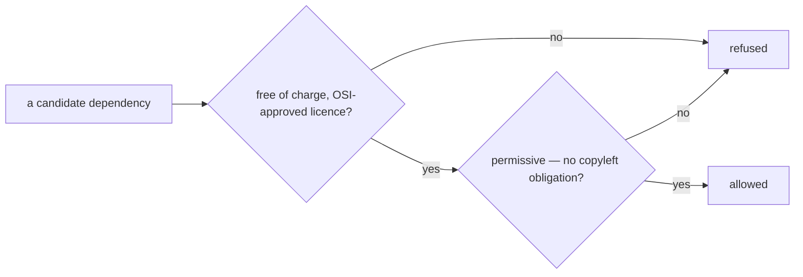

# SR-LAW-2 — L2, every dependency is free, open source and permissive

## §1 — For humans

**Nothing paid, nothing proprietary.** codelaw depends only on software that
is free of charge and released under an open source licence. A paid library,
a paid SDK and a paid hosted service are all out.

**Nothing copyleft either.** The licence must also be *permissive* — MIT,
Apache-2.0, BSD, ISC, Zlib and the like. GPL, AGPL, LGPL, MPL, EPL and every
other licence that obliges a combined or derived work to carry the same terms
is out, in every scope, dev tooling included.

**"Every" means every.** Rust crates, npm and PyPI packages, runtime, dev and
build dependencies, every transitive dependency under them, and any
third-party code copied into the repo.



<details>
<summary><b>ASCII twin</b> — the same diagram, for terminals and diffs</summary>

```text
   a candidate dependency --> free of charge, OSI-approved licence? --no--> refused
                                     | yes
                                     v
                              permissive, no copyleft obligation? ---no--> refused
                                     | yes
                                     v
                                  allowed
```

</details>

---

## §2 — For agents

### Context

codelaw ships as a native binary, statically linked, through npm and PyPI
into other people's repositories. A paid dependency makes every user a
customer of someone else; a copyleft one binds the terms of every user's
distribution. The decider ruled on 2026-10-18: dependencies are free and open
source, nothing paid — and no copyleft anywhere, dev tooling included.

### Decision

1. **Every dependency is free and open source.** The exact version resolved is
   free of charge and released under a licence on the OSI-approved list.
2. **Every dependency is permissive.** Its licence imposes no obligation to
   release a combined or derived work under the same terms. Allowed examples:
   MIT, Apache-2.0, BSD-2-Clause, BSD-3-Clause, ISC, Zlib, 0BSD,
   Unicode-3.0. **Copyleft is refused, strong or weak:** GPL, AGPL, LGPL,
   MPL, EPL, CDDL, EUPL, OSL, and any licence of that kind.
3. **Refused outright:** paid or commercial licences, proprietary code,
   freemium tiers, source-available licences (BSL, SSPL, Commons Clause,
   "fair source"), freeware, and code with no licence at all.
4. **Scope is everything.** Runtime, dev, build and optional dependencies in
   every manifest (Cargo, npm, PyPI), every transitive dependency of each, and
   third-party code vendored, copied or pasted into the repo.
5. **A hosted service the code or the build calls is a dependency** under
   decision 3: a paid API or SaaS is refused.
6. **A multi-licensed dependency qualifies** only if one of its licences for
   the resolved version satisfies decisions 1 and 2, and codelaw takes it
   under that licence.
7. **A licence that changes** to one this law refuses: the dependency is
   pinned below that version or removed, in the change that notices.

### Consequences

- **Judgment today:** no manifest exists yet and no licence check runs —
  backlog row W-20 (`ungated`). The check is owed the day the first manifest
  lands.
- **The editor extension's npm lockfile** (`packaging/vscode/package-lock.json`)
  is checked by `crates/codelaw-cli/tests/licences.rs`, beside the Cargo
  manifest, runtime and dev dependencies alike (decision 4).
- Weak copyleft (MPL, EPL) is refused too, so some ecosystem crates are
  unavailable; the answer is a permissive alternative or building it.
- The parsing stack named in `docs/DESIGN.md` — tree-sitter and
  `ast-grep-core` — is MIT-licensed and passes; every grammar crate is
  checked on its own.

### Alternatives considered

- Copyleft allowed in dev tooling that never ships — rejected by the ruling
  (*no copyleft anywhere*).
- Any OSI licence, copyleft included, in the shipped binary — rejected: it
  would put codelaw's own distribution under the GPL.
- No third-party dependencies at all — offered as a reading of the ask and
  rejected by the ruling.

### Reference (required)

- The decider's ruling, 2026-10-18 — [`work/WORKLOG.md`](../work/WORKLOG.md),
  the entry of that date titled *law L2 filed*.
- The OSI-approved licence list — https://opensource.org/licenses

### Veto condition

**Reopen this decision if:** any resolved dependency carries a licence that is
not both OSI-approved and permissive.

**How to check it:** `ls Cargo.lock package-lock.json pnpm-lock.yaml uv.lock poetry.lock 2>/dev/null || echo "no dependencies yet"` — once a lockfile exists, the licence check W-20 names.

---

## References

*Every source this record cites, gathered in one place. An archived document
is never listed here.*

**Records** — [SR-LAWS](0001_LAWS.md) · [SR-LAW-0](0002_LAW-0-authority.md)

**Project docs**

- [`work/BACKLOG.md`](../work/BACKLOG.md) — W-20
- [`work/WORKLOG.md`](../work/WORKLOG.md)

**External**

- OSI-approved licences — https://opensource.org/licenses
