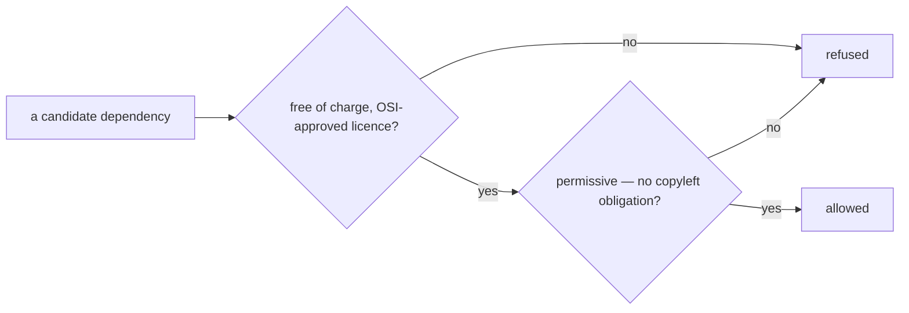

# SR-LAW-2 — L2, every dependency is free, open source and permissive

## §1 — For humans

**Nothing paid, nothing proprietary.** codelaw depends only on software that
is free of charge and released under an open source licence. A paid library,
a paid SDK and a paid hosted service are all out.

**Nothing copyleft either.** The licence must also be *permissive* — MIT,
Apache-2.0, BSD, ISC, Zlib and the like. GPL, AGPL, LGPL, MPL, EPL and every
other licence that obliges a combined or derived work to carry the same terms
is out, in every scope, dev tooling included.

**"Every" means every.** Rust crates, npm and PyPI packages, runtime, dev and
build dependencies, every transitive dependency under them, and any
third-party code copied into the repo.



<details>
<summary><b>ASCII twin</b> — the same diagram, for terminals and diffs</summary>

```text
   a candidate dependency --> free of charge, OSI-approved licence? --no--> refused
                                     | yes
                                     v
                              permissive, no copyleft obligation? ---no--> refused
                                     | yes
                                     v
                                  allowed
```

</details>

---

## §2 — For agents

### Context

codelaw ships as a native binary, statically linked, through npm and PyPI
into other people's repositories. A paid dependency makes every user a
customer of someone else; a copyleft one binds the terms of every user's
distribution. The decider ruled on 2026-10-18: dependencies are free and open
source, nothing paid — and no copyleft anywhere, dev tooling included.

### Decision

1. **Every dependency is free and open source.** The exact version resolved is
   free of charge and released under a licence on the OSI-approved list.
2. **Every dependency is permissive.** Its licence imposes no obligation to
   release a combined or derived work under the same terms. Allowed examples:
   MIT, Apache-2.0, BSD-2-Clause, BSD-3-Clause, ISC, Zlib, 0BSD,
   Unicode-3.0, Artistic-2.0. Artistic-2.0 conditions only a *modified copy
   of the package itself* that is redistributed (share the changes or rename
   it); nothing that uses or aggregates it carries its terms, so it passes —
   the decider's ruling, 2026-10-22, for npm (W-20). **Copyleft is refused, strong or weak:** GPL, AGPL, LGPL,
   MPL, EPL, CDDL, EUPL, OSL, and any licence of that kind.
3. **Refused outright:** paid or commercial licences, proprietary code,
   freemium tiers, source-available licences (BSL, SSPL, Commons Clause,
   "fair source"), freeware, and code with no licence at all.
4. **Scope is everything.** Runtime, dev, build and optional dependencies in
   every manifest (Cargo, npm, PyPI), every transitive dependency of each, and
   third-party code vendored, copied or pasted into the repo.
5. **A hosted service the code or the build calls is a dependency** under
   decision 3: a paid API or SaaS is refused.
6. **A multi-licensed dependency qualifies** only if one of its licences for
   the resolved version satisfies decisions 1 and 2, and codelaw takes it
   under that licence.
7. **A licence that changes** to one this law refuses: the dependency is
   pinned below that version or removed, in the change that notices.
8. **One scoped exception: the VS Code extension's registry tools** (the decider, 2026-10-29 (voice; written on *"file it."*): on `@vscode/vsce`, *"Let's add it as an exception. And only to be used for checking the VS Code extension and publishing the VS Code extension. That's it, nothing else."*; asked whether `ovsx` takes the same terms, *"Yes."*). `@vscode/vsce` (MIT, but its tree holds `@vscode/vsce-sign` under Microsoft's proprietary licence — decision 3) and `ovsx` (EPL-2.0, weak copyleft — decision 2) are allowed **only** to publish the codelaw VS Code extension and to check what a registry holds of it — `vsce` on the Visual Studio Marketplace, `ovsx` on Open VSX — and only in `publish.yml`'s extension job and a check command beside it. Never in the engine, a package, a test, `ci.yml` or a consumer's repo; any other use of either is refused under decisions 2 and 3. Each is ratified by name in [L11](0013_LAW-11-dependencies.md) §3 (D-46, D-47).

### Consequences

- **How L2 is enforced:** `crates/codelaw-cli/tests/licences.rs`, in
  `cargo test`, over three scopes (decision 4):
  - every resolved Cargo package, transitive ones included, every platform's;
  - every npm lockfile under `.github/workflows`, `scripts/` and `packaging/`
    — the editor extension's `packaging/vscode/package-lock.json` today —
    runtime and dev dependencies alike, and every dependency its
    `package.json` names must be resolved in it;
  - every npm and PyPI package the build, the CI and the release install:
    the test scans those folders for install commands (`pip install`,
    `npm i`, `npx`, …) and for `pyproject.toml` / lockfile-less
    `package.json` dependencies, and each one found must be declared in its
    `BUILD_TOOLS` table with its licence, its source and what it installs in
    turn. An undeclared install, or a declared one nothing installs, fails.
    codelaw's own packages — `codelaw`, `@codelaw/*`, `codelaw-rules-*` and,
    since W-77 (2026-10-27), `codelaw-skills` — are not third-party and are
    not declared there.
- **npm itself is `Artistic-2.0`,** allowed by decision 2 since the
  decider's ruling of 2026-10-22: codelaw runs npm to publish and ships none
  of it. `licences.rs` keeps an `AWAITING_RULING` list for the next licence
  decision 2 does not name; it is empty and may not grow without the decider.
- **The staging index the install smoke uses** (W-18, 2026-10-22) is built,
  not adopted: `scripts/staging-index.py` is the Python standard library only,
  so it adds nothing to vet. Its one installed tool, `uv` (`MIT OR Apache-2.0`,
  no dependencies), is declared in `licences.rs`'s `BUILD_TOOLS`. A third-party
  local registry (Verdaccio and the like) would bring a transitive npm tree that
  decision 4 makes in scope.
- **The CSS grammar fork** (W-21, 2026-10-22) is third-party code vendored
  into the repo, so decision 4 covers it: `tree-sitter-css` 0.25.0, MIT, kept
  with its upstream `LICENSE` in `crates/codelaw-lang/grammars/tree-sitter-css`
  ([SR-ARCHITECTURE](0108_architecture.md) decision 3). `licences.rs` sees it
  as a path crate declaring `MIT`. The tree-sitter CLI that regenerates it
  (`tree-sitter-cli` 0.25.10, MIT) is a manual step no build, CI or release
  runs, so it is not in `BUILD_TOOLS`; if a script or workflow ever runs it,
  it is declared there.
- Weak copyleft (MPL, EPL) is refused too, so some ecosystem crates are
  unavailable; the answer is a permissive alternative or building it.
- The parsing stack named in `docs/DESIGN.md` — tree-sitter and
  `ast-grep-core` — is MIT-licensed and passes; every grammar crate is
  checked on its own.

### Alternatives considered

- Copyleft allowed in dev tooling that never ships — rejected by the ruling
  (*no copyleft anywhere*).
- Any OSI licence, copyleft included, in the shipped binary — rejected: it
  would put codelaw's own distribution under the GPL.
- No third-party dependencies at all — offered as a reading of the ask and
  rejected by the ruling.

### Reference (required)

- The decider's ruling, 2026-10-18 — [`work/WORKLOG.md`](../work/WORKLOG.md),
  the entry of that date titled *law L2 filed*.
- The decider's ruling, 2026-10-22, that npm's `Artistic-2.0` passes decision 2
  — [`work/WORKLOG.md`](../work/WORKLOG.md), the entry of that date titled
  *npm's Artistic-2.0 ruled permissive*.
- Artistic License 2.0 — https://opensource.org/license/artistic-2-0
- The OSI-approved licence list — https://opensource.org/licenses

### Veto condition

**Reopen this decision if:** any resolved dependency carries a licence that is
not both OSI-approved and permissive.

**How to check it:** `cargo test -p codelaw-cli --test licences` — every test passes, and the `⚠ L2` lines it prints name what still awaits a ruling.

---

## References

*Every source this record cites, gathered in one place. An archived document
is never listed here.*

**Records** — [SR-LAWS](0001_LAWS.md) · [SR-LAW-0](0002_LAW-0-authority.md) · [SR-ARCHITECTURE](0108_architecture.md)

**Project docs**

- [`work/BACKLOG.md`](../work/BACKLOG.md) — W-20
- [`work/WORKLOG.md`](../work/WORKLOG.md)

**External**

- OSI-approved licences — https://opensource.org/licenses
