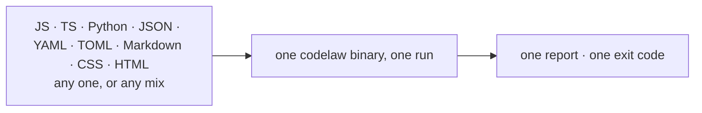

# SR-LAW-3 — L3 — nine languages, each alone or in any combination

## §1 — For humans

**The law (L3).**

> **codelaw lints and formats nine languages, twelve file types: JavaScript, JSX, TypeScript, TSX, JSON (with JSONC), YAML, TOML, CSS, SCSS, HTML, Markdown and Python.** JSX and TSX are first-class: every capability that works for `.js`/`.ts` works for `.jsx`/`.tsx`. **SCSS is a CSS dialect, as JSX is a JavaScript one:** `.scss` files are linted and formatted, and every capability that works for `.css` works for `.scss` (the `.sass` indented syntax and Less stay out). It works on a repo that holds **only one** of them and on a repo that holds **any combination**, from **one binary**, in **one run**. **No language is second-class**: every capability that ships for one ships for all nine, unless a rule explicitly limits itself to some.

**Ruled by Arpit, 2026-10-18;** CSS and HTML added by his ruling the same day, keeping YAML, TOML and Markdown. **Amended 2026-10-26 (W-62)** on his ruling that SCSS joins as a CSS dialect — *"The CSS pack should work with SCSS, and CSS modules as well"* and *"Create separate packages for SCSS and CSS modules"* — with B-047 ruled the same day, *"Own grammar / tree-sitter-scss"*. **This amendment was written by an agent on that ruling.**

**Why it exists.** Real repos are mixed: a React or Stencil front end, Python services or tooling, and a pile of config (`package.json`, `tsconfig.json`, `pyproject.toml`, CI YAML) and docs. A linter that covers only some of these pushes the rest back to five different tools, five configs, and five things an agent has to know about.

**What it forbids, concretely:**
- requiring Node in a Python-only repo, or Python in a JS-only repo;
- a feature (`check`, `fix`, `test`, MCP, hooks, LSP) that works for TypeScript but not Python, unless the gap is written down in a rule's own frontmatter;
- a file's result changing because *other* languages are present in the repo.



<details>
<summary><b>ASCII twin</b></summary>

```text
   JS TS Py JSON YAML TOML MD CSS HTML  --->  one binary, one run  --->  one report, one exit code
   (any one, or any mix)
```

</details>

---

## §2 — For agents

### Context

Real repos mix a JS/TS front end, Python services, config files and docs. A linter that covers only some of them hands the rest back to five tools, five configs and five things an agent has to learn.

### Decision


1. **The nine languages and their grammars.**

   | Language | Includes | Extensions (defaults, overridable) |
   |---|---|---|
   | JavaScript | JSX | `.js` `.mjs` `.cjs` `.jsx` |
   | TypeScript | TSX, decorators (Stencil) | `.ts` `.mts` `.cts` `.tsx` |
   | Python | | `.py` `.pyi` |
   | JSON | JSONC (comments, trailing commas) | `.json` `.jsonc`, plus `tsconfig*.json` and `.vscode/*.json` as JSONC |
   | YAML | multi-document files | `.yml` `.yaml` |
   | TOML | | `.toml` |
   | Markdown | YAML frontmatter | `.md` `.mdx` (MDX: Markdown parts only) |
   | CSS | CSS Modules syntax (`composes`, `:global`, `:local`, `:export`, `@value`) in `*.module.css` and `*.module.scss`, read as a mode of the same grammar; SCSS (a dialect: `$variables`, nesting, `@mixin`/`@include`, `@use`, `//` comments; the `.sass` indented syntax and Less are not) | `.css`, `.scss` |
   | HTML | inline `<script>`, `<style>` and `style=""` are linted and formatted as JS/TS and CSS ([SR-LINTER](0106_linter.md) decision 3) | `.html` `.htm` |

2. **Independently.** A repo containing only one language needs no configuration about the other eight. It also needs no runtime for them: `pip install codelaw` in a Python-only repo pulls no Node, and `npm i -D codelaw` in a JS-only repo pulls no Python. The same holds for rules: a Python-only repo gets its rule packs from PyPI (`codelaw-rules-python`, `codelaw-rules-data`) and a JS-only repo gets them from npm ([L6](0008_LAW-6-python-and-node-packages.md) decision 11).
3. **Together.** A repo with any mix is checked in **one invocation**, with one config, one report and one exit code.
4. **Selectable.** Any language can be switched off per repo (`languages = [...]` in `codelaw.toml`) or per run (`--lang python`, `--lang js,ts`). A language that's off costs nothing: its grammar isn't loaded and its rules aren't parsed.
5. **Isolation.** A file's diagnostics and fixed bytes are identical whether it's checked alone, inside a single-language repo, or inside the all-languages repo.
6. **Equal capability.** `check`, `fix`, `test`, `rules --for`, `explain`, MCP tools, hooks and LSP all work for all nine. A rule that applies to only some languages says so in its `languages:` field; that is the only permitted asymmetry.
7. **Distribution.** How codelaw reaches Python and Node users, and the guarantee that both packages behave identically, is [L6](0008_LAW-6-python-and-node-packages.md)'s, and isn't restated here.
8. **Markdown is linted as Markdown.** Headings, links, code fences and frontmatter are in scope. Fenced code blocks inside Markdown are linted with their own language's rules only when `markdown.lint_code_blocks = true`; it's off by default, because examples in docs are often deliberately wrong (codelaw's own `Don't` blocks, for instance).

#### How L3 is enforced

- **Fixture matrix in CI:** nine single-language fixture repos plus one combined repo. Each runs every command. The isolation check (decision 5) diffs each file's output across the single-language and combined runs.
- **The fixtures are formatted.** Every fixture file is already in codelaw's format, so `check` on the matrix reports only the fixture rules. [SR-LAW-7](0009_LAW-7-linter-and-formatter.md)'s check, in the same `laws.rs`, fails on a fixture that `codelaw format` would change.
- **Runtime fence:** the Python-only fixture runs in a container with no Node, and the JS-only fixture runs with no Python.
- **Rule load check:** a rule whose `languages:` names a language outside the nine is refused at load (exit code 2).

#### Out of scope until this law is amended

- Vue, Svelte and Angular templates.
- The `.sass` indented syntax and Less (CSS dialects). SCSS is in, as of 2026-10-26.
- **Type-aware checks**, which need a type checker. tree-sitter has none, so these go to adapters (typescript-eslint/oxlint, pyright/mypy). See DESIGN §3.6.
- Any eighth language.

### Consequences

- **Every capability is tested nine times.** The fixture matrix is the price of decision 6.
- **Vue, Svelte, Angular, Sass (indented)/Less and type-aware checks stay outside the core** until this law is amended; adapters cover them.
- **SCSS** (2026-10-26): `crates/codelaw-cli/tests/scss.rs` runs the `css` and `scss` packs over `fixtures/scss/corpus` against pinned counts, checks that the `css/*` rules stay quiet on valid Sass, and that `codelaw format` on `.scss` is idempotent; `laws.rs`'s matrix includes `scss` as a twelfth file type.
- **Checked on every CI run** by `crates/codelaw-cli/tests/laws.rs`: `l3_each_language_alone_and_together` (the fixture matrix and decision 5's isolation diff) and `l3_a_language_switched_off_costs_nothing`. The runtime fence runs in `scripts/smoke.sh` (W-18).

### Alternatives considered

- **JS/TS only, with Python left to Ruff:** rejected. Two tools and two rule formats, and agents have to learn both.
- **One binary per language:** rejected. A mixed repo would install and configure several tools.

### Reference (required)

- [`docs/DESIGN.md`](../docs/DESIGN.md) §3: the engine and the grammars this law constrains.
- The decider's ruling of 2026-10-18 (worklog entry of that date).

### Veto condition

**Reopen this decision if:** a rule, preset or live document names a language outside the nine, or documents a capability for only some of them.

**How to check it:** `grep -rhoE '^languages: \[[^]]*\]' records docs | sort -u   # only the nine names appear`

---

## References

*Every source this record cites, gathered in one place. An archived document is never listed here.*

**Records** — [SR-LINTER](0106_linter.md) · [SR-LAW-6](0008_LAW-6-python-and-node-packages.md)

**Project docs** — [`docs/DESIGN.md`](../docs/DESIGN.md)
