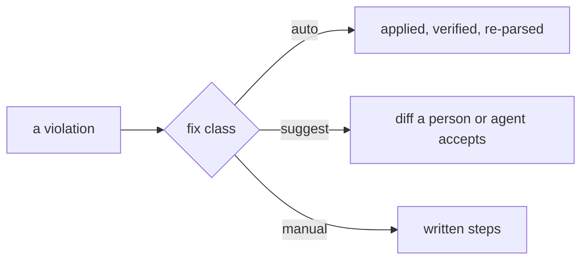

# SR-LAW-4 — L4 — every rule has a fix

## §1 — For humans

**The law (L4).**

> **Every rule says how to fix what it finds.** Wherever a fix can be applied mechanically **and** safely, it is **automatic**. Where it can be applied mechanically but might change behaviour, it is a **suggestion** shown as a diff that a person or agent must accept. Where it can't be mechanical, the rule **writes out the steps** and **a skill carries the fix**: `codelaw-fix` by default, or a specialised skill the rule names, which tells a person or agent exactly what needs fixing and how. **"No fix" is not an option**: a rule without fix guidance is refused at load. And an automatic fix **never leaves a file broken**.

**Ruled by Arpit, 2026-10-18.**

**Why it exists.** An error without a fix is a chore handed to whoever reads it. For an agent it's worse: an error with no fix guidance invites guessing, and guessing produces new errors. If every diagnostic carries its fix, a person can run one command and an agent can repair its own output without improvising.

**The three fix classes:**

| Class | Applied by | Shown as | Use when |
|---|---|---|---|
| `auto` | `codelaw fix`, agent hooks (silently) | "fixed" note | The edit can't change behaviour (moving exports, sorting keys, adding `readonly`) |
| `suggest` | `codelaw fix --unsafe`, or accepted by a person or agent | Unified diff | The edit is mechanical but might change behaviour (turning on `strict`, swapping `print` for `logging`) |
| `manual` | A person or agent, following written steps | `## How to fix` steps | The fix needs a decision or another file (renaming across files, choosing a value, resolving a pinned SHA) |



<details>
<summary><b>ASCII twin</b></summary>

```text
   violation --> fix class --+-- auto    : applied, verified
                             +-- suggest : diff to accept
                             +-- manual  : written steps
```

</details>

---

## §2 — For agents

### Context

A diagnostic without a fix is a chore for a person and an invitation to guess for an agent. Guessing produces new violations.

### Decision


1. **`fix:` is required** in every rule's frontmatter and must be `auto`, `suggest` or `manual`. A missing or other value refuses the rule at load (exit code 2).
2. **`auto` is the default expectation.** A rule declared `suggest` or `manual` must also carry `fix_reason:`, one line on why it can't be automatic. Reviewers treat a weak reason as a bug in the rule.
3. **`manual` rules carry a `## How to fix` section** with numbered steps and, where possible, a before/after example. `codelaw test` fails a `manual` rule without it.
4. **Every diagnostic carries its fix.** That means:
   - the rule id;
   - the location;
   - what's wrong;
   - the fix class;
   - the diff, for `auto` and `suggest`;
   - the steps, for `manual`.

   This holds for every output format (text, JSON, SARIF, agent, MCP, LSP code actions).
5. **Fixes never corrupt a file.** Each `auto` or `suggest` edit is verified before it's written:
   - the file still parses;
   - a second run makes no further change (idempotent);
   - the same rule no longer fires on the edited range.

   If verification fails, that instance is reported as `manual` with the rule's steps, and the file is left untouched.
6. **Fixes touch only their own range.** Comments, formatting and code outside the edit are byte-identical before and after.
7. **Fixes are proven by the rule's own examples.** `codelaw test` applies each `auto` or `suggest` fix to every `Don't` example. The result must:
   - pass the rule;
   - equal the paired `Do` example, or a `Fixed` block if one is given;
   - be a fixpoint.

   Under [L3](0005_LAW-3-languages.md), that's checked for every language the rule declares.
8. **Agents get the same classes.** Hooks apply `auto` silently and return what's left. `suggest` goes back to the agent as a diff to accept or reject. `manual` goes back with its steps. An agent may never "fix" a violation by suppressing it; suppression is its own path (see [SR-AGENT-SURFACES](0102_agent-surfaces.md), the `codelaw-suppress` skill).
9. **Adapter findings** (oxlint, ruff, markdownlint, …) are mapped onto the same three classes: the tool's own autofix becomes `auto` or `suggest` according to its safety flag, and anything else becomes `manual`, with a link to the tool's rule docs as the steps.

10. **A skill serves every `manual` fix.**
    - `codelaw-fix` ([SR-AGENT-SURFACES](0102_agent-surfaces.md)) reads the rule's `## How to fix` steps, shows the person or agent what is wrong, and walks them through the fix.
    - A rule may name a specialised skill in `fix_skill:`. A `fix_skill` that ships in no codelaw package refuses the rule at load.
    - The skill guides; the engine still decides ([L5](0007_LAW-5-no-model-in-the-engine.md)). The result is checked like any other change.

#### How L4 is enforced

- Rule loader: decisions 1–3.
- `codelaw test`: decisions 3 and 7, run in CI over every built-in and local rule.
- Fix verifier: decisions 5 and 6. It runs on every fix, not just in tests.
- Output schema test: every diagnostic in every format carries the fields in decision 4.

### Consequences

- **Rule authors carry the cost:** every rule needs a fix class, and every `manual` rule needs written steps.
- **The verifier runs on every fix**, so fixing is slower than matching. That cost is accepted.
- **Nothing checks this law yet:** `B-010` in `work/BACKLOG.md`.

### Alternatives considered

- **Fixes optional, as in ESLint:** rejected. Most rules would ship without one.
- **Auto-fix everything that's mechanical:** rejected. A fix that changes behaviour needs someone to accept a diff.

### Reference (required)

- [`docs/DESIGN.md`](../docs/DESIGN.md) §3.3: the fix model this law binds.
- The decider's ruling of 2026-10-18 (worklog entry of that date).

### Veto condition

**Reopen this decision if:** a rule in any live document declares a fix class other than `auto`, `suggest` or `manual`, or none.

**How to check it:** `grep -rhE '^fix: ' records docs | sort -u   # only auto, suggest or manual`

---

## References

*Every source this record cites, gathered in one place. An archived document is never listed here.*

**Records** — [SR-AGENT-SURFACES](0102_agent-surfaces.md)

**Project docs** — [`docs/DESIGN.md`](../docs/DESIGN.md)
