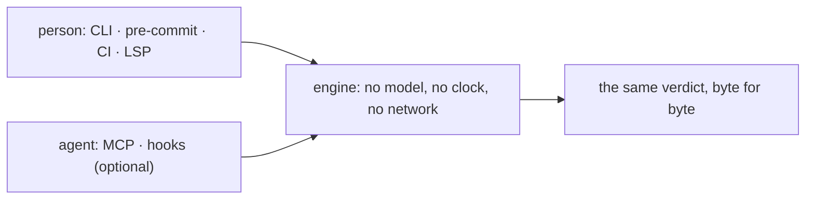

# SR-LAW-5 — L5 — no model in the engine; works with or without an agent

## §1 — For humans

**The law (L5).**

> **No model is ever called to decide or fix anything.** The same files, the same rules and the same codelaw version give **byte-identical** diagnostics and fixed output on every machine, offline, **with or without an AI agent attached**. Agents are **callers**: they can ask for rules and receive verdicts, but they **cannot change** one. **Every capability works with no agent configured.**

**Ruled by Arpit, 2026-10-19:** accepted as drafted from his requirement of 2026-10-18 ("rules should run with and without AI").

**Ruled by Arpit, 2026-10-25** (W-52), on latest-version highlighting: one command outside the engine, `codelaw deps refresh`, may use the network; it writes a committed snapshot that the rules read as a file. *"Let's go with it. I like the suggestion."* The amendment to decision 3 was written on his ruling of the same day, *"Yes, include them."* The engine stays offline.

**Why it exists.** A linter is only trustworthy if its answer is reproducible: CI, a teammate's laptop and an agent's hook must agree. A model in the loop would make the answer depend on the model, the prompt and the day. Keeping AI strictly outside the engine is also what lets the same tool serve a team that uses no agents at all.



<details>
<summary><b>ASCII twin</b></summary>

```text
   person (CLI, CI, LSP) --+
                           +--> engine (no model, no clock, no network) --> same verdict
   agent (MCP, hooks)    --+
```

</details>

---

## §2 — For agents

### Context

A linter is trusted only if CI, a laptop and an agent's hook agree. A model in the loop would make the verdict depend on the model, the prompt and the day.

### Decision


1. **No model calls** anywhere in matching, fixing, verifying, rule loading or output. This includes local models and "AI-assisted" fix generation.
2. **Deterministic output.** Diagnostics are sorted by path, line, column and rule id. There are no wall-clock timestamps in output, no unseeded randomness, and no dependence on hash-map iteration order.
   - **Time is an input.** The engine never reads the clock. Date-aware rules (deadlines, expiry) use the **as-of date**, which defaults to the `HEAD` commit date and can be overridden with `--as-of`. The mechanism is [SR-BASELINE](0104_baseline-and-deprecations.md)'s.
   - **The change set is an input.** "Which files were touched" comes only from an explicit source (`--changed-since`, `--staged`, or the file the hook received).
3. **Offline.** The engine makes no network calls: `check`, `fix`, `format`, `hook`, the LSP and the MCP server never reach the network. A rule that would need the network to fix itself (for example, resolving a GitHub Action tag to a SHA) is `manual` under [L4](0006_LAW-4-every-rule-has-a-fix.md).
   - **One networked command, outside the engine: `codelaw deps refresh`** (the decider's ruling of 2026-10-25, W-52). It reads npm and the Python index and writes `.codelaw/deps-snapshot.json`, which the project commits; it is the only command that may use the network, and nothing runs it implicitly. Rules read the snapshot like any other file, so a verdict still depends only on the files, the config and the codelaw version ([SR-RULE-PACKS](0101_rule-packs.md) decision 15).
4. **No-agent is the primary mode.** The terminal, pre-commit, CI and LSP are complete without any agent. `codelaw init` writes no agent files unless `--agents` is passed.
5. **Agents are callers only.** MCP tools and hook mode call the same engine functions as `codelaw check` and `codelaw fix`. No agent-only code path exists that can produce a different verdict.
6. **AI is allowed only outside the engine**, and its output becomes an input that a person reviews. Examples:
   - an agent drafting a new rule file with the `codelaw-author-rule` skill;
   - an agent applying a `suggest` fix;
   - an agent following `manual` steps.

   In every case, the result is checked by the deterministic engine like any other change.

#### How L5 is enforced

- **Parity test:** for every fixture file, `codelaw hook`, the MCP `check_paths` and `fix_paths` tools, and `codelaw check` / `codelaw fix` must produce identical diagnostics and identical fixed bytes.
- **Determinism test:** run the combined fixture twice, in different working directories and with shuffled file order, and require byte-equal output.
- **Network fence:** the full test suite runs with networking disabled; `deps refresh` is the one command that fails inside it.
- **Dependency check:** CI fails if any model, LLM-client or inference library is a dependency of the engine crate.

### Consequences

- **Checks that would need a model are out of the engine.** They become exact-match rules, or agent skills outside it.
- **Date-aware and change-aware rules need explicit inputs** (the as-of date and the change set).
- **The network fence is `crates/codelaw-cli/tests/network_fence.rs`:** `codelaw check` (json, text, agent) and `codelaw fix` (safe, and `--unsafe`) run on the L3 fixture repo with networking denied by the operating system, and must give the same exit code, the same output and the same fixed bytes as an open run. The fence is proven before it is used: on Linux a network namespace whose only interface is `lo` (`unshare --net`, or `sudo -n unshare --net` dropping back with `setpriv`); on macOS `sandbox-exec` denying `network*`, refusing a connection to a port the test itself listens on. Where no fence can be raised the test says so and passes, unless `CODELAW_REQUIRE_NETWORK_FENCE=1`, which CI sets ([SR-PACKAGES](0107_packages.md) Consequences). It fences `check` and `fix`, not yet the full suite the enforcement list names. A second case runs the dependency rules the same way — `check` in every format and `fix --unsafe` on a project with npm and Python manifests, a lockfile and a committed snapshot, identical open and fenced — and requires `deps refresh` to fail inside the fence and leave the snapshot as it was (W-52). `deps refresh`'s own tests (`crates/codelaw-cli/tests/deps.rs`) serve their registry on 127.0.0.1, never the network.

### Alternatives considered

- **LLM-assisted fixes inside the engine:** rejected. Not reproducible, and it would make the no-agent mode second-class.
- **Wall-clock deadlines:** rejected. The same commit would pass today and fail tomorrow, so the `HEAD` commit date is used instead.

### Reference (required)

- [`docs/DESIGN.md`](../docs/DESIGN.md) §4: the agent channels this law keeps outside the engine.
- [SR-BASELINE](0104_baseline-and-deprecations.md) decision 4: the as-of date.

### Veto condition

**Reopen this decision if:** a live document describes the engine calling a model, reading the wall clock, or reaching the network, or a command other than `codelaw deps refresh` reaches the network.

**How to check it:** `grep -rniE 'Date\.now|datetime\.now|model call|LLM' docs/DESIGN.md records/01*.md   # each hit is outside the engine`

---

## References

*Every source this record cites, gathered in one place. An archived document is never listed here.*

**Records** — [SR-BASELINE](0104_baseline-and-deprecations.md) · [SR-PACKAGES](0107_packages.md) · [SR-RULE-PACKS](0101_rule-packs.md)

**Project docs** — [`docs/DESIGN.md`](../docs/DESIGN.md)
