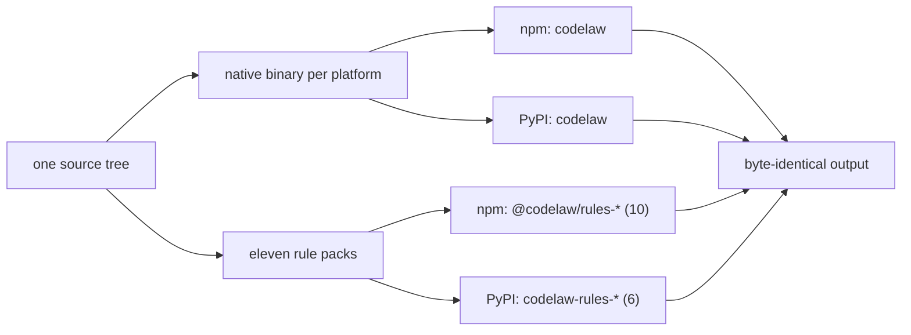

# SR-LAW-6 — L6 — one release, two packages: PyPI and npm

## §1 — For humans

**The law (L6).**

> **codelaw is published as a Python package on PyPI and a Node package on npm, both named `codelaw`, in the same release, under the same version number.** Each `codelaw` package is **complete on its own as an engine**: it needs no runtime of the other language, has no optional extras, and contains every language, the formatter, the MCP server and the LSP. **Its rules ship as eleven rule packs, published in the same release under the same version: ten on npm as `@codelaw/rules-<name>` (`js`, `ts`, `react`, `node`, `stencil`, `html`, `css`, `data`, `tanstack-query`, `redux-toolkit`) and six on PyPI as `codelaw-rules-<name>` (`js`, `react`, `html`, `css`, `python`, `data`); each registry carries only the packs its users install.** For the same inputs and the same packs, the two registries' packages produce **byte-identical output**. **A release that reaches one registry and not the other is a failed release.** **On npm, the only unscoped package is `codelaw`; every other npm package is `@codelaw/<name>`. On PyPI, the engine is `codelaw` and the only other codelaw distributions are the six `codelaw-rules-<name>` packs; platform builds are wheels, never separate packages.**

**Ruled by Arpit, 2026-10-18;** amended by his ruling of 2026-10-19: rules ship as five separately published packs, mirrored on both registries, apart from the engine ([SR-RULE-PACKS](0101_rule-packs.md)); amended again by his ruling of 2026-10-24 (W-31): *"The ones that are going to be used in npm and the ones that are going to be used in PyPI should only be published"* — `rules-js` splits into `js`, `ts`, `react`, `node` and `stencil`, npm carries eight packs and PyPI six; and by his ruling of 2026-10-24 (W-32, named 2026-10-25): *"i want a redux tool kit and react query pack as well in npm"* — two npm-only library packs, `tanstack-query` and `redux-toolkit`, so npm carries ten.

**Why it exists.** [L3](0005_LAW-3-languages.md) promises Python-only, JS-only and mixed repos. That promise is only real if each kind of team can install codelaw with the package manager it already uses, and gets the same tool.

**Name check, 2026-10-18:** `codelaw` returned 404, meaning not yet taken, on both registries. It should be reserved before anything is announced.



<details>
<summary><b>ASCII twin</b></summary>

```text
   source --> binary per platform --+--> npm  codelaw ----------+
          |                         +--> PyPI codelaw ----------+
          +-> eleven rule packs ----+--> npm  @codelaw/rules-* (10) +--> identical output
                                    +--> PyPI codelaw-rules-* (6) --+    (same packs)
```

</details>

---

## §2 — For agents

### Context

[L3](0005_LAW-3-languages.md) promises Python-only, JS-only and mixed repos. That promise is real only if each kind of team can install codelaw with the package manager it already uses, and gets the same tool.

### Decision


1. **Two packages, one name, one version.**

   | Registry | Package | Install |
   |---|---|---|
   | PyPI | `codelaw` | `pip install codelaw` · `uv add --dev codelaw` · `pipx install codelaw` · `uvx codelaw` |
   | npm | `codelaw` | `npm i -D codelaw` · `pnpm add -D codelaw` · `yarn add -D codelaw` · `npx codelaw` · `bunx codelaw` |

2. **Same binary inside both.** Both packages carry the native codelaw binary built once per platform from one source tree in one CI run. The wrappers only find the binary and run it.
3. **Complete alone, as an engine.** Neither `codelaw` package depends on the other, or on Python or Node beyond the host it's installed into. There are no extras (`codelaw[...]`) and no optional peer dependencies. Every [L3](0005_LAW-3-languages.md) language, the formatter, the MCP server and the LSP are always present. **Rules are not:** they come from the rule packs (decision 11), which `codelaw init` installs for the detected languages ([SR-RULE-PACKS](0101_rule-packs.md) decision 6). `codelaw` installed alone formats every language and lints with no rules, and says so (`codelaw/no-rules`).
4. **Zero runtime dependencies** in either wrapper package or any rule pack. Neither `codelaw` package depends on a pack; the consumer's project does, through `codelaw init`.
5. **Same commands, same API.**
   - Both install a `codelaw` command with identical flags and output.
   - Both expose a small programmatic API with identical names and JSON shapes:
     - Python: `codelaw.check()`, `codelaw.fix()`, `codelaw.rules_for()`;
     - Node: `check()`, `fix()`, `rulesFor()` from `codelaw`.
   - The API calls the bundled binary, so the results are the binary's results.
6. **Supported platforms** (prebuilt for each):
   - macOS arm64 and x64;
   - Linux x64 and arm64 (glibc and musl);
   - Windows x64 and arm64.

   npm ships them as per-platform `optionalDependencies` (the Biome and oxlint pattern). PyPI ships them as platform wheels (the Ruff pattern).
7. **An unsupported platform fails clearly.** It stops with an error that names the supported platforms. It never silently builds from source; no sdist that needs a Rust toolchain is published.
8. **Host floors:** Python ≥ 3.11 and Node ≥ 22. **Ruled by Arpit, 2026-10-19:** the oldest lines still supported upstream when codelaw first ships (Python 3.10 reaches end of life in October 2026; Node 18 and 20 already have). Each package declares its floor (`requires-python`, `engines.node`).
9. **Released together.** One release job publishes the engine to both registries and each rule pack to the registries decision 11 names. If any publish fails:
   - the job fails;
   - everything already published in that release is yanked (PyPI) or deprecated (npm);
   - the version is not announced.

   The version number lives in one file, and every manifest (the engine's and each pack's, on both registries) is generated from it.

10. **Package names.**
    - **npm:** exactly one unscoped package, `codelaw`. Everything else lives under the `@codelaw` scope, for example the per-platform binaries `@codelaw/cli-<os>-<arch>` and the rule packs `@codelaw/rules-<name>` ([SR-PACKAGES](0107_packages.md)).
    - **PyPI:** one engine distribution, `codelaw`, whose platform builds are wheels of it, plus the six rule packs `codelaw-rules-<name>` (decision 11). PyPI has no scopes, so no other codelaw distribution is published.
    - The `@codelaw` npm organisation, the `codelaw` names on both registries and the six `codelaw-rules-<name>` names on PyPI are reserved before the first release.
11. **Rule packs** ([SR-RULE-PACKS](0101_rule-packs.md)). **Ruled by Arpit, 2026-10-19** (five packs on both registries); **amended 2026-10-24** (W-31; and W-32, two npm-only library packs):

    | registry | packs |
    |---|---|
    | npm, `@codelaw/rules-<name>` | `js`, `ts`, `react`, `node`, `stencil`, `html`, `css`, `data`, `tanstack-query`, `redux-toolkit` |
    | PyPI, `codelaw-rules-<name>` | `js`, `react`, `html`, `css`, `python`, `data` |

    - Each is pure data (rule files, presets, data tables): one tarball on npm, one `py3-none-any` wheel on PyPI, or both. **A pack on both registries holds the same files on both.**
    - Each declares `min_codelaw` and shares the engine's version (decision 9).
    - A Python-only repo installs `codelaw` and `codelaw-rules-python` (plus `codelaw-rules-data` for its TOML, YAML and Markdown) from PyPI and never touches npm. A Node-only repo does the same from npm ([L3](0005_LAW-3-languages.md) decision 2).
    - **What each registry leaves out is the decider's accepted cost:** an npm-only install has no Python rules, and a PyPI-only install has no `ts/*`, `node/*`, `stencil/*`, `tanstack-query/*` or `redux-toolkit/*` rules. The engine on either registry is still complete (decision 3): it formats and parses every language, and its TypeScript gets the `js` rules that declare it.

#### How L6 is enforced

- **Completeness gate:** `scripts/law-gate.py` refuses a release whose binary has no `format`, `mcp` or `lsp` (decision 3), in `publish.yml` and before the one-time hand publish ([SR-PACKAGES](0107_packages.md) decision 11).
- **Version check:** CI fails if `pyproject.toml`, `package.json` and the binary's `--version` disagree.
- **Install matrix:** on every release candidate, a clean container per platform installs from each registry (a staging index first) and runs the [L3](0005_LAW-3-languages.md) combined fixture. The npm and PyPI outputs must be byte-equal.
- **Pack parity:** every published copy of a pack holds `packs/<name>/`, byte for byte, so a pack on both registries is the same on both; the names on each registry are decision 11's table, read from `FIRST_PARTY_PACKS` in `crates/codelaw-rules/src/pack.rs`; and the install matrix installs the packs for each fixture's languages.
- **Runtime fence:** the PyPI package is installed and run with no Node on the PATH, and the npm package with no Python.
- **Dependency check:** both published manifests are checked for zero runtime dependencies (apart from the npm per-platform binary packages).

### Consequences

- **Every release builds a binary for each platform and publishes the engine to both registries, ten packs to npm and six to PyPI.** One failed publish fails the release.
- **The first npm publish (0.1.0, 2026-10-24, W-29) predates the split:** it carried the five packs, so `@codelaw/rules-python` is unpublished from npm by hand and 0.2.0 is the first release in the per-registry layout ([W-31](../work/open/W-31-registry-pack-split.md)).
- **`codelaw` installed alone lints nothing:** rules come from packs, and `codelaw init` installs them ([SR-RULE-PACKS](0101_rule-packs.md) decision 6).
- **The wrappers stay thin:** zero runtime dependencies, which also keeps them trivially within [L2](0004_LAW-2-foss-dependencies.md).
- **Checked since 2026-10-20 by every `ci.yml` run:** the version check (`scripts/version.py --check`, with the binary on every platform), the dependency check and pack parity (`scripts/package.py check`), and the runtime fence and npm-vs-PyPI byte-equality (`scripts/smoke.sh`). **The install matrix and the runtime fence run on all eight platforms** (`ci.yml`'s `smoke` job, added by W-18 on 2026-10-20 and first proven by its first CI run; the musl two in a clean Alpine container). **Since 2026-10-22 (W-18) they install from a staging index**: `smoke.sh` publishes the built files to a throwaway npm registry and PyPI simple index on localhost and installs `codelaw` from it by name ([SR-PACKAGES](0107_packages.md) decision 11). Proven on darwin-arm64 by hand; the eight platforms are proven by the first CI run that carries it.

### Alternatives considered

- **npm only, with a Python shim that needs Node:** rejected. It breaks Python-only repos.
- **A pure-Python and a pure-JS implementation:** rejected. Two engines drift apart.
- **Every built-in rule inside the `codelaw` package** (this law's 2026-10-18 text): superseded by the decider's ruling of 2026-10-19. Rules ship as packs.
- **Every pack on both registries** (this law's 2026-10-19 text): superseded by the decider's ruling of 2026-10-24. Each registry carries the packs its users install.
- **An sdist that builds from source:** rejected. It means a silent Rust compile on unsupported platforms.

### Reference (required)

- [`docs/DESIGN.md`](../docs/DESIGN.md) §3.1: the Rust-core option table.
- The decider's ruling of 2026-10-18 (worklog entry of that date); the host floors (Python 3.11, Node 22) and the rule packs (decisions 3, 9–11) by his rulings of 2026-10-19.
- [Python release status](https://devguide.python.org/versions/) · [Node.js release schedule](https://nodejs.org/en/about/previous-releases).

### Veto condition

**Reopen this decision if:** the npm and PyPI packages (engine or pack) carry different versions, either engine package depends on the other, a pack on both registries holds different files on each, or a registry carries a pack decision 11 does not name.

**How to check it:** `python3 scripts/package.py check dist` — one version, no engine depending on the other, each published pack its `packs/` folder byte for byte, and each registry's names exactly decision 11's.

---

## References

*Every source this record cites, gathered in one place. An archived document is never listed here.*

**Records** — [SR-RULE-PACKS](0101_rule-packs.md) · [SR-PACKAGES](0107_packages.md) · [SR-LAW-3](0005_LAW-3-languages.md)

**Work items** — [W-31](../work/open/W-31-registry-pack-split.md) · [W-32](../work/open/W-32-redux-and-query-packs.md)

**Project docs** — [`docs/DESIGN.md`](../docs/DESIGN.md)
