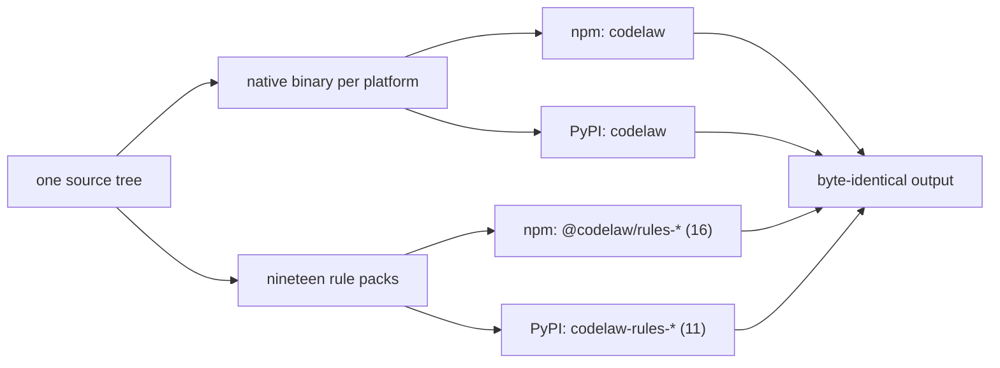

# SR-LAW-6 — L6 — one release, two packages: PyPI and npm

## §1 — For humans

**The law (L6).**

> **codelaw is published as a Python package on PyPI and a Node package on npm, both named `codelaw`, in the same release, under the same version number.** Each `codelaw` package is **complete on its own as an engine**: it needs no runtime of the other language — **except the type-aware TypeScript rules, which run on Node and the project's own TypeScript, through a helper that ships inside both engine packages** (decision 3) — has no optional extras, and contains every language, the formatter, the MCP server and the LSP. **Its rules ship as nineteen rule packs, published in the same release under the same version: seventeen on npm as `@codelaw/rules-<name>` (`js`, `ts`, `react`, `node`, `stencil`, `html`, `css`, `scss`, `css-modules`, `data`, `tanstack-query`, `redux-toolkit`, `security-js`, `security-ts`, `security-html`, `spell`, `deps`) and twelve on PyPI as `codelaw-rules-<name>` (`js`, `react`, `html`, `css`, `scss`, `python`, `data`, `security-js`, `security-html`, `security-python`, `spell`, `deps`); each registry carries only the packs its users install.** For the same inputs and the same packs, the two registries' packages produce **byte-identical output**. **A release that reaches one registry and not the other is a failed release.** **On npm, the only unscoped package is `codelaw`; every other npm package is `@codelaw/<name>`. On PyPI, the engine is `codelaw` and the only other codelaw distributions are the twelve `codelaw-rules-<name>` packs; platform builds are wheels, never separate packages. Each rule pack may have one optional companion, `@codelaw/rules-<name>-fux-index` on npm and `codelaw-rules-<name>-fux-index` on PyPI: a Fux index of that pack's rules, pure data, never inside the pack, never a dependency of it and never installed by `codelaw init`; they are the only other packages (decision 12) but one: every agent-facing file codelaw writes ships as the skills package, `@codelaw/skills` on npm and `codelaw-skills` on PyPI, released with the engine at the same version, holding the same files on both, and depending on `codelaw` at exactly that version — the one runtime dependency a codelaw package has (decision 13).**

**Ruled by Arpit, 2026-10-18;** amended by his ruling of 2026-10-19: rules ship as five separately published packs, mirrored on both registries, apart from the engine ([SR-RULE-PACKS](0101_rule-packs.md)); amended again by his ruling of 2026-10-24 (W-31): *"The ones that are going to be used in npm and the ones that are going to be used in PyPI should only be published"* — `rules-js` splits into `js`, `ts`, `react`, `node` and `stencil`, npm carries eight packs and PyPI six; and by his ruling of 2026-10-24 (W-32, named 2026-10-25): *"i want a redux tool kit and react query pack as well in npm"* — two npm-only library packs, `tanstack-query` and `redux-toolkit`, so npm carries ten; and by his ruling of 2026-10-25 (W-53): *"I want to create a pack for security issues. Security issues like Veracode, Black Duck, X-Ray, OWASP. … So create … one for JavaScript, one for TypeScript, one for HTML, one for Python."* — four security packs on the existing split: `security-js` and `security-html` on both registries, `security-ts` on npm only, `security-python` on PyPI only, so npm carries thirteen and PyPI nine; and by his ruling of 2026-10-26 (W-62): *"Create separate packages for SCSS and CSS modules."* — the `scss` pack, on both registries because SCSS is a CSS dialect under [L3](0005_LAW-3-languages.md), so npm carries fourteen and PyPI ten; and the same ruling's `css-modules` pack (W-63), on npm only because CSS Modules are a JavaScript-bundler feature, so npm carries fifteen and PyPI stays at ten. **The 2026-10-26 amendments were written by an agent on that ruling; the 2026-10-25 one was written by an agent on the decider's ruling of 2026-10-25**, given when he was asked whether agents should write W-52's and W-53's law amendments now: *"Yes, include them."* Amended once more by his ruling of 2026-10-25 (W-34, Cowork, by voice): *"I want codelaw to have a separate package for Fux index. It shouldn't be added as a default one."* → *"I would like to go with @codelaw/rules-js-fux-index."* → on PyPI: *"Both. It should be NPM as well as PyPI."* — decision 12; written by an agent once the Fux index-package item (fux item 299) had built the pin, the runtime and `fux pack`. Amended once more by his ruling of 2026-10-27 (W-77, Cowork): *"I want a separate package to be created just for skills, and it will have a hard dependency on code law. Skills being agent facing scripts or files."* — answering four questions: the whole agent-facing set, not only the skills; npm and PyPI; the engine keeps nothing agent-facing; the exact same version — decision 13; written by an agent on that ruling, in the change that built it. Amended once more by his ruling of 2026-10-27 (W-101, by voice; R4 and R5 of [the proposal](../work/proposals/type-aware-rules.md) §3): *"using Node at runtime makes sense. Let's go with it."* — for type rules only — and *"the rules go in TS pack, the existing one."* — so no new package; decision 3's exception; written by an agent on that ruling (W-104). Amended once more by his ruling of 2026-10-27 (W-103, Cowork, by voice, on the CSpell research): *"want it as a separate package."* — the `spell` pack, on both registries, so npm carries sixteen packs and PyPI eleven ([SR-SPELL](0116_spell.md)); written by an agent on that ruling, in the change that built the pack. Amended once more by his ruling of 2026-10-29 (W-128, Cowork, by voice): *"I like the first one, that is deps."* — the `deps` pack, on both registries, holding every dependency rule ([SR-RULE-PACKS](0101_rule-packs.md) decision 15), so npm carries seventeen packs and PyPI twelve; written by an agent on that ruling, in the change that built the pack.

**Why it exists.** [L3](0005_LAW-3-languages.md) promises Python-only, JS-only and mixed repos. That promise is only real if each kind of team can install codelaw with the package manager it already uses, and gets the same tool.

**Name check, 2026-10-18:** `codelaw` returned 404, meaning not yet taken, on both registries. It should be reserved before anything is announced.



<details>
<summary><b>ASCII twin</b></summary>

```text
   source --> binary per platform --+--> npm  codelaw ----------+
          |                         +--> PyPI codelaw ----------+
          +-> nineteen rule packs ---+--> npm  @codelaw/rules-* (17) +--> identical output
                                    +--> PyPI codelaw-rules-* (11) -+    (same packs)
```

</details>

---

## §2 — For agents

### Context

[L3](0005_LAW-3-languages.md) promises Python-only, JS-only and mixed repos. That promise is real only if each kind of team can install codelaw with the package manager it already uses, and gets the same tool.

### Decision


1. **Two packages, one name, one version.**

   | Registry | Package | Install |
   |---|---|---|
   | PyPI | `codelaw` | `pip install codelaw` · `uv add --dev codelaw` · `pipx install codelaw` · `uvx codelaw` |
   | npm | `codelaw` | `npm i -D codelaw` · `pnpm add -D codelaw` · `yarn add -D codelaw` · `npx codelaw` · `bunx codelaw` |

2. **Same binary inside both.** Both packages carry the native codelaw binary built once per platform from one source tree in one CI run. The wrappers only find the binary and run it.
3. **Complete alone, as an engine.** Neither `codelaw` package depends on the other, or on Python or Node beyond the host it's installed into. There are no extras (`codelaw[...]`) and no optional peer dependencies. Every [L3](0005_LAW-3-languages.md) language, the formatter, the MCP server and the LSP are always present. **Rules are not:** they come from the rule packs (decision 11), which `codelaw init` installs for the detected languages ([SR-RULE-PACKS](0101_rule-packs.md) decision 6). `codelaw` installed alone formats every language and lints with no rules, and says so (`codelaw/no-rules`).
   - **The one runtime exception: type-aware TypeScript rules** ([L3](0005_LAW-3-languages.md) decision 9; [SR-TYPES](0117_types.md)). They run on **Node** and **the project's own TypeScript ≥ 7.1**, and on nothing else. The helper that drives them, `codelaw-types`, is codelaw's own code and **ships inside both engine packages** — the same bytes in each — never as a package of its own or a dependency. Without Node or that TypeScript, the type rules are skipped with a note and everything else runs; "complete alone" holds for everything but them.
4. **Zero runtime dependencies** in either wrapper package or any rule pack. Neither `codelaw` package depends on a pack; the consumer's project does, through `codelaw init`. **The one exception is the skills package (decision 13), which depends on `codelaw` at exactly its own version**; nothing depends on it.
5. **Same commands, same API.**
   - Both install a `codelaw` command with identical flags and output.
   - Both expose a small programmatic API with identical names and JSON shapes:
     - Python: `codelaw.check()`, `codelaw.fix()`, `codelaw.rules_for()`;
     - Node: `check()`, `fix()`, `rulesFor()` from `codelaw`.
   - The API calls the bundled binary, so the results are the binary's results.
6. **Supported platforms** (prebuilt for each):
   - macOS arm64 and x64;
   - Linux x64 and arm64 (glibc and musl);
   - Windows x64 and arm64.

   npm ships them as per-platform `optionalDependencies` (the Biome and oxlint pattern). PyPI ships them as platform wheels (the Ruff pattern).
7. **An unsupported platform fails clearly.** It stops with an error that names the supported platforms. It never silently builds from source; no sdist that needs a Rust toolchain is published.
8. **Host floors:** Python ≥ 3.11 and Node ≥ 22. **Ruled by Arpit, 2026-10-19:** the oldest lines still supported upstream when codelaw first ships (Python 3.10 reaches end of life in October 2026; Node 18 and 20 already have). Each package declares its floor (`requires-python`, `engines.node`).
9. **Released together.** One release job publishes the engine to both registries and each rule pack to the registries decision 11 names. If any publish fails:
   - the job fails;
   - everything already published in that release is yanked (PyPI) or deprecated (npm);
   - the version is not announced.

   - **npm may go first.** **Ruled by Arpit, 2026-10-25:** *"All codelaw npm packages are published. The PyPI packages will take 2 to 3 days because there is a limit of 4 packages per day to be published by hand … Everything else related to npm, let's go ahead and build it out, even have the pipelines start working and start publishing those packages."* A release may reach npm first, by a run of `publish.yml` by hand on the release's `v*` tag, which publishes npm only; the GitHub Release on **the same tag** later runs both registries and skips every version already published. One tag, one commit, one `dist`, so both registries still carry the same binary (decision 2) — "together" means the same release, not the same hour. A run that fails part-way is withdrawn as above, for what that run published.

   - **PyPI uploads only what exists.** **Ruled by Arpit, 2026-10-29 (W-116):** *"We can skip the one pending for PyPI."* PyPI's first upload of a project is by hand ([RELEASING.md](../RELEASING.md)), except `codelaw`, whose *pending* publisher lets CI create it. So the release job uploads a wheel only when its project already exists on PyPI or is `codelaw`, and names every project it skipped in the job summary; a skipped project is not a failed publish. **Amended by Arpit's ruling of 2026-10-30 (W-134):** *"I don't want to trigger the package from my local for PyPI. I'll trigger the pipeline, and that is going to publish the package."* — the exception is every project holding a pending publisher the decider added (`codelaw`, `codelaw-rules-deps`; the list is [SR-PACKAGES](0107_packages.md) decision 11's), and a run by hand from the release's `v*` tag may upload one such project's wheel alone (`only=pypi`). Written by an agent on that ruling. npm has no such skip: a name npm does not trust stops the release before either registry is written.

   - **A new PyPI project's first version is by hand** (`twine upload`, then a trusted publisher on the project). **From 2026-10-29 until every project existed, CI created them instead, one at a time,** through a pending publisher (W-119: *"one package in pending state, then you give me the command …"*), by a run of `publish.yml` from `main` with `only=pypi-new`, `main` admitted to the `pypi` environment for it. **That path was temporary — ruled by Arpit, 2026-10-29 10:31:** *"publish only one PyPI package temporarily. Once all of them are published, then you will revert the pipeline to original"* — and was removed once W-119 had created all ten (W-125): `publish.yml` publishes only from a Release or, npm only, a `v*` tag, and only a `v*` tag may deploy to `pypi`.

   The version number lives in one file, and every manifest (the engine's and each pack's, on both registries) is generated from it.

10. **Package names.**
    - **npm:** exactly one unscoped package, `codelaw`. Everything else lives under the `@codelaw` scope, for example the per-platform binaries `@codelaw/cli-<os>-<arch>` and the rule packs `@codelaw/rules-<name>` ([SR-PACKAGES](0107_packages.md)).
    - **PyPI:** one engine distribution, `codelaw`, whose platform builds are wheels of it, plus the twelve rule packs `codelaw-rules-<name>` (decision 11), their optional index packages `codelaw-rules-<name>-fux-index` (decision 12) and the skills package `codelaw-skills` (decision 13). PyPI has no scopes, so no other codelaw distribution is published.
    - **npm**'s skills package is `@codelaw/skills` (decision 13).
    - The `@codelaw` npm organisation, the `codelaw` names on both registries and the twelve `codelaw-rules-<name>` names on PyPI are reserved before the first release; each `-fux-index` name is reserved before the release that first publishes it.
11. **Rule packs** ([SR-RULE-PACKS](0101_rule-packs.md)). **Ruled by Arpit, 2026-10-19** (five packs on both registries); **amended 2026-10-24** (W-31; and W-32, two npm-only library packs), **2026-10-25** (W-53, four security packs), **2026-10-26** (W-62, the `scss` pack; W-63, the npm-only `css-modules` pack), **2026-10-27** (W-103, the `spell` pack on both) and **2026-10-29** (W-128, the `deps` pack on both):

    | registry | packs |
    |---|---|
    | npm, `@codelaw/rules-<name>` | `js`, `ts`, `react`, `node`, `stencil`, `html`, `css`, `scss`, `css-modules`, `data`, `tanstack-query`, `redux-toolkit`, `security-js`, `security-ts`, `security-html`, `spell`, `deps` |
    | PyPI, `codelaw-rules-<name>` | `js`, `react`, `html`, `css`, `scss`, `python`, `data`, `security-js`, `security-html`, `security-python`, `spell`, `deps` |

    - Each is pure data (rule files, presets, data tables): one tarball on npm, one `py3-none-any` wheel on PyPI, or both. **A pack on both registries holds the same files on both.**
    - Each declares `min_codelaw` and shares the engine's version (decision 9).
    - A pack whose presets extend another pack's (`security-ts` → `security-js`, `security-html` → `html`; [SR-RULE-PACKS](0101_rule-packs.md) decision 3) extends only a pack published on every registry it is, so neither registry's users need the other.
    - A Python-only repo installs `codelaw` and `codelaw-rules-python` (plus `codelaw-rules-data` for its TOML, YAML and Markdown) from PyPI and never touches npm. A Node-only repo does the same from npm ([L3](0005_LAW-3-languages.md) decision 2).
    - **What each registry leaves out is the decider's accepted cost:** an npm-only install has no Python rules (`py/*`, `sec-py/*`), and a PyPI-only install has no `ts/*`, `node/*`, `stencil/*`, `tanstack-query/*`, `redux-toolkit/*` or `sec-ts/*` rules. The engine on either registry is still complete (decision 3): it formats and parses every language, and its TypeScript gets the `js` rules that declare it.

12. **The optional Fux index package** ([W-34](../work/open/W-34-fux-index-packages.md); **ruled by Arpit, 2026-10-25**, words above). Each rule pack that holds rules has one companion package, released with its pack at the same version (decision 9):

    | registry | names |
    |---|---|
    | npm | `@codelaw/rules-<name>-fux-index` for each npm pack of decision 11 that holds rules |
    | PyPI | `codelaw-rules-<name>-fux-index` for each PyPI pack that holds rules |

    - **Today that is seventeen on npm and twelve on PyPI** — one per pack, every pack now holding rules (sixteen and eleven before the `deps` pack, W-128; fifteen and ten before the `spell` pack, W-103; ten and six before the `scss` and `css-modules` packs, W-62 and W-63; twelve and seven until the four security packs held their first rule files): Fux refuses an empty index, so a pack gets its package with its first rule.
    - **What it holds:** Fux's index of that pack's `rules/` and nothing else — the shards, `identifiers.toml` and `fux-index.json` ([SR-PKG-INDEX](https://github.com/arpitarya/fux/blob/main/records/0166_pkg-index.md), Fux's record). **Pure data, zero runtime dependencies.** Fux reads it; codelaw's engine never does, so codelaw stays complete with no Fux ([L5](0007_LAW-5-no-model-in-the-engine.md)).
    - **Never inside the rule pack, never a dependency of it, never installed by `codelaw init`.** `init` only prints how to add them, and only when the repo has a `.fux/` folder ([SR-RULE-PACKS](0101_rule-packs.md) decision 6).
    - **A segment is the same on both registries** (one digest, Fux's SR-PKG-INDEX decision 4); a pack on one registry has its index on that registry only.
    - **Built in CI, by a pinned Fux.** `scripts/fux-index.py` runs `fux` over each pack's `rules/` and packs the segment with the pack builders of `scripts/package.py`; Fux (`fux-engine`, MIT) is a build tool of CI only, pinned at one version so the bytes are reproducible, and a release's index packages are rebuilt only by moving that pin ([SR-PACKAGES](0107_packages.md) decision 14).
    - **Published on their own.** They are assembled into `dist/fux-index/`, never `dist/npm` or `dist/pypi`, so the release job does not upload a name nobody has reserved ([RELEASING.md](../RELEASING.md)).

13. **The skills package** ([W-77](../work/open/W-77-skills-package.md); **ruled by Arpit, 2026-10-27**, words above). Every file codelaw writes for a coding agent — the skills, the steering, instruction and rules files, the custom agent, the hook and MCP registrations, the trigger evals: all of `templates/agents/` — ships as one package, apart from the engine:

    | registry | name | depends on |
    |---|---|---|
    | npm | `@codelaw/skills` | `codelaw` at exactly its version (`"dependencies": { "codelaw": "X" }`) |
    | PyPI | `codelaw-skills` (one `py3-none-any` wheel, module `codelaw_skills`) | `codelaw==X` |

    - **What it holds:** `templates/agents/` byte for byte ([SR-LAW-10](0012_LAW-10-consumer-templates.md) unchanged — the files still come from templates), plus `codelaw-skills.json` naming its version, the licence and a README. **The same files on both registries.**
    - **The engine keeps none of it.** The binary embeds no file of `templates/agents/`; `codelaw init --agents` and `codelaw sync-agents` read the installed package ([SR-AGENT-SURFACES](0102_agent-surfaces.md) decision 8), and refuse with exit 2 and both install lines when it is missing or is another version — never an older copy.
    - **The dependency is one-way and exact.** Installing the skills package brings the engine it was written for; `codelaw` never depends on it, so a team that wants no agent files installs nothing more. Both are released together, at one version (decision 9).

#### How L6 is enforced

- **Completeness gate:** `scripts/law-gate.py` refuses a release whose binary has no `format`, `mcp` or `lsp` (decision 3), in `publish.yml` and before the one-time hand publish ([SR-PACKAGES](0107_packages.md) decision 11).
- **Version check:** CI fails if `pyproject.toml`, `package.json` and the binary's `--version` disagree.
- **Install matrix:** on every release candidate, a clean container per platform installs from each registry (a staging index first) and runs the [L3](0005_LAW-3-languages.md) combined fixture. The npm and PyPI outputs must be byte-equal.
- **Pack parity:** every published copy of a pack holds `packs/<name>/`, byte for byte, so a pack on both registries is the same on both; the names on each registry are decision 11's table, read from `FIRST_PARTY_PACKS` in `crates/codelaw-rules/src/pack.rs`; and the install matrix installs the packs for each fixture's languages.
- **Runtime fence:** the PyPI package is installed and run with no Node on the PATH, and the npm package with no Python. With no Node, a type rule is skipped with its note, never an error (decision 3).
- **Dependency check:** both published manifests are checked for zero runtime dependencies (apart from the npm per-platform binary packages); the skills package's one dependency must be exactly `codelaw` at the release version (`package.json` `dependencies`, the wheel's one `Requires-Dist`).
- **Skills parity:** `scripts/package.py check` requires the npm and PyPI skills packages to hold `templates/agents/` byte for byte plus the manifest at the release version, and `smoke.sh` installs each by name from the staging index and requires `sync-agents` to write byte-identical agent files from either (`fixtures/skills-consumer`).
- **Index packages:** `python3 scripts/fux-index.py check dist` — only decision 12's names, the pack's version, zero dependencies, each manifest's digest the shards' own and its `content` the pack it indexes, the npm and PyPI copies equal, and none of them in `dist/npm` or `dist/pypi`; `assemble` builds each segment twice and refuses a pair that differs.

### Consequences

- **Every release builds a binary for each platform and publishes the engine to both registries, seventeen packs to npm and twelve to PyPI.** One failed publish fails the release.
- **The four security packs (W-53, 2026-10-25) are six new names to bind by hand once:** three on npm (`@codelaw/rules-security-js`, `-security-ts`, `-security-html`) and three on PyPI (`codelaw-rules-security-js`, `-security-html`, `-security-python`), as W-38 did for the first six ([SR-PACKAGES](0107_packages.md) Consequences).
- **The first npm publish (0.1.0, 2026-10-24, W-29) predates the split:** it carried the five packs, so `@codelaw/rules-python` is unpublished from npm by hand and 0.2.0 is the first release in the per-registry layout ([W-31](../archive/open/W-31-registry-pack-split.md)).
- **Nineteen more names to bind by hand once (W-34, 2026-10-25; W-62 added `scss`'s two, W-63 `css-modules`' one):** twelve on npm (`@codelaw/rules-<name>-fux-index`) and seven on PyPI (`codelaw-rules-<name>-fux-index`), each with its trusted publisher, as W-29 and W-38 did for the packs; the four security packs add theirs when they hold rules. **That step is the decider's and is not done:** `scripts/fux-index.py` builds the packages in CI, and nothing uploads them ([RELEASING.md](../RELEASING.md)).
- **Two more pack names to bind by hand once (W-103, 2026-10-27):** `@codelaw/rules-spell` on npm and `codelaw-rules-spell` on PyPI, each with its trusted publisher, and their `-fux-index` companions with the others; that step is the decider's ([RELEASING.md](../RELEASING.md)).
- **Two more pack names to bind by hand once (W-128, 2026-10-29):** `@codelaw/rules-deps` on npm and `codelaw-rules-deps` on PyPI, each with its trusted publisher, and their `-fux-index` companions — [W-135](../work/open/W-151-release-0-4-1.md) and [W-134](../work/open/W-151-release-0-4-1.md), the decider's, before the release that carries the pack.
- **Two more names to bind by hand once (W-77, 2026-10-27):** `@codelaw/skills` on npm and `codelaw-skills` on PyPI, each with its trusted publisher. Until then `publish.yml`'s trust check stops a release before anything is uploaded ([RELEASING.md](../RELEASING.md)).
- **A breaking change for consumers of agent files:** from the first release that carries W-77 (the next minor), `sync-agents` and `init --agents` need the skills package installed beside codelaw; the refusal names the install line (CHANGELOG).
- **A Fux release that changes the segment format rebuilds every index package;** the pin in `scripts/fux-index.py` is what keeps that a deliberate act.
- **Type-aware rules need Node at run time** (2026-10-27, W-104): a PyPI-installed codelaw in a TypeScript project runs them only where Node is on the PATH, as it is wherever that project's `typescript` was installed. The helper adds no package and no name to reserve; it is built by W-105.
- **`codelaw` installed alone lints nothing:** rules come from packs, and `codelaw init` installs them ([SR-RULE-PACKS](0101_rule-packs.md) decision 6).
- **The wrappers stay thin:** zero runtime dependencies, which also keeps them trivially within [L2](0004_LAW-2-foss-dependencies.md).
- **Checked since 2026-10-20 by every `ci.yml` run:** the version check (`scripts/version.py --check`, with the binary on every platform), the dependency check and pack parity (`scripts/package.py check`), and the runtime fence and npm-vs-PyPI byte-equality (`scripts/smoke.sh`). **The install matrix and the runtime fence run on all eight platforms** (`ci.yml`'s `smoke` job, added by W-18 on 2026-10-20 and first proven by its first CI run; the musl two in a clean Alpine container). **Since 2026-10-22 (W-18) they install from a staging index**: `smoke.sh` publishes the built files to a throwaway npm registry and PyPI simple index on localhost and installs `codelaw` from it by name ([SR-PACKAGES](0107_packages.md) decision 11). Proven on darwin-arm64 by hand; the eight platforms are proven by the first CI run that carries it.

### Alternatives considered

- **npm only, with a Python shim that needs Node:** rejected. It breaks Python-only repos.
- **A pure-Python and a pure-JS implementation:** rejected. Two engines drift apart.
- **Every built-in rule inside the `codelaw` package** (this law's 2026-10-18 text): superseded by the decider's ruling of 2026-10-19. Rules ship as packs.
- **The agent files inside the engine binary** (decisions 1–12 before 2026-10-27): superseded by the decider's ruling of 2026-10-27 — they ship and upgrade as their own package (decision 13).
- **Every pack on both registries** (this law's 2026-10-19 text): superseded by the decider's ruling of 2026-10-24. Each registry carries the packs its users install.
- **An sdist that builds from source:** rejected. It means a silent Rust compile on unsupported platforms.

### Reference (required)

- [`docs/DESIGN.md`](../docs/DESIGN.md) §3.1: the Rust-core option table.
- The decider's ruling of 2026-10-18 (worklog entry of that date); the host floors (Python 3.11, Node 22) and the rule packs (decisions 3, 9–11) by his rulings of 2026-10-19; the four security packs by his ruling of 2026-10-25 ([W-53](../work/open/W-53-security-packs-groundwork.md)).
- [Python release status](https://devguide.python.org/versions/) · [Node.js release schedule](https://nodejs.org/en/about/previous-releases).

### Veto condition

**Reopen this decision if:** the npm and PyPI packages (engine, pack or index package) carry different versions, either engine package depends on the other, a pack on both registries holds different files on each, a registry carries a pack decision 11 or an index package decision 12 does not name, `codelaw init` installs an index package, the skills package's dependency on `codelaw` is anything but its exact version, or the binary carries an agent file.

**How to check it:** `python3 scripts/package.py check dist` — one version, no engine depending on the other, each published pack its `packs/` folder byte for byte, and each registry's names exactly decision 11's.

---

## References

*Every source this record cites, gathered in one place. An archived document is never listed here.*

**Records** — [SR-RULE-PACKS](0101_rule-packs.md) · [SR-PACKAGES](0107_packages.md) · [SR-LAW-3](0005_LAW-3-languages.md) · [SR-SPELL](0116_spell.md) · [SR-TYPES](0117_types.md)

**Work items** — [W-103](../work/open/W-103-spell-pack.md) · [W-77](../work/open/W-77-skills-package.md) · [W-34](../work/open/W-34-fux-index-packages.md) · [W-31](../archive/open/W-31-registry-pack-split.md) · [W-32](../archive/open/W-32-redux-and-query-packs.md) · [W-53](../work/open/W-53-security-packs-groundwork.md)

**Project docs** — [`docs/DESIGN.md`](../docs/DESIGN.md)
