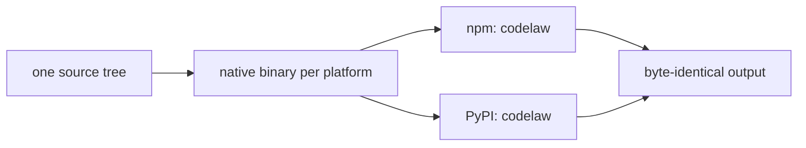

# SR-LAW-6 — L6 — one release, two packages: PyPI and npm

## §1 — For humans

**The law (L6).**

> **codelaw is published as a Python package on PyPI and a Node package on npm, both named `codelaw`, in the same release, under the same version number.** Each package is **complete on its own**: it needs no runtime of the other language, has no optional extras, and contains every language, every built-in rule, the MCP server and the LSP. For the same inputs, the two packages produce **byte-identical output**. **A release that reaches one registry and not the other is a failed release.** **On npm, the only unscoped package is `codelaw`; every other npm package is `@codelaw/<name>`. On PyPI, the only package is `codelaw`; platform builds are wheels of it, never separate packages.**

**Ruled by Arpit, 2026-10-18.**

**Why it exists.** [L3](0005_LAW-3-languages.md) promises Python-only, JS-only and mixed repos. That promise is only real if each kind of team can install codelaw with the package manager it already uses, and gets the same tool.

**Name check, 2026-10-18:** `codelaw` returned 404, meaning not yet taken, on both registries. It should be reserved before anything is announced.



<details>
<summary><b>ASCII twin</b></summary>

```text
   source --> binary per platform --+--> npm  codelaw --+
                                    +--> PyPI codelaw --+--> identical output
```

</details>

---

## §2 — For agents

### Context

[L3](0005_LAW-3-languages.md) promises Python-only, JS-only and mixed repos. That promise is real only if each kind of team can install codelaw with the package manager it already uses, and gets the same tool.

### Decision


1. **Two packages, one name, one version.**

   | Registry | Package | Install |
   |---|---|---|
   | PyPI | `codelaw` | `pip install codelaw` · `uv add --dev codelaw` · `pipx install codelaw` · `uvx codelaw` |
   | npm | `codelaw` | `npm i -D codelaw` · `pnpm add -D codelaw` · `yarn add -D codelaw` · `npx codelaw` · `bunx codelaw` |

2. **Same binary inside both.** Both packages carry the native codelaw binary built once per platform from one source tree in one CI run. The wrappers only find the binary and run it.
3. **Complete alone.** Neither package depends on the other, or on Python or Node beyond the host it's installed into. There are no extras (`codelaw[...]`) and no optional peer dependencies. Every [L3](0005_LAW-3-languages.md) language, every built-in rule ([SR-RULE-PACKS](0101_rule-packs.md)), the MCP server and the LSP are always present.
4. **Zero runtime dependencies** in either wrapper package.
5. **Same commands, same API.**
   - Both install a `codelaw` command with identical flags and output.
   - Both expose a small programmatic API with identical names and JSON shapes:
     - Python: `codelaw.check()`, `codelaw.fix()`, `codelaw.rules_for()`;
     - Node: `check()`, `fix()`, `rulesFor()` from `codelaw`.
   - The API calls the bundled binary, so the results are the binary's results.
6. **Supported platforms** (prebuilt for each):
   - macOS arm64 and x64;
   - Linux x64 and arm64 (glibc and musl);
   - Windows x64 and arm64.

   npm ships them as per-platform `optionalDependencies` (the Biome and oxlint pattern). PyPI ships them as platform wheels (the Ruff pattern).
7. **An unsupported platform fails clearly.** It stops with an error that names the supported platforms. It never silently builds from source; no sdist that needs a Rust toolchain is published.
8. **Host floors:** Python ≥ 3.11 and Node ≥ 22. **Ruled by Arpit, 2026-10-19:** the oldest lines still supported upstream when codelaw first ships (Python 3.10 reaches end of life in October 2026; Node 18 and 20 already have). Each package declares its floor (`requires-python`, `engines.node`).
9. **Released together.** One release job publishes to both registries. If either publish fails:
   - the job fails;
   - the other registry's release is yanked (PyPI) or deprecated (npm);
   - the version is not announced.

   The version number lives in one file, and both manifests are generated from it.

10. **Package names.**
    - **npm:** exactly one unscoped package, `codelaw`. Everything else lives under the `@codelaw` scope, for example the per-platform binaries `@codelaw/cli-<os>-<arch>` ([SR-PACKAGES](0107_packages.md)).
    - **PyPI:** exactly one distribution, `codelaw`. Platform builds are wheels of it. PyPI has no scopes, so no second codelaw distribution is published.
    - The `@codelaw` npm organisation and the `codelaw` names on both registries are reserved before the first release.

#### How L6 is enforced

- **Version check:** CI fails if `pyproject.toml`, `package.json` and the binary's `--version` disagree.
- **Install matrix:** on every release candidate, a clean container per platform installs from each registry (a staging index first) and runs the [L3](0005_LAW-3-languages.md) combined fixture. The npm and PyPI outputs must be byte-equal.
- **Runtime fence:** the PyPI package is installed and run with no Node on the PATH, and the npm package with no Python.
- **Dependency check:** both published manifests are checked for zero runtime dependencies (apart from the npm per-platform binary packages).

### Consequences

- **Every release builds a binary for each platform and publishes twice.** One failed publish fails the release.
- **The wrappers stay thin:** zero runtime dependencies, which also keeps them trivially within [L2](0004_LAW-2-foss-dependencies.md).
- **Nothing checks this law yet:** `B-012` in `work/BACKLOG.md`.

### Alternatives considered

- **npm only, with a Python shim that needs Node:** rejected. It breaks Python-only repos.
- **A pure-Python and a pure-JS implementation:** rejected. Two engines drift apart.
- **An sdist that builds from source:** rejected. It means a silent Rust compile on unsupported platforms.

### Reference (required)

- [`docs/DESIGN.md`](../docs/DESIGN.md) §3.1: the Rust-core option table.
- The decider's ruling of 2026-10-18 (worklog entry of that date); the host floors (Python 3.11, Node 22) by his ruling of 2026-10-19.
- [Python release status](https://devguide.python.org/versions/) · [Node.js release schedule](https://nodejs.org/en/about/previous-releases).

### Veto condition

**Reopen this decision if:** the npm and PyPI packages carry different versions, or either one depends on the other.

**How to check it:** `once manifests exist: compare the version in package.json and pyproject.toml; until then nothing to check`

---

## References

*Every source this record cites, gathered in one place. An archived document is never listed here.*

**Records** — [SR-RULE-PACKS](0101_rule-packs.md) · [SR-PACKAGES](0107_packages.md)

**Project docs** — [`docs/DESIGN.md`](../docs/DESIGN.md)
