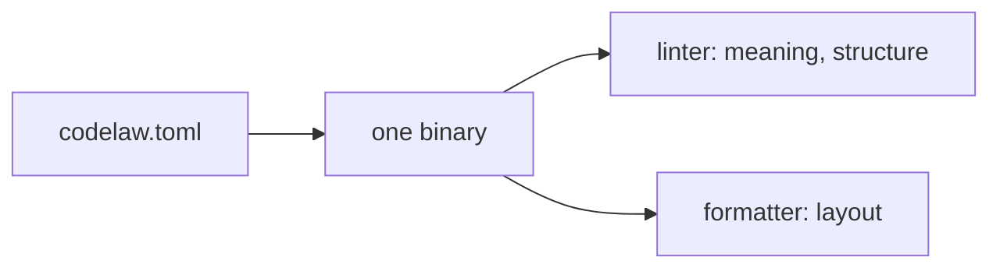

# SR-LAW-7 — L7 — codelaw is always both a linter and a formatter

## §1 — For humans

**The law (L7).**

> **codelaw is a linter and a formatter, for every [L3](0005_LAW-3-languages.md) language, in one binary with one config.** Neither ships without the other. **The formatter never changes what code means; the linter never rules on layout.**

**Ruled by Arpit, 2026-10-18.**

**Why it exists.** Teams run two tools today, and the two fight: a lint rule demands a style the formatter undoes. One tool with one config, and a hard line between the two jobs, removes that whole class of problem.



<details>
<summary><b>ASCII twin</b></summary>

```text
   codelaw.toml --> one binary --+--> linter    (meaning, structure)
                                 +--> formatter (layout)
```

</details>

---

## §2 — For agents

### Context

The decider ruled that codelaw is both a linter and a formatter. Until now that lived only in a proposed record (SR-FORMATTER), which a later decision could quietly drop.

### Decision

1. **Both, for every language.** A language enters [L3](0005_LAW-3-languages.md) only with a lint engine **and** a formatter for it.
2. **One binary, one config.** `codelaw check` lints and reports unformatted files, `codelaw format` formats, and `codelaw fix` does both. Each job's mechanism is its own record: [SR-LINTER](0106_linter.md) and [SR-FORMATTER](0105_formatter.md).
3. **The line between the jobs.**
   - Layout (whitespace, line breaks, quotes, semicolons, trailing commas) belongs to the formatter.
   - Meaning and structure belong to the linter.
   - A layout-only lint rule is refused ([SR-FORMATTER](0105_formatter.md) decision 3).
   - A format that changes meaning fails verification ([SR-FORMATTER](0105_formatter.md) decision 4).
4. **Users may switch either off** (`[format] enabled = false`, or rules set to `off`), but both always ship.

#### How L7 is enforced

- The [L3](0005_LAW-3-languages.md) fixture matrix also asserts that every language has at least one lint rule and a formatter that round-trips its fixtures.
- The fixture-matrix check is not built yet: `W-07`.
- **The release gate:** `scripts/law-gate.py` refuses to release a binary that has no `format` command, in `publish.yml` and before the one-time hand publish ([SR-PACKAGES](0107_packages.md) decision 11). Added 2026-10-20, after a release was put to the decider while the formatter did not exist.

### Consequences

- **Every new language costs two integrations** (lint and format) before it can join L3.
- **Only the release gate checks this law** until W-07 adds the fixture matrix; a linter-only binary can be built and tested, never released.

### Alternatives considered

- **Linter only, formatting left to Prettier/Black:** rejected. Two tools, two configs, and the fights this law exists to end.
- **Formatter as an optional add-on:** rejected. An optional half is the half that drifts.

### Reference (required)

- The decider's ruling of 2026-10-18 (worklog entry of that date).
- [SR-FORMATTER](0105_formatter.md) and [SR-LINTER](0106_linter.md): the two mechanisms this law binds.

### Veto condition

**Reopen this decision if:** a language is in L3 without a lint engine or without a formatter.

**How to check it:** every language row in SR-LAW-3 decision 1 appears in both SR-LINTER decision 1 and SR-FORMATTER decision 2.

---

## References

*Every source this record cites, gathered in one place. An archived document is never listed here.*

**Records** — [SR-FORMATTER](0105_formatter.md) · [SR-LINTER](0106_linter.md)

**Project docs** — [`docs/DESIGN.md`](../docs/DESIGN.md)
