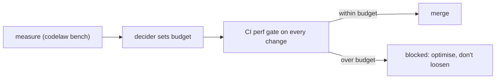

# SR-LAW-8 — L8 — performance budgets: measured once, never broken, only tightened

## §1 — For humans

**The law (L8).**

> **codelaw is a high-performance tool, and its speed is a law.** Every operation it offers has a **time budget**. A budget starts **unset**; the decider sets it from measurements. **Once set, a budget is never exceeded and never loosened.** A change that breaks a budget does not merge. Budgets only ever tighten.

**Ruled by Arpit, 2026-10-18.**

**Why it exists.** A linter and formatter run on every save, every commit and every agent edit. If it's slow, people switch it off and agents time out. Speed has to be a constraint that features fit inside, not a property hoped for afterwards.



<details>
<summary><b>ASCII twin</b></summary>

```text
   measure --> decider sets budget --> CI perf gate --+--> within: merge
                                                     +--> over:   blocked (optimise, never loosen)
```

</details>

---

## §2 — For agents

### Context

The decider wants performance to be a key property and accepts that today's numbers are unknown. So the law fixes the mechanism now and leaves the numbers to be filled in from measurement, and once filled they bind.

### Decision

1. **The budgets file.** `perf/budgets.toml` in the codelaw repo holds one entry per operation. Every value is `unset` today.

   | Operation | What is timed |
   |---|---|
   | `startup` | binary start to first output (`codelaw --version`) |
   | `check_warm_10k` | `codelaw check` (lint + format check) on the reference repo, warm cache |
   | `check_cold_10k` | the same with an empty cache |
   | `format_warm_10k` | `codelaw format --check` on the reference repo, warm cache |
   | `fix_one_file` | the agent-hook path: fix + format + verify on one changed file |
   | `lsp_after_edit` | edit to published diagnostics in the LSP |
   | `mcp_rules_for_path` | one MCP `rules_for_path` call |
   | `peak_memory_10k` | peak resident memory during `check_cold_10k` |

2. **The reference workload.**
   - A deterministic, seeded, generated repo of 10,000 files spanning every [L3](0005_LAW-3-languages.md) language, in `fixtures/perf/`.
   - Three pinned real repos.
   - A reference machine named in `budgets.toml`.
3. **The measurement.** `codelaw bench` runs each operation 10 times, discards the first run, and reports the median and p95. The gate compares **p95** against the budget.
4. **Setting a budget** is the decider's ruling. The entry records the value, the measured p95 it came from, and the date. Anyone may propose a tighter value; only a ruling sets one. The decider may rule a method in advance; each entry then names that ruling. **Ruled 2026-10-25 (W-19):** min(design target, 1.5 × the worst p95 of the `perf` job's three `ubuntu-24.04` runs on `main`), rounded up; an operation whose design target is below 1.5 × that p95 is not set and goes back to the decider.
5. **Never broken, never loosened.**
   - No flag, label or override lets a change over budget merge.
   - A budget is never raised.
   - If the reference machine must change, the decider re-measures **every** budget on the new machine in one change, and no budget may get slower relative to the measured baseline.
6. **Until a budget is set,** the gate reports that operation's p95 on every change without blocking, and the design targets in [SR-ARCHITECTURE](0108_architecture.md) guide the work.
7. **The gate runs on every change to the engine** once the engine exists. Its mechanism is `W-19`.

#### How L8 is enforced

- The CI perf gate (`W-19`) over `perf/budgets.toml`: `ci.yml`'s `perf` job runs `codelaw bench --budgets perf/budgets.toml` ([SR-CLI-MCP](0115_cli-and-mcp.md) decision 10) on every change to what it times — the engine (`crates/`, `Cargo.toml`, `Cargo.lock`, `rust-toolchain.toml`), the packs it loads, `perf/` and `ci.yml` itself — and fails when it exits `1` (decision 7). A push touching none of them skips it; the nightly run and a manual dispatch always run it (W-24, 2026-10-24).
- Determinism ([L5](0007_LAW-5-no-model-in-the-engine.md)) keeps the measured work identical across runs, so only timing varies.

**How the gate tells a set budget from a proposal (W-19, 2026-10-22).** Each operation is an `[operation.<name>]` table with a `unit` (`ms` or `MiB`) and a `budget`.
- `budget = "unset"`: not set. Its p95 is reported and never fails (decision 6).
- `budget = <number>`: **set**. A p95 over it exits `1` and fails the job. The table must also name `set_by`, `set_on` and `measured_p95` (decision 4), or the file is refused (exit `2`) — a bare number cannot pass for a ruling.
- `proposed = <number>`: a proposal awaiting the decider. It is printed beside the p95 and never compared.
- So the file of proposals the gate runs on today reports and passes; the ruling that writes a number into `budget` turns the gate on for that operation, with no change to CI.

**The reference workload, as built (W-19).** Decision 2's generated repo is written by `codelaw bench` from seed `20261018` (10,000 files, digest `bf9c5bea0d8b31ee`, pinned by a test in `crates/codelaw-cli/src/bench/workload.rs`; it was `8a5682d3ee6bf132` until 2026-10-24, when the pack split (W-31) added `codelaw:js/typescript` to its config — the same rules run, but a number measured before that day was measured on the old digest) and is not committed; [`fixtures/perf/README.md`](../fixtures/perf/README.md) describes it. Its config extends every pack's `recommended` presets with `preview = true`, since every pack rule is preview today. **Named by the decider, 2026-10-24 (W-19):** the reference machine is GitHub's hosted `ubuntu-24.04` runner, and the three pinned real repos are `djangoproject.com`, `full-stack-fastapi-template` and `html5-boilerplate`, at the commits in `scripts/corpus.json`. `codelaw bench --repo <dir>` (repeatable) copies each repo beside the workload with the workload's config and packs and times `check_cold_repo` and `check_warm_repo` on it; the `perf` job fetches the three with `scripts/corpus.py fetch --repo` and passes them (W-19, 2026-10-25). Those rows are context: reported, never gated, until the decider names a budgeted operation on a repo.

#### Measurements

**First measurements, 2026-10-22 (W-19). They were taken on a loaded developer Mac and must be re-measured on CI's runner before any budget is set.**
- **Machine:** Apple M4, 10 cores, 16 GiB, macOS. Three other agents were compiling Rust throughout: load average 18.3 at the start, 9.7 at the end.
- **Build:** release profile of `W-19-bench` on top of `main` 9a95428.
- **Runs:** three `codelaw bench` sessions, 10 runs per operation each, first run discarded. Each cell gives the median of the three session medians, then the range of the three session p95s.

| operation | median | p95, across sessions | design target ([SR-ARCHITECTURE](0108_architecture.md) decision 29) | proposed (not set) |
|---|---|---|---|---|
| `startup` | 2.0 ms | 2.1–2.6 ms | < 20 ms | 4 ms |
| `check_warm_10k` | 350.6 ms | 361.8–366.2 ms | < 2 s | 550 ms |
| `check_cold_10k` | 3,602.7 ms | 3,381.5–4,367.9 ms | < 20 s | 6,600 ms |
| `format_warm_10k` | 532.7 ms | 524.3–587.1 ms | — | 900 ms |
| `fix_one_file` | 53.7 ms | 63.7–66.1 ms | < 100 ms warm | 100 ms |
| `lsp_after_edit` | 1.4 ms | 1.5 ms | < 50 ms | 3 ms |
| `mcp_rules_for_path` | 23.6 ms | 24.1–25.6 ms | — | 40 ms |
| `peak_memory_10k` | 74.6 MiB | 78.2–82.3 MiB | < 1 GiB | 125 MiB |
| *`check_warm_10k_no_daemon` (context)* | 340.4 ms | 389.9–404.2 ms | — | — |
| *`fix_one_file_cold` (context)* | 49.7 ms | 49.9–51.8 ms | < 300 ms cold | — |

- **The proposal rule:** the smaller of the design target and 1.5 × the worst p95 observed, rounded up. It is to be applied again to the CI runner's numbers.
- **What the numbers say:**
  - The daemon barely helps `check_warm_10k`: 350.6 ms through it against 340.4 ms in a process of its own.
  - `codelaw hook` gains nothing from a primed cache: `fix_one_file` is 53.7 ms warm and 49.7 ms cold. Its time is project and rule-set loading, not checking.
  - Every operation is well inside its design target on this machine.

**The reference machine's numbers and the budgets set from them, 2026-10-25 (W-19).** Decision 4's ruled method applied to the `perf` job's three runs on `main` on `ubuntu-24.04` (image 20261012.334): A = run 40124005285 (`483b2a1`), B = 40124756694 and C = 40124878075 (both `ae90982`). "Rounded up" is taken to the next whole ms or MiB.

| operation | p95 A / B / C | worst | 1.5 × worst | design target | budget |
|---|---|---|---|---|---|
| `startup` | 1.6 / 1.3 / 1.4 ms | 1.6 | 2.4 | < 20 ms | **3 ms** |
| `check_warm_10k` | 217.9 / 173.5 / 220.6 ms | 220.6 | 330.9 | < 2 s | **331 ms** |
| `check_cold_10k` | 8,700.8 / 7,526.4 / 8,745.0 ms | 8,745.0 | 13,117.5 | < 20 s | **13,118 ms** |
| `format_warm_10k` | 1,353.3 / 1,167.4 / 1,585.9 ms | 1,585.9 | 2,378.85 | — | **2,379 ms** |
| `fix_one_file` | 73.9 / 58.6 / 76.3 ms | 76.3 | 114.45 | < 100 ms warm | **unset** — the guard: the target is below 1.5 × the worst p95, so it is the decider's |
| `lsp_after_edit` | 2.8 / 2.5 / 2.8 ms | 2.8 | 4.2 | < 50 ms | **5 ms** |
| `mcp_rules_for_path` | 40.8 / 30.0 / 43.0 ms | 43.0 | 64.5 | — | **65 ms** |
| `peak_memory_10k` | 47.6 / 48.0 / 46.6 MiB | 48.0 | 72.0 | < 1 GiB | **72 MiB** |

- On the runner `check_cold_10k` (8.7 s), `format_warm_10k` (1.6 s) and `mcp_rules_for_path` (43 ms) are past the loaded Mac's proposals; every one but `fix_one_file` still leaves 1.5 × headroom under its design target.
- `fix_one_file` is 76.3 ms against a 100 ms target: 1.31 × headroom, not 1.5 ×. Its context twin `fix_one_file_cold` is 76.7 ms against < 300 ms.

### Consequences

- **Performance work is first-class:** a feature that costs time must fit inside the budget, or be optimised until it does.
- **CI timing is noisy;** p95 over repeated runs and a dedicated reference machine are the price.
- **The gate binds seven of the eight operations** since 2026-10-25 (§Measurements): a `perf` p95 over one of them fails CI. `fix_one_file` is still `unset` and only reported, until the decider rules on it (`W-19`).

### Alternatives considered

- **Budgets as targets, not a law:** rejected by the decider. Targets erode one "small" regression at a time.
- **Allow loosening with sign-off:** rejected. "Whatever happens, it never gets broken."
- **Set numbers now, before any code:** rejected. Unmeasured numbers are guesses; the law fixes the mechanism now and the numbers later.

### Reference (required)

- The decider's ruling of 2026-10-18 (worklog entry of that date).
- [SR-ARCHITECTURE](0108_architecture.md): the design targets that apply until budgets are set.
- [SR-CACHE](0109_cache.md): the main lever for the warm budgets.

### Veto condition

**Reopen this decision if:** a change merged while an operation's p95 exceeded its set budget, or a budget value in `perf/budgets.toml` increased.

**How to check it:** `git log -p perf/budgets.toml` shows no budget value rising, and the perf gate's history (`ci.yml`, job `perf`) shows no merge over budget.

---

## References

*Every source this record cites, gathered in one place. An archived document is never listed here.*

**Records** — [SR-ARCHITECTURE](0108_architecture.md) · [SR-CACHE](0109_cache.md) · [SR-CLI-MCP](0115_cli-and-mcp.md)

**Project docs** — [`docs/DESIGN.md`](../docs/DESIGN.md)
