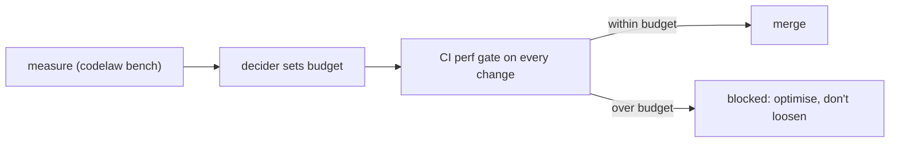

# SR-LAW-8 — L8 — performance budgets: measured once, never broken, only tightened

## §1 — For humans

**The law (L8).**

> **codelaw is a high-performance tool, and its speed is a law.** Every operation it offers has a **time budget**. A budget starts **unset**; the decider sets it from measurements. **Once set, a budget is never exceeded and never loosened.** A change that breaks a budget does not merge. Budgets only ever tighten.

**Ruled by Arpit, 2026-10-18.**

**Why it exists.** A linter and formatter run on every save, every commit and every agent edit. If it's slow, people switch it off and agents time out. Speed has to be a constraint that features fit inside, not a property hoped for afterwards.



<details>
<summary><b>ASCII twin</b></summary>

```text
   measure --> decider sets budget --> CI perf gate --+--> within: merge
                                                     +--> over:   blocked (optimise, never loosen)
```

</details>

---

## §2 — For agents

### Context

The decider wants performance to be a key property and accepts that today's numbers are unknown. So the law fixes the mechanism now and leaves the numbers to be filled in from measurement, and once filled they bind.

### Decision

1. **The budgets file.** `perf/budgets.toml` in the codelaw repo holds one entry per operation. Every value is `unset` today.

   | Operation | What is timed |
   |---|---|
   | `startup` | binary start to first output (`codelaw --version`) |
   | `check_warm_10k` | `codelaw check` (lint + format check) on the reference repo, warm cache |
   | `check_cold_10k` | the same with an empty cache |
   | `format_warm_10k` | `codelaw format --check` on the reference repo, warm cache |
   | `fix_one_file` | the agent-hook path: fix + format + verify on one changed file |
   | `lsp_after_edit` | edit to published diagnostics in the LSP |
   | `mcp_rules_for_path` | one MCP `rules_for_path` call |
   | `peak_memory_10k` | peak resident memory during `check_cold_10k` |

2. **The reference workload.**
   - A deterministic, seeded, generated repo of 10,000 files spanning every [L3](0005_LAW-3-languages.md) language, in `fixtures/perf/`.
   - Three pinned real repos.
   - A reference machine named in `budgets.toml`.
3. **The measurement.** `codelaw bench` runs each operation 10 times, discards the first run, and reports the median and p95. The gate compares **p95** against the budget.
4. **Setting a budget** is the decider's ruling. The entry records the value, the measured p95 it came from, and the date. Anyone may propose a tighter value; only a ruling sets one.
5. **Never broken, never loosened.**
   - No flag, label or override lets a change over budget merge.
   - A budget is never raised.
   - If the reference machine must change, the decider re-measures **every** budget on the new machine in one change, and no budget may get slower relative to the measured baseline.
6. **Until a budget is set,** the gate reports that operation's p95 on every change without blocking, and the design targets in [SR-ARCHITECTURE](0108_architecture.md) guide the work.
7. **The gate runs on every change to the engine** once the engine exists. Its mechanism is `B-018`.

#### How L8 is enforced

- The CI perf gate (`B-018`) over `perf/budgets.toml`.
- Determinism ([L5](0007_LAW-5-no-model-in-the-engine.md)) keeps the measured work identical across runs, so only timing varies.

### Consequences

- **Performance work is first-class:** a feature that costs time must fit inside the budget, or be optimised until it does.
- **CI timing is noisy;** p95 over repeated runs and a dedicated reference machine are the price.
- **Nothing checks this law yet:** `B-018` (the gate) and `B-019` (first measurements and the proposed budgets).

### Alternatives considered

- **Budgets as targets, not a law:** rejected by the decider. Targets erode one "small" regression at a time.
- **Allow loosening with sign-off:** rejected. "Whatever happens, it never gets broken."
- **Set numbers now, before any code:** rejected. Unmeasured numbers are guesses; the law fixes the mechanism now and the numbers later.

### Reference (required)

- The decider's ruling of 2026-10-18 (worklog entry of that date).
- [SR-ARCHITECTURE](0108_architecture.md): the design targets that apply until budgets are set.
- [SR-CACHE](0109_cache.md): the main lever for the warm budgets.

### Veto condition

**Reopen this decision if:** a change merged while an operation's p95 exceeded its set budget, or a budget value in `perf/budgets.toml` increased.

**How to check it:** `git log -p perf/budgets.toml` shows no budget value rising, and the perf gate's history shows no merge over budget (once `B-018` exists).

---

## References

*Every source this record cites, gathered in one place. An archived document is never listed here.*

**Records** — [SR-ARCHITECTURE](0108_architecture.md) · [SR-CACHE](0109_cache.md)

**Project docs** — [`docs/DESIGN.md`](../docs/DESIGN.md)
