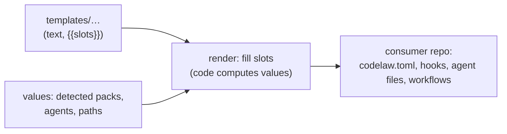

# SR-LAW-10 — L10 — every file codelaw writes into a consumer's repo comes from a template in `templates/`

## §1 — For humans

**The law (L10).**

> **Every file codelaw writes into a consumer's repository is rendered from a template in [`templates/`](../templates/) at this repo's root** — one template per output, laid out by where it lands. Code computes values and fills the template's named slots; **no consumer file's text lives inline in code.** A change to what consumers receive is a diff in `templates/`.

**Ruled by Arpit, 2026-10-26:** *"create a law that all the files that are supposed to be created on the consumer end will have templates in separate templates directory. So that it can be edited easily. And changes are more visible."*

**Why it exists.** Today the text codelaw writes for users is spread across Rust string literals (`init.rs`'s `codelaw.toml`, `sync.rs`'s instruction blocks), shell files beside the code (`crates/codelaw-cli/src/hooks/`) and `agents/`. Editing a sentence a user will read means finding it in code; reviewing it means reading a Rust diff.



<details>
<summary><b>ASCII twin</b></summary>

```text
   templates/... (text, {{slots}}) --+
                                     +--> render (fill slots) --> consumer repo files
   values computed by code ----------+
```

</details>

---

## §2 — For agents

### Context

codelaw writes a dozen kinds of files into a consumer's repo. Their text is the product's voice to its users, and it was spread across code.

### Decision

1. **What is a consumer file:** any file codelaw creates, or writes fixed text into, in a consumer's repository — the `codelaw.toml` and `.codelaw/rules/README.md` from `init`, the lines it adds to `.gitignore`, git hooks, agent instruction blocks, agent hook and MCP settings, skills, agents and the Cowork plugin from `sync-agents`, CI workflows from `init --ci`, and the scaffold from `new-rule`.
2. **What is not:** data codelaw serialises from state, whose shape the owning record defines — baseline files, deprecation entries, the deps snapshot, the cache, fixed or formatted source, report output, and a pack rule copied by `rules eject`.
3. **Layout:** `templates/<area>/<path as it lands>` — for example `templates/init/codelaw.toml`, `templates/git-hooks/pre-commit`, `templates/agents/claude/CLAUDE.md`, `templates/agents/skills/<name>/SKILL.md`, `templates/ci/github/codelaw-autofix.yml`, `templates/new-rule/rule.md`. **`templates/README.md` is the registry:** one row per template — its consumer path, the command that writes it, the record that owns that command.
4. **Slots, no logic:** a template holds text and `{{name}}` slots only — no conditionals, no loops. Code renders a list or an optional section into a slot. `\{{` writes a literal `{{`. The renderer is codelaw's own (no dependency, L2).
5. **Merged writes:** where codelaw writes into a file the consumer owns (a block between markers in `CLAUDE.md`, a key in `.claude/settings.json`, a line in `.gitignore`), the inserted text is the template; the merge itself stays in code.
6. **Shipped inside the binary:** templates are embedded at build time, so both packages stay complete and byte-identical (L6) and nothing is read from disk at run time (L5). **Except `templates/agents/`** (the decider's ruling of 2026-10-27, W-77: the engine keeps nothing agent-facing): it ships byte for byte as the skills package, `@codelaw/skills` and `codelaw-skills`, at the engine's exact version ([SR-LAW-6](0008_LAW-6-python-and-node-packages.md) decision 13), and `init --agents` and `sync-agents` read it from the installed package on disk — never from the network — and refuse when it is missing or another version ([SR-AGENT-SURFACES](0102_agent-surfaces.md) decision 8). Those files are still templates, under every other decision here.
7. **Checked by a test:** every file in `templates/` has a registry row and is embedded, `templates/agents/` excepted (decision 6), which must not be; every row's template exists; rendering each with its fixture values leaves no unfilled `{{`; and a value given for a slot the template lacks is an error. The fixture values are the test's `FIXTURES` table: a new template with slots, or a new slot, adds its row there in the same change (as W-93's pre-write hook templates did, 2026-10-27).

### Consequences

- One more step to change user-facing text: edit the template, not the code — which is the point.
- A slot-only renderer pushes formatting of lists into code; the template stays readable.
- Moving `agents/` under `templates/agents/` changes paths other records cite; that move is W-60's, done 2026-10-26.

### Alternatives considered

- **A template engine with logic** (Handlebars, Tera) — rejected: logic in templates is code nobody tests as code, and a dependency.
- **Templates read from disk at run time** — rejected: breaks L6's complete-package rule and L5's same-output rule.
- **Consumers overriding templates** (`.codelaw/templates/`) — not ruled; a separate decision if asked for.

### Reference (required)

- [SR-AGENT-SURFACES](0102_agent-surfaces.md) — what `sync-agents` writes.
- [SR-CLI-MCP](0115_cli-and-mcp.md) — `init`, `new-rule`, `init --git-hooks`, `init --ci`.

### Veto condition

**Reopen this decision if:** a consumer file's text is found inline in code.

**How to check it:** the registry test (decision 7, built by W-60 in `crates/codelaw-core/src/template.rs`), plus review of every new write to a consumer path (L0 obligation iii).

---

## References

**Records** — [SR-LAWS](0001_LAWS.md) · [SR-AGENT-SURFACES](0102_agent-surfaces.md) · [SR-CLI-MCP](0115_cli-and-mcp.md) · [SR-LAW-6](0008_LAW-6-python-and-node-packages.md) · [SR-LAW-5](0007_LAW-5-no-model-in-the-engine.md)
