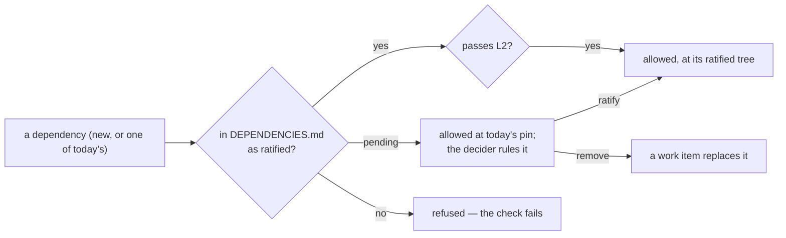

# SR-LAW-11 — L11 — no dependencies, unless the decider ratifies each one by name

## §1 — For humans

**The law (L11).**

> **codelaw has no dependencies.** No third-party code — no Rust crate, Python package, npm package, grammar, CI action or copied-in source — is used in any scope (runtime, build, dev, test, CI) **unless the decider has ratified it by name** in [`DEPENDENCIES.md`](../DEPENDENCIES.md). A ratified dependency still passes [L2](0004_LAW-2-foss-dependencies.md) (free, open source, permissive).

**Ruled by Arpit, 2026-10-26:** *"Create a law, no dependencies. For Rust, for Python, for JavaScript, TypeScript, JSON, CSS, YAML, TOML, HTML, nothing. No dependencies. Create a law. And then tell me what all dependencies do we have. We will ratify them one by one."*

**Why it exists.** Every dependency is code codelaw ships but did not write: an upgrade it must test, an API that can break, a licence to keep, a supply-chain risk. Default-deny makes each one a decision instead of a habit.



<details>
<summary><b>ASCII twin</b></summary>

```text
   dependency --> ratified in DEPENDENCIES.md? --yes--> passes L2? --yes--> allowed
                         | pending --> allowed at today's pin until ruled --> ratify / remove (work item)
                         | no -------> refused
```

</details>

---

## §2 — For agents

### Context

On 2026-10-26 codelaw had 47 direct Rust crates (376 in `Cargo.lock` with their own dependencies), one runtime npm package and three dev ones in the VS Code extension, a Python build backend, and ten CI actions. None had been chosen by the decider one by one. **Ruled 2026-10-26 (W-66):** 29 units ratified; `strsim`, `anyhow`, `postcard` to be replaced (W-67).

### Decision

1. **Default deny.** No third-party dependency in any ecosystem or scope without a `ratified` row in `DEPENDENCIES.md`. **Copying third-party source into the repo (vendoring, a fork, a pasted file) is a dependency** and needs a row like any other.
2. **Not dependencies:** the language toolchains and their standard libraries (Rust `rustc`/`cargo`/`std`, CPython and its standard library, Node.js and npm), `git`, the operating system, and codelaw's own crates and packages.
3. **One list:** `DEPENDENCIES.md` at the repo root — one row per ratification unit (a family of crates published together counts as one unit), with its ecosystem, scope, what it does, its pinned version, its transitive count, and its status: `pending`, `ratified YYYY-MM-DD` with the decider's words, or `remove`.
4. **Ratifying a unit accepts its transitive tree as pinned at that moment.** An upgrade that adds a new transitive package, or a new major version, needs the unit ratified again.
5. **Today's dependencies are `pending`:** they stay at their current pin until the decider rules each one. A `pending` unit may not be upgraded to a version that adds transitive packages. `remove` opens a work item that replaces it with codelaw's own code; the row goes when the code no longer uses it.
6. **What ships to users already holds:** the npm and PyPI `codelaw` packages have zero runtime dependencies ([SR-PACKAGES](0107_packages.md)); this law keeps it so.
7. **Checked mechanically** (built by W-65): CI compares every manifest and lockfile — `Cargo.toml`/`Cargo.lock`, `packaging/**/package.json` and `package-lock.json`, `pyproject.toml` build requirements, `.github/workflows/*.yml` `uses:` — with `DEPENDENCIES.md`, and fails on any unit not listed, or on a transitive tree that grew past what was ratified.

### Consequences

- Every new crate, action or package is a question for the decider before it lands.
- A `remove` ruling on a large unit (a formatter, a parser) is a large work item; L7 still requires a formatter for every L3 language, so the replacement must exist before the dependency goes.
- L2 stays: it answers *which* licences are acceptable; L11 answers *whether* to depend at all.

### Alternatives considered

- **Zero dependencies at once** — not ruled: the decider asked to ratify one by one, and L7 forbids dropping a formatter before its replacement exists.
- **Ratifying only direct dependencies, ignoring the tree** — rejected by decision 4: a crate's own dependencies are code codelaw ships too.

### Reference (required)

- [`DEPENDENCIES.md`](../DEPENDENCIES.md) — the list (decision 3).
- [SR-LAW-2](0004_LAW-2-foss-dependencies.md) — the licence test a ratified dependency still passes.

### Veto condition

**Reopen this decision if:** a dependency is in use with no row in `DEPENDENCIES.md`.

**How to check it:** W-65's check in CI; until it lands, the inventory in `DEPENDENCIES.md` §How it was taken, re-run by hand.

---

## References

**Records** — [SR-LAWS](0001_LAWS.md) · [SR-LAW-2](0004_LAW-2-foss-dependencies.md) · [SR-LAW-7](0009_LAW-7-linter-and-formatter.md) · [SR-PACKAGES](0107_packages.md)
