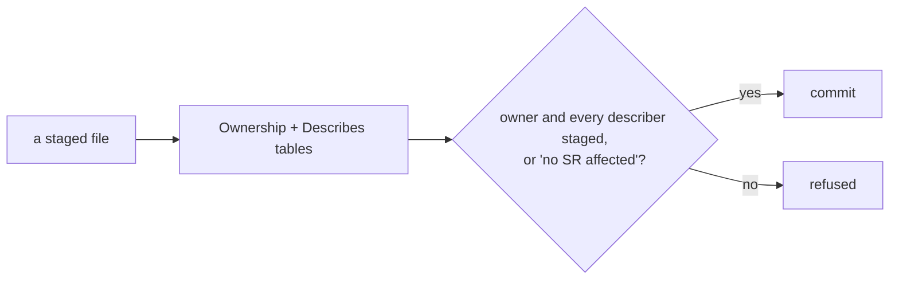

# SR-WORK-OWNERSHIP — owns, describes, and the commit guard

## §1 — For humans

**Every component has exactly one owning record**, declared in the register's
Ownership table; any number of other records may *describe* it, each with a
reason.

**The commit guard holds them to it.** `scripts/sr-guard.sh`, installed as the
`commit-msg` hook, refuses a commit that changes an owned or described
component without staging its owner and every describer — unless the message
carries `no SR affected` on its own line, a claim under the author's name.

**The guard proves a record was touched, never that it is coherent.**



<details>
<summary><b>ASCII twin</b> — the same diagram, for terminals and diffs</summary>

```text
   a staged file --> Ownership + Describes tables
                           |
         owner and every describer staged, or "no SR affected"?
                 yes --> commit          no --> refused
```

</details>

---

## §2 — For agents

### Context

Law zero says a behaviour change lands with its record. Without a mechanical
check that slips on the first busy day.

### Decision — the ownership discipline (normative)

1. Two relations: `owns` (exactly one record per component) and `describes`
   (any number). `describes` never substitutes for `owns`.
2. Both are declared in the register, in two marked tables.
3. **The guard demands the owner and every describer** be staged in the same
   commit as a change to the component — or the commit message carries
   `no SR affected` on its own line.
4. A `describes` row states **why**, in its note cell.
5. Most specific wins, for `owns` only.
6. `scripts/sr-guard.sh` runs as a **`commit-msg`** hook — never `pre-commit`,
   because the escape line has to be read from the message, which does not
   exist at `pre-commit` time. Install once:
   `ln -sf ../../scripts/sr-guard.sh .git/hooks/commit-msg`.
7. `--no-verify` leaves no trace locally, so **CI replays the guard over every
   commit since `records/RULE-SINCE`** (`.github/workflows/ci.yml`, job `lint`),
   each judged against the register as it stood in that commit
   (`SR_GUARD_COMMIT=<sha> scripts/sr-guard.sh`).
8. The guard proves a record was **touched**, never that it is coherent.

### Consequences

- Decisions 3 and 6 are enforced by `scripts/sr-guard.sh` once the decider
  installs it; until then nothing runs.
- `owns:` ↔ Ownership-table agreement (decision 2) is unchecked — backlog row
  W-20.
- A `--no-verify` commit fails CI on its first push (decision 7); a merge
  commit is not replayed, since its changes are its parents'.
- Coherence is not checked (decision 8; backlog row B-006).

### Alternatives considered

- A `pre-commit` hook — rejected: the escape line lives in the commit message,
  which does not exist at pre-commit time.
- Ownership decided per change — rejected: two sessions judge differently; a
  table does not.

### Reference (required)

- [`scripts/sr-guard.sh`](../scripts/sr-guard.sh) — decisions 3 and 6.
- [`records/README.md`](README.md) §Ownership and §Describes — the two tables.
- [`records/RULE-SINCE`](RULE-SINCE) — the audit baseline.

### Veto condition

**Reopen this decision if:** a commit after `records/RULE-SINCE` changed an owned component without staging its record and without the escape line.

**How to check it:** `git log --format='%h %s' $(grep -v '^#' records/RULE-SINCE)..HEAD -- scripts .claude/hooks` — inspect each listed commit for its record or `no SR affected`.

---

## References

*Every source this record cites, gathered in one place. An archived document is never listed here.*

**Records** — [SR-LAW-0](0002_LAW-0-authority.md) · [SR-WORK-GOVERNANCE](0059_WORK-governance.md)

**Code**

- [`scripts/sr-guard.sh`](../scripts/sr-guard.sh)

**Project docs**

- [`records/README.md`](README.md) · [`records/RULE-SINCE`](RULE-SINCE)
