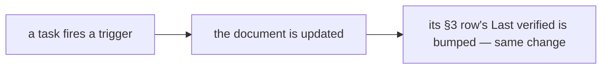

# SR-WORK-REGISTRY — the doc registry

## §1 — For humans

**Every maintained document has a row in §3 below**: what fires an update to
it, and when it was last verified. A task that fires a trigger updates the
document and bumps its row in the same change.

**The registry holds live documents only.** An archived document loses its row,
and a row older than about thirty days is a prompt to review, not a failure.



<details>
<summary><b>ASCII twin</b> — the same diagram, for terminals and diffs</summary>

```text
   a task fires a trigger --> the document is updated --> its §3 row's Last verified bumped (same change)
```

</details>

---

## §2 — For agents

### Context

Documents rot silently. A trigger column turns *remember to update the docs*
into a scan anyone can do at task end.

### Decision — the registry discipline (normative)

1. The registry is §3 of this record — a table, no other file.
2. Every maintained document has an **update trigger** and a **last verified**
   date; a task that fires a trigger updates the document *and* bumps its row
   in the same change.
3. A row is `| Document | Update trigger | Last verified | Notes |`.
4. Live documents only; an archived document loses its row in the same change.
5. No row points into `archive/`. 6. Every row's target exists. 7. One row
   per document. 8. A new maintained document gets its row in the same change.
9. A row older than about thirty days is a review prompt, not a failure.
10. At task end, scan the trigger column.

### Consequences

- Decisions 5–8 are checked in CI (job `lint`) by
  `scripts/check-work-system.py`. Decision 8 reads "maintained" as: every
  Markdown file at the repo root, at the top of `docs/` and of `work/`, each
  `work/*/README.md`, and `records/README.md` and `records/TEMPLATE.md`; a
  record, an item file and an archived file are not rows.
- Every other decision is judgment; decision 10's scan is the session's.

### Alternatives considered

- A separate registry file — rejected: decision 1 keeps the table inside this
  record, so the rules and the table move together.

### Reference (required)

- §3 below — the table itself.
- [SR-WORK-DOCS](0055_WORK-docs.md) decision 10 — step 5 is the bump.

### Veto condition

**Reopen this decision if:** a registry row names a document that does not exist.

**How to check it:** `python3 scripts/check-work-system.py | grep registry:` must print nothing.

---

## §3 — The registry

| Document | Update trigger | Last verified | Notes |
|---|---|---|---|
| `CLAUDE.md` | any rule or pointer changes | 2026-10-27 | 2026-10-26 — the L3 and L6 lines: SCSS as a CSS dialect, sixteen packs, fourteen on npm and ten on PyPI (W-62, the decider's ruling); named in the session output as SR-WORK-DOCS decision 7a requires · 2026-10-26 (W-63) — the L6 line and the `packs/` line: seventeen packs, fifteen on npm · 2026-10-27 (W-103) — the L6 line and the `packs/` line: eighteen packs, sixteen on npm and eleven on PyPI (the decider's ruling, SR-SPELL); named in the session output and the worklog |
| `AGENTS.md` | the Fux setup or how agents search the index changes | 2026-10-27 | 2026-10-27 — committed with the Fux setup (W-75) |
| `work/README.md` | a file is added to or removed from `work/` | 2026-10-18 | 2026-10-18 — created at setup |
| `work/OPEN-WORK.md` | the same change as the work it tracks | 2026-10-29 | 2026-10-25 — W-47, W-52, W-53 closed; W-44, W-45, W-50 to the inbox; W-54–W-57 unblocked · 2026-10-27 — W-103 filed (the spell pack) · 2026-10-27 (W-104) — re-balled to the decider; the L11 inbox row · 2026-10-28 — the docket's rulings written back: six inbox rows ruled, W-93/W-99/W-100/W-102/W-104 🟢; W-108–W-112 filed · 2026-10-29 — reconciled: W-111 merged into W-114, W-115 filed, W-95 current · 2026-10-29 — the docket: six inbox rows ruled; W-116–W-118 filed |
| `work/BACKLOG.md` | a record names something nobody is doing | 2026-10-29 | 2026-10-25 — B-050 (`migrate`), B-051 (`requirements*.txt`), B-052 (the deps agent hint) · 2026-10-27 — B-054 (`cspell.json` migration), B-055 (non-English word lists) · 2026-10-29 — B-062 (the shared benchmark with the spell pack) |
| `work/open/README.md` | the item-file contract changes | 2026-10-18 | 2026-10-18 — created at setup |
| `work/INTERVIEW.md` | direction, a decision or the live state changes — during the session | 2026-10-29 | 2026-10-25 — §1: the six parallel builds · 2026-10-27 — §1: the spell pack ruled and filed (W-103) · 2026-10-27 (W-104) — §1: the type-aware records landed · 2026-10-28 — §1, §2: the docket's rulings · 2026-10-29 — §2: the reconcile · 2026-10-29 — §2: the docket |
| `work/IMPLEMENTATION.md` | something lands | 2026-10-29 | 2026-10-25 — W-44, W-45, W-47, W-50, W-52, W-53 merged · 2026-10-27 — W-104's records · 2026-10-29 — W-111 merged |
| `work/WORKLOG.md` | every session, before it ends — chat-only ones too | 2026-10-29 | 2026-10-25 — six items built in parallel and merged · 2026-10-27 — the CSpell research and the spell-pack rulings · 2026-10-27 — W-104 · 2026-10-28 — the docket write-back · 2026-10-29 — the reconcile · 2026-10-29 — the docket |
| `work/NOW.md` | kept by hooks: a row per live session; empty when nothing runs | 2026-10-28 | 2026-10-24 — after W-31: unpublish `@codelaw/rules-python`, push, 0.2.0 · 2026-10-28 — the Cowork docket row |
| `work/LESSONS.md` | a failure teaches something durable | 2026-10-24 | 2026-10-24 — the cfg-split lesson and the two-sessions-one-checkout lesson |
| `work/MACHINE.md` | a surface breaks in a way the code did not cause | 2026-10-20 | 2026-10-20 — Windows runner cp1252; the cloud session's blocked Actions logs |
| `work/compare/README.md` | a fork opens, closes, or its trigger fires | 2026-10-27 | 2026-10-18 — created at setup · 2026-10-27 — the `spell-checking` fork, decided |
| `work/proposals/README.md` | an idea is filed, graduates, or is rejected | 2026-10-18 | 2026-10-18 — created at setup |
| `docs/GLOSSARY.md` | a term is coined or redefined | 2026-10-27 | 2026-10-26 — first-party pack: sixteen packs; SCSS and `scss` pack terms (W-62) · 2026-10-26 (W-63) — CSS Modules and css-modules pack terms · 2026-10-27 — spell pack, known-typo list (W-103) · 2026-10-27 (W-104) — type question, type helper |
| `docs/rules/` | a rule file, a `.cases.md`, a preset, the pack table or the config schema changes — regenerated by `python3 scripts/rule-docs.py --write`, held by `--check` in CI | 2026-10-27 | 2026-10-27 — created: 651 rule pages, the engine page and the index, generated from the tree · 2026-10-27 (W-98) — `llms-full.txt` and `rules.json` beside them · 2026-10-27 (W-103) — `docs/rules/spell/`, the spell pack's first rule |
| `llms.txt` | as `docs/rules/` — generated with it by `python3 scripts/rule-docs.py --write`, held by `--check` in CI | 2026-10-27 | 2026-10-27 — created: the llmstxt.org index of the docs and the seventeen packs (W-98) · 2026-10-27 (W-103) — the `spell` pack |
| `docs/DESIGN.md` | the design changes — after the owning record | 2026-10-27 | 2026-10-26 — the L6 and SR-RULE-PACKS rows: sixteen packs (W-62) · 2026-10-26 (W-63) — seventeen packs · 2026-10-27 (W-104) — §3.6 and the risks row: TypeScript's type-aware checks through SR-TYPES · 2026-10-27 (W-103) — the L6 and SR-RULE-PACKS rows: eighteen packs |
| `records/README.md` | a record's state, ownership or number changes | 2026-10-27 | 2026-10-26 — the L3 and L6 rows, SR-RULE-PACKS and SR-PACKAGES: sixteen packs (W-62) · 2026-10-26 (W-63) — seventeen packs; ownership rows for `fixtures/css-modules` and `tests/css_modules.rs` · 2026-10-27 — ownership row for `scripts/rule-docs.py` · 2026-10-27 — SR-SPELL (0116), built: no · 2026-10-27 (W-104) — SR-TYPES (0117) · 2026-10-27 (W-103) — the L6 and SR-RULE-PACKS rows: eighteen packs; SR-SPELL built: partly; ownership rows for `packs/spell`, `spell.rs`, `scripts/spell-data.py` and `scripts/spell-typos.txt` |
| `RELEASING.md` | the release process, the one-time setup or a workflow's name changes | 2026-10-27 | 2026-10-26 — the fourteen npm and ten PyPI pack names, `scss` added (W-62) · 2026-10-26 (W-63) — the fifteen npm pack names, `css-modules` added · 2026-10-27 (W-103) — sixteen npm and eleven PyPI packs; `@codelaw/rules-spell` and `codelaw-rules-spell` among the first-publish names |
| `records/TEMPLATE.md` | the convention changes | 2026-10-18 | 2026-10-18 — created at setup |
| `README.md` | a command, flag, preset or pack's rule count changes; something on the roadmap lands; the licence is ruled | 2026-10-27 | 2026-10-26 — the `scss` pack row, sixteen packs, SCSS in the language lines (W-62) · 2026-10-26 (W-63) — the `css-modules` pack row, seventeen packs · 2026-10-27 (W-98) — *Rule packs* links `llms.txt`, `llms-full.txt` and `rules.json` · 2026-10-27 (W-103) — the `spell` pack row, eighteen packs |
| `USAGE.md` | a command, flag, install step, config key or agent wiring changes | 2026-10-27 | 2026-10-26 — the from-source link loop names `scss` (W-62; generated by docs-sync) · 2026-10-27 — *Configure* points to the per-rule pages in `docs/rules/` · 2026-10-27 (W-98) — and to `llms.txt`, `llms-full.txt` and `rules.json` · 2026-10-27 (W-103) — the `spell` pack in the link-from-the-clone loop |
| `CHANGELOG.md` | a user-visible change lands; a release is cut | 2026-10-25 | 2026-10-25 — Unreleased: the security packs' groundwork (W-53) |
| `CONTRIBUTING.md` | the build, test or contribution steps change | 2026-10-20 | 2026-10-20 — contributions are MIT |
| `SECURITY.md` | the reporting channel or the supported versions change | 2026-10-20 | 2026-10-20 — created (W-06, filed as W-04) |
| `CODE_OF_CONDUCT.md` | the code or its contact changes | 2026-10-20 | 2026-10-20 — created (W-06, filed as W-04) |
| `LICENSE` | the licence or the copyright holder changes (SR-PACKAGES decision 10); every `packs/*/LICENSE` copy changes with it | 2026-10-20 | 2026-10-20 — created: MIT |

---

## References

*Every source this record cites, gathered in one place. An archived document is never listed here.*

**Records** — [SR-WORK-DOCS](0055_WORK-docs.md) · [SR-WORK-GOVERNANCE](0059_WORK-governance.md)

**Project docs** — every document §3 lists.
