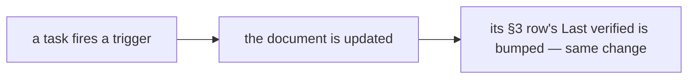

# SR-WORK-REGISTRY — the doc registry

## §1 — For humans

**Every maintained document has a row in §3 below**: what fires an update to
it, and when it was last verified. A task that fires a trigger updates the
document and bumps its row in the same change.

**The registry holds live documents only.** An archived document loses its row,
and a row older than about thirty days is a prompt to review, not a failure.



<details>
<summary><b>ASCII twin</b> — the same diagram, for terminals and diffs</summary>

```text
   a task fires a trigger --> the document is updated --> its §3 row's Last verified bumped (same change)
```

</details>

---

## §2 — For agents

### Context

Documents rot silently. A trigger column turns *remember to update the docs*
into a scan anyone can do at task end.

### Decision — the registry discipline (normative)

1. The registry is §3 of this record — a table, no other file.
2. Every maintained document has an **update trigger** and a **last verified**
   date; a task that fires a trigger updates the document *and* bumps its row
   in the same change.
3. A row is `| Document | Update trigger | Last verified | Notes |`.
4. Live documents only; an archived document loses its row in the same change.
5. No row points into `archive/`. 6. Every row's target exists. 7. One row
   per document. 8. A new maintained document gets its row in the same change.
9. A row older than about thirty days is a review prompt, not a failure.
10. At task end, scan the trigger column.

### Consequences

- Decisions 5–8 are enforced by nothing — backlog row B-003.
- Every other decision is judgment; decision 10's scan is the session's.

### Alternatives considered

- A separate registry file — rejected: decision 1 keeps the table inside this
  record, so the rules and the table move together.

### Reference (required)

- §3 below — the table itself.
- [SR-WORK-DOCS](0055_WORK-docs.md) decision 10 — step 5 is the bump.

### Veto condition

**Reopen this decision if:** a registry row names a document that does not exist.

**How to check it:** `sed -n '/^## §3/,/^## References/p' records/0060_WORK-registry.md | grep -oE '^\| `[^`]+`' | tr -d '|` ' | while read p; do [ -e "$p" ] || echo "missing: $p"; done` must print nothing.

---

## §3 — The registry

| Document | Update trigger | Last verified | Notes |
|---|---|---|---|
| `CLAUDE.md` | any rule or pointer changes | 2026-10-20 | 2026-10-20 — layout names `packs/`, `packaging/`, `.github/` |
| `work/README.md` | a file is added to or removed from `work/` | 2026-10-18 | 2026-10-18 — created at setup |
| `work/OPEN-WORK.md` | the same change as the work it tracks | 2026-10-20 | 2026-10-20 — W-04 🔴; inbox: the registry setup and the ruling to publish |
| `work/BACKLOG.md` | a record names something nobody is doing | 2026-10-20 | 2026-10-20 — B-038 promoted to W-04; B-020 closed; B-008, B-009, B-012 narrowed; B-042 unbuilt |
| `work/open/README.md` | the item-file contract changes | 2026-10-18 | 2026-10-18 — created at setup |
| `work/INTERVIEW.md` | direction, a decision or the live state changes — during the session | 2026-10-20 | 2026-10-20 — W-04 built; the licence |
| `work/IMPLEMENTATION.md` | something lands | 2026-10-20 | 2026-10-20 — W-04: the release pipeline |
| `work/LESSONS.md` | a failure teaches something durable | 2026-10-20 | 2026-10-20 — skip the compile, not the checks |
| `work/MACHINE.md` | a surface breaks in a way the code did not cause | 2026-10-20 | 2026-10-20 — Windows runner cp1252; the cloud session's blocked Actions logs |
| `work/compare/README.md` | a fork opens, closes, or its trigger fires | 2026-10-18 | 2026-10-18 — created at setup |
| `work/proposals/README.md` | an idea is filed, graduates, or is rejected | 2026-10-18 | 2026-10-18 — created at setup |
| `docs/GLOSSARY.md` | a term is coined or redefined | 2026-10-20 | 2026-10-20 — trusted publishing, `dist`, half-published |
| `docs/DESIGN.md` | the design changes — after the owning record | 2026-10-19 | 2026-10-19 — L6 and SR-RULE-PACKS rows; rule packs in the distribution sketch and the config example |
| `records/README.md` | a record's state, ownership or number changes | 2026-10-20 | 2026-10-20 — SR-PACKAGES owns the licence, `packaging/`, the release scripts and `.github/workflows` |
| `RELEASING.md` | the release process, the one-time setup or a workflow's name changes | 2026-10-20 | 2026-10-20 — created (W-04) |
| `records/TEMPLATE.md` | the convention changes | 2026-10-18 | 2026-10-18 — created at setup |

---

## References

*Every source this record cites, gathered in one place. An archived document is never listed here.*

**Records** — [SR-WORK-DOCS](0055_WORK-docs.md) · [SR-WORK-GOVERNANCE](0059_WORK-governance.md)

**Project docs** — every document §3 lists.
