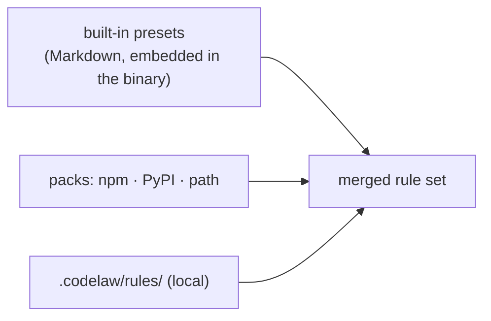

# SR-RULE-PACKS — presets, packs and local rules: built-in presets ship inside the binary, team rules as packs, project rules in .codelaw/rules

## §1 — For humans

**The decision in one line.** codelaw's own predefined rules are **Markdown rule files embedded in the binary at build time**, grouped into presets you switch on with `extends`. Everyone else's rules (your team's, a community's) ship as **separate packs**: plain folders of rule files, published to npm, PyPI or kept at a path.

**Three options were on the table. This takes the best of two:**

| Option | Verdict |
|---|---|
| Rules written as Rust code inside the engine | ❌ People and agents can't read them; you can't copy and edit one; breaks "a rule is one Markdown file" |
| One separate `codelaw-rules` package | ❌ Published twice ([L6](0008_LAW-6-python-and-node-packages.md): npm and PyPI); the rules and engine versions can drift apart; an extra install for everyone |
| **Rules as Markdown, embedded in the binary** | ✅ Readable, ejectable, versioned with the engine, nothing extra to install, works offline ([L5](0007_LAW-5-no-model-in-the-engine.md)) |
| A separate package per language | ❌ Nine packages × two registries, for no benefit |

**Why embedding beats a separate package.** A rule depends on the engine's matcher and fix primitives. Shipped together, a rule can never ask for a primitive the installed engine doesn't have. And Python-only and Node-only users get the identical rule set, which [L3](0005_LAW-3-languages.md) and [L6](0008_LAW-6-python-and-node-packages.md) require.



<details>
<summary><b>ASCII twin</b></summary>

```text
   built-in presets --+
   packs (npm/PyPI)  --+--> merged rule set   (local wins, then packs, then presets)
   local rules       --+
```

</details>

---

## §2 — For agents

### Context

codelaw needs predefined rules. The decider asked whether they ship as a dependency, as a separate package, or inside the code, and left the choice to this session.

### Decision


1. **Built-in rules live in the source tree** as `rules/<preset>/<id>.md`, in the same format as consumer rules. They are compiled into the binary, and both packages carry the same set ([L6](0008_LAW-6-python-and-node-packages.md)).
2. **Presets.** `codelaw init` writes `extends = ["codelaw:recommended"]` plus the presets for the languages it detects. Nothing is active unless a preset or a local rule enables it.

   | Preset | Covers |
   |---|---|
   | `codelaw:recommended` | High-signal, low-noise rules across all languages |
   | `codelaw:javascript` · `codelaw:typescript` | JS / TS conventions (shared rules declare both) |
   | `codelaw:react` · `codelaw:stencil` | Framework conventions; `stencil` also turns off rules Stencil's compiler conflicts with |
   | `codelaw:python` | Python conventions |
   | `codelaw:json` · `codelaw:yaml` · `codelaw:toml` | Flat-file shape and hygiene (`package.json`, `tsconfig`, CI YAML, `pyproject.toml`) |
   | `codelaw:markdown` | Docs structure and links |
   | `codelaw:css` · `codelaw:html` | Stylesheet hygiene; markup correctness and accessibility basics |

3. **No duplication with adapters.** If oxlint, Ruff or markdownlint already does a check well, the presets don't repeat it. The built-ins cover conventions those tools can't express, especially structural ones with fixes.
4. **Stability.** Each rule is `stable` or `preview`. Preview rules run only with `preview = true`. A stable rule that starts finding new violations, or changes its fix, is a minor release and is listed in the changelog.
5. **Eject to customise.** `codelaw rules eject <id>` copies a built-in rule into `.codelaw/rules/`. A local rule with the same id shadows the built-in one. `codelaw rules --why <id>` shows which copy is active.
6. **Packs (team and third-party rules).** A pack is a folder containing:
   - a `codelaw-pack.toml` manifest (`name`, `version`, `min_codelaw`, `languages`);
   - `rules/**/*.md`.

   Packs are resolved through `extends`:
   ```toml
   extends = [
     "codelaw:recommended",
     "npm:@acme/codelaw-rules",     # from node_modules
     "pypi:acme-codelaw-rules",     # from the active Python environment
     "path:../shared/codelaw-rules" # monorepo or vendored
   ]
   ```
   A pack may publish to npm, PyPI or both. codelaw reads only its Markdown, so one folder layout works for both.
7. **Packs contain no code by default.** A pack's external fixers (any `fix: { external: … }`) are disabled unless the consumer sets `allow_pack_fixers = ["@acme/codelaw-rules"]`. Installing a rule pack must never mean running someone else's code by surprise.
8. **Every rule, built-in or pack, obeys [L4](0006_LAW-4-every-rule-has-a-fix.md).** Every pack and built-in rule goes through the same load-time checks and `codelaw test`. A pack whose rules fail to load is refused as a whole, with the failing rule named.
9. **Precedence, highest first:**
   1. local `.codelaw/rules/`;
   2. packs, in `extends` order (later wins);
   3. built-in presets.

   A preset or pack can't loosen a rule the consumer set locally.

### Starter catalogue (built-in, v0)

The fix class follows [L4](0006_LAW-4-every-rule-has-a-fix.md). The aim is `auto` wherever an edit can't change behaviour.

| Id | Languages | Checks | Fix |
|---|---|---|---|
| `js/exports-at-end` | js jsx ts tsx | Exports declared inline instead of in one block at the end | **auto** |
| `js/import-groups` | js jsx ts tsx | Imports in builtin → external → internal → relative order, one blank line between groups | **auto** |
| `js/no-default-export` | js jsx ts tsx | `export default` | manual (importers in other files must change) |
| `ts/type-only-imports` | ts tsx | `import { T }` used only as a type (syntactic check within the file) | suggest |
| `react/hook-prefix` | jsx tsx | Custom hook not named `use*` | manual (callers rename) |
| `react/props-type-name` | tsx | Component props type not named `<Component>Props` | suggest (local rename) |
| `stencil/tag-prefix` | tsx | `@Component({ tag })` without the configured prefix | manual (HTML usages change) |
| `stencil/prop-readonly` | tsx | `@Prop()` not `readonly` and not `mutable: true` | **auto** |
| `py/all-sorted` | python | `__all__` not sorted | **auto** |
| `py/no-mutable-default` | python | `def f(x=[])` / `{}` / `set()` | suggest (`None` + initialise in body) |
| `py/no-bare-except` | python | `except:` | suggest (`except Exception:`) |
| `py/no-print` | python | `print()` under `src/` | suggest (`logging`) |
| `py/no-tunable-literals` | python | A threshold, timeout or limit hard-coded in code instead of config | manual (pick the config key) |
| `json/package-scripts-sorted` | json | `package.json` `scripts` not sorted | **auto** |
| `json/package-engines` | json | `package.json` missing `engines.node` | suggest (value from config) |
| `json/tsconfig-strict` | json | `tsconfig.json` without `"strict": true` | suggest (may surface type errors) |
| `json/no-duplicate-keys` | json | Same key twice in one object | manual (which value wins?) |
| `yaml/no-duplicate-keys` | yaml | Same key twice in one mapping | manual |
| `yaml/gha-pin-sha` | yaml | GitHub Action pinned to a tag, not a commit SHA | manual (needs the network, so [L5](0007_LAW-5-no-model-in-the-engine.md) forbids auto) |
| `yaml/document-start` | yaml | Missing or inconsistent `---` | **auto** |
| `toml/pyproject-requires-python` | toml | `pyproject.toml` missing `requires-python` | suggest (value from config) |
| `toml/deps-sorted` | toml | `[project].dependencies` not sorted | **auto** |
| `md/single-h1` | markdown | More than one `#` heading | manual |
| `md/heading-increment` | markdown | Heading level jumps (`#` → `###`) | suggest |
| `md/fence-language` | markdown | Fenced code block without a language | manual (which language?) |
| `md/relative-links` | markdown | Relative link to a file that doesn't exist | manual |
| `css/no-empty-block` | css | Empty rule block `a {}` | **auto** (remove it) |
| `css/no-duplicate-selector` | css | The same selector declared twice in one file | manual (merging depends on cascade order) |
| `css/no-important` | css | `!important` | manual |
| `css/no-unknown-property` | css | A property not in the CSS spec table shipped with codelaw | suggest (closest known name) |
| `html/img-alt` | html | `` without `alt` | manual (the text needs a human) |
| `html/target-blank-rel` | html | `target="_blank"` without `rel="noopener"` | **auto** |
| `html/no-duplicate-id` | html | The same `id` twice in one document | manual |
| `html/button-type` | html | `<button>` without `type` | suggest (`type="button"`; changes form behaviour) |

That's 34 rules: 9 auto, 11 suggest and 14 manual. Every `manual` rule carries `fix_reason:` and `## How to fix` ([L4](0006_LAW-4-every-rule-has-a-fix.md) decisions 2–3).

### Consequences

- **Built-in rule changes ship only with engine releases.** A team that wants faster rule updates uses a pack.
- **Packs are read as Markdown only**, so one folder layout serves npm and PyPI.
- **The starter catalogue is unbuilt** until the engine exists.

### Alternatives considered

- The four options and why each lost are in the §1 table.

### Reference (required)

- [`docs/DESIGN.md`](../docs/DESIGN.md) §3.2: the rule-file format the built-ins use.
- [SR-LAW-6](0008_LAW-6-python-and-node-packages.md): both packages carry the same rules.

### Veto condition

**Reopen this decision if:** a built-in rule needs an engine feature released separately from the binary, or a team needs rule updates faster than engine releases.

**How to check it:** `nothing is built yet; once it is, `codelaw rules --list --source builtin` must match `rules/` in the source tree`

---

## References

*Every source this record cites, gathered in one place. An archived document is never listed here.*

**Records** — [SR-LAW-6](0008_LAW-6-python-and-node-packages.md)

**Project docs** — [`docs/DESIGN.md`](../docs/DESIGN.md)
