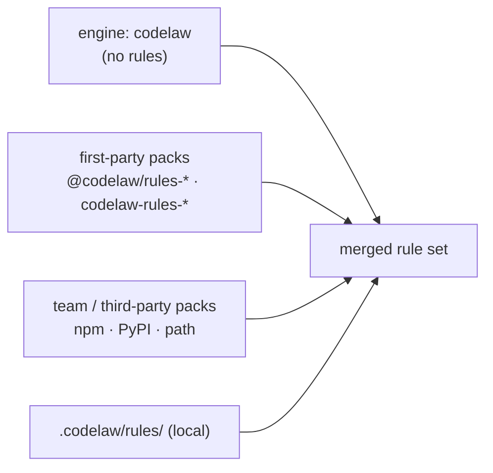

# SR-RULE-PACKS — fifteen first-party rule packs published apart from the engine, thirteen on npm and nine on PyPI; team packs and local rules on the same footing

## §1 — For humans

**The decision in one line.** The engine package, `codelaw`, carries **no rules**. codelaw's own rules ship as **fifteen rule packs**. A pack is published on **npm as `@codelaw/rules-<name>`**, on **PyPI as `codelaw-rules-<name>`**, or on both, as §1's table says, in the same release and at the same version as the engine. `codelaw init` installs the packs for the languages it finds. Teams publish their own packs the same way, and project rules stay in `.codelaw/rules/`.

**Ruled by Arpit, 2026-10-19:**
- the packs are separately published, not just separate in the source tree;
- every pack is mirrored on both registries;
- a fifth pack, `rules-data`, covers JSON, YAML, TOML and Markdown;
- `init` installs the packs it detects a need for.

This record was rewritten to that ruling and then accepted ("go with the recommendations").

**Ruled by Arpit, 2026-10-24** (W-31), superseding "every pack is mirrored on both registries": *"The ones that are going to be used in npm and the ones that are going to be used in PyPI should only be published."*
- `rules-js` splits into `js`, `ts`, `react`, `node` and `stencil`;
- **npm** carries `js`, `ts`, `react`, `node`, `stencil`, `html`, `css` and `data` (eight);
- **PyPI** carries `js`, `react`, `html`, `css`, `python` and `data` (six);
- `rules-python` leaves npm, and `ts`, `node` and `stencil` are not on PyPI.

**Ruled by Arpit, 2026-10-24** (W-32): *"i want a redux tool kit and react query pack as well in npm"*; names and source ruled the same day at the docket, the query pack renamed `tanstack-query` on 2026-10-25.
- two npm-only library packs: `tanstack-query` (@tanstack/eslint-plugin-query's `recommended`, reimplemented) and `redux-toolkit` (codelaw's own rules, written from the Redux Style Guide's Priority A and B rules: there is no official Redux Toolkit ESLint plugin);
- **npm** carries ten packs; PyPI is unchanged.

**Ruled by Arpit, 2026-10-25** (W-52): *"I want latest versions of any dependencies that are present in Node or Python to be highlighted as well."* On the design, the same day: *"Let's go with it. I like the suggestion."* — a separate, explicit network command writes a committed snapshot, and two `data/*` rules read it offline (decision 15; [L5](0007_LAW-5-no-model-in-the-engine.md) decision 3).

**Ruled by Arpit, 2026-10-25** (W-53): *"I want to create a pack for security issues. Security issues like Veracode, Black Duck, X-Ray, OWASP. … So create … one for JavaScript, one for TypeScript, one for HTML, one for Python."*
- four security packs, `security-js`, `security-ts`, `security-html` and `security-python` (namespaces `sec-js`, `sec-ts`, `sec-html`, `sec-py`), on the existing split: npm carries js, ts and html, PyPI js, html and python;
- every rule in them carries `security:` metadata — CWE, OWASP Top 10:2025 category, severity ([SR-RULE-FORMAT](0112_rule-format.md) decision 2a);
- each has a `recommended` preset (high-confidence rules, `error`) and a `strict` one (adds the heuristic rules, `warn`);
- `security-ts` **extends** `security-js` (the `sec-js` rules already run on TypeScript), and `security-html` turns on the html pack's own security rules through `html/security` instead of copying them (decision 3);
- **npm** carries thirteen packs and **PyPI** nine. `security-js` has its 66 rules since W-54 (2026-10-26, [archived](../archive/open/W-54-security-js-pack.md)): 55 in `sec-js/recommended` at `error`, 11 more in `strict` at `warn`, a `data/sources/` table per request-source family for `from_source:`, counts in `packs/security-js/corpus.toml` from the three pinned repositories. `security-ts` and `security-html` are still scaffolds until [W-55](../work/open/W-55-security-ts-pack.md) and [W-56](../work/open/W-56-security-html-pack.md). `security-python` has its 61 rules since W-57 (2026-10-26, [archived](../archive/open/W-57-security-python-pack.md)): `match:` rules only, from Bandit and Ruff `S`, Django, Flask, FastAPI, ML loaders and LLM sinks, in `packs/security-python/README.md`.

| Pack | npm | PyPI | Languages | Presets |
|---|---|---|---|---|
| engine | `codelaw` | `codelaw` | none: this is the engine. It ships only the `codelaw/*` meta diagnostics, the formatter's `format/unformatted` and `format/failed`, and `graph/no-deprecated-usage` | — |
| `js` | `@codelaw/rules-js` | `codelaw-rules-js` | JS, JSX; its core rules also run on TS and TSX | `js/recommended`, `js/typescript`, `js/conventions`, `js/project`, `js/size` · *later:* `js/strict` |
| `ts` | `@codelaw/rules-ts` | — | TS, TSX | `ts/recommended`, `ts/conventions` |
| `react` | `@codelaw/rules-react` | `codelaw-rules-react` | JSX, TSX, and React in JS and TS | `react/recommended`, `react/conventions` |
| `node` | `@codelaw/rules-node` | — | JS, JSX, TS, TSX run on Node.js | `node/recommended` |
| `stencil` | `@codelaw/rules-stencil` | — | TS, TSX Stencil components | `stencil/recommended`, `stencil/conventions` |
| `html` | `@codelaw/rules-html` | `codelaw-rules-html` | HTML, incl. HTML embedded in Markdown and templates | `html/recommended`, `html/a11y`, `html/document`, `html/conventions`, `html/security`, `html/size` |
| `css` | `@codelaw/rules-css` | `codelaw-rules-css` | CSS | `css/recommended`, `css/standard`, `css/conventions`, `css/project`, `css/size` |
| `python` | — | `codelaw-rules-python` | Python | `py/recommended`, `py/conventions`, `py/project`, `py/size` · *later:* `py/strict` |
| `data` | `@codelaw/rules-data` | `codelaw-rules-data` | JSON, YAML, TOML, Markdown; the dependencies of `package.json` and `pyproject.toml` (decision 15) | `data/recommended`, `md/recommended`, `data/package-json`, `data/tsconfig`, `data/pyproject`, `data/github-actions`, `data/conventions` |
| `tanstack-query` | `@codelaw/rules-tanstack-query` | — | JS, JSX, TS, TSX using TanStack Query | `tanstack-query/recommended` |
| `redux-toolkit` | `@codelaw/rules-redux-toolkit` | — | JS, JSX, TS, TSX using Redux | `redux-toolkit/recommended` |
| `security-js` | `@codelaw/rules-security-js` | `codelaw-rules-security-js` | JS, JSX, and the TS and TSX that run them | `sec-js/recommended`, `sec-js/strict` |
| `security-ts` | `@codelaw/rules-security-ts` | — | TS, TSX (TypeScript-only security rules) | `sec-ts/recommended`, `sec-ts/strict` (extend `sec-js/*`) |
| `security-html` | `@codelaw/rules-security-html` | `codelaw-rules-security-html` | HTML | `sec-html/recommended` (14 rules at `error`), `sec-html/strict` (5 more at `warn`); both extend `html/security`; 19 native rules, each with `security:` (W-56, 2026-10-26) |
| `security-python` | — | `codelaw-rules-security-python` | Python (61 rules, W-57) | `sec-py/recommended`, `sec-py/strict` |

`FIRST_PARTY_PACKS` in `crates/codelaw-rules/src/pack.rs` is this table in code, and `scripts/package.py` reads it, so the engine and the release name the same packs on the same registries.

*Later* marks a preset the ruling names that no pack ships yet: `js/strict` and `py/strict` are planned as B-048 in [`work/BACKLOG.md`](../work/BACKLOG.md) and are not in `packs/` (checked 2026-10-20). Every other preset in the table is in its pack's `codelaw-pack.toml` and `presets/`. Each `<namespace>/project` preset is opt-in and turns on only that pack's `graph/*` rule, the one that reads the whole repository (W-26, 2026-10-24); `init` does not write it.

**What you install depends on your repo.** A Python-only repo installs `codelaw` and `codelaw-rules-python`, plus `codelaw-rules-data` if it wants `pyproject.toml`, YAML and Markdown checked, all from PyPI, and never touches npm. A React and TypeScript repo installs `codelaw`, `@codelaw/rules-js`, `@codelaw/rules-ts`, `@codelaw/rules-react` and, likely, `@codelaw/rules-data` from npm. **What each registry leaves out:** a repo that installs only from npm gets no Python rules (`py/*`, `sec-py/*`), and one that installs only from PyPI gets no `ts/*`, `node/*`, `stencil/*`, `tanstack-query/*`, `redux-toolkit/*` or `sec-ts/*` rules (its TypeScript still gets the `js` rules that declare it, and `js/typescript`).



<details>
<summary><b>ASCII twin</b></summary>

```text
   engine codelaw (no rules) ------------------+
   first-party packs (rules-js, -ts, -react,   |
     -node, -stencil, -html, -css, -python,    |
     -data, -tanstack-query, -redux-toolkit,   |
     -security-js/-ts/-html/-python) ----------+--> merged rule set   (local wins, then packs in extends order)
   team / third-party packs (npm, PyPI, path) -+
   local .codelaw/rules/ ----------------------+
```

</details>

---

## §2 — For agents

### Context

The first version of this record (2026-10-18) embedded codelaw's predefined rules in the binary, because the decider had left the choice open. On 2026-10-19 he asked for the presets of ESLint, typescript-eslint, TSLint, Ruff, Prettier, stylelint and the HTML linters to be researched. He also asked for the rules to ship as separate packages, one per ecosystem, with the engine on its own. He then ruled on the shape (§1).

The research ([W-03](../archive/open/W-03-rule-packs.md)) found that porting the correctness core of those presets yields several hundred rules. Some of those rules need per-ecosystem data tables (CSS properties, HTML elements, JSON Schemas). Embedding all of that in the binary would make every user carry every ecosystem's rules and data.

### Decision

1. **The engine carries no rules except its own:**
   - the `codelaw/*` meta diagnostics, such as `codelaw/not-utf8`, `codelaw/internal-error` and `codelaw/no-rules` ([SR-ARCHITECTURE](0108_architecture.md));
   - `format/unformatted` and `format/failed`, the formatter's findings in `check` ([SR-FORMATTER](0105_formatter.md) decisions 1 and 4);
   - `graph/no-deprecated-usage`, which reads the consumer's deprecations registry and belongs to no language, and runs only when the project declares deprecations; and `codelaw/stale-baseline`, a baseline entry its file has outgrown ([SR-BASELINE](0104_baseline-and-deprecations.md) decisions 2 and 6); and the dated-exception rules `codelaw/expiring-exception`, `codelaw/expired-exception`, `codelaw/exception-without-expiry` and `codelaw/exception-author` (SR-BASELINE decision 9).

   Every other rule codelaw publishes lives in a pack.
2. **The fifteen first-party packs, their registries and their presets** are §1's table. A library pack (`tanstack-query`, `redux-toolkit`) checks one library's API in the JS-family languages; its rules that follow a hook or a constructor check that it is imported from that library, so the same name from elsewhere is left alone.
   - Graph rules live with their language: `graph/no-unused-exports` in `js` and `python`, and `graph/no-unused-css-classes` in `css`. A graph rule two packs ship loads as one rule over both packs' languages with the later pack's body, so **the copies' `codelaw` blocks are identical** (a `codelaw-graph` test holds them so): when the `python` copy listed fewer kinds, a TypeScript repo lost its `interface` and `enum` findings whenever `python` loaded last (W-11 corpus run, 2026-10-22). A pack rule may also be `scope: project` under its own prefix: `node/recommended`'s six import rules (`node/no-{missing,extraneous,unpublished}-{import,require}`) run on the graph's `import:` query ([SR-PROJECT-GRAPH](0103_project-graph.md) decision 6). A file-scope native rule that reads the files around it stays file-scope: `node/hashbang` reads the nearest `package.json`'s `bin`, `md/relative-links` checks each relative link's target, and `html/no-utf8-bom` reads the file's bytes (SR-ARCHITECTURE decision 15b; W-21, 2026-10-22).
   - **A rule's fix class follows what the grammar can verify.** The engine refuses a fix whose output parses worse than its input (SR-ARCHITECTURE decision 5), so a rule whose fix writes syntax the grammar rejects ships `manual`. `css/media-feature-range-notation` is `auto` because codelaw's CSS grammar fork parses the range syntax it writes (SR-ARCHITECTURE decision 3; W-21, 2026-10-22).
   - There's **no umbrella preset that spans packs**, because it would require packs the repo hasn't installed.
3. **Pack layout.** A pack is the same folder in the source tree (`packs/<name>/` in the codelaw repo) and in each published form it has:

   ```text
   packs/js/
   ├─ codelaw-pack.toml               name, version, min_codelaw, languages, presets
   ├─ presets/<preset>.toml           the rules a preset turns on, with severity and options
   ├─ rules/<namespace>/<name>.md     rule files (SR-RULE-FORMAT), + <name>.cases.md
   ├─ data/                           tables rules read: CSS properties, HTML elements, JSON Schemas
   ├─ README.md                       rule count per preset; ported / not-ported table; upstream versions
   └─ LICENSE · NOTICE
   ```

   - **On npm,** the package *is* this folder.
   - **On PyPI,** it is one pure `py3-none-any` wheel whose `codelaw_rules_<name>` package holds this folder as package data.
   - **Every published form holds the folder's files, byte for byte**, so a pack on both registries is the same on both. A pack has no code to execute and no dependencies.
   - **A preset** is `presets/<namespace>/<name>.toml`: an optional `description`, an optional `extends`, and a `[rules]` table, a severity or `{ severity, options }` per rule. Every rule its `[rules]` names is in the pack: the four core rules typescript-eslint switches on for TypeScript are `js/typescript` in `js`, not part of `ts/recommended` (2026-10-24), and each pack's starter conventions are its own `<namespace>/conventions`.
   - **A preset may ship scopes** (W-59, 2026-10-26): `[scope.<name>]` tables with `files`, `exclude`, `rules` and `remap`, the shapes of [SR-CONFIG](0110_config.md) decision 3a, each naming rules of its own pack and always with `files`. They are laid in front of the project's scopes in `extends` order, and a project scope of the same name extends them. `js/recommended` ships `tests` (`**/*.test.*`, `**/*.spec.*`), `stories` (`**/*.stories.*`) and `config` (`**/*.config.*`); `py/recommended` ships `tests` (`**/tests/**`, `**/test_*.py`, `**/*_test.py`). A scope sets no rule by itself: it is a name for the files, which a project fills in.
   - **A preset may extend first-party presets** (W-53, 2026-10-25): `extends = ["codelaw:<namespace>/<preset>", …]`, only `codelaw:` entries, never itself. They are resolved as `extends` entries are (decision 4) **before** the preset's own `[rules]`, so its settings win, and `rules --why` names the chain (`codelaw:html/security (extended by codelaw:sec-html/recommended)`). A pack it needs that is not installed stops the run with decision 4's error, naming the preset that needed it; presets that extend each other in a cycle are a load error (`crates/codelaw-rules/src/ruleset.rs`).
     - **A first-party preset extends only a pack published on every registry its own pack is** (a test in `pack.rs` holds it), so neither registry's users need the other: `sec-ts/*` (npm) extends `sec-js/*` (npm and PyPI); `sec-html/*` (both) extends `html/security` (both); each `strict` extends its `recommended`.
     - **`html/security`** gathers the html pack's five security rules — `html/require-sri`, `html/target-blank-rel`, `html/no-inline-script`, `html/autocomplete-password`, `html/meta-refresh` — so `sec-html/recommended` turns them on without a copy.
     - **`size` presets** (W-61, 2026-10-26): `html/size` holds `html/max-lines` and `css/size` holds `css/max-lines`, each opt-in and in no `recommended`. Both count lines of a whole file only (`.html`/`.htm`; `.css`, and `.scss` once it is a language) and do nothing on a `<style>` region or a fenced block. Options: `max` (HTML 400, CSS 300), `skip_blank_lines` and `skip_comments` (true), `skip_imports` (CSS, false), `skip_embedded` (HTML, false: lines wholly inside `<script>` and `<style>`). `fix: manual`.
   - **A data table** is `data/**/*.json`, named by its path under `data/` without `.json` (`data/globals/browser.json` is `globals/browser`).
4. **Resolution.** First-party presets are named `codelaw:<namespace>/<preset>` in `extends`, for example `codelaw:js/recommended`.
   - **A pack is first-party** when its manifest `name` is one of §1's: the npm name when the pack is on npm, else its PyPI name (`codelaw-rules-python`).
   - **Namespace to pack** is a fixed map in the engine:
     - `js` → `rules-js`; `ts` → `rules-ts`; `react` → `rules-react`; `node` → `rules-node`; `stencil` → `rules-stencil`;
     - `html` → `rules-html`;
     - `css` → `rules-css`;
     - `py` → `rules-python`;
     - `data`, `md`, `json`, `yaml`, `toml` → `rules-data`;
     - `tanstack-query` → `rules-tanstack-query`; `redux-toolkit` → `rules-redux-toolkit`;
     - `sec-js` → `rules-security-js`; `sec-ts` → `rules-security-ts`; `sec-html` → `rules-security-html`; `sec-py` → `rules-security-python`.
   - **The pack is found in this order,** each place only for a registry the pack is published on:
     1. `node_modules/@codelaw/rules-<name>`, walking up from the config file's directory.
     2. The Python environment: the site-packages paths the Python launcher passes in (`CODELAW_SITE_PACKAGES`); otherwise `$VIRTUAL_ENV`; otherwise `.venv/` at the project root.

     The first one found wins. Both copies of one version are identical (decision 3).
   - **A missing pack stops the run:** exit 2, with an error naming every install command the pack has, for example `npm i -D @codelaw/rules-js` and `pip install codelaw-rules-js`; a pack on one registry is named as that registry's only (`@codelaw/rules-ts, which is published on npm only`).
5. **One version, released together.** The engine and the fifteen packs carry one version and are published by one release job ([L6](0008_LAW-6-python-and-node-packages.md) decision 9).
   - Each pack's manifest declares `min_codelaw`. An engine older than that refuses the pack, with an error naming the upgrade.
   - `codelaw rules --why <id>` and the JSON output name the pack and version each rule came from.
6. **`codelaw init` installs what it detects.**
   - **Languages to packs:** JS/JSX → `js`; TS/TSX → `js` and `ts`; HTML → `html`; CSS → `css`; Python → `python`; JSON/YAML/TOML/Markdown → `data`. With JS or TS, `react` when `package.json` depends on `react`, `stencil` when it depends on `@stencil/core`, `tanstack-query` when it depends on `@tanstack/react-query` or `react-query`, and `redux-toolkit` when it depends on `@reduxjs/toolkit` or `redux`. `node` and the four security packs are never added by `init`: a security pack is chosen, not detected.
   - **How it installs:** it adds those packs as dev dependencies with the package manager the repo already uses: npm, pnpm, yarn or bun for a `package.json` repo; uv, pip or poetry for a `pyproject.toml` repo. A repo with both uses both — `rules-python` from PyPI, the other packs from npm — unless `--registry npm|pypi` picks one.
   - **A pack the chosen registry does not publish** (§1) comes from the other registry when the repo uses that one too, or uses neither; otherwise — and always under `--registry` — it is left out, its presets are not written, and `init` prints a `note:` naming the registry it is on. An npm repo with a few Python files gets no `codelaw:py/recommended` until `codelaw-rules-python` is installed from PyPI.
   - **What it writes** (its text is `templates/init/`, [L10](0012_LAW-10-consumer-templates.md)): `extends` with each installed pack's `recommended` presets, and `js/typescript` when the repo has TypeScript ([SR-CONFIG](0110_config.md) decision 8).
   - **The optional Fux index package is never installed (W-34; [L6](0008_LAW-6-python-and-node-packages.md) decision 12).** Each pack has a companion, `<pack's name>-fux-index` on the pack's registry, holding a Fux index of its rules. `init` installs none, with or without a flag. **When the repo has a `.fux/` folder** it prints, after the install step and under every flag, the install command for the index package of each pack it chose and the `fux setup --index` line that pins it; **with no `.fux/` it prints nothing about Fux.** `init` only prints it, never runs it, and writes nothing about Fux to `codelaw.toml` (`crates/codelaw-cli/tests/fux_index.rs`).
   - **`--no-install`** prints the install commands instead of running them.
   - **`--agents`** writes the agent files after the packs are installed, so the per-language instructions list the packs' rules; under `--no-install` they wait for `codelaw sync-agents` ([SR-AGENT-SURFACES](0102_agent-surfaces.md) decision 7).
   - **`--git-hooks`** installs the git hooks after everything above, and alone in a repo that already has a `codelaw.toml`; it picks and installs no pack ([SR-CLI-MCP](0115_cli-and-mcp.md) decision 11).
   - **With no pack and no local rule,** `codelaw check` reports one `codelaw/no-rules` info diagnostic naming `codelaw init`. The formatter works regardless ([L7](0009_LAW-7-linter-and-formatter.md)).
7. **Ported rules are reimplemented, never vendored.**
   - A rule ported from another linter is written fresh in codelaw's format, and its `ported_from:` names the source rule or rules ([SR-RULE-FORMAT](0112_rule-format.md) decision 2).
   - Only ideas are taken from GPL-licensed tools (Pylint, yamllint), never their text or code ([L2](0004_LAW-2-foss-dependencies.md)). A rule name that describes the same check may coincide with theirs (`yaml/document-start`, yamllint's `document-start`); the pack's NOTICE names each such coincidence instead of claiming no names were shared (W-17).
   - **Not ported:** rules that need type information or the React Compiler's analysis. Each pack's README lists them under "not ported, and why".
     - **A React Compiler rule whose core case is visible in one file's syntax and scopes is ported for that case,** and its "Differences from the source" says what the compiler's data flow finds that the port does not. `react/recommended` holds 8 of the 14 compiler rules eslint-plugin-react-hooks 7.1.1's `recommended` turns on (`no-set-state-in-render`, `no-set-state-in-effect`, `no-ref-in-render`, `purity`, `no-nested-components`, `use-memo`, `globals`, `error-boundaries`), and two of @eslint-react 5.28.8's hooks rules (`no-unnecessary-use-prefix`, `prefer-lazy-state-init`) at `warn`, as @eslint-react sets them; `immutability` and `preserve-manual-memoization` need the compiler's alias analysis, and `config`, `gating`, `incompatible-library` and `unsupported-syntax` are about the compiler itself. None of the ten has a false positive on the pinned corpus (W-43, 2026-10-25).
     - **A preset ported from a source config accounts for every rule that config turns on:** each is in the preset or in the README's "not ported" table, and the README's preset row counts against the source. `stencil/recommended` holds 16 of the 23 rules @stencil/eslint-plugin 1.4.0's `recommended` turns on, and the 7 left out are each named with a reason; `ban-side-effects` and `enforce-slot-jsdoc` need no type information and were ported (W-33, 2026-10-25).
   - **A library pack may also hold rules written from the library's own documentation,** where the docs state a rule a matcher can decide without types; such a rule has no `ported_from:`, its **Why** quotes the docs, and its "Differences from the source" says what the matcher leaves out. `tanstack-query` holds six from TanStack Query v5's guides — `no-renamed-v4-options`, `no-removed-v4-options`, `object-syntax`, `array-query-key`, `no-mutating-set-query-data`, `no-unsupported-suspense-options` — and the pack README lists the candidate dropped because the guide describes a choice, not a rule (W-42, 2026-10-25).
     - **A preset may add to its source, and its README says so.** `js/recommended` is ESLint's 64 plus `js/no-console` at `warn`, which ESLint leaves out: the ask was a `console.log` that warns on a laptop and fails in CI, which a team gets by setting it to `error` in `[profile.ci]` ([SR-CONFIG](0110_config.md) decision 10; W-39, 2026-10-25).
   - **Never ported:** layout-only rules, which the formatter owns ([L7](0009_LAW-7-linter-and-formatter.md), [SR-FORMATTER](0105_formatter.md) decision 3).
     - A source rule that is only partly layout is ported for the part the formatter leaves, and its "Differences from the source" says what was cut: `js/no-irregular-whitespace` reports templates, regular expressions, JSX text and comments, not whitespace between tokens (the decider, 2026-10-22, W-23).
   - **Data tables** in `data/` come only from sources under a permissive OSI-approved licence ([L2](0004_LAW-2-foss-dependencies.md)), each named in the pack's NOTICE with its version — for example `globals` and `known-css-properties` (MIT), html-validate's element metadata (MIT), SchemaStore (Apache-2.0).
     - CC0-1.0 is not OSI-approved, so MDN's `browser-compat-data` and `mdn-data` are not used; a table written for a pack from the specifications says so in its NOTICE.
8. **The v0 starter catalogue is kept** (below). Each starter rule goes to the pack named by its namespace.
   - A starter rule that matches a ported source rule carries it in `ported_from:` and sits in `recommended`.
   - The rest are house conventions (`js/exports-at-end`, `py/no-print`, …) and form each pack's opt-in `conventions` preset.
   - **A rule that is a team's policy, not a defect, is in no preset:** the team turns it on under `[rules]`. `react/no-context` (no `createContext` or `useContext` from `react`) is the first; its page carries the adoption recipe — a baseline with `--warn-from` and `--on-touch keep` and no deadline, so today's uses warn and new ones fail with no engine code of its own ([SR-BASELINE](0104_baseline-and-deprecations.md) decisions 1–2). `fixtures/react-no-context/` is that recipe as a repo, run by `crates/codelaw-cli/tests/react_no_context.rs` (W-41, 2026-10-25).
9. **Stability.** Each rule is `stable` or `preview`. Preview pack rules run only with `preview = true`; a local rule runs whatever its stability. A stable rule that starts finding new violations, or changes its fix, is a minor release and is listed in the changelog.
10. **Eject to customise.** `codelaw rules eject <id>` copies a pack rule into `.codelaw/rules/`, and a local rule with the same id shadows it. `codelaw rules --why <id>` shows which copy is active.
    - An ejected `native:` rule keeps its `native:` id: the copy can change the docs, severity, options and examples, but the matcher stays in the engine.
    - **`native:` is accepted only in first-party packs and in an ejected copy of one of their rules** ([SR-ARCHITECTURE](0108_architecture.md) decision 15b).
    - **A pack is first-party by where it was found, not only by its name:** its manifest names a first-party pack *and* it was reached through `codelaw:` or an `npm:`/`pypi:` spec naming that package. A `path:` pack that copies a first-party name is third-party.
11. **Team and third-party packs** use the same layout and manifest (decision 3) and are resolved through `extends`:
    ```toml
    extends = [
      "codelaw:js/recommended",       # first-party, from @codelaw/rules-js or codelaw-rules-js
      "npm:@acme/codelaw-rules",      # from node_modules
      "pypi:acme-codelaw-rules",      # from the active Python environment
      "path:../shared/codelaw-rules"  # monorepo or vendored
    ]
    ```
    A team pack may publish to npm, PyPI or both. The first-party namespaces are reserved ([SR-RULE-FORMAT](0112_rule-format.md) decision 1). An `npm:`, `pypi:` or `path:` entry enables every rule its pack holds, at the rule's own severity.
12. **Packs contain no code by default.** A pack's external fixers (any `fix: { external: … }`) are disabled unless the consumer sets `allow_pack_fixers = ["@acme/codelaw-rules"]`. Installing a rule pack must never mean running someone else's code by surprise. First-party packs ship no external fixers.
13. **Every rule, in any pack, obeys [L4](0006_LAW-4-every-rule-has-a-fix.md).** Every rule goes through the same load-time checks and `codelaw test`. A pack whose rules fail to load is refused as a whole, with the failing rule named.
14. **Precedence, highest first:**
    1. local `.codelaw/rules/`;
    2. packs, in `extends` order (later wins), first-party and third-party alike.

    A pack can't loosen a rule the consumer set locally.
15. **Dependencies and their latest versions** (W-52, the decider's ruling of 2026-10-25). Two native rules in `data`, both in `data/package-json` and `data/pyproject`, compare a manifest's dependencies with **`.codelaw/deps-snapshot.json`**, a committed file of registry facts. They read only that file and the lockfiles, never a registry ([L5](0007_LAW-5-no-model-in-the-engine.md) decision 3).
    - **The snapshot** is written only by `codelaw deps refresh` ([SR-CLI-MCP](0115_cli-and-mcp.md) decision 1), the one command that uses the network. It holds `fetched` (the day, `--as-of` or today in UTC), `registries` (each ecosystem's or npm scope's URL, without credentials) and `packages`: per `npm:<name>` or `pypi:<normalised name>`, `latest` (the highest stable version that is not deprecated or yanked), `versions` (each version from the lowest one in use up, with its publish day; prereleases only under `[deps] prerelease`), and `deprecated` (npm) or `yanked` (PyPI) with the registry's message. Every map is sorted and the file is two-space JSON, so a refresh with no registry change writes the same bytes. A failed request writes nothing; a package the registry does not have is left out with a warning.
    - **What `deps refresh` reads:** every `package.json` and `pyproject.toml` the project's discovery finds (each workspace of a monorepo; one snapshot at the root). npm comes from `registry` and `@scope:registry` in the user's and the project's `.npmrc` (the project's wins, `NPM_CONFIG_REGISTRY` over both), with `//host/path/:_authToken` values whose `${VAR}` is read from the environment; Python from `PIP_INDEX_URL`, `UV_DEFAULT_INDEX` or `UV_INDEX_URL`, else the root `[[tool.uv.index]]` marked `default = true`, else `https://pypi.org/simple/`, through PEP 691's JSON simple API with PEP 700's `versions` and `upload-time`. Requests go through `curl` on the PATH, as the as-of date goes through `git`: the binary carries no HTTP or TLS stack ([L2](0004_LAW-2-foss-dependencies.md)), and a token goes to curl on its standard input, never on its command line or into the snapshot.
    - **`data/outdated-dependency`** (`suggest`) reads `dependencies`, `devDependencies`, `peerDependencies` and `optionalDependencies`, and `[project] dependencies`, `[project.optional-dependencies]` and `[dependency-groups]`. The version in use is the nearest lockfile's — `package-lock.json`, `pnpm-lock.yaml`, `yarn.lock`, `uv.lock` or `poetry.lock`, beside the manifest or above it — else the one the range starts from. Versions compare by semver for npm and by PEP 440 for Python (`crates/codelaw-native/src/deps/`, no new dependency). The latest is the highest stable version in the snapshot that is not deprecated or yanked and is at least `[deps] min_release_age` old on `fetched`. Each finding ends with its grade, and **the grade sets its severity**, not the rule's (`[deps] severity`; the rule's own severity only turns it on or off): `major` `warn`, `minor` `info`, `patch` `info`, `deprecated` and `yanked` (the version in use) `error`, `lockfile` (the range allows the latest, the lockfile is behind) `info`; `off` drops a grade.
    - **Its fix** moves the range's version to the latest and keeps the operator: `^`, `~`, `>=`, `=` or none for npm, at the written precision except for a full exact version; `==` (the full version), `>=` and `~=` (the written precision, at least two parts for `~=`) for Python. A range with `||`, a hyphen, a space, `x`, a tag, or another clause the latest falls outside is reported without an edit.
    - **`data/stale-deps-snapshot`** (`info`, `manual`) reports, once per project, on the root `package.json` or else the root `pyproject.toml`: a snapshot that cannot be read, or one fetched more than `[deps] max_snapshot_age` days before the as-of date. It never reads the clock.
    - **`[deps]`** is the root config's ([SR-CONFIG](0110_config.md) decision 2): `[deps] severity` (a table of the six grades above, each `error`, `warn`, `info` or `off`), `[deps] min_release_age` (days, default 0), `[deps] prerelease` (default `false`), `[deps] ignore` (`npm:<name>` / `pypi:<name>`, or `{ package, expires, added_by, reason }`, which holds until its `expires` on the as-of date, as a dated exception: [SR-BASELINE](0104_baseline-and-deprecations.md) decision 9) and `[deps] max_snapshot_age` (days, default 14). The rules receive it as their options: a native rule may name one config section to read so ([SR-ARCHITECTURE](0108_architecture.md) decision 15b).
    - **Not read:** `requirements*.txt` — a text file is not one of [L3](0005_LAW-3-languages.md)'s nine languages, so no rule can report on its lines; and the agent hint W-52 names (`rules_for_path` naming a source file's major-version gaps), which is not built.

### Starter catalogue (v0)

The fix class follows [L4](0006_LAW-4-every-rule-has-a-fix.md). The aim is `auto` wherever an edit can't change behaviour. The pack is the one the namespace maps to (decision 4).

| Id | Languages | Checks | Fix |
|---|---|---|---|
| `js/exports-at-end` | js jsx ts tsx | Exports declared inline instead of in one block at the end | **auto** |
| `js/import-groups` | js jsx ts tsx | Imports in builtin → external → internal → relative order, one blank line between groups | **auto** |
| `js/no-default-export` | js jsx ts tsx | `export default` | manual (importers in other files must change) |
| `ts/type-only-imports` | ts tsx | `import { T }` used only as a type (syntactic check within the file) | suggest |
| `react/hook-prefix` | jsx tsx | Custom hook not named `use*` | manual (callers rename) |
| `react/props-type-name` | tsx | Component props type not named `<Component>Props` | suggest (local rename) |
| `stencil/tag-prefix` | tsx | `@Component({ tag })` without the configured prefix | manual (HTML usages change) |
| `stencil/prop-readonly` | tsx | `@Prop()` not `readonly` and not `mutable: true` | **auto** |
| `py/all-sorted` | python | `__all__` not sorted | **auto** |
| `py/no-mutable-default` | python | `def f(x=[])` / `{}` / `set()` | suggest (`None` + initialise in body) |
| `py/no-bare-except` | python | `except:` | suggest (`except Exception:`) |
| `py/no-print` | python | `print()` under `src/` | suggest (`logging`) |
| `py/no-tunable-literals` | python | A threshold, timeout or limit hard-coded in code instead of config | manual (pick the config key) |
| `json/package-scripts-sorted` | json | `package.json` `scripts` not sorted | **auto** |
| `json/package-engines` | json | `package.json` missing `engines.node` | suggest (value from config) |
| `json/tsconfig-strict` | json | `tsconfig.json` without `"strict": true` | suggest (may surface type errors) |
| `json/no-duplicate-keys` | json | Same key twice in one object | manual (which value wins?) |
| `yaml/no-duplicate-keys` | yaml | Same key twice in one mapping | manual |
| `yaml/gha-pin-sha` | yaml | GitHub Action pinned to a tag, not a commit SHA | manual (needs the network, so [L5](0007_LAW-5-no-model-in-the-engine.md) forbids auto) |
| `yaml/document-start` | yaml | Missing or inconsistent `---` | **auto** |
| `toml/pyproject-requires-python` | toml | `pyproject.toml` missing `requires-python` | suggest (value from config) |
| `toml/deps-sorted` | toml | `[project].dependencies` not sorted | **auto** |
| `md/single-h1` | markdown | More than one `#` heading | manual |
| `md/heading-increment` | markdown | Heading level jumps (`#` → `###`) | suggest |
| `md/fence-language` | markdown | Fenced code block without a language | manual (which language?) |
| `md/relative-links` | markdown | Relative link to a file that doesn't exist (a native rule on the file's neighbours, [SR-ARCHITECTURE](0108_architecture.md) decision 15b; in `md/recommended`) | manual |
| `css/no-empty-block` | css | Empty rule block `a {}` | **auto** (remove it) |
| `css/no-duplicate-selector` | css | The same selector declared twice in one file | manual (merging depends on cascade order) |
| `css/no-important` | css | `!important` | manual |
| `css/no-unknown-property` | css | A property not in the pack's CSS property table | suggest (closest known name) |
| `html/img-alt` | html | `` without `alt` | manual (the text needs a human) |
| `html/target-blank-rel` | html | `target="_blank"` without `rel="noopener"` | **auto** |
| `html/no-duplicate-id` | html | The same `id` twice in one document | manual |
| `html/button-type` | html | `<button>` without `type` | suggest (`type="button"`; changes form behaviour) |

That's 34 rules: 9 auto, 11 suggest and 14 manual. **33 ship today** (all but `md/relative-links`; 13 manual). Every `manual` rule carries `fix_reason:` and `## How to fix` ([L4](0006_LAW-4-every-rule-has-a-fix.md) decisions 2–3).

### Consequences

- **`codelaw` installed alone lints nothing.** It formats every language and reports `codelaw/no-rules`. `codelaw init` is the documented path, and `codelaw-setup` follows it ([SR-AGENT-SURFACES](0102_agent-surfaces.md)).
- **Each release publishes thirty-two packages:** on npm, `codelaw`, the eight `@codelaw/cli-*` binary packages and thirteen packs (twenty-two); on PyPI, `codelaw` and nine packs (ten). That is 39 files — 22 npm tarballs and 17 wheels — because PyPI's `codelaw` is eight platform wheels. One failed publish fails the release ([L6](0008_LAW-6-python-and-node-packages.md) decision 9).
- **`@codelaw/rules-python@0.1.0` and `@codelaw/rules-js@0.1.0` predate the split** (the first npm publish, 2026-10-24, W-29): `rules-python` is unpublished from npm by hand, and 0.2.0 is the first release in this layout ([W-31](../archive/open/W-31-registry-pack-split.md)).
- **A repo carries only its ecosystems' rules and data tables.** A Python-only repo stays on PyPI ([L3](0005_LAW-3-languages.md) decision 2).
- **Rules still update with engine releases** (one version). Engine and rules can't drift, which was the reason for embedding them in the first version: `min_codelaw` and the native-id check keep that guarantee.
- **The engine work this needs:** the semantic model, `native:` rules and pack loading, in [W-02](../archive/open/W-02-engine-p0.md) ([SR-ARCHITECTURE](0108_architecture.md) decisions 15a–15c).
- **The packs' content** is [W-03](../archive/open/W-03-rule-packs.md).

### Alternatives considered

- **Built-in rules embedded in the binary** (this record's 2026-10-18 version): superseded by the decider's ruling of 2026-10-19. Its argument, that rules and engine can't drift apart, is kept by one version and `min_codelaw`.
- **One `codelaw-rules` package for every language:** rejected. A Python-only repo would install JS, HTML and CSS rules and their data tables.
- **Security rules inside each language pack** (`js/no-eval` beside `js/no-var`): not chosen. The decider asked for security packs of their own (2026-10-25), so a team opts into security findings, with their CWE and OWASP mapping, on its own schedule.
- **A package per language (eleven):** rejected. JS, JSX, TS and TSX share most rules, and the JSON, YAML, TOML and Markdown rules are small and share schema data. The JS family splits by framework instead (2026-10-24).
- **Every pack mirrored on both registries** (the 2026-10-19 ruling, five packs): superseded by the decider's ruling of 2026-10-24. Each registry carries only the packs its users install.
- **Packs on npm only, with a Python shim:** rejected. It breaks [L3](0005_LAW-3-languages.md) and [L6](0008_LAW-6-python-and-node-packages.md).
- **Rules written as Rust code:** still rejected as the face of a rule, because people and agents can't read them. `native:` keeps the Markdown file as the rule while the engine runs the check.

### Reference (required)

- [W-03](../archive/open/W-03-rule-packs.md): the preset research behind §1's table.
- [ESLint recommended](https://cdn.jsdelivr.net/npm/@eslint/js/src/configs/eslint-recommended.js) · [typescript-eslint configs](https://typescript-eslint.io/users/configs/) · [Ruff rules](https://docs.astral.sh/ruff/rules/) · [stylelint-config-recommended](https://cdn.jsdelivr.net/npm/stylelint-config-recommended/index.js) · [html-validate presets](https://html-validate.org/rules/presets.html) · [markdownlint](https://github.com/DavidAnson/markdownlint).
- [SR-LAW-6](0008_LAW-6-python-and-node-packages.md): the pack package names and the joint release.
- [`docs/DESIGN.md`](../docs/DESIGN.md) §3.2: the rule-file format.

### Veto condition

**Reopen this decision if:**
- a first-party pack needs code executed at load;
- a pack on both registries holds different files on npm and on PyPI;
- a Python-only or Node-only repo needs the other registry to get its rules;
- `packs/`, `FIRST_PARTY_PACKS` and the published names disagree.

**How to check it:** `python3 scripts/package.py check dist` compares every published copy of each pack with `packs/<name>/`, file by file, and the names with `FIRST_PARTY_PACKS`; `cargo test -p codelaw-rules` loads every `packs/` folder as its first-party pack. Decision 15: `cargo test -p codelaw-native --lib deps`, `cargo test -p codelaw-cli --test deps` and `--test network_fence`.

---

## References

*Every source this record cites, gathered in one place. An archived document is never listed here.*

**Records** — [SR-LAW-2](0004_LAW-2-foss-dependencies.md) · [SR-LAW-3](0005_LAW-3-languages.md) · [SR-LAW-4](0006_LAW-4-every-rule-has-a-fix.md) · [SR-LAW-5](0007_LAW-5-no-model-in-the-engine.md) · [SR-LAW-6](0008_LAW-6-python-and-node-packages.md) · [SR-LAW-7](0009_LAW-7-linter-and-formatter.md) · [SR-AGENT-SURFACES](0102_agent-surfaces.md) · [SR-BASELINE](0104_baseline-and-deprecations.md) · [SR-FORMATTER](0105_formatter.md) · [SR-ARCHITECTURE](0108_architecture.md) · [SR-CONFIG](0110_config.md) · [SR-RULE-FORMAT](0112_rule-format.md)

**Project docs** — [`docs/DESIGN.md`](../docs/DESIGN.md) · [W-02](../archive/open/W-02-engine-p0.md) · [W-03](../archive/open/W-03-rule-packs.md) · [W-31](../archive/open/W-31-registry-pack-split.md) · [W-32](../archive/open/W-32-redux-and-query-packs.md) · [W-53](../work/open/W-53-security-packs-groundwork.md)
