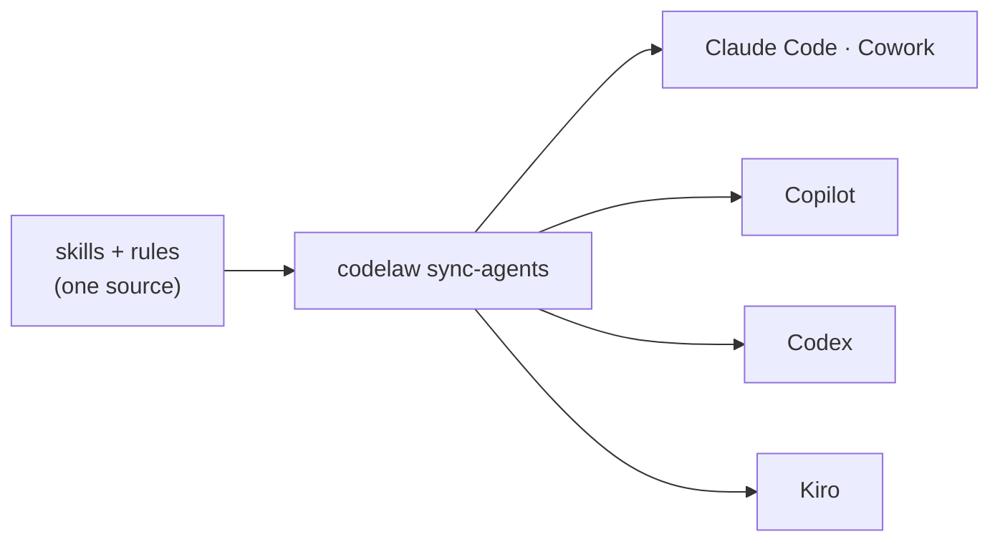

# SR-AGENT-SURFACES — skills, steering, instructions, agent files and hooks, generated from one source

## §1 — For humans

**Scope.** This record covers the **whole agent-facing set**: skills, steering, rules and instruction files, AGENTS.md / CLAUDE.md, custom agents, agent hooks and MCP registration.

**The decision in one line.** codelaw ships **12 skills** written once in the open **Agent Skills** format (`SKILL.md`). `codelaw sync-agents` copies them into each agent's skills folder and generates every other agent file from the rules. Nothing agent-facing is ever hand-edited in a consumer repo.

**Three kinds of surface, three jobs:**

| Kind | Job | Examples | Can it block? |
|---|---|---|---|
| **Instruct** | Tell the agent the rules before it writes | AGENTS.md, CLAUDE.md, Kiro steering, Copilot instructions, skills | Never |
| **Query** | Let the agent ask for exactly the rules it needs | MCP server: `rules_for_path`, `check_snippet`, `explain_rule` | Never |
| **Enforce** | Check and fix after the agent writes | Post-edit hooks running `codelaw hook` | Yes. Every engine rule is an exact match ([L5](0007_LAW-5-no-model-in-the-engine.md)), so a block is never a guess |

**Agents are optional** ([L5](0007_LAW-5-no-model-in-the-engine.md)). With no `--agents` flag, none of this is written.



<details>
<summary><b>ASCII twin</b></summary>

```text
   skills + rules --> codelaw sync-agents --+--> Claude Code / Cowork
                                            +--> Copilot
                                            +--> Codex
                                            +--> Kiro
```

</details>

---

## §2 — For agents

### Context

Each agent reads a different set of files from a different place. Maintaining them by hand, per agent, drifts the day a rule changes.

### Decision


#### 1. One source, generated everywhere

- Skills live in the codelaw source tree as `agents/skills/<name>/SKILL.md`, with optional `references/` and `scripts/`. They follow the Agent Skills standard:
  - `name`: lowercase, hyphens, at most 64 characters;
  - `description`: at most 1,024 characters, saying what the skill does **and** when to use it;
  - progressive disclosure: metadata about 100 tokens, `SKILL.md` body under 5,000 tokens, detail moved into `references/`.
- `codelaw sync-agents` writes each agent's files. Shared files (AGENTS.md, CLAUDE.md) get **marker blocks**, `<!-- codelaw:begin -->` … `<!-- codelaw:end -->`, so the team's own text is never touched.
- `codelaw sync-agents --check` runs in CI and fails if any generated file differs from what the rules and skills would produce.
- Skills ship inside both packages ([L6](0008_LAW-6-python-and-node-packages.md)), so a Python-only repo gets the same skills as a Node repo.

#### 2. Surface matrix

`init --agents claude,cowork,copilot,codex,kiro` writes:

| Surface | Claude Code | Cowork | GitHub Copilot | Codex | Kiro |
|---|---|---|---|---|---|
| Always-on instructions | `CLAUDE.md` block | via plugin skills | `AGENTS.md` block (also reads `.github/copilot-instructions.md`) | `AGENTS.md` block | `.kiro/steering/codelaw.md` (`inclusion: always`) |
| Path-scoped instructions | via `codelaw-write` skill + MCP | via plugin | `.github/instructions/codelaw-<lang>.instructions.md` (`applyTo`) | via skill + MCP | `.kiro/steering/codelaw-<lang>.md` (`inclusion: fileMatch`) |
| Skills | `.claude/skills/<n>/SKILL.md` | bundled in a codelaw plugin | `.github/skills/<n>/SKILL.md` | `.agents/skills/<n>/SKILL.md` | `.kiro/skills/<n>/SKILL.md` |
| Custom agent | `.claude/agents/codelaw-rule-author.md` | none | `.github/agents/codelaw-rule-author.agent.md` | none | none |
| Post-edit hook | `.claude/settings.json` `PostToolUse` | plugin hook | `.github/hooks/codelaw.json` | `PostToolUse` hook (printed snippet; config is user-level) | agent hook (file save / post-tool) |
| MCP registration | `.mcp.json` | plugin | `.vscode/mcp.json` | printed `config.toml` snippet | `.kiro/settings/mcp.json` |
| Bundle | none | **plugin** (skills + MCP + hook) | none | none | optional **Power** (steering + MCP + hooks) |

- Cursor (`.cursor/rules/*.mdc`) and Gemini CLI (`GEMINI.md`) are **P3**. Both claim Agent Skills support, but their skill paths haven't been verified; check before building.
- codelaw never edits files in the user's home directory. User-level config (Codex) is printed for the user to paste.

#### 3. Token budget

- **Always-on surfaces stay under 40 lines.** They hold:
  - what codelaw is;
  - "ask before you write";
  - "run `codelaw check` on changed files";
  - the list of active presets;
  - pointers to the skills.

  They never inline every rule.
- **Path-scoped surfaces** hold one line per rule (id plus one-liner), filtered to that language ([L3](0005_LAW-3-languages.md)).
- **Detail comes on demand:** `rules_for_path`, `explain_rule`, or the rule file itself.

#### 4. Safety rules every skill obeys

- **Never disable, loosen or eject a rule to make a check pass.**
- **Never edit a generated file;** edit the rule or skill source and re-run `sync-agents`.
- **Never suppress without a reason.** Inline `codelaw-ignore <rule-id>: <reason>` requires the reason, and `check` flags a suppression that no longer suppresses anything.
- **Apply `suggest` fixes only after showing the diff; follow `manual` steps exactly** ([L4](0006_LAW-4-every-rule-has-a-fix.md)).
- **A skill may only call codelaw for verdicts**; it never asserts a verdict from its own judgment ([L5](0007_LAW-5-no-model-in-the-engine.md)).

#### 5. Every skill ships with evals

- **Trigger evals:** prompts that **should** fire the skill and near-misses that **shouldn't**.
- **Task evals:** a fixture repo plus a task with a deterministic pass check. For example, "add a function to `math.ts`" passes when `codelaw check` is clean and the export is in the end block.
- Evals run in CI against each supported agent where that agent can be run headless.

#### 6. The config and the hook

- **`[agents]`** in the root config, both keys optional and validated at load ([SR-CONFIG](0110_config.md) decision 5):
  - `[agents] targets`: the agents of the decision-2 matrix (`claude`, `cowork`, `copilot`, `codex`, `kiro`) whose files `sync-agents` writes. Empty by default, and then no agent file exists. An unknown name is an error naming the nearest one. `init --agents <list>` writes it.
  - `[agents] command`: how a hook or an MCP registration starts codelaw. Unset, it is the repo's own install: `npx --no-install codelaw` beside a `package.json`, `uv run codelaw` beside a `uv.lock`, else `codelaw`.
- **`codelaw hook [paths]`** is the post-edit hook of every row of the matrix.
  - The files are its arguments, or, with none, the ones the agent's hook payload on stdin names: `tool_input.file_path` / `path` (Claude Code, Codex), the files an `apply_patch` envelope adds or updates (Codex), or `toolArgs` (Copilot). A deleted file, or one with no [L3](0005_LAW-3-languages.md) extension, is ignored.
  - It runs `codelaw fix` on them with `auto` fixes only, format step included ([L8](0010_LAW-8-performance-budgets.md) `fix_one_file`; [L4](0006_LAW-4-every-rule-has-a-fix.md) decision 8). It is the same engine call, so the bytes are `fix`'s ([L5](0007_LAW-5-no-model-in-the-engine.md) decision 5). The files it was given count as touched, so a grandfathered finding in one gets the verdict CI would give it ([SR-BASELINE](0104_baseline-and-deprecations.md) decisions 3 and 8).
  - **It judges with the `ci` profile** ([SR-CONFIG](0110_config.md) decision 10) whether or not `CI` is set, so an agent never leaves behind what CI would fail; `--profile <name>` or `CODELAW_PROFILE` picks another.
  - Nothing left: exit `0`, with the auto-fix notes on stdout. An error or warning left: exit `2`, with the fixes applied and up to 20 findings, each with its next step (a `suggest` diff to show, or the `manual` steps), on stderr. Exit 2 with stderr is how Claude Code and Codex hand a `PostToolUse` result back to the agent. A config or rule error is also exit `2`, as `error: …`.
- **A pre-write mode** ([W-05](../work/open/W-05-write-time-guidance.md)'s `hook --pre`) would be a flag of the same command.

#### 7. What `sync-agents` writes, file by file

- **Owned files** are written whole, with a "generated, do not edit" note after any frontmatter: the skills, the custom agent, `.kiro/steering/codelaw*.md`, `.github/instructions/codelaw-<lang>.instructions.md`, `.github/hooks/codelaw.json`, `.kiro/hooks/codelaw.json` and the Cowork plugin.
- **Shared files** are touched only at codelaw's part:
  - `CLAUDE.md` and `AGENTS.md`: the marker block, replaced in place, or appended when there is none;
  - `.mcp.json`, `.kiro/settings/mcp.json` (`mcpServers.codelaw`) and `.vscode/mcp.json` (`servers.codelaw`): that one key;
  - `.claude/settings.json`: the `PostToolUse` entry whose command runs `codelaw … hook`, replaced; every other entry and key is kept.
  - A shared JSON file that does not parse is an error naming it; codelaw never overwrites it.
- **Path-scoped files** exist for each language that has an enabled rule; `<lang>` is the `languages:` name (`typescript`, `tsx`, …). A `codelaw-<lang>` file for a language with no rule left, and a `codelaw-*` skill the catalogue no longer has, are removed. The team's own files beside them are never touched.
- **The Cowork plugin** is `.claude/plugins/codelaw/`: `.claude-plugin/plugin.json`, `skills/`, `hooks/hooks.json` and `.mcp.json`.
- **The Kiro hook** is `.kiro/hooks/codelaw.json`: a `PostFileSave` trigger on the L3 extensions running `<command> hook {{filePath}}`.
- **Codex** gets a printed `~/.codex/config.toml` snippet: `[mcp_servers.codelaw]` and a `[[hooks.PostToolUse]]` group.
- **The skills are compiled into the binary** (`include_str!` of `agents/`), so both packages carry the same ones ([L6](0008_LAW-6-python-and-node-packages.md)).
- **`sync-agents --check`**: exit `0` when every planned file matches, `1` listing each file that differs or should be removed, `2` on a config, rule or file error. With no `[agents] targets` both forms exit `0` without loading the rules.

### The skill catalogue

**P1** ships with the MCP server. **P2** follows once rules can be authored outside the codelaw repo. **P3** comes later.

| Pri | Skill | Fires on (trigger summary) | What it does | Writes files? |
|---|---|---|---|---|
| **P1** | `codelaw-write` | Any create or edit of a JS/TS/Python/JSON/YAML/TOML/Markdown/CSS/HTML file in a repo with `codelaw.toml` | Calls `rules_for_path` first, writes code that complies, runs `codelaw check` on the changed files, and handles what comes back by fix class | Code only |
| **P1** | `codelaw-fix` | "fix lint errors", "codelaw is failing", a hook or CI reported violations | `codelaw fix`; shows `suggest` diffs and applies them on accept; works through `manual` steps; re-checks until clean | Code only |
| **P1** | `codelaw-explain` | "why did this fire", "what does rule X want", "is this allowed" | `explain_rule` + the Do/Don't examples + which preset or pack enabled it (`rules --why`) | No |
| **P1** | `codelaw-author-rule` | "make a rule that…", "enforce X", "we always do Y" | Turns a convention into a rule file:<br>1. Inspects the syntax tree of a real example.<br>2. Writes the matcher.<br>3. Picks the fix class ([L4](0006_LAW-4-every-rule-has-a-fix.md)).<br>4. Writes Do/Don't for every declared language ([L3](0005_LAW-3-languages.md)).<br>5. Runs `codelaw test` until green. | `.codelaw/rules/` |
| **P2** | `codelaw-setup` | "set up codelaw", "add a linter that agents follow" | Detects languages and package manager, installs the engine and the matching rule packs from npm or PyPI ([L6](0008_LAW-6-python-and-node-packages.md), [SR-RULE-PACKS](0101_rule-packs.md) decision 6), and says which registry has a pack `init` left out (since 2026-10-24 not every pack is on both), picks presets, wires pre-commit and CI, and adds agents only if asked | Config + CI |
| **P2** | `codelaw-migrate` | "move from ESLint / Ruff / markdownlint", "turn our style guide into rules" | Maps existing ESLint, typescript-eslint, Ruff, stylelint, html-validate and markdownlint configs rule by rule through `ported_from:` ([SR-RULE-FORMAT](0112_rule-format.md) decision 2), then to presets and adapters, turns prose conventions (CONTRIBUTING.md, ADRs) into draft rules, and writes a mapping report of what was covered, dropped or needs a human | Rules + report |
| **P2** | `codelaw-debug-rule` | "false positive", "rule didn't catch this", "rule test failing" | Reproduces the case as a failing example **first**, inspects the tree, adjusts the matcher, and keeps every existing example green | `.codelaw/rules/` |
| **P2** | `codelaw-ci-triage` | A CI codelaw job failed, or a SARIF file or log is pasted | Reads SARIF, reproduces locally with the same flags, fixes or routes to `codelaw-fix` / `codelaw-debug-rule` | Code only |
| **P3** | `codelaw-review` | "review this diff/PR against our rules" | Runs `check` on the changed files only and writes review comments that quote each violation's fix (diff or steps); adds no verdicts of its own | No |
| **P3** | `codelaw-suppress` | "this violation is intended", "ignore this rule here" | Picks the narrowest suppression (inline with reason → per-glob override), refuses a blanket disable, and records the reason | Code / config |
| **P3** | `codelaw-pack` | "share our rules across repos", "publish a rule pack" | Scaffolds a pack ([SR-RULE-PACKS](0101_rule-packs.md)) with its manifest, versioning, tests, and npm/PyPI publish config | Pack folder |
| **P3** | `codelaw-upgrade` | "upgrade codelaw", a new version is available | Reads the changelog, runs the new rules in preview, and fixes or adopts them deliberately | Config + code |

**Custom agent: `codelaw-rule-author`.** A subagent version of `codelaw-author-rule`. Rule authoring is iterative (inspect the tree → write → test → repeat) and floods the context with syntax trees, so it runs in its own context and returns only the finished rule and the test result.

**Slash commands come free.** Each skill can be invoked directly (for example `/codelaw-fix`) in agents that expose skills as commands. No separate command files are generated.

### Research basis

- **Agent Skills** is an open `SKILL.md` standard supported by 30+ coding tools: `name` and `description` frontmatter, three-stage progressive disclosure, and optional `scripts/`, `references/` and `assets/` folders. Codex reads `.agents/skills/` ([Vaughan, May 2026](https://codex.danielvaughan.com/2026/05/05/agent-skills-open-standard-portable-skills-codex-cli-cross-agent/); [Noqta](https://noqta.tn/en/news/skill-md-open-standard-30-ai-coding-tools-adoption-2026)).
- **Kiro:** steering with `inclusion: always | fileMatch | manual`; skills in `.kiro/skills/`; Powers bundle MCP servers, steering and hooks ([Kiro guide](https://medium.com/@Sanjjushri/advanced-kiro-steering-strategies-skills-powers-and-production-workflows-b68153ba88c2); [Kiro changelog](https://kiro.dev/changelog/remote-mcp-and-global-steering)).
- **Copilot:** `AGENTS.md` / `copilot-instructions.md`, `.github/instructions/*.instructions.md` (`applyTo`), `.github/prompts/` (VS Code only), `.github/agents/*.agent.md`, `.github/skills/*/SKILL.md` ([example repo docs](https://forge.saif.com/about/contributing/copilot-skills/)); hooks ([GitHub docs](https://docs.github.com/en/copilot/how-tos/copilot-on-github/customize-copilot/customize-cloud-agent/use-hooks)).
- **Codex:** `PostToolUse` and the other hooks are stable since v0.124 ([Vaughan, Apr 2026](https://codex.danielvaughan.com/2026/04/23/codex-cli-hooks-graduate-stable-v0124-mcp-observation-inline-config/)).
- **Codex hooks** in `config.toml`: `[[hooks.PostToolUse]]` matcher groups with `[[hooks.PostToolUse.hooks]]` `type = "command"` handlers ([OpenAI docs](https://developers.openai.com/codex/hooks)).
- **Kiro hooks** in `.kiro/hooks/`: the v1 schema's `trigger` (`PostFileSave`) and `action` (`type: command`), with `{{filePath}}` for file triggers ([Kiro hooks](https://kiro.dev/docs/hooks/)). Older Kiro versions used a `when`/`then` `.kiro.hook` file; decision 7 follows the v1 schema.
- **Claude Code:** `PostToolUse` hooks, where exit code 2 sends stderr back to the agent ([Anthropic docs](https://docs.anthropic.com/en/docs/claude-code/hooks)).
- **Prior art for "instruct never blocks; enforce only when exact":** the same principle in Arpit's Fux repo, in the `.claude/hooks/fux-index-hint.sh` header.

### Consequences

- **codelaw owns its generated files in consumer repos;** teams must not hand-edit them.
- **The Cursor and Gemini CLI rows wait for their paths to be verified.**
- **The Cowork plugin path and the Kiro hook schema (decision 7) are the least verified rows;** the veto check covers them first.
- **Copilot ignores a `postToolUse` hook's output,** so on Copilot the hook applies `auto` fixes but cannot hand findings back; the always-on block's "run `codelaw check`" carries that.
- **Evals cost CI time for each agent.**

### Alternatives considered

- **Hand-written files per agent:** rejected. They drift.
- **AGENTS.md only:** rejected. No path scoping, no hooks, no skills.
- **One skill that does everything:** rejected. It breaks the token budget and triggers poorly.

### Reference (required)

- The research basis under decision 2 (Agent Skills standard, Kiro, Copilot, Codex and Claude Code docs, each linked).

### Veto condition

**Reopen this decision if:** an agent in the decision-2 matrix changes where it reads skills, instructions, hooks or MCP config.

**How to check it:** `re-verify each row of the decision-2 matrix against that agent's current docs; a mismatch reopens this record`

---

## References

*Every source this record cites, gathered in one place. An archived document is never listed here.*

**Records** — [SR-RULE-PACKS](0101_rule-packs.md) · [SR-RULE-FORMAT](0112_rule-format.md)

**Project docs** — [`docs/DESIGN.md`](../docs/DESIGN.md)
