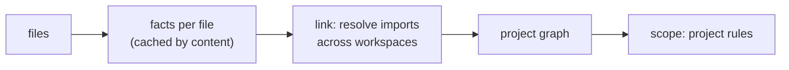

# SR-PROJECT-GRAPH — a deterministic, whole-repo symbol graph for cross-file rules

## §1 — For humans

**The problem.** Every rule so far looks at one file at a time. "This exported function is used nowhere in the repo" can't be answered from one file: it needs every file, every package in a monorepo, and how imports resolve between them.

**The decision.** codelaw builds a **project graph** in three steps:
1. **Facts:** read each file once and record what it declares, exports, imports and references. This is cached by the file's content.
2. **Links:** resolve every import to the module it points at, across workspaces and packages.
3. **Queries:** expose the result to rules that declare `scope: project`.

It is built from the files alone, sorted and offline ([L5](0007_LAW-5-no-model-in-the-engine.md)), and it covers JS/TS, Python and the manifest files ([L3](0005_LAW-3-languages.md)).

**First use case: unused exports.** An exported function that nothing outside its own file imports, and that isn't part of the package's public API, gets reported with a fix.

**The same graph powers the "more like this" rules:**

| Rule (future) | Graph question |
|---|---|
| `graph/no-unused-exports` | Exported, but no reference from any other module and not reachable from an entry point |
| `graph/no-unused-files` | A module nothing imports and no entry point reaches |
| `graph/no-unused-dependencies` | Declared in `package.json` / `pyproject.toml`, never imported |
| `graph/no-undeclared-dependencies` | Imported, but not declared in that package's manifest (common monorepo bug) |
| `graph/no-deep-imports` | Package A imports `@acme/b/src/internal/x` instead of B's public entry |
| `graph/boundaries` | `packages/ui` must not import `packages/server`; `domain` must not import `infra` (layer rules) |
| `graph/no-cycles` | Circular imports between modules or packages |
| `graph/no-unused-css-classes` | A class defined in CSS that no HTML `class`, JSX `className` or TSX template references |
| `graph/no-deprecated-usage` | Any reference to a deprecated symbol (see [SR-BASELINE](0104_baseline-and-deprecations.md)) |

**Prior art:**
- **Knip** (JS/TS): unused files, exports, types and dependencies, with workspaces, entry points and framework plugins.
- **Vulture** (Python): dead code, with confidence levels and whitelists.
- **import-linter** (Python): layer and forbidden-import contracts.
- **dependency-cruiser** (JS): boundaries and cycles.

codelaw folds all of these into one engine, one graph and one rule format.



<details>
<summary><b>ASCII twin</b></summary>

```text
   files --> facts (cached) --> link imports across packages --> graph --> project rules
```

</details>

---

## §2 — For agents

### Context

Every rule so far reads one file at a time. Unused exports, unused dependencies, boundaries, cycles and deprecated-symbol usage all need the whole repo, across every package in a monorepo.

### Decision


#### 1. What the graph holds

| Node | From |
|---|---|
| **Workspace / package** | `package.json` `workspaces`, `pnpm-workspace.yaml`; `[tool.uv.workspace]`; any folder with its own `package.json` or `pyproject.toml` under the configured roots |
| **Module** | Each JS/TS/Python file; Markdown files as link targets |
| **Symbol** | Each top-level declaration: function, class, const/let, type, interface, enum, and Python module-level def/class/assignment |

| Edge | Meaning |
|---|---|
| `exports` | module → symbol (including `export … from` re-exports, `export *`, and Python `__all__`) |
| `imports` | module → symbol or module (named, default, namespace, side-effect, dynamic) |
| `references` | symbol → symbol (an identifier inside one declaration that resolves to another) |
| `declares-dependency` | package → external package (from the manifests) |
| `links` | Markdown → file (relative links); HTML → file (`<script src>`, `<link href>`, ``) |
| `uses-class` | HTML / JSX / TSX → CSS class selector |

#### 2. Resolution, without a type checker

- **JS/TS** follows Node and bundler resolution:
  - relative paths and extension probing;
  - `package.json` `exports`, `main`, `module` and `types`;
  - tsconfig `paths`, `baseUrl` and project references.

  Workspace package names resolve to the **local source**, not `node_modules`. The resolver is `codelaw-graph`'s own and works over the project's file set without reading the disk, so the graph stays a pure function of the files and a rule test's virtual repo resolves exactly as a checkout does; `oxc_resolver` (Rust, MIT) was the planned choice and is not a dependency, because it reads the disk.
- **Python** resolves:
  - package roots (detects `src/` layouts);
  - `__init__.py` and namespace packages;
  - relative imports;
  - `from x import *` through `__all__`.
- **Namespace imports** (`import * as ns`, `import mod`): `ns.x` counts as a use of `x`. If `ns` itself is passed around, every member counts as used, which is the conservative choice.
- **Module augmentation** (`declare module "./x" { interface I { … } }`) merges into `./x`'s `I`, so it counts as a use of `I`, like a type-only import.
- **A stylesheet linked from HTML** (`<link href>`) is imported by that page, not an entry: its classes are still checked by `graph/no-unused-css-classes`.
- **Out of scope for v1:** class members and methods. `obj.method()` can't be resolved without types. Only top-level symbols are tracked.

#### 3. Entry points: things used from outside the repo

A symbol reachable from an entry point is **never** unused:

| Source | Entry points |
|---|---|
| `package.json` | `main`, `module`, `exports`, `types`, `bin`; a package not marked `"private": true` keeps its whole public export surface |
| `pyproject.toml` | `[project.scripts]`, `[project.entry-points]`, `__main__.py` |
| Framework presets | Next.js routes, Stencil `@Component` classes, Storybook stories, Jest/Vitest test files, `*.config.*` files, pytest and unittest tests (`test*.py`, so Django's `tests.py`; `*_test.py`) and `conftest.py` |
| Decorator registration | Functions decorated with configured registrars (`app.get`, `router.post`, `pytest.fixture`, `click.command`, Flask's request, error and template hooks such as `bp.before_app_request`, Django's template library `register.filter` / `simple_tag` / `inclusion_tag` / `tag`, …) count as used |
| Config | `[graph] entry = ["scripts/**/*.ts"]` |

#### 4. Dynamic code is reported honestly, never guessed

- **Explicit keep:**
  - `/** @public */` or `/** @keep */` (JSDoc);
  - `# codelaw: keep` (Python);
  - `[graph] keep = ["src/plugins/**"]` in config.
- **Dynamic access marks a module `dynamic`:**
  - a dynamic `import()` with a template string marks every module matching its pattern as reachable;
  - Python `importlib.import_module(var)` or `getattr(module, name)` marks that module `dynamic`.
- **Certainty is part of the result.** Exports of a `dynamic` module are reported as `info` with `certainty: uncertain`, never as errors. This is the deterministic version of Vulture's confidence levels: the reason is stated, not scored.

#### 5. Cached and incremental

- Per-file facts are cached in `.codelaw/cache/` (gitignored), keyed by content hash plus codelaw version.
- **Full run:** extract only changed files, then relink. Linking is cheap compared with parsing.
- **Hook mode** (an agent edited one file):
  1. Re-extract that file.
  2. Relink only its edges.
  3. Report project rules for the symbols the file declares, plus a note for symbols the edit just left unused.

  Target: under 300 ms on a 10,000-file repo with a warm cache.
- **Determinism ([L5](0007_LAW-5-no-model-in-the-engine.md)):** the graph is a pure function of the files and config. A cache hit and a cold build must give identical results; a test enforces this.

#### 6. How a project rule is written

Same Markdown format, same [L4](0006_LAW-4-every-rule-has-a-fix.md) fix contract. The `codelaw` block uses `scope: project` and a `graph:` query instead of a syntax pattern.

````markdown
---
id: graph/no-unused-exports
title: Exported symbols must be used somewhere
languages: [javascript, jsx, typescript, tsx, python]
severity: error
fix: suggest
fix_reason: "Static analysis can't rule out reflective or external use, so removal needs a human or agent to accept the diff."
---

Every exported symbol must be imported by another module, be reachable
from an entry point, or be marked `@public` / `# codelaw: keep`.

```codelaw
scope: project
graph:
  symbol:
    exported: true
    kind: [function, class, variable, type, interface, enum]
  unless:
    - reachable_from: entry
    - tagged: [public, keep]
  when:
    external_references: 0
message: "`$SYMBOL` is exported but never used outside `$FILE`"
certainty_from: module.dynamic
fix:
  - when: { local_references: ">0" }
    do: [strip-export-keyword]       # still used in its own file: just un-export it
  - else:
    do: [remove-declaration]         # unused everywhere: delete it
```

### Examples
#### TypeScript
#### Don't
```ts files
// packages/utils/src/date.ts
export function formatDate(d: Date) { return d.toISOString(); }
export function parseDate(s: string) { return new Date(s); }
// packages/web/src/app.ts
import { formatDate } from "@acme/utils";
console.log(formatDate(new Date()));
```
#### Do
```ts files
// packages/utils/src/date.ts
export function formatDate(d: Date) { return d.toISOString(); }
// packages/web/src/app.ts
import { formatDate } from "@acme/utils";
console.log(formatDate(new Date()));
```
````

- **Import queries:** `graph: import: { form: [import, export, dynamic, require], resolves | declared | published: false }` reports import specifiers rather than symbols; it backs the six `node/no-{missing,extraneous,unpublished}-{import,require}` rules (W-11). The graph never reads `node_modules`: `resolves: false` judges only the project's own paths (relative, absolute, tsconfig `paths`) that are extensionless or JavaScript/TypeScript; `declared: false` reads the nearest `package.json`, and a type-only import is satisfied by its `@types/` package; `published: false` applies only to a package that is not `private` and lists `files`.
- **Files outside `[files]` or `languages`** are still read for their uses, so an export they import is not reported; findings are reported only in files the config lets be checked.
- **Multi-file examples** use a `files` fence: one block holding several `// path` sections. `codelaw test` builds a small virtual repo from it.
- **Debugging:**
  - `codelaw graph refs @acme/utils#parseDate` lists every reference and the entry points it can reach;
  - `codelaw graph why-unused <symbol>` shows each `unless` clause and why it failed. This is the project-rule equivalent of `match --explain`.

#### 7. Output

```
$ codelaw check --rule graph/no-unused-exports
packages/utils/src/date.ts:2:1  error  graph/no-unused-exports  `parseDate` is exported but never used outside `date.ts`  [suggest]
packages/legacy/src/plugins.py:14:1  info  graph/no-unused-exports  `register` looks unused (module uses importlib — uncertain)  [suggest]

1 error, 1 info · 2 suggestions (`codelaw fix --unsafe` or review with `--dry-run`)
```

### Consequences

- **A cache and incremental relinking are required** to keep hook latency down.
- **Without types, method-level usage is out of scope.** The design prefers missing a finding to reporting a false one.
- **Dynamic code yields `info`-level "uncertain" results**, never errors.
- **The false-positive rate is measured** (W-11 corpus run, 2026-10-22): **14 of 145 findings are false (9.7%)** — `graph/no-unused-exports` 11 of 142 (7.7%), `graph/no-unused-css-classes` 3 of 3 — and **none is one that config cannot express**, so the veto condition does not hold.
  - **Method.** Seven repos cloned at pinned commits; a release build of the engine; `codelaw check --rule graph/no-unused-exports,graph/no-unused-css-classes` with only `preview = true` and the `js`, `py` and `css` presets (no `[graph]` section). Every finding was classified by hand, none sampled: the name was searched across the repo, then the use read. **False** means something does use the symbol (a framework, reflection, generated markup, a published surface); an export nothing uses is **true** even in generated or copied-in code. Each false one was then re-run with the config that expresses it.

    | repo @ commit | findings | true | false | the config that expresses the false ones |
    |---|---|---|---|---|
    | pallets/flask @ `d086db856be1` | 8 | 8 | 0 | — (dead `TypeVar`s, a never-raised exception, a leftover alias) |
    | encode/httpx @ `b5addb64f016` | 2 (css) | 0 | 2 | `keep = ["docs/css/**"]`: MkDocs' generated pages use the classes |
    | encode/starlette @ `1a3a401c0d33` | 1 (css) | 0 | 1 | the same |
    | pmndrs/zustand @ `382d29c485e6` | 4 | 0 | 4 | `entry = ["src/*.ts"]`: published from a build folder, so the root `package.json` is `private` and its `exports` name unbuilt paths |
    | excalidraw/excalidraw @ `1d4dc2c0e6e4` | 7 | 7 | 0 | — |
    | fastapi/full-stack-fastapi-template @ `b1125d883948` | 114 | 114 | 0 | — (74 in generated `*.gen.ts` clients, 38 in a copied-in shadcn/ui kit, 2 test helpers; `keep` silences them if wanted) |
    | django/djangoproject.com @ `c78c1306b313` | 9 | 2 | 7 | `registrars = ["stat"]` (a local registry decorator, 4); `keep = ["**/models.py"]` (Django models reached through `Metric.__subclasses__()` and a `ForeignKey("Component")` string, 2); `entry = ["docs/sphinx_ext/*.py"]` (a Sphinx `setup()`, 1) |

  - **Fixed during the run.** On `main` at `68b5c2c` the same corpus gave 149 findings, 27 false (18%). Defaults: unittest's `test*.py` (Django's `tests.py`, 9) and Django's template-library decorators (4) are now entries and registrars (decision 3). Engine: module augmentation now counts as a use (zustand's `StoreMutators`); a stylesheet linked from HTML was an entry and so never checked; and the `python` copy of `graph/no-unused-exports` listed fewer kinds, so a TypeScript repo lost its `interface` and `enum` findings (10 here) when it loaded last ([SR-RULE-PACKS](0101_rule-packs.md) decision 2).
  - **What it does not measure.** Missed findings: a published package whose `exports` point at a build folder is kept whole (excalidraw's six packages), a file nothing imports is not judged, and SCSS is not read. The CSS sample is three findings.

### Alternatives considered

- **Knip and Vulture as the core:** rejected. Two tools and two output formats, and no shared symbol identity for deprecations. Both are permissive, so they remain possible adapters.
- **Resolve with the TypeScript compiler or pyright:** rejected. It needs a Node or Python runtime, which breaks [L6](0008_LAW-6-python-and-node-packages.md), and it's slow.

### Reference (required)

- [Knip configuration](https://knip.dev/reference/configuration): entry points, workspaces, plugins and tags.
- [Vulture](https://github.com/jendrikseipp/vulture): Python dead code, confidence levels and whitelists.
- [import-linter contract types](https://import-linter.readthedocs.io/en/stable/contract_types/): layer and forbidden-import contracts.

### Veto condition

**Reopen this decision if:** a real repo's unused-export report contains a false positive that no entry, keep or decorator setting can express.

**How to check it:** `the corpus run (`W-11`) reports zero false positives that config can't express`

---

## References

*Every source this record cites, gathered in one place. An archived document is never listed here.*

**Records** — [SR-BASELINE](0104_baseline-and-deprecations.md)

**Project docs** — [`docs/DESIGN.md`](../docs/DESIGN.md)
