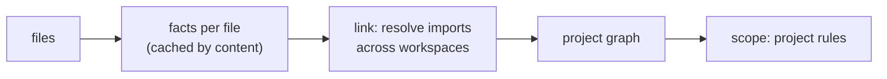

# SR-PROJECT-GRAPH — a deterministic, whole-repo symbol graph for cross-file rules

## §1 — For humans

**The problem.** Every rule so far looks at one file at a time. "This exported function is used nowhere in the repo" can't be answered from one file: it needs every file, every package in a monorepo, and how imports resolve between them.

**The decision.** codelaw builds a **project graph** in three steps:
1. **Facts:** read each file once and record what it declares, exports, imports and references. This is cached by the file's content.
2. **Links:** resolve every import to the module it points at, across workspaces and packages.
3. **Queries:** expose the result to rules that declare `scope: project`.

It is built from the files alone, sorted and offline ([L5](0007_LAW-5-no-model-in-the-engine.md)), and it covers JS/TS, Python and the manifest files ([L3](0005_LAW-3-languages.md)).

**First use case: unused exports.** An exported function that nothing outside its own file imports, and that isn't part of the package's public API, gets reported with a fix.

**The same graph powers the "more like this" rules:**

| Rule (future) | Graph question |
|---|---|
| `graph/no-unused-exports` | Exported, but no reference from any other module and not reachable from an entry point |
| `graph/no-unused-files` | A module nothing imports and no entry point reaches |
| `graph/no-unused-dependencies` | Declared in `package.json` / `pyproject.toml`, never imported |
| `graph/no-undeclared-dependencies` | Imported, but not declared in that package's manifest (common monorepo bug) |
| `graph/no-deep-imports` | Package A imports `@acme/b/src/internal/x` instead of B's public entry |
| `graph/boundaries` | `packages/ui` must not import `packages/server`; `domain` must not import `infra` (layer rules) |
| `graph/no-cycles` | Circular imports between modules or packages |
| `graph/no-unused-css-classes` | A class defined in CSS that no HTML `class`, JSX `className` or TSX template references |
| `graph/no-deprecated-usage` | Any reference to a deprecated symbol (see [SR-BASELINE](0104_baseline-and-deprecations.md)) |
| `graph/untested-function` | A new or edited function that no test file reaches (decision 9) |
| `graph/function-coverage` | A new or edited function an lcov report shows under `min` (decision 9) |

**Prior art:**
- **Knip** (JS/TS): unused files, exports, types and dependencies, with workspaces, entry points and framework plugins.
- **Vulture** (Python): dead code, with confidence levels and whitelists.
- **import-linter** (Python): layer and forbidden-import contracts.
- **dependency-cruiser** (JS): boundaries and cycles.

codelaw folds all of these into one engine, one graph and one rule format.



<details>
<summary><b>ASCII twin</b></summary>

```text
   files --> facts (cached) --> link imports across packages --> graph --> project rules
```

</details>

---

## §2 — For agents

### Context

Every rule so far reads one file at a time. Unused exports, unused dependencies, boundaries, cycles and deprecated-symbol usage all need the whole repo, across every package in a monorepo.

### Decision


#### 1. What the graph holds

| Node | From |
|---|---|
| **Workspace / package** | `package.json` `workspaces`, `pnpm-workspace.yaml`; `[tool.uv.workspace]`; any folder with its own `package.json` or `pyproject.toml` under the configured roots |
| **Module** | Each JS/TS/Python file; Markdown files as link targets; a CSS Module stylesheet with its local classes (decision 8) |
| **Symbol** | Each top-level declaration: function, class, const/let, type, interface, enum, and Python module-level def/class/assignment |

| Edge | Meaning |
|---|---|
| `exports` | module → symbol (including `export … from` re-exports, `export *`, and Python `__all__`) |
| `imports` | module → symbol or module (named, default, namespace, side-effect, dynamic) |
| `references` | symbol → symbol (an identifier inside one declaration that resolves to another) |
| `declares-dependency` | package → external package (from the manifests) |
| `links` | Markdown → file (relative links); HTML → file (`<script src>`, `<link href>`, ``) |
| `uses-class` | HTML / JSX / TSX → CSS class selector |
| `reads-class` | JS / TS → a class of the CSS Module it imports: `styles.x`, `styles["x"]`, `{ x } = styles`, `import { x }` (decision 8) |

#### 2. Resolution, without a type checker

- **JS/TS** follows Node and bundler resolution:
  - relative paths and extension probing;
  - `package.json` `exports`, `main`, `module` and `types`;
  - tsconfig `paths`, `baseUrl` and project references.

  Workspace package names resolve to the **local source**, not `node_modules`. The resolver is `codelaw-graph`'s own and works over the project's file set without reading the disk, so the graph stays a pure function of the files and a rule test's virtual repo resolves exactly as a checkout does; `oxc_resolver` (Rust, MIT) was the planned choice and is not a dependency, because it reads the disk.
- **Python** resolves:
  - package roots (detects `src/` layouts);
  - `__init__.py` and namespace packages;
  - relative imports;
  - `from x import *` through `__all__`.
- **Namespace imports** (`import * as ns`, `import mod`): `ns.x` counts as a use of `x`. If `ns` itself is passed around, every member counts as used, which is the conservative choice.
- **Module augmentation** (`declare module "./x" { interface I { … } }`) merges into `./x`'s `I`, so it counts as a use of `I`, like a type-only import.
- **A stylesheet linked from HTML** (`<link href>`) is imported by that page, not an entry: its classes are still checked by `graph/no-unused-css-classes`.
- **Out of scope for v1:** class members and methods. `obj.method()` can't be resolved without types. Only top-level symbols are tracked.

#### 3. Entry points: things used from outside the repo

A symbol reachable from an entry point is **never** unused:

| Source | Entry points |
|---|---|
| `package.json` | `main`, `module`, `exports`, `types`, `bin`; a package not marked `"private": true` keeps its whole public export surface |
| `pyproject.toml` | `[project.scripts]`, `[project.entry-points]`, `__main__.py` |
| Framework presets | Next.js routes, Stencil `@Component` classes, Storybook stories, Jest/Vitest test files, `*.config.*` files, pytest and unittest tests (`test*.py`, so Django's `tests.py`; `*_test.py`) and `conftest.py` |
| Decorator registration | Functions decorated with configured registrars (`app.get`, `router.post`, `pytest.fixture`, `click.command`, Flask's request, error and template hooks such as `bp.before_app_request`, Django's template library `register.filter` / `simple_tag` / `inclusion_tag` / `tag`, …) count as used |
| Config | `[graph] entry = ["scripts/**/*.ts"]` |

#### 4. Dynamic code is reported honestly, never guessed

- **Explicit keep:**
  - `/** @public */` or `/** @keep */` (JSDoc);
  - `# codelaw: keep` (Python);
  - `[graph] keep = ["src/plugins/**"]` in config.
- **Dynamic access marks a module `dynamic`:**
  - a dynamic `import()` with a template string marks every module matching its pattern as reachable;
  - Python `importlib.import_module(var)` or `getattr(module, name)` marks that module `dynamic`.
- **Certainty is part of the result.** Exports of a `dynamic` module are reported as `info` with `certainty: uncertain`, never as errors. This is the deterministic version of Vulture's confidence levels: the reason is stated, not scored.

#### 5. Cached and incremental

- Per-file facts are cached in `.codelaw/cache/` (gitignored), keyed by content hash plus codelaw version.
- **Full run:** extract only changed files, then relink. Linking is cheap compared with parsing.
- **Hook mode** (an agent edited one file):
  1. Re-extract that file.
  2. Relink only its edges.
  3. Report project rules for the symbols the file declares, plus a note for symbols the edit just left unused.

  Target: under 300 ms on a 10,000-file repo with a warm cache.
- **Determinism ([L5](0007_LAW-5-no-model-in-the-engine.md)):** the graph is a pure function of the files and config. A cache hit and a cold build must give identical results; a test enforces this.

#### 6. How a project rule is written

Same Markdown format, same [L4](0006_LAW-4-every-rule-has-a-fix.md) fix contract. The `codelaw` block uses `scope: project` and a `graph:` query instead of a syntax pattern.

````markdown
---
id: graph/no-unused-exports
title: Exported symbols must be used somewhere
languages: [javascript, jsx, typescript, tsx, python]
severity: error
fix: suggest
fix_reason: "Static analysis can't rule out reflective or external use, so removal needs a human or agent to accept the diff."
---

Every exported symbol must be imported by another module, be reachable
from an entry point, or be marked `@public` / `# codelaw: keep`.

```codelaw
scope: project
graph:
  symbol:
    exported: true
    kind: [function, class, variable, type, interface, enum]
  unless:
    - reachable_from: entry
    - tagged: [public, keep]
  when:
    external_references: 0
message: "`$SYMBOL` is exported but never used outside `$FILE`"
certainty_from: module.dynamic
fix:
  - when: { local_references: ">0" }
    do: [strip-export-keyword]       # still used in its own file: just un-export it
  - else:
    do: [remove-declaration]         # unused everywhere: delete it
```

### Examples
#### TypeScript
#### Don't
```ts files
// packages/utils/src/date.ts
export function formatDate(d: Date) { return d.toISOString(); }
export function parseDate(s: string) { return new Date(s); }
// packages/web/src/app.ts
import { formatDate } from "@acme/utils";
console.log(formatDate(new Date()));
```
#### Do
```ts files
// packages/utils/src/date.ts
export function formatDate(d: Date) { return d.toISOString(); }
// packages/web/src/app.ts
import { formatDate } from "@acme/utils";
console.log(formatDate(new Date()));
```
````

- **Import queries:** `graph: import: { form: [import, export, dynamic, require], resolves | declared | published: false }` reports import specifiers rather than symbols; it backs the six `node/no-{missing,extraneous,unpublished}-{import,require}` rules (W-11). The graph never reads `node_modules`: `resolves: false` judges only the project's own paths (relative, absolute, tsconfig `paths`) that are extensionless or JavaScript/TypeScript; `declared: false` reads the nearest `package.json`, and a type-only import is satisfied by its `@types/` package; `published: false` applies only to a package that is not `private` and lists `files`.
- **Files outside `[files]` or `languages`** are still read for their uses, so an export they import is not reported; findings are reported only in files the config lets be checked.
- **Multi-file examples** use a `files` fence: one block holding several `// path` sections. `codelaw test` builds a small virtual repo from it.
- **Debugging:**
  - `codelaw graph refs @acme/utils#parseDate` lists every reference and the entry points it can reach;
  - `codelaw graph why-unused <symbol>` shows each `unless` clause and why it failed. This is the project-rule equivalent of `match --explain`.

#### 7. Output

```
$ codelaw check --rule graph/no-unused-exports
packages/utils/src/date.ts:2:1  error  graph/no-unused-exports  `parseDate` is exported but never used outside `date.ts`  [suggest]
packages/legacy/src/plugins.py:14:1  info  graph/no-unused-exports  `register` looks unused (module uses importlib — uncertain)  [suggest]

1 error, 1 info · 2 suggestions (`codelaw fix --unsafe` or review with `--dry-run`)
```

#### 8. Stylesheet modules (CSS Modules)

*Ruled by Arpit, 2026-10-26 (W-63): "The CSS pack should work with SCSS, and CSS modules as well", and "Create separate packages for SCSS and CSS modules".*

- **A CSS Module** is a `.css` or `.scss` file named `*.module.css` or `*.module.scss`, or matching `[css] modules` (globs from the project root; root config only). Facts are read for every stylesheet from its text — not from a tree, because tree-sitter-scss cannot read all modern Sass and a class it missed would be reported as undefined — and the graph decides by name and config whether the file is a module.
- **What a module holds:** its local classes (`:global(.x)` and a bare `:global` switch leave scope, `:local` returns; `&-suffix` is named from a parent that is one plain class; classes inside `@keyframes`, comments, strings and `url()` are not classes), each `composes: a b [from "./f.module.css" | global]`, and what it exports to JavaScript, the `:export` keys and the `@value` names.
- **What reads it:** an import of a module stylesheet binds its classes as members: `styles.x`, `styles["x"]`, `const { x, y: z } = styles` and `import { x } from "./a.module.css"`. A `composes: a from "./b.module.css"` is a read of `b`'s `.a`, and `composes: a` one of this file's.
- **Two queries,** `graph: { module: { classes: unused } }` (reported in the stylesheet, at the class; fix `remove-rule` when the class is its rule's only selector) and `graph: { module: { classes: undefined } }` (reported in the JS or TS file, at the name). They back `css-modules/no-unused-class` and `css-modules/no-undefined-class`.
- **Never a guess.** A module read by a computed name (`styles[name]`, a template), spread, rest-destructured or passed to a function is *dynamic*: `no-unused-class` reports nothing for it. A module no file imports is unjudged. A module whose class names could not be worked out (interpolated selector, `&-suffix` on a selector list) is *incomplete*: neither query judges it.
- **The bundler's names.** `[css] modules_convention` is css-loader's `localsConvention` (`asIs`, `camelCase`, `camelCaseOnly`, `dashes`, `dashesOnly`): `.btn-primary` is `styles["btn-primary"]` under `asIs` and also `styles.btnPrimary` under `camelCase`; both queries compare through it.
- **Per-file rules** (`css-modules/composes-valid`, `class-naming`, `no-global`) are `native:` rules of the `css-modules` pack; `composes-valid` reads the file a `composes` points at through the project view ([SR-ARCHITECTURE](0108_architecture.md) decision 15b). The `css/*` rules read a module stylesheet in a *module mode* and report none of its syntax (`@value`, `composes`, `:export`, `:import()`, `:global`, `:local`).
- **Not built:** the graph does not follow `composes` through an `@import`, a `@value … from` is read as an export only, and a module imported only from HTML or a template is unjudged.


#### 9. Tests for new code: `graph/untested-function` and `graph/function-coverage`

*Ruled by Arpit, 2026-10-26 (W-71): "if a new function is added … it should have a unit test for it. And by default, it should have a coverage of around 60%, which can be configured … for JS, TS, Python. But if there are older functions, then no need … If somebody is editing that function, then this rule again gets applied." Scope: "every function unless called out in a separate `.codelawignore` file"; coverage per function; diff-scoped, confirmed "yes".*

- **Diff-scoped.** Only the change set's **new and edited** functions are judged ([SR-BASELINE](0104_baseline-and-deprecations.md) decision 3 says how a function is new, edited or untouched, by token stream). An untouched function is never reported, whatever its coverage. With no change set (plain `check`, no git, a shallow clone) nothing is judged and the header says `new code: no change set; test rules not evaluated`.
- **What counts as a function** is `codelaw_lang::functions`: declarations, methods (getters and setters included), arrow and function expressions bound to a name (a `const`, a class field, an object property), Python `def` and `async def` at module or class level. Not: anonymous callbacks, nested functions (judged through the one that holds them), overload signatures, abstract methods, `.d.ts` files, and **test files** — the graph's test presets: Jest/Vitest `*.test.*` and `*.spec.*`, a file under `__tests__/`, pytest/unittest `test*.py`, `*_test.py`, `conftest.py` (`codelaw_graph::is_test_file`).
- **`graph/untested-function`** (`error`, `manual`): a new or edited function that **no test file reaches**. A test reaches it by graph identity — imported under any alias, through a barrel or a renamed re-export (`export { a as b } from`), as `from pkg.mod import f` or `mod.f`; a method is reached when its class is. A function its module does not export is reached when a test file imports the module. A test that takes the whole module (`import *` passed around, `from m import *`) reaches every name in it. **Strings are not identity:** `mock.patch("pkg.mod.f")` does not reach `f`. The finding sits on the function's first line, so a `codelaw-ignore` above it covers it: "`computeTax` is new and no test reaches it (add one in `orders.test.ts`, or exempt it in `.codelawignore`)". It needs no report, so it also runs in the pre-commit hook and the agent hook.
- **`graph/function-coverage`** (`error`, `manual`): a new or edited function whose line coverage in an **lcov** report is under `min`. Of the report's `DA` lines inside the function's span *as codelaw parses it now*, the share with hits above 0 — the tool's own `FN` records are not trusted, so Jest, Vitest, c8, coverage.py and pytest-cov are judged alike. "`computeTax` is 42% covered (5 of 12 lines; min 60)", with `data: { function, change, covered, lines, pct, min }`. A function with no instrumented line is skipped. codelaw reads lcov itself ([L11](0013_LAW-11-dependencies.md)); a `SF:` path may be absolute or relative to the report's folder or the project root. Only lcov is read; Istanbul's and coverage.py's JSON, and Cobertura XML, are not.
- **The engine never runs tests** ([L5](0007_LAW-5-no-model-in-the-engine.md)): the report is an input, `--coverage <path>` or `[coverage] report` (relative to the config file; the flag wins). No report: not evaluated, and the header says `coverage: none; not evaluated` — unless `[coverage] require_report` is `true`, which makes it one error at the config file.
- **`codelaw/stale-coverage`** (`warn`, `manual`): the report does not name a judged file, has a `DA` line past its end, or counts a line that is blank or a comment now. One finding at the file's first line, and no coverage verdict for that file. lcov carries no content hash, so a stale report is only mostly caught: generate it in the same CI job, before `codelaw check`.
- **Options, in `[coverage]`** (root config only; the rules' severities stay in `[rules]`): `[coverage] scope` — `all` (default, Arpit's ruling) or `public` (exported in JS/TS; no leading `_` or in `__all__` in Python); `[coverage] min` — 0–100, default `60`; `[coverage] mode` — `function` (default) or `patch`, one finding when all judged functions' lines together are under `min` (diff-cover's measure); `[coverage] require_report` — default `false`; `[coverage] on_no_change_set` — `skip` (default) or `all`, every function judged, for a baseline roll-out; `[coverage] ignore_names` — a regex of function names never judged; `[coverage] report`; and `[coverage] ignore`, the `.codelawignore` policy, which is [SR-BASELINE](0104_baseline-and-deprecations.md) decision 12's.
- **Exemptions:** `.codelawignore` ([SR-BASELINE](0104_baseline-and-deprecations.md) decision 12) and the inline `codelaw-ignore`.
- **Opt-in** ([L8](0010_LAW-8-performance-budgets.md)): `extends = ["codelaw:tests"]` — the engine's own preset, not in any `recommended` ([SR-RULE-PACKS](0101_rule-packs.md) decision 3) — or a `[coverage]` table, or a rule named in `[rules]` (which turns on that one). Off, no graph is built for them and nothing here runs.
- **The header** (`text` and `agent`, and `new_code` in JSON): `new code: 3 new, 1 edited functions since <base>` and, when the coverage rule runs, `coverage: <report> (N files)` ([SR-CLI-MCP](0115_cli-and-mcp.md)).
- **The test:** `crates/codelaw-cli/tests/tests_for_new_code.rs` on real git repos — JS/TS with a renamed barrel re-export and an unexported helper, Python with a class, an alias and a `mock.patch` string, `--changed-since`, `--staged`, the agent hook, no change set and `on_no_change_set = "all"`, lcov with absolute and relative `SF:`, `min`, `mode = "patch"`, `require_report`, three kinds of stale report; and `crates/codelaw-graph/src/tests.rs` for what a test reaches.

#### 10. Words across the project: `graph: { terms: inconsistent }`

*W-103, 2026-10-28: SR-SPELL's `spell/inconsistent-term` needs every file's words at once, so it is a project rule; the decider ruled the rule and its fix class in SR-SPELL decision 5.*

- **The query:** `graph: { terms: inconsistent }`, with `fix: { do: [respell] }` — the primitive only this query takes, and the only one it takes. `codelaw_graph::run` gives it nothing: like `graph/no-deprecated-usage`, the engine runs it (`crates/codelaw-engine/src/project.rs`), because its words are the spell pack's data, not the graph's facts.
- **What it reads:** while the rule is on, the project stage's sources carry the text of every file in its languages, the files `[files]` or `languages` leave out included, so they count; findings are reported only in files `check` would check, after `codelaw-ignore`, as for every project rule.
- **Cached and incremental (decision 5):** a file's words are read once, through `codelaw_native::spell::term_uses`, and cached by its text, its language, the grammars and the rule set's fingerprint (which covers every pack's data table); a watch re-reads a saved file's and runs the rule over every file again.

#### 11. Feature-flag expiry: `graph: { flags: reads | markers | registry }`

*Asked by Arpit, 2026-10-29 (Cowork, voice; W-130): "We need to build it out for all of them … in a bit more generic way, because … people might be using wrapper over Unleash, wrapper over LaunchDarkly or Split.io"; on where a flag's expiry lives, registry or inline: "Both." The design is [the proposal](../work/proposals/deps-flags-markers-reviews.md) §3; what it left open is decided here.*

- **Accessors are config** — `[flags] accessors`: a call pattern with one `$NAME` slot. Its arguments are `$NAME`, `$_` (any one), `$$$` (any number, last), `{ key: $NAME }` (a JS object literal's key) or `key=$NAME` (a Python keyword); `$_.` before a dotted callee matches any receiver (`$_.variation($NAME, $$$)` matches `ldClient.variation(…)` and `useLDClient().variation(…)`). A pattern with an object key is JS/TS only, one with a keyword Python only, the rest both. A pattern that does not parse, or names no `$NAME` or two, is a config error at load.
- **Presets** — `[flags] presets`: the same patterns shipped, `launchdarkly`, `unleash`, `split`, `openfeature`, `growthbook`, `flagsmith`, for JS/TS (React hooks included) and Python, in `crates/codelaw-graph/src/flags/patterns.rs`. Each is its SDK's documented read of **one flag by its key**; a read of every flag at once (`useFlags()`, `allFlags()`) names no flag and is not a pattern. Split's server SDK takes the user key first (`getTreatment(key, flag)`), its browser SDK not (`getTreatment(flag)`): both are patterns, by arity.
- **Wrappers, found** (the accessor flow): a named function whose own parameter flows **unchanged** — never reassigned in it — into the `$NAME` slot of an accessor is an accessor too, and so, to a fixpoint, is a function that does the same to that one: a wrapper of a wrapper, across files. A top-level function is followed through the graph's import resolution (decisions 2 and 3): a named, default, aliased or namespace import, a barrel re-export, a Python `from m import f` or `import m` and `m.f`, a submodule import. A class method or an object literal's function property (`self` dropped in Python) is called as `$_.name(…)`, and counts only in its own file and the files that import that file — so a wrapper method named `get` does not make every `map.get("x")` of the project a flag read. Deterministic: the files, functions and calls are visited in path order, and the fixpoint is bounded by the number of functions. `codelaw flags accessors` ([SR-CLI-MCP](0115_cli-and-mcp.md) decision 1) prints every pattern and wrapper with where it comes from.
- **Names:** a string literal, or a template string with nothing interpolated; a constant, an enum member (TS `enum`, a Python `Enum` class attribute, `.value` or not) or an object literal's key, declared at a module's top level, in the file or imported from another through the graph. Anything else — a parameter no wrapper explains, an f-string, a concatenation, a call — is **dynamic**: one `info` finding marked uncertain (decision 4), never an error.
- **The registry**, `.codelaw/flags.toml` (relative to the project root): `[[flag]]` tables with `name`, `owner`, `ticket`, `expires` (a `YYYY-MM-DD` date, quoted or a TOML date, or `"never"`, which needs `reason`), `keep` (`"on"` or `"off"`: the flag is decided) and `reason`. Another key is an error. **Inline markers**: a comment whose text starts `codelaw-flag <name>`, then `expires`, `owner`, `ticket`, `keep` and `reason` (the rest of the line), each a word; `expires` is required. With **`[flags] inline`** = `"allow"` (the default) a marker registers its flag when the registry does not; the registry wins when both do, and the marker is rewritten to match (auto). One flag marked in several places with different values is an error at each, with no edit: moving it into the registry is a person's choice of the values. `"registry-only"` makes every marker an error; one whose flag the registry has is removed (auto).
- **At each read** (`js/flag-expiry`, `py/flag-expiry`; `suggest`): not registered → `error`; within **`[flags] warn_days`** (default 14; an integer or `"14d"`, `"2w"`) before its `expires` on the as-of date → `warn`; past it → `error`; decided (`keep`) → `warn` whatever the date; `"never"` with a `reason` → nothing; a dynamic name → `info`, uncertain. **Each finding's severity is its own** (the rule's severity in `[rules]` turns it on or off), as `[deps]`'s grades are (SR-RULE-PACKS decision 15). Dates are judged on the as-of date only ([SR-BASELINE](0104_baseline-and-deprecations.md) decision 4: `--as-of`, `CODELAW_AS_OF`, `HEAD`'s commit date), never the clock; with none, only unregistered, decided and dynamic reads are reported. **No flag service is ever asked** ([L5](0007_LAW-5-no-model-in-the-engine.md)): the registry is the truth.
- **The fix, `keep-branch`** (`suggest`): with `keep = "on"` or `"off"`, a read that is the **whole condition** of an `if` or a conditional expression (`?:`, `a if c else b`), with arguments that have no side effect (literals, names, member paths, objects of them), keeps that branch: the block's statements re-indented in place of the `if` (Python: dedented; an `elif` becomes the `if`; an emptied block gets `pass`), the `else` branch or nothing for `"off"`. Refused, so the finding is `manual`: a read inside a larger condition (`&&`, `!`, `await`), an argument with a side effect, a JS block that declares a name (it would leak into the enclosing scope), an `if` that does not start its line. Without `keep` the fix is `manual`: the rule's steps, carried by the default `codelaw-fix` skill ([L4](0006_LAW-4-every-rule-has-a-fix.md) decision 10).
- **At each marker** (`js/flag-marker`, `py/flag-marker`; `auto`, fix `fix-marker`): disagrees with the registry → `warn`, rewritten; a marker that cannot be read, has no `expires`, `never` without a `reason`, or conflicts with another → `error`, by hand; its flag has no read left → `info`, removed (the comment, and its line when alone on it).
- **In the registry** (`data/flag-registry`; `auto`, fix `remove-entry`): an entry no read names → `info`, removed (the `[[flag]]` table to the next header; the last one with the blank lines before it); while any read is dynamic the verdict is uncertain and the entry stays. No `name`, an unknown key, a name twice, a bad `expires` or `keep`, `never` without a `reason`, or a file that is not TOML → `error`, by hand. A `codelaw fix --unsafe` that collapses a flag's last read removes its entry in the same run.
- **Opt-in** ([L8](0010_LAW-8-performance-budgets.md)): a **`[flags]`** table in the root config turns the five rules on in whichever of the `js`, `python` and `data` packs the project loads (as `[coverage]` turns on decision 9's rules), each still `preview` while it is; `"<id>" = "off"` in `[rules]` turns one off; naming one in `[rules]` turns it on. They are in no preset. With no `presets` and no `accessors`, nothing is read.
- **How it runs:** the engine runs the three queries (`crates/codelaw-engine/src/flags.rs`; `codelaw_graph::run` gives them nothing), once per run for all five rules: each JS, TS and Python file's flag facts — its calls and their arguments, its functions and parameters, its string constants, its markers, and each condition's collapse — are read once and cached by content like the graph's facts (decision 5); the registry is a source of the project stage; the verdicts are `codelaw_graph::flags`, a pure function of the files, `[flags]`, the registry and the as-of date. Files `[files]` leaves out count for their reads; findings are reported in checked files only.
- **The test:** `crates/codelaw-cli/tests/flags.rs` on `fixtures/flags` — one read per preset in JS/TS and in Python, a two-level wrapper in each, an inline marker and the registry, on two as-of dates; `fix --unsafe`; `flags accessors`; and `crates/codelaw-graph/src/flags/` for the patterns, the facts, the wrapper fixpoint, the name resolution and the verdicts. `codelaw init` writes no starter `flags.toml`, so [L10](0012_LAW-10-consumer-templates.md) adds no template.
- **Measured ([L8](0010_LAW-8-performance-budgets.md)), 2026-10-30, a debug build on the decider's Mac:** Bootstrap 5.3.8's `js/` and `site/` (129 JS/TS files, the corpus pin), `check --no-cache` with `js/recommended`: 1.17–1.40 s without `[flags]`, 1.93–1.98 s with all six presets — the project graph and the flag facts it then builds. The stage is opt-in and no reference workload sets `[flags]`, so no budget operation moves; the corpus counts of the five rules are 0 (no corpus repo has a `[flags]` table).
- **Not built:** a read through a destructured hook result (`const { newCheckout } = useFlags()`), a flag name assigned to a local variable before the read, a wrapper taking an options object, and JSX `{on && <A />}` collapse — each is a read the rules do not see, or a finding without an edit.

### Consequences

- **A cache and incremental relinking are required** to keep hook latency down.
- **Without types, method-level usage is out of scope.** The design prefers missing a finding to reporting a false one.
- **Dynamic code yields `info`-level "uncertain" results**, never errors.
- **The false-positive rate is measured** (W-11 corpus run, 2026-10-22): **14 of 145 findings are false (9.7%)** — `graph/no-unused-exports` 11 of 142 (7.7%), `graph/no-unused-css-classes` 3 of 3 — and **none is one that config cannot express**, so the veto condition does not hold.
  - **Method.** Seven repos cloned at pinned commits; a release build of the engine; `codelaw check --rule graph/no-unused-exports,graph/no-unused-css-classes` with only `preview = true` and the `js`, `py` and `css` presets (no `[graph]` section). Every finding was classified by hand, none sampled: the name was searched across the repo, then the use read. **False** means something does use the symbol (a framework, reflection, generated markup, a published surface); an export nothing uses is **true** even in generated or copied-in code. Each false one was then re-run with the config that expresses it.

    | repo @ commit | findings | true | false | the config that expresses the false ones |
    |---|---|---|---|---|
    | pallets/flask @ `d086db856be1` | 8 | 8 | 0 | — (dead `TypeVar`s, a never-raised exception, a leftover alias) |
    | encode/httpx @ `b5addb64f016` | 2 (css) | 0 | 2 | `keep = ["docs/css/**"]`: MkDocs' generated pages use the classes |
    | encode/starlette @ `1a3a401c0d33` | 1 (css) | 0 | 1 | the same |
    | pmndrs/zustand @ `382d29c485e6` | 4 | 0 | 4 | `entry = ["src/*.ts"]`: published from a build folder, so the root `package.json` is `private` and its `exports` name unbuilt paths |
    | excalidraw/excalidraw @ `1d4dc2c0e6e4` | 7 | 7 | 0 | — |
    | fastapi/full-stack-fastapi-template @ `b1125d883948` | 114 | 114 | 0 | — (74 in generated `*.gen.ts` clients, 38 in a copied-in shadcn/ui kit, 2 test helpers; `keep` silences them if wanted) |
    | django/djangoproject.com @ `c78c1306b313` | 9 | 2 | 7 | `registrars = ["stat"]` (a local registry decorator, 4); `keep = ["**/models.py"]` (Django models reached through `Metric.__subclasses__()` and a `ForeignKey("Component")` string, 2); `entry = ["docs/sphinx_ext/*.py"]` (a Sphinx `setup()`, 1) |

  - **Fixed during the run.** On `main` at `68b5c2c` the same corpus gave 149 findings, 27 false (18%). Defaults: unittest's `test*.py` (Django's `tests.py`, 9) and Django's template-library decorators (4) are now entries and registrars (decision 3). Engine: module augmentation now counts as a use (zustand's `StoreMutators`); a stylesheet linked from HTML was an entry and so never checked; and the `python` copy of `graph/no-unused-exports` listed fewer kinds, so a TypeScript repo lost its `interface` and `enum` findings (10 here) when it loaded last ([SR-RULE-PACKS](0101_rule-packs.md) decision 2).
  - **What it does not measure.** Missed findings: a published package whose `exports` point at a build folder is kept whole (excalidraw's six packages), a file nothing imports is not judged, and SCSS is not read. The CSS sample is three findings.

### Alternatives considered

- **Knip and Vulture as the core:** rejected. Two tools and two output formats, and no shared symbol identity for deprecations. Both are permissive, so they remain possible adapters.
- **Resolve with the TypeScript compiler or pyright:** rejected. It needs a Node or Python runtime, which breaks [L6](0008_LAW-6-python-and-node-packages.md), and it's slow.

### Reference (required)

- [Knip configuration](https://knip.dev/reference/configuration): entry points, workspaces, plugins and tags.
- [Vulture](https://github.com/jendrikseipp/vulture): Python dead code, confidence levels and whitelists.
- [import-linter contract types](https://import-linter.readthedocs.io/en/stable/contract_types/): layer and forbidden-import contracts.

### Veto condition

**Reopen this decision if:** a real repo's unused-export report contains a false positive that no entry, keep or decorator setting can express.

**How to check it:** `the corpus run (`W-11`) reports zero false positives that config can't express`

---

## References

*Every source this record cites, gathered in one place. An archived document is never listed here.*

**Records** — [SR-BASELINE](0104_baseline-and-deprecations.md)

**Project docs** — [`docs/DESIGN.md`](../docs/DESIGN.md)
