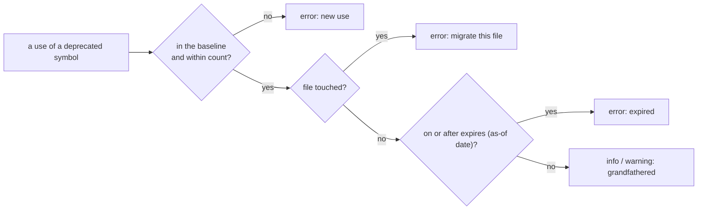

# SR-BASELINE — grandfather existing violations with a deadline and a touch policy; deprecations are its first user

## §1 — For humans

**The use case.** A function is deprecated. You want three things:
- **No new uses anywhere:** an error immediately.
- **Existing uses may stay until a date**, recorded in a file.
- **If someone edits a file that still uses it, that file must migrate now:** an error in that file.

**The decision.** It's two pieces, and the first is general:

1. **The baseline** works for *any* rule, not just deprecations. A committed list records how many violations of a rule each file is allowed to keep, until when, and what happens when the file is touched. New violations always fail. The list can only shrink without review.
2. **The deprecations registry** is a file listing deprecated symbols, their replacements and deadlines. The engine's own rule `graph/no-deprecated-usage` (it ships with the engine, not in a pack; [SR-RULE-PACKS](0101_rule-packs.md) decision 1) uses the [project graph](0103_project-graph.md) to find real uses (including aliased and re-exported imports), and the baseline to grandfather the existing ones.

The same baseline also lets you switch on any new rule in a legacy repo: freeze today's violations, block new ones, and burn the old ones down.

**Prior art:**
- **ESLint bulk suppressions:** a committed suppressions file; new violations still fail; a suppression that no longer occurs fails the run until it's pruned.
- **Notion's ratchet:** counts per file and rule, not line numbers, so moving code doesn't break it; counts may only go down; raising one needs approval.
- **Betterer:** snapshots that can't get worse.
- **unicorn `expiring-todo-comments`:** deadlines in the code itself.
- **PEP 702 `@deprecated`** and **JSDoc `@deprecated`** (typescript-eslint `no-deprecated`): in-code deprecation markers.



<details>
<summary><b>ASCII twin</b></summary>

```text
   use --> in baseline & within count? --no--> error (new use)
                 | yes
                 v
           file touched? --yes--> error (migrate now)
                 | no
                 v
           on/after `expires`? --yes--> error (expired)
                 | no
                 v
           info / warning (grandfathered)
```

</details>

---

## §2 — For agents

### Context

Deprecating a function means three things: no new uses, old uses allowed until a date, and migration whenever a file using it is edited. Adopting any new rule in a legacy repo needs the same freeze.

### Decision


#### 1. The baseline file: one per rule, count-based

`.codelaw/baseline/<rule-id>.toml`, written only by `codelaw baseline …` and reviewed in PRs:

```toml
# .codelaw/baseline/graph--no-deprecated-usage.toml
[[allow]]
file      = "packages/web/src/orders/list.tsx"
symbol    = "@acme/utils#formatDate"      # omitted for rules that aren't symbol-based
count     = 3                             # occurrences this file may keep
expires   = "2027-04-01"                  # the first day it fails; inherited from the deprecation; may be set per entry
on_touch  = "error"                       # error | warn | keep
reason    = "ORD-1432 migration"
added_by  = "lead@example.com"            # optional; checked against git (decision 9)
```

- **Counts per file, not line numbers.** Moving code around doesn't invalidate the baseline; adding a use does.
- **One file per rule** keeps diffs small and merge conflicts rare. The file name is the rule id with `/` written `--`. Entries are sorted by file, then symbol, so the output is deterministic ([L5](0007_LAW-5-no-model-in-the-engine.md)).
- **Keys:** `file` and `count` are required; `symbol`, `expires` (the first day the entry no longer holds), `warn_from` (the start of the warning window), `warn_days`, `on_touch`, `reason` and `added_by` are optional — decision 9 gives the dated ones. `until`, the last allowed day, is still read for one minor release as `expires` the day after. An unknown key, a malformed date, `until` and `expires` on one entry, a `warn_from` not before `expires`, or two entries for the same file and symbol make the run fail with exit 2, as a config error does. Dates are `YYYY-MM-DD`, quoted or bare.
- **Defaults:** an entry without `expires`, `warn_from`, `warn_days` or `on_touch` inherits the deprecation's; with none there either, `on_touch` is `error` and there is no deadline. `baseline add` writes `on_touch` explicitly, and writes `expires` where a file said `until`.
- **The engine reads the folder at load,** so a warm process ([SR-ARCHITECTURE](0108_architecture.md) decision 22), which loads per request, serves a changed baseline at once.

#### 2. What each occurrence becomes

| Situation | Result |
|---|---|
| Use in a file with no baseline entry | the rule's own finding, unchanged: for `graph/no-deprecated-usage` an **error** ("`formatDate` is deprecated; use `formatISO` (deadline 2027-03-31)") |
| More occurrences than the file's `count` | **every occurrence in the file at the rule's own severity**, each saying "4 in this file; the baseline allows 3": counts can't tell which one is new (ESLint's bulk suppressions do the same) |
| Within allowance, before the warning window | **info:** "grandfathered, expires 2027-04-01 (3 left in this file)"; exit 0 |
| Within allowance, in the warning window (from `warn_from`, else `expires` − `warn_days`) | the findings stay **info**; the entry itself gets one **warning**, `codelaw/expiring-exception`, at its `[[allow]]` line: "expires in 12 days (2027-04-01)" (decision 9) |
| On or after `expires` | the entry covers nothing: **every finding is back at its rule's own severity**, and the entry is an **error**, `codelaw/expired-exception`, at its own line (decision 9) |
| Within allowance, but **the file is touched** and `on_touch = "error"` | **error for every occurrence in that file:** "you edited this file; migrate its 3 uses of `formatDate` now" |
| Baseline allows 3, file now has 2 | **error, `codelaw/stale-baseline`,** on that file. `codelaw baseline prune` lowers it, and `codelaw fix` prunes too (always safe). An entry is judged stale only when the run saw the whole of its rule in its file: a run of other paths, or `--rule` of another rule, leaves it alone |

- **The order** is the flowchart's: the count first, then the touch, then the dates — except that on or after `expires` the entry covers nothing, so its findings are back whether or not their file was touched.
- **Without an as-of date** (no `git`, no `--as-of`), a grandfathered finding stays `info` and the header says deadlines were not evaluated.

#### 3. What "touched" means

A file is touched when it's in the **change set**, and the change set always comes from an explicit source:

| Where codelaw runs | Change set |
|---|---|
| CI on a PR | `--changed-since origin/main` (diff against the merge base) |
| Pre-commit | `--staged` (what `codelaw init --git-hooks` installs: [SR-CLI-MCP](0115_cli-and-mcp.md) decision 11) |
| Agent hook | The file the agent just edited |
| Plain `codelaw check` | **Empty:** nothing counts as touched |

- The change sets add up: `--changed-since` and `--staged` together count both. Paths come from `git diff --name-only --relative` run in the project root, so they are project-relative.
- **Without `git`** or outside a repository, the flag adds a warning saying so, marks nothing as touched, and the rest of the run goes on ([SR-ARCHITECTURE](0108_architecture.md) decision 14).
- `on_touch_scope = "file"` is the default. `"function"` narrows it to occurrences inside a function whose lines changed in the diff.

#### 4. The clock is an input, never read implicitly ([L5](0007_LAW-5-no-model-in-the-engine.md))

- Deadlines need "today", but reading the wall clock would let the same commit pass yesterday and fail today on two machines.
- **The as-of date defaults to the commit date of `HEAD`.** The same commit gives the same verdict everywhere: on a laptop, in CI, or in an agent's hook.
- **`--as-of 2027-04-01`** checks against any date. Use it to see what will break after a deadline before it arrives.
- **The order:** `--as-of`, then `CODELAW_AS_OF`, then the commit date of `HEAD` (`git log -1 --format=%cI`, the date part, in the committer's own time zone). A malformed date is a usage error, exit 2.
- **No `git` binary or no repository** (for example, a tarball): `--as-of` or `CODELAW_AS_OF` is required for date-based results ([SR-ARCHITECTURE](0108_architecture.md) decision 14). Without it, deadlines aren't evaluated, and the report says so in its header.
- **The header:** whenever a baseline or the deprecations registry is in play, `text` and `agent` output open with `as-of 2026-10-18 (HEAD commit date)` (or `as-of: none (<why>); deadlines are not evaluated`), and `json` carries `as_of: { date, source }`. With neither, nothing is read and nothing is printed.
- **The test:** `crates/codelaw-cli/tests/baseline.rs` checks the same commit with the wall clock in UTC+14 and in UTC−12, which are always on different calendar days, with a deadline between them, and requires byte-identical output.

#### 5. The ratchet: counts only go down

- **Lowering is automatic:** `codelaw fix` and the pre-commit hook run `baseline prune`. Fixing a use is never blocked by bookkeeping.
- **Raising a count, adding an entry or moving an `expires` later takes one explicit command:** `codelaw baseline add --rule <id> [--file …] --reason "…"`.
- **CI enforces it:** `codelaw baseline check --since origin/main` compares the baseline files at the merge base (read with `git show`) with the working tree, and exits 1 if any count rose, any entry was added, any deadline (`expires`) moved later or was removed, or any `on_touch` got less strict (`error` > `warn` > `keep`). Lowering a count and removing an entry always pass, and so do adding a `reason` or an `added_by` and rewriting an `until` as the `expires` the day after. Without `git` it is a usage error, exit 2.
- **Approval** comes from a `CODEOWNERS` entry on `.codelaw/baseline/`, the platform's own review, with nothing invented. `baseline check` warns on stderr when no `CODEOWNERS` (`.github/`, the root, `docs/`, `.gitlab/`) assigns an owner to that folder.
- **`baseline add`** records the rule's current counts for every file (or the `--file`s given), sets `--expires` (or `--until`, read as the day after), `--warn-from`, `--warn-days`, `--on-touch`, `--reason` and `--added-by` (by default `git config user.email`) on the entries it writes, and is the one command that raises a count. `baseline prune [paths]` and `fix` only lower.
- **Adopting a new rule in a legacy repo:**
  1. `codelaw baseline add --rule js/exports-at-end --expires 2027-07-01`
  2. From then on, new violations fail and old ones count down.

#### 6. The deprecations registry

`.codelaw/deprecations.toml`:

```toml
[[deprecated]]
symbol      = "@acme/utils#formatDate"         # JS/TS: <package or path>#<export>
replacement = "@acme/utils#formatISO"
expires     = "2027-04-01"
warn_from   = "2027-03-01"
on_touch    = "error"
reason      = "Timezone bugs — see ADR-0042"
rewrite     = { from = "formatDate($D)", to = "formatISO($D)" }   # optional → `suggest` fix

[[deprecated]]
symbol      = "acme.billing.legacy:compute_tax"  # Python: <module>:<qualname>
replacement = "acme.billing.tax:compute"
expires     = "2027-07-01"
on_touch    = "error"
reason      = "Replaced by the new tax engine"
```

- **In-code markers also count:**
  - JSDoc `@deprecated` on an export;
  - Python `@deprecated(...)` (PEP 702: `warnings.deprecated` from Python 3.13, `typing_extensions` before that).

  A marked symbol with no registry entry gets the `[deprecation]` defaults from `codelaw.toml` — `[deprecation] expires` (or `[deprecation] until`, read as the day after), `[deprecation] warn_from`, `[deprecation] warn_days` and `[deprecation] on_touch`, the same keys as an entry — and the marker's message becomes the finding's "Why". The registry adds deadlines and policy.
- **When the rule runs.** It needs the whole graph, so it runs only when the project asks: a `.codelaw/deprecations.toml`, a `[deprecation]` table, or `graph/no-deprecated-usage` named in `[rules]`. It is an engine rule ([SR-RULE-PACKS](0101_rule-packs.md) decision 1): `codelaw explain` shows it, `--rule` selects it, and `[rules]` sets its severity or turns it `off`. `codelaw-ignore graph/no-deprecated-usage: <reason>` suppresses one use.
- **What counts as a use:** each read of the imported binding, or the import itself when it is never read; a re-export only passes the name on, and the uses through it are counted where they are. A symbol of a package outside the project (`date-fns#format`) is found by its import specifier.
- **Identity comes from the [project graph](0103_project-graph.md).** `import { formatDate as fd } from "@acme/utils"`, a barrel re-export, and `from acme.billing.legacy import compute_tax as ct` are all caught. A local function that happens to be named `formatDate` is not.
- **Fix ([L4](0006_LAW-4-every-rule-has-a-fix.md)):** with a `rewrite`, the fix is `suggest` (a diff, because call semantics may differ). Without one, it's `manual`, and the steps name the replacement and quote `reason`. The `rewrite` is read and checked but not applied yet, so every finding is `manual` for now.
- **Seeding the baseline:** `codelaw deprecate @acme/utils#formatDate --replacement … --expires …` does two things in one reviewed change:
  1. appends the registry entry, leaving the rest of the file as written;
  2. runs `baseline add` for every current use of that symbol, copying its `expires`, `warn_from`, `warn_days`, `on_touch` and `added_by` into the entries so the ratchet guards them.

#### 7. Running it

```
$ codelaw check --changed-since origin/main --format agent
as-of 2026-10-18 (HEAD commit date)
packages/web/src/cart/total.ts:8:10 graph/no-deprecated-usage `formatDate` is deprecated; use `formatISO` (expires 2027-04-01) — fix: manual — …
packages/web/src/orders/list.tsx:22:7 graph/no-deprecated-usage `formatDate` is deprecated; use `formatISO` (expires 2027-04-01); you edited this file: migrate its 3 occurrences now (on_touch = error) — fix: manual — …
packages/web/src/orders/list.tsx:40:7 …
packages/web/src/orders/list.tsx:61:12 …
packages/api/app/billing.py:31:12 graph/no-deprecated-usage `compute_tax` is deprecated; use `compute` (expires 2027-07-01); grandfathered, expires 2027-07-01 (1 left in this file) — fix: manual — …
4 errors, 0 warnings, 1 infos
exit 1

$ codelaw check --as-of 2027-04-01          # what breaks on the day it expires?
… 47 errors: every remaining use of `formatDate` reached its `expires`, 2027-04-01
```

#### 8. Agents get the same rules, earlier

- **`rules_for_path`** (MCP) includes the deprecations that apply to the file. For example: "`formatDate` is deprecated, use `formatISO`; this file has 3 grandfathered uses that become errors as soon as you edit it." The agent migrates while it's already in the file, instead of being blocked after.
- **The hook** treats the agent's edited file as touched, so it gets exactly the CI verdict ([L5](0007_LAW-5-no-model-in-the-engine.md) parity).
- **MCP:** `check_paths` and `fix_paths` take `as_of`, `changed_since` and `staged`, the twins of the three flags; `check_snippet` applies the baseline to the file's own rules as `check` does ([SR-CLI-MCP](0115_cli-and-mcp.md) decision 5).
- **No skill may raise a baseline count or extend a deadline** ([SR-AGENT-SURFACES](0102_agent-surfaces.md) §4). Only a person runs `baseline add`.

#### 9. Dated exceptions: `expires`, a warning before it, an optional reason and author

*The decider's ruling, 2026-10-25 (W-40; [the compare](../work/compare/ci-profiles-and-dated-exceptions.compare.md) forks 4 and 6).*

- **What an exception is:** a baseline entry, a deprecations-registry entry, an inline `codelaw-ignore` ([SR-LINTER](0106_linter.md) decision 6). The same keys on each — inline they are `key=value` words before the colon, `by=` for `added_by`, and the reason after it:

  ```toml
  # codelaw.toml
  [exceptions]
  require_expiry = true   # default false: an exception without a date is fine
  warn_days      = 3      # default 3
  ```

  ```ts
  // codelaw-ignore js/no-console expires=2026-11-15 by=arpit@example.com: needed until the logger lands
  ```

- **`expires`** is `YYYY-MM-DD`, the **first day the exception no longer holds**. `until` (the last allowed day) is read for one minor release as `expires = until + 1`, then removed (SR-CONFIG's rename rule); both on one entry is a load error, exit 2 (inline: the comment is reported as unreadable and covers nothing).
- **`warn_days`** — optional; default `[exceptions] warn_days` (3). Where `warn_from` is allowed (a baseline or registry entry) it still wins.
- **`reason`** — optional on a file, required inline (SR-LINTER decision 6, unchanged).
- **`added_by`** (`by=` inline) — optional; an email.
- **The timeline**, on the as-of date (decision 4, never the wall clock):

  | as-of date | result |
  |---|---|
  | before `expires` − `warn_days` (or `warn_from`) | as without a date: suppressed (inline) or `info` (baseline) |
  | from then | **warning**, `codelaw/expiring-exception`, at the exception's own line: "expires in 2 days (2026-11-15)" |
  | on or after `expires` | **error**, `codelaw/expired-exception`, at the exception's own line, and the exception covers nothing — the rule's findings come back at their own severity |

  A baseline entry's line is its `[[allow]]` in its baseline file; an entry that inherits its date from the registry is reported at its own line too. Without an as-of date nothing expires, as in decision 4. A cached result of a file holding a dated `codelaw-ignore` is keyed by the as-of date.
- **`[exceptions] require_expiry = true`:** each exception without a date is an **error**, `codelaw/exception-without-expiry`, at its line — a baseline entry counts as dated when it inherits `expires` from its deprecation. Fix `manual`: add `expires`; `baseline add --expires` rewrites an entry. `[[overrides]]` are configuration, not exceptions: the switch never applies to them.
- **The `added_by` check**, `codelaw/exception-author` (error):
  - always: a malformed email;
  - under `--staged`: each exception the index adds or changes (a line of it in `git diff --cached -U0`) whose `added_by` is not `git config user.email`, ignoring case;
  - under `--changed-since <ref>`: each exception changed since the merge base whose `added_by` is not the `author-mail` of `git blame --porcelain` on its line (its `added_by` line, else its first); a line not committed yet is the committer's own, `git config user.email`. One `git blame` per changed file that holds such an exception;
  - plain `check`, the hook and the editor: the format only. Without `git` the flag's warning says the author was checked for its format only. An absent `added_by` is never an error.
- **The ratchet** (decision 5) compares `expires`: moving it later is extending a deadline and fails `baseline check`; adding `added_by` or a `reason` never does.
- **`baseline add` and `deprecate`** take `--expires`, `--warn-days` and `--added-by` (default `git config user.email`), so nobody hand-writes an entry; `--until` stays as the alias.
- **The four engine rules** carry their fix class and steps ([SR-RULE-PACKS](0101_rule-packs.md) decision 1): `codelaw/expiring-exception` (`warn`), `codelaw/expired-exception`, `codelaw/exception-without-expiry`, `codelaw/exception-author` (`error`), all `manual`.
- **The hazard it names:** a branch with no new commit does not start failing on the day, because the as-of date is `HEAD`'s; a scheduled CI job passes `--as-of "$(date +%F)"`.

### Consequences

- **The baseline is committed and reviewed**, and CODEOWNERS approval on it is a process cost.
- **As-of defaults to the `HEAD` commit date**, so a long-lived branch sees its own date. Accepted; `--as-of` overrides.
- **Counts, not locations:** a use removed and another added in the same file net out on the count. Accepted (Notion's trade-off). The touch policy is what closes the hole — see the veto condition.

### Alternatives considered

- **Line-number baselines:** rejected. Every refactor breaks them.
- **An inline ignore comment on each use:** rejected. Noise in the code, no deadline, no ratchet.
- **Wall-clock "today":** rejected by [L5](0007_LAW-5-no-model-in-the-engine.md).

### Reference (required)

- [ESLint bulk suppressions](https://eslint.org/docs/v9.x/use/suppressions): a committed suppressions file, and unused suppressions fail the run.
- [Notion's ratchet](https://www.notion.com/blog/how-we-evolved-our-code-notions-ratcheting-system-using-custom-eslint-rules): per-file counts that only go down, and raising one needs approval.
- [PEP 702](https://peps.python.org/pep-0702/): `@deprecated` in the type system.
- [unicorn `expiring-todo-comments`](https://github.com/sindresorhus/eslint-plugin-unicorn/blob/master/docs/rules/expiring-todo-comments.md): deadlines in code.

### Veto condition

**Reopen this decision if:** in practice, a count-based baseline lets a new use slip in by offsetting a removed one.

**How to check it:** `cargo test -p codelaw-baseline veto && cargo test -p codelaw-cli --test baseline the_change_set_and_the_ratchet` — each removes one use and adds another in the same file.

**Result (W-13, 2026-10-22):** **yes, under plain `check` the swap passes:** nothing is touched, the count holds, and both occurrences stay grandfathered. **With the file in the change set it fails:** the swap edits the file, so `--changed-since`, `--staged` or the agent hook makes every occurrence an error under the default `on_touch = "error"`. The hole stays open in exactly two cases: an entry with `on_touch = "keep"` (or `"warn"`, which does not fail the run), and a CI that runs `codelaw check` without `--changed-since`. The decision stands; the reopen trigger is now a CI that gates on plain `check`, or a team that sets `keep` widely.

---

## References

*Every source this record cites, gathered in one place. An archived document is never listed here.*

**Records** — [SR-AGENT-SURFACES](0102_agent-surfaces.md) · [SR-RULE-PACKS](0101_rule-packs.md)

**Project docs** — [`docs/DESIGN.md`](../docs/DESIGN.md)
