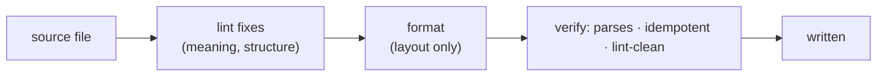

# SR-FORMATTER — codelaw is a linter and a formatter: one binary, one config, one run

## §1 — For humans

**The decision.** codelaw does both jobs. **The linter owns meaning and structure.** **The formatter owns layout:** whitespace, line breaks, indentation, quotes, semicolons and trailing commas. One binary, one `codelaw.toml`, one command, and the two never fight over the same characters.

**What you run:**

| Command | Does |
|---|---|
| `codelaw format` | Formats files in place (like `prettier --write` / `ruff format`) |
| `codelaw format --check` | Changes nothing; exit 1 if any file isn't formatted (CI) |
| `codelaw fix` | Lint fixes first, **then** formats, then verifies the result |
| `codelaw check` | Lint findings plus one `format/unformatted` finding per unformatted file (`auto` fix, [L4](0006_LAW-4-every-rule-has-a-fix.md)) |

**No Node, no Python, no Prettier install.** Each language's formatter is embedded in the binary, so a Python-only repo gets Prettier-style JSON and Markdown formatting, and a JS-only repo gets Black-style Python, without either runtime ([L3](0005_LAW-3-languages.md), [L6](0008_LAW-6-python-and-node-packages.md)).



<details>
<summary><b>ASCII twin</b></summary>

```text
   source --> lint fixes (meaning) --> format (layout) --> verify (parses, idempotent, lint-clean) --> written
```

</details>

---

## §2 — For agents

### Context

Teams run a linter and a formatter as two tools: ESLint plus Prettier, or Ruff check plus Ruff format, plus yet another tool for YAML and TOML. They have two configs that can contradict each other, and agents have to know both. The decider asked for codelaw to be both.

### Decision

1. **One tool, two roles.** `codelaw format [paths] [--check]` is the formatter. `codelaw fix` runs lint fixes and then formats. `codelaw check` reports unformatted files as `format/unformatted` (fix class `auto`). Set `[format] check = false` to leave formatting out of `check`.

2. **The embedded engines.** Each one is compiled into the binary; none is invoked as an external program.

   | Language | Engine | Output style | Licence | How it's pulled in |
   |---|---|---|---|---|
   | JS · JSX · TS · TSX | Biome formatter (`biome_js_formatter`) | Prettier-compatible (Biome tracks its Prettier compatibility in a published report) | MIT / Apache-2.0 | git dependency pinned to a Biome release tag; the crates.io copies are stale |
   | JSON · JSONC | Biome formatter (`biome_json_formatter`) | Prettier-compatible | MIT / Apache-2.0 | same pin |
   | Python | Ruff formatter (`ruff_python_formatter`) | Black-compatible (> 99.9 % identical lines on Django and Zulip, per Ruff) | MIT | crates.io, pinned exactly (`=0.0.18`, the crates Ruff 0.17.1 publishes) |
   | YAML | `pretty_yaml` | configurable, close to Prettier's YAML style | MIT | crates.io |
   | TOML | `taplo` formatter | taplo style | MIT | crates.io |
   | Markdown | `dprint-plugin-markdown` | CommonMark/GFM, dprint style | MIT | crates.io |
   | CSS | Biome formatter (`biome_css_formatter`) | Prettier-compatible; standard CSS only (no SCSS/Less) | MIT / Apache-2.0 | same Biome pin |
   | HTML | `markup_fmt` | Prettier-like; embedded `<script>` and `<style>` are handed to the JS and CSS engines through its callback | MIT | crates.io |

   Every engine must pass [L2](0004_LAW-2-foss-dependencies.md); `crates/codelaw-cli/tests/licences.rs` checks every crate in `Cargo.lock`, the git-pinned Biome ones included. One transitive crate failed L2: Biome reaches `option-ext` (MPL-2.0) through `directories`. The workspace's `[patch.crates-io]` replaces it with `crates/codelaw-format/shims/option-ext`, an MIT re-implementation of the one trait method `dirs-sys` uses; the licence check sees the shim, not the original. The engine versions are `codelaw_format::ENGINES_FINGERPRINT`, part of every cache key a format result enters (decision 7).

3. **Layout belongs to the formatter, and the rule loader enforces it.** A lint rule whose fix only changes layout is refused. Layout is what codelaw's own parser does not see: `codelaw test` checks this deterministically, and the same on every machine and under every formatter version — if a `Don't` has the same token stream as a `Do` (or `Fixed`), the two differ only in layout, the rule is a layout rule, and it fails. This is the formatter-versus-linter fight that ESLint's stylistic rules caused, ruled out by construction. (Decided `W-28`, on the decider's ruling of 2026-10-22: *"biome is not the right thing to reference. build how we design it."*)
   - **How:** for every language's examples, each `Don't` is compared with each `Do` and `Fixed` by `codelaw_lang::token_stream`, file by file for a multi-file snippet (the file's path is part of the comparison). The stream is every visible node of the tree in pre-order, each with its depth and kind, and each leaf with its exact text; whitespace no token holds is not in it. Equal streams fail the `Don't` at the examples level with a message naming this decision ([SR-RULE-AUTHORING](0113_rule-authoring.md) decision 4). The walk runs per example at `codelaw test` time, never in `check` ([L8](0010_LAW-8-performance-budgets.md)).
   - **What counts as a token, for all nine grammars:**
     - a **comment** is a token with its text, although tree-sitter parses it as an extra: a fix that edits or deletes a comment is not layout;
     - **text no node holds** (Markdown's inline grammar leaves plain words outside any node) is split on whitespace into `text` tokens, so a changed word is a changed token;
     - **depth** carries the structure that hidden tokens hold — Python's and YAML's indentation — so re-indenting a statement into another block is not layout;
     - **embedded regions** (`<script>`, `<style>`, `style=""`, Markdown code blocks and inline content) are compared region by region in their own language;
     - **a leaf's text is compared exactly**, so whitespace inside a string, a template, a regular expression, JSX text, an HTML text node or a Markdown inline run is token text, not layout;
     - **quotes, semicolons and trailing commas are tokens.** The formatter still owns them (§1), but a rule that only changes them is not refused: the advisory check below reports it. **Confirmed by the decider, 2026-10-24 (`W-28`)**, together with `not(`/`not (` being layout under codelaw's CSS tokens (B-045).
   - **The formatter is evidence, not the judge.** After the token check passes, each `Don't` is also formatted with the default options and compared with each `Do` and `Fixed` formatted the same way. Equal formatted texts with different tokens mean the formatter changes tokens there — a quote style, or a meaning change such as B-045's — and `codelaw test` prints a warning naming the engine and B-045. It is never a failure. A snippet the formatter cannot format is not compared.
   - **Measured on the nine packs, 2026-10-24 (`W-28`, re-run on the `W-31` layout):** every one of the 419 rules passes the token check and no rule draws the advisory warning.
     - `js/no-irregular-whitespace`: a no-break space between tokens is not in the token stream, so that part is layout and stays the formatter's; inside a template, a regular expression, JSX text or a comment it is token text, so the rule as narrowed on 2026-10-22 (`W-23`) stands, with its `suggest` fix that escapes the character.
     - `css/media-query-no-invalid`: CSS Syntax reads `not(` as a function token and `not (` as an identifier and a parenthesis, but codelaw's CSS grammar parses both to the same tree, so by codelaw's tokens the two differ only in layout. The rule's `Don't` is the mixed `and`/`or` query, which has different tokens from its `Do`; `not(` stays a case in its `.cases.md`, where the layout check does not run. Biome rewriting `not(` to `not (` is B-045.

4. **Order of operations:**
   1. Parse.
   2. Lint fixes, multi-pass up to the fixpoint.
   3. Format.
   4. Verify: the file still parses, a second `format` changes nothing, and no lint rule fires that didn't fire before formatting.

   If verification fails, the file is left untouched and the failure is reported ([L4](0006_LAW-4-every-rule-has-a-fix.md) decision 5).
   - **What verification checks:** the formatted text parses with the engine's own parser; a second format changes nothing; for JSON, YAML and TOML it holds the same data as the original; and no lint rule fires on it that did not fire before.
   - **How a failure is reported:** `format/failed` (`info`, `manual`), with note `format-syntax` (the input does not parse), `format-engine` or `format-verify-failed`. In `fix`, a failed format keeps the lint fixes and drops only the format.
   - **Where the step runs:** `fix` on disk and MCP `format_snippet` format; `fix --dry-run` does too. The rule tester and the LSP's "fix all" (`fix_source`) do not: an editor formats through its own formatting request.

5. **One config, Prettier/Black-shaped keys.**
   ```toml
   [format]
   enabled         = true
   check           = true          # report unformatted files in `codelaw check`
   line_width      = 80
   indent_style    = "space"       # space | tab
   indent_width    = 2
   end_of_line     = "lf"
   quote_style     = "double"      # JS/TS
   semicolons      = "always"      # JS/TS: always | as-needed
   trailing_commas = "all"         # JS/TS: all | es5 | none
   exclude         = ["**/generated/**"]

   [format.python]
   line_width  = 88                # Black/Ruff default
   indent_width = 4

   [format.markdown]
   format_code_blocks = true       # fenced js/ts/py/json/yaml/toml blocks use their own formatter
   ```
   - **Defaults:** Prettier's for JS/TS/JSON/CSS/HTML/YAML/Markdown; Black/Ruff's for Python. One exception: `end_of_line` unset keeps each file's dominant line ending, because only a set `end_of_line` may change one ([SR-ARCHITECTURE](0108_architecture.md) decision 9).
   - **`.editorconfig` is always read** as the base layer; `codelaw.toml` wins over it.
     - **Which files:** as the EditorConfig specification says, the `.editorconfig` in the file's folder and in each folder above it, up to one with `root = true`; the nearer file and the later section win. Each folder's file is read once per run (`crates/codelaw-format/src/editorconfig.rs` parses, `codelaw-engine` caches), and a file's resolved options are part of its cache key. A project with no folder on disk (the rule tester's) reads none.
     - **Which properties:** `indent_style` → `indent_style`; `indent_size` (or `tab_width` when it is `tab` or unset) → `indent_width` and `[format.python] indent_width`; `end_of_line` (`lf`, `crlf`) → `end_of_line`; `max_line_length` → `line_width` and `[format.python] line_width`. A value out of the key's range, `cr` or `off` is ignored, and `unset` removes a property.
     - **What wins:** a key `[format]` (or `[format.python]`) sets is never changed by `.editorconfig`. Section globs go through `globset` (MIT / Unlicense), already a dependency of the engine.
   - **Migrating from existing configs:** `codelaw format --import-config` reads `.prettierrc*`, `[tool.ruff.format]` and `[tool.black]` once and writes the equivalent `[format]` keys. From then on, `codelaw.toml` is the only source.
     - **What is read** (`crates/codelaw-format/src/import.rs` translates; `codelaw-cli` reads and writes): in the project root, `.prettierrc` (JSON or YAML), `.prettierrc.json`, `.yaml`, `.yml`, `.json5`, `.toml`, and `package.json`'s `"prettier"` object; `pyproject.toml`'s `[tool.ruff]`, `[tool.ruff.format]` and `[tool.black]`. A Prettier config that is a program (`.prettierrc.js`, `prettier.config.*`, …) is never run ([L5](0007_LAW-5-no-model-in-the-engine.md)) and is listed as not imported, as is a string naming a shared config package (an error).
     - **The mapping:** `printWidth` → `line_width`, `tabWidth` → `indent_width`, `useTabs` → `indent_style`, `endOfLine` (`lf`, `crlf`) → `end_of_line`, `singleQuote` → `quote_style`, `semi` → `semicolons`, `trailingComma` → `trailing_commas`. Ruff's `line-length` and `indent-width` (top-level `[tool.ruff]`, where Ruff keeps them, not `[tool.ruff.format]`) and Black's `line-length` → `[format.python]`. Ruff's `[tool.ruff.format]` options have no `[format]` key, so codelaw keeps Ruff's defaults for them. Every setting with no key is printed as `not imported: …`, never guessed at.
     - **Order and once:** the first source to give a key keeps it (Prettier's files in the order above, Ruff before Black). A key the config already sets is kept as written and printed as `kept`; so a second run writes nothing. Nothing is formatted.
     - **Where it writes:** the project's config — `codelaw.toml`, or `[tool.codelaw.format]` when the config lives in `pyproject.toml`; a project with none gets `codelaw.toml`. A config in `package.json` is refused with exit `2` (the command writes TOML). The rest of the file is kept byte for byte through `toml_edit` (MIT OR Apache-2.0).

6. **Ignore markers.**
   - **codelaw's own:** `// codelaw-format-ignore` and `# codelaw-format-ignore` skip the next node.
   - **Honoured for compatibility:** `// prettier-ignore`, `<!-- prettier-ignore -->`, and Ruff/Black's `# fmt: off` / `# fmt: on` and `# fmt: skip`.
   - **Whole files:** `[format] exclude`.
   - **How every engine honours them** (`crates/codelaw-format/src/markers.rs`). A marker is a comment in the language's own syntax (`//` or `/* */` in JS/TS/JSON, `/* */` in CSS, `#` in Python/YAML/TOML, `<!-- -->` in Markdown/HTML) whose text starts with the marker word.

     | engine | how |
     |---|---|
     | Biome (JS · TS · JSON · CSS) | the marker is rewritten to Biome's own `biome-ignore format: codelaw` before formatting and restored after |
     | pretty_yaml · dprint-plugin-markdown · markup_fmt | each is configured with `prettier-ignore` as its directive; `codelaw-format-ignore` is rewritten to it and restored. Markdown also takes `<!-- prettier-ignore-start -->` … `<!-- prettier-ignore-end -->` |
     | Ruff (Python) | Ruff's own `# fmt:` pragmas work as they are. An own-line marker followed at its own indentation by a statement becomes `# fmt: off`, and a `# fmt: on` follows that statement; both are undone after. A marker inside an expression, or with no statement after it at its level, skips nothing |
     | taplo (TOML) | taplo has no directive: the file is formatted, then the next entry, table header or array element after each marker is put back as it was written |

     Restoring goes by order: a marker the engine drops or moves fails the file with `format-engine`, so a fenced-off node is never reformatted silently. pretty_yaml applies a marker before a block's first entry to the whole block, not only that entry. The statement tree comes from `ruff_python_ast` and `ruff_text_size` (MIT, `=0.0.18`, the same Ruff release as the formatter).

7. **Deterministic and stable ([L5](0007_LAW-5-no-model-in-the-engine.md)).**
   - The same input and the same codelaw version always give byte-identical output.
   - A pinned engine upgrade that changes output for any corpus file is a **minor** release, and the changelog lists the changed styles.
   - Already-formatted files are skipped using the content-hash cache.

8. **Every surface.**
   - **LSP:** document and range formatting, and format-on-save. Range formatting formats and verifies the whole document as document formatting does — the engines format whole files — then returns only the changed runs of a line diff (`similar`, Apache-2.0, the CLI's `=2.7.0` pin) that touch the selection's lines; a run that maps line for line is split per line, so a selection takes only its own lines. A selection ending at column 0 does not take that line. A document already formatted gets no edits.
   - **Agent hook ([SR-AGENT-SURFACES](0102_agent-surfaces.md)):** runs `fix` then `format` on the edited file, so an agent never hand-formats and never fights the formatter.
   - **MCP:** a `format_snippet` tool: the bytes `fix <path>` would write, format step included.
   - **Generated agent instructions** say "don't format by hand; codelaw formats on save".

### What is built

Built 2026-10-21 (`W-07`): decisions 1, 2, 4 and 7; decision 5's keys and `exclude`; decision 8's LSP document formatting and MCP tool. Built 2026-10-22 (`W-23`): decision 3's refusal in `codelaw test`, with every pack passing it — decided by the formatter's output until 2026-10-24, when `W-28` made the token stream the judge and the formatter an advisory cross-check; decision 5's `.editorconfig` layer and `--import-config`; decision 6's markers in every engine; decision 8's LSP range formatting. The agent hook is `W-10`'s; nothing else in this record is missing.

### Consequences

- **Two engines are git-pinned with unstable APIs** (Biome, Ruff). Upgrades are deliberate, gated by a snapshot corpus, and a breaking upstream change can stall them. `dprint-plugin-ruff` shows the approach is sustainable.
- **Git dependencies mean the engine crate can't be published to crates.io.** That doesn't matter: [L6](0008_LAW-6-python-and-node-packages.md) ships through npm and PyPI.
- **"Prettier-compatible" isn't "identical"** on every edge case for JS, and YAML and Markdown follow their engines' styles. Measured 2026-10-21 by `scripts/format-parity.py` against Prettier 3.6.2 and Black 25.9.0, on 1,688 files: every fenced example in `packs/` plus the repo's own tracked files, at commit `67beb69`. All options were defaults. A file either tool cannot parse is skipped.

  | language | vs | files compared | identical files | identical lines | skipped |
  |---|---|---|---|---|---|
  | JS · JSX | Prettier | 382 | 100.0 % | 100.0 % | 6 |
  | TS · TSX | Prettier | 424 | 100.0 % | 100.0 % | 6 |
  | JSON | Prettier | 16 | 100.0 % | 100.0 % | 0 |
  | CSS | Prettier | 189 | 97.4 % | 99.4 % | 10 |
  | YAML | Prettier | 21 | 95.2 % | 99.2 % | 5 |
  | Markdown | Prettier | 88 | 42.0 % | 96.7 % | 0 |
  | HTML | Prettier | 182 | 62.1 % | 68.4 % | 13 |
  | Python | Black | 346 | 97.7 % | 99.6 % | 0 |

  `markup_fmt` (HTML) is the one engine far from Prettier. Markdown differs in a few lines of most files. TOML has no Prettier or Black formatter to compare against.
- **The binary grows** by the size of six formatter engines. Accepted, because each package must be complete ([L6](0008_LAW-6-python-and-node-packages.md) decision 3).

### Alternatives considered

- **Shell out to Prettier and Black:** rejected. It needs Node and Python at runtime, which breaks [L3](0005_LAW-3-languages.md) independence and [L6](0008_LAW-6-python-and-node-packages.md) completeness, and it adds two more tools for users to install.
- **`dprint-plugin-typescript` for JS/TS:** kept only as a fallback. It's MIT and on crates.io, but its output isn't Prettier-compatible, which is the style teams expect.
- **Write codelaw's own formatters:** rejected. It's years of work, and mature permissive engines already exist.
- **`malva` for CSS** (MIT; handles CSS, SCSS, Sass and Less): kept as the replacement if SCSS or Less ever enter [L3](0005_LAW-3-languages.md).
- **dprint's WASM plugin host for every language:** deferred. It's one uniform plugin model, but it adds a WASM runtime and a plugin-download step that conflicts with "complete, offline" ([L5](0007_LAW-5-no-model-in-the-engine.md) decision 3).

### Reference (required)

- [Ruff formatter README](https://github.com/astral-sh/ruff/blob/main/crates/ruff_python_formatter/README.md): Black compatibility, and the crate is internal with an unstable API.
- [dprint-plugin-ruff](https://github.com/dprint/dprint-plugin-ruff): embeds `ruff_python_formatter` by pinning a Ruff tag.
- [Biome Prettier challenge hub](https://github.com/biomejs/biome/issues/720) and [`biome_js_formatter` on lib.rs](https://lib.rs/crates/biome_js_formatter): Prettier-compatibility tracking, and the crates.io copy is stale (0.5.7, March 2024).
- [`pretty_yaml` on docs.rs](https://docs.rs/pretty_yaml): an MIT, configurable YAML formatter.

### Veto condition

**Reopen this decision if:** an embedded engine's licence stops being permissive, or measured Prettier/Black compatibility on the corpus falls below what teams accept (`W-07`).

**How to check it:** `crates/codelaw-cli/tests/licences.rs` over `Cargo.lock`, and `python3 scripts/format-parity.py --binary <codelaw>`.

---

## References

*Every source this record cites, gathered in one place. An archived document is never listed here.*

**Records** — [SR-AGENT-SURFACES](0102_agent-surfaces.md)

**Project docs** — [`docs/DESIGN.md`](../docs/DESIGN.md)
