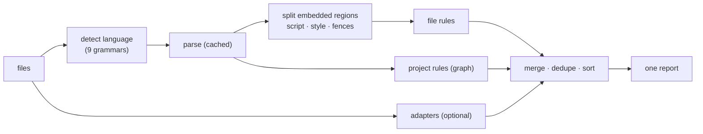

# SR-LINTER — the linter: nine languages, three rule scopes, embedded code, one diagnostic stream

## §1 — For humans

**The decision.** codelaw's linter is **one engine for nine languages**: JavaScript, TypeScript, JSON, Python, CSS, HTML, YAML, TOML and Markdown ([L3](0005_LAW-3-languages.md)). It is the partner of [SR-FORMATTER](0105_formatter.md): **the linter owns meaning and structure; the formatter owns layout.**

**Rules come in three scopes:**

| Scope | Looks at | Example | Defined by |
|---|---|---|---|
| **file** (default) | one file's syntax tree | `js/exports-at-end`, `css/no-empty-block`, `html/img-alt` | a Markdown rule with an ast-grep matcher |
| **project** | the whole-repo graph | `graph/no-unused-exports`, `graph/no-deprecated-usage` | [SR-PROJECT-GRAPH](0103_project-graph.md) |
| **adapter** | an external linter's findings | oxlint, Ruff, stylelint, html-validate | config; must pass [L2](0004_LAW-2-foss-dependencies.md) |

**Code inside other files is linted as its own language.** A `<script>` in HTML is checked by the JS/TS rules, a `<style>` by the CSS rules, and a fenced `py` block in Markdown by the Python rules (when switched on). Each finding points at the line in the host file.



<details>
<summary><b>ASCII twin</b></summary>

```text
   files --> detect language --> parse (cached) --> embedded regions --> file rules ----+
                                       |                                                 |
                                       +-------------------------> project rules -------+--> merge, dedupe, sort --> report
   files ---------------------------------------------------------> adapters (opt.) ----+
```

</details>

---

## §2 — For agents

### Context

The decider asked for an SR for the linter itself, covering JavaScript, TypeScript, JSON, Python, CSS and HTML, with YAML, TOML and Markdown kept. Until now the records described rules, packs, the graph and the formatter, but not the engine that runs rules, how it handles each language, or how languages nest inside each other.

### Decision

1. **Languages and parsers.** Every grammar is MIT-licensed tree-sitter ([L2](0004_LAW-2-foss-dependencies.md)).

   | Language | Grammar | Built into ast-grep? |
   |---|---|---|
   | JavaScript · JSX | `tree-sitter-javascript` | yes |
   | TypeScript · TSX | `tree-sitter-typescript` (both dialects; Stencil decorators parse as decorators) | yes |
   | JSON · JSONC | `tree-sitter-json` | yes |
   | Python | `tree-sitter-python` | yes |
   | CSS | `tree-sitter-css`: codelaw's in-tree fork of 0.25.0, which adds range media features, `layer()` in `@import` and fractional keyframe percentages ([SR-ARCHITECTURE](0108_architecture.md) decision 3); the `css/*` rules still read the text themselves (decision 15b there) | yes, patched in place of ast-grep's |
   | HTML | `tree-sitter-html` | yes |
   | YAML | `tree-sitter-yaml` | yes |
   | TOML | `tree-sitter-toml` | **no**: registered by codelaw as a custom language |
   | Markdown | `tree-sitter-markdown` (block + inline) | yes |

   `codelaw-lang`'s `reparse` applies one edit to a parsed text through tree-sitter's edit API, for the warm processes' incremental re-parse ([SR-ARCHITECTURE](0108_architecture.md) decision 23).

   `codelaw-lang`'s `token_stream` is a text's tokens through these grammars — what [SR-FORMATTER](0105_formatter.md) decision 3 compares to decide that a rule only changes layout. What it counts as a token in each grammar (comments, words no node holds, the depth that carries indentation, embedded regions) is that decision's, not this one's.

2. **Three rule scopes**, all in the same Markdown rule format ([SR-RULE-PACKS](0101_rule-packs.md)) and all bound by [L4](0006_LAW-4-every-rule-has-a-fix.md):
   - **`scope: file`** (the default): an ast-grep pattern or YAML rule with relational clauses (`inside`, `has`, `precedes`, `follows`) and the semantic-model predicates ([SR-RULE-FORMAT](0112_rule-format.md) decision 3a), or a `native:` rule ([SR-ARCHITECTURE](0108_architecture.md) decision 15b) for checks a pattern can't express, or for JSON, YAML and TOML a `target:` + `assert:` rule on the file's data tree ([SR-RULE-FORMAT](0112_rule-format.md) decision 3e); fixes come from the edit primitives;
   - **`scope: project`**: a `graph:` query ([SR-PROJECT-GRAPH](0103_project-graph.md));
   - **adapters**: oxlint and Ruff by default when installed; stylelint (CSS) and html-validate (HTML) available. Each one is run only if installed, its output is mapped to the three fix classes, and none of them is bundled ([L6](0008_LAW-6-python-and-node-packages.md) completeness never depends on an adapter). Built in `crates/codelaw-adapters` (W-14):
     - **Which run:** `[adapters] enabled` lists them by name (`"oxlint"`, `"ruff"`, `"stylelint"`, `"html-validate"`); unset, it is the two defaults; `[]` turns every adapter off. A name codelaw has no manifest for is a config error (exit 2), so yamllint, refused by [L2](0004_LAW-2-foss-dependencies.md) as GPL-3.0, can't be named. `[adapters] timeout` bounds each run of a program, 60 s by default. Both are root config only.
     - **Each tool's licence is in its manifest** and must be on L2's permissive list; all four are MIT. The tools are the user's install, never codelaw's dependency.
     - **The mapping, per tool** ([L4](0006_LAW-4-every-rule-has-a-fix.md) decision 9): Ruff's `safe` fix is `auto`, `unsafe` is `suggest`, `display-only` or none is `manual`; stylelint's `--compute-edit-info` fix is `auto`, the rest `manual`; oxlint and html-validate give no edits, so every finding is `manual`. A `manual` finding's steps are the tool's help line, when it gives one, and a link to the rule's docs. Positions are converted from each tool's unit (oxlint UTF-8 bytes, Ruff code points, stylelint and html-validate UTF-16 units) to codelaw's.
     - **Shown once:** an adapter finding whose tool rule a codelaw rule names in `ported_from:` (`ruff/F401`, `eslint/no-debugger`, `stylelint/<rule>`, `html-validate/<rule>`) is dropped when that codelaw rule reports the same file and an overlapping range; codelaw's finding, with codelaw's fix, stays.
     - **Off for:** `--no-adapters`, `--rule` (the run is narrowed to codelaw's rules), and every surface but the CLI's `check` and `fix` ([SR-ARCHITECTURE](0108_architecture.md) decision 19).

3. **Embedded code ("injections").** A host file's embedded regions are parsed with their own grammar and linted with their own language's rules.

   | Host | Region | Linted as |
   |---|---|---|
   | HTML | `<script>`, `<script type="module">` | JavaScript |
   | HTML | `<script lang="ts">` | TypeScript |
   | HTML | `<script type="application/json">`, `importmap` | JSON |
   | HTML | `<style>` | CSS |
   | HTML | `style="…"` attribute | CSS declarations |
   | Markdown | fenced block with a known language tag | that language, only when `markdown.lint_code_blocks = true` ([L3](0005_LAW-3-languages.md) decision 8) |
   | Markdown | YAML frontmatter | YAML |
   | Markdown | inline content (links, emphasis, code spans) | Markdown, with the inline grammar; a Markdown rule runs on whichever of the two grammars its kinds belong to |
   | JS/TS | `` css`…` `` / `` html`…` `` tagged templates | CSS / HTML, only when `[lint] tagged_templates = true` |

   - **Locations map back to the host:** diagnostics report host-file line and column.
   - **A template's `${…}` is a hole:** the region's text holds a placeholder that keeps it parseable (in CSS chosen by where it stands: a comment, a custom property, a class, `all` in `@media`, a number, `var(--…)`; in HTML `${}`). A finding wholly inside a placeholder is dropped, and a fix whose edit would touch a hole's host code is refused (`fix-outside-region`). Only a plain identifier tag, `css` or `html`, makes a region; each nested template is a region of its own. *(W-21, 2026-10-22.)*
   - **Fixes are applied in the host:** fixes edit the host text and are verified by re-parsing the host.
   - **Rules can target a host:** a rule may say `host: html` to apply only to embedded regions (for example, "no inline `<script>` without `nonce`").
   - **A language switched off is off inside hosts too,** and a region is parsed only when something applies to it ([SR-ARCHITECTURE](0108_architecture.md) decision 16).

4. **Pipeline:**
   1. Discover files (honouring `.gitignore`, `include` and `exclude`).
   2. Detect the language by extension and config.
   3. Parse, using the content-hash cache.
   4. Split out the embedded regions.
   5. Run file rules in parallel, one task per file.
   6. Run project rules.
   7. Run adapters.
   8. Merge the results, dropping exact duplicates (same file, range and rule).
   9. Sort by path, line, column and rule ([L5](0007_LAW-5-no-model-in-the-engine.md)).
   10. Print the output.

   The fix pipeline is [SR-FORMATTER](0105_formatter.md) decision 4.

5. **Severity and options.**
   - **Severity:** `error`, `warn`, `info` or `off`, set per rule in `[rules]` and per glob in `[[overrides]]`.
   - **Options:** a rule declares its options and their types in frontmatter (`options:`), and a value of the wrong type is a load error (exit 2).
   - **Exit codes:** `0` no errors · `1` errors · `2` config, rule or usage error. Warnings fail only with `--max-warnings N`.

6. **Inline suppression always needs a reason.**
   - Written in the host language's comment syntax: `// codelaw-ignore <rule>: <reason>`, `# …`, `/* … */`, `<!-- … -->`. The marker opens the comment; a comment that only mentions it (`// see codelaw-ignore docs`) is not a suppression.
   - A suppression is checked in every file, even one no rule runs on.
   - **What it covers:** a comment alone on its line covers the next line with code; a trailing comment covers its own line. Several rules are comma-separated before the colon.
   - A suppression with no reason is an error, and so is one naming a rule that doesn't exist (`codelaw/unknown-suppression`).
   - A suppression that suppresses nothing is reported as `info` with an `auto` fix that removes it.
   - Bulk freezing of existing violations is [SR-BASELINE](0104_baseline-and-deprecations.md)'s job, never a wall of inline ignores.

7. **The linter never judges layout.** A layout-only rule is refused at load ([SR-FORMATTER](0105_formatter.md) decision 3). Adapter rules that only concern layout are switched off by default (for example stylelint's stylistic rules).

8. **Performance budget.** Each file is parsed once per run and shared by every rule, and an unchanged file is served from the cache. The targets below are design targets; `codelaw bench` measures them (`check_warm_10k`, `fix_one_file`), and the first numbers and the proposed budgets are in [SR-LAW-8](0010_LAW-8-performance-budgets.md) §Measurements (`W-19`):
   - warm-cache `check` on 10,000 files: under 2 s;
   - hook mode on one file: under 100 ms.

9. **Rules per language** live in the nine rule packs of [SR-RULE-PACKS](0101_rule-packs.md), `rules-css` and `rules-html` included. The engine carries none.

### Consequences

- **Embedded-region mapping is new engine work.** Off-by-one location bugs are the main risk, so each injection kind gets its own cases in `codelaw test`.
- **CSS and HTML rules are tree-sitter only**, with no browser-compatibility data. "Does this property work in Safari 15" needs an adapter or a later data table.
- **Adapters run only from the CLI and CI, never in hook or LSP mode,** and each has a manifest with its tested version range ([SR-ARCHITECTURE](0108_architecture.md) decision 19).
- **Adapters remain optional,** so a repo without them gets only codelaw-native rules. That's the price of [L6](0008_LAW-6-python-and-node-packages.md) completeness.

### Alternatives considered

- **Embed Biome's analyzer for JS/CSS lint rules:** rejected. Its rule engine isn't a stable library and its rules aren't in codelaw's Markdown format. Biome stays in codelaw for formatting only ([SR-FORMATTER](0105_formatter.md)).
- **Separate linters per language, orchestrated (MegaLinter-style):** rejected. Many configs, no shared rule format, no cross-language injections.
- **No injection support:** rejected. HTML without its scripts and styles, and docs without their code, leave the most copy-pasted code unchecked.

### Reference (required)

- [ast-grep built-in languages](https://docs.rs/ast-grep-language): CSS, HTML, JS, TS, TSX, JSON, Python, YAML and Markdown are built in; TOML is not.
- [Biome v1.9](https://biomejs.dev/blog/biome-v1-9/): the CSS formatter and linter are stable; standard CSS only, with no SCSS.
- [`docs/DESIGN.md`](../docs/DESIGN.md) §3: the engine architecture.

### Veto condition

**Reopen this decision if:** a language in [L3](0005_LAW-3-languages.md) has no tree-sitter grammar that ast-grep can load, or an injection kind can't map diagnostics back to exact host locations.

**How to check it:** `cargo test -p codelaw-lang regions && cargo test -p codelaw-engine --test engine regions` passes — the region extractor's mapping back to host offsets for decision 3's hosts, then lint and fix inside HTML and Markdown regions.

---

## References

*Every source this record cites, gathered in one place. An archived document is never listed here.*

**Records** — [SR-RULE-PACKS](0101_rule-packs.md) · [SR-PROJECT-GRAPH](0103_project-graph.md) · [SR-BASELINE](0104_baseline-and-deprecations.md) · [SR-FORMATTER](0105_formatter.md) · [SR-ARCHITECTURE](0108_architecture.md)

**Project docs** — [`docs/DESIGN.md`](../docs/DESIGN.md)
