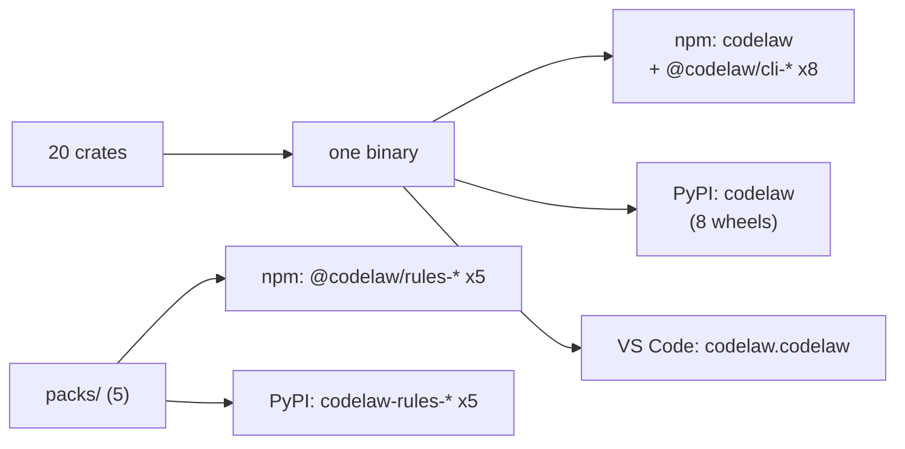

# SR-PACKAGES — what goes into which package: 20 internal crates, one engine on npm (with eight @codelaw binaries) and PyPI, five rule packs on both, one editor extension

## §1 — For humans

**The decision in one line.** The engine is **one Rust workspace of 20 internal crates** compiled into **one binary**. That binary is published as **`codelaw` on npm** (with eight `@codelaw/cli-<os>-<arch>` binary packages) and **`codelaw` on PyPI** (eight platform wheels). The rules ship as **five rule packs on both registries**, built from `packs/<name>/` ([SR-RULE-PACKS](0101_rule-packs.md)). There's also **one editor extension**. Nothing else is published ([L6](0008_LAW-6-python-and-node-packages.md)).

| Published as | Name | Contains |
|---|---|---|
| npm | `codelaw` | launcher, JS API, TypeScript types, config JSON Schema; zero dependencies |
| npm | `@codelaw/cli-<os>-<arch>` × 8 | the native binary for one platform; nothing else |
| PyPI | `codelaw` | 8 platform wheels: the native binary + Python API |
| npm | `@codelaw/rules-<name>` × 5 | a rule pack (`js`, `html`, `css`, `python`, `data`): rules, presets, data tables; no code, no dependencies |
| PyPI | `codelaw-rules-<name>` × 5 | the same pack as one pure `py3-none-any` wheel, holding the same files as on npm |
| VS Code Marketplace + Open VSX | `codelaw.codelaw` | LSP client ([SR-EDITOR](0114_editor.md)) |



<details>
<summary><b>ASCII twin</b></summary>

```text
   20 crates --> one binary --+--> npm  codelaw + @codelaw/cli-* (x8)
                              +--> PyPI codelaw (8 wheels)
                              +--> VS Code / Open VSX extension
   packs/ (5) ----------------+--> npm  @codelaw/rules-* (x5)
                              +--> PyPI codelaw-rules-* (x5)
```

</details>

---

## §2 — For agents

### Context

The decider asked for a record of what goes into which package, under the naming law L6 decision 10.

### Decision

1. **Internal crates (never published).** They form one Cargo workspace under `crates/`. Each depends only on crates in a layer above it ([SR-ARCHITECTURE](0108_architecture.md) decision 1).

   | Layer | Crate | Contains |
   |---|---|---|
   | foundation | `codelaw-core` | Diagnostic, TextEdit, FixClass, Severity, Language, Range |
   | foundation | `codelaw-cache` | [SR-CACHE](0109_cache.md) |
   | inputs | `codelaw-config` | [SR-CONFIG](0110_config.md) |
   | inputs | `codelaw-lang` | the [L3](0005_LAW-3-languages.md) grammars, language detection, embedded regions ([SR-LINTER](0106_linter.md) decision 3) |
   | inputs | `codelaw-rules` | the rule-file parser and loader ([SR-RULE-FORMAT](0112_rule-format.md)); pack resolution and manifests ([SR-RULE-PACKS](0101_rule-packs.md) decision 4); load-time checks for [L4](0006_LAW-4-every-rule-has-a-fix.md); the engine's own `graph/no-deprecated-usage`, embedded |
   | engines | `codelaw-semantic` | the per-file semantic model: scopes, bindings, references, imports and exports for JS/TS and Python ([SR-ARCHITECTURE](0108_architecture.md) decision 15a) |
   | engines | `codelaw-match` | file-scope rules on `ast-grep-core`, with the semantic-model predicates |
   | engines | `codelaw-native` | the Rust implementations behind `native:` rules ([SR-ARCHITECTURE](0108_architecture.md) decision 15b) |
   | engines | `codelaw-fix` | edit primitives, the apply loop, the verifier |
   | engines | `codelaw-format` | the formatter engines ([SR-FORMATTER](0105_formatter.md)) |
   | engines | `codelaw-graph` | [SR-PROJECT-GRAPH](0103_project-graph.md) |
   | engines | `codelaw-baseline` | [SR-BASELINE](0104_baseline-and-deprecations.md) |
   | engines | `codelaw-adapters` | optional external linters ([SR-LINTER](0106_linter.md) decision 2) |
   | orchestration | `codelaw-engine` | the check, fix and format pipelines |
   | orchestration | `codelaw-report` | text, JSON, SARIF and agent output; exit codes |
   | orchestration | `codelaw-test` | the rule tester and `codelaw bench` ([SR-RULE-AUTHORING](0113_rule-authoring.md), [L8](0010_LAW-8-performance-budgets.md)) |
   | surfaces | `codelaw-cli` | the `codelaw` binary's entry point and commands ([SR-CLI-MCP](0115_cli-and-mcp.md)) |
   | surfaces | `codelaw-mcp` | the MCP server ([SR-CLI-MCP](0115_cli-and-mcp.md)) |
   | surfaces | `codelaw-lsp` | the language server ([SR-EDITOR](0114_editor.md)) |
   | surfaces | `codelaw-agents` | hook mode, `sync-agents`, and the skill sources from `agents/skills/` ([SR-AGENT-SURFACES](0102_agent-surfaces.md)) |

2. **The binary** links every crate. A single `codelaw` executable serves the CLI, `codelaw lsp` and `codelaw mcp`, with no second executable.
3. **npm `codelaw`** contains:
   - `bin/codelaw.js`: picks the right `@codelaw/cli-*` package for the platform and runs the binary;
   - `index.js` and `index.d.ts`: `check`, `fix`, `format`, `rulesFor`, each returning the `--format json` shape;
   - `codelaw.schema.json`: the config schema ([SR-CONFIG](0110_config.md));
   - `optionalDependencies` on the eight binary packages, and no other dependency.
4. **npm `@codelaw/cli-<os>-<arch>`, eight packages:**
   - `darwin-arm64`, `darwin-x64`;
   - `linux-x64-gnu`, `linux-arm64-gnu`, `linux-x64-musl`, `linux-arm64-musl`;
   - `win32-x64`, `win32-arm64`.

   Each holds only the binary, with `os`, `cpu` and `libc` fields so npm installs exactly one.
5. **PyPI `codelaw`:**
   - eight platform wheels, built with maturin's `bin` bindings;
   - each wheel holds the binary, a `codelaw` Python module (`check`, `fix`, `format`, `rules_for`) and `py.typed`;
   - no sdist ([L6](0008_LAW-6-python-and-node-packages.md) decision 7).
6. **The editor extension `codelaw.codelaw`** (source: `packaging/vscode`) is published as platform-specific packages. It runs the project's own codelaw first (`node_modules/.bin`, then `.venv/bin`) and falls back to a bundled binary ([SR-EDITOR](0114_editor.md)).
7. **One version for everything:** every crate, both registries' engine packages, the five rule packs and the extension carry the same version from one file ([L6](0008_LAW-6-python-and-node-packages.md) decision 9).
8. **Not in any package:**
   - adapters (external tools);
   - third-party rule packs;
   - user config;
   - anything downloaded at runtime.

   codelaw never fetches code after install ([L5](0007_LAW-5-no-model-in-the-engine.md) decision 3).
9. **The five rule packs:** npm `@codelaw/rules-<name>` and PyPI `codelaw-rules-<name>`, for `js`, `html`, `css`, `python` and `data`.
   - **Built** from `packs/<name>/` in the source repo by the release job (`scripts/package.py assemble`, decision 11). The npm tarball and the wheel's `codelaw_rules_<name>/` package data hold the same files; the only additions are each registry's own metadata (`package.json`, `*.dist-info/`).
   - **`scripts/build-packs.py`** builds the same ten pack artefacts locally, with no engine binary: it refuses a pack whose manifest version differs from `Cargo.toml` and, with `--release`, a pack without `LICENSE`; it checks both artefacts against the folder byte for byte; `--verify <codelaw>` installs both and requires identical `codelaw check` output.
   - **No dependencies,** and neither `codelaw` package depends on a pack. `codelaw init` adds them to the consumer ([SR-RULE-PACKS](0101_rule-packs.md) decisions 3 and 6).
10. **Licence: MIT,** for the repository and every package it publishes — both engine packages, the eight binaries, the five rule packs and the extension. **Ruled by Arpit, 2026-10-20** (MIT only; it supersedes `MIT OR Apache-2.0`, recorded the same day on the release-pipeline branch).
    - The root `LICENSE` holds the MIT text and the line `SPDX-License-Identifier: MIT`.
    - Every npm package and every wheel carries `LICENSE` and declares `MIT` (`license` in `package.json`, `License-Expression` in the wheel's metadata); `scripts/package.py check` refuses one that doesn't.
    - Each pack folder carries its own copy as `packs/<name>/LICENSE` (SR-RULE-PACKS §2 layout).
11. **Built once, in CI; published as built.** The release job of [L6](0008_LAW-6-python-and-node-packages.md) decision 9 is two workflows.
    - **`ci.yml`, every push:** one maturin wheel per platform (decision 5). The npm binary is **taken out of that wheel**, so both registries ship the same bytes for a platform.
    - **`scripts/package.py assemble`** builds the 14 npm tarballs and the five pack wheels from those binaries and `packs/`; nothing is compiled there.
    - **`scripts/package.py check`** refuses the set unless it is exactly §1's names, at one version, with zero runtime dependencies, licensed (decision 10), one binary per platform on both registries, and each pack byte-equal on both.
    - **`scripts/law-gate.py`** refuses a release whose binary has no `format`, `mcp` or `lsp` command ([L7](0009_LAW-7-linter-and-formatter.md); [L6](0008_LAW-6-python-and-node-packages.md) decision 3). `publish.yml`'s gate runs it and stops; `ci.yml` reports it on every push without failing; the decider runs it before the one-time hand publish (`RELEASING.md`).
    - **`publish.yml`, a published GitHub Release only:** it refuses a commit on which `ci.yml` did not succeed on `main`, downloads **that run's** checked set, checks it again and uploads it. Trusted publishing (OIDC) on both registries; no token exists.
    - **Nothing is written until npm trusts the workflow for every package:** a preflight job makes npm's OIDC exchange per package, and both registry jobs wait on it.
    - **npm order:** the eight binaries, then the five packs, then `codelaw` — so a failure leaves the previous `codelaw` as `latest`. A version already published is skipped, so a failed job is re-run, not re-released.
    - **The one version** is `Cargo.toml`'s; `scripts/version.py` writes and checks every copy.
12. **A half-published release is withdrawn by the decider.** A CI OIDC token may publish but not deprecate, and PyPI has no yank API.
    - `publish.yml`'s `half-published` job lists what reached a registry and fails.
    - `scripts/withdraw.sh <version>` deprecates it on npm and names each PyPI yank page.
13. **One pinned Rust toolchain:** `rust-toolchain.toml` names the exact release (1.99.1 today) that builds, tests and releases codelaw. **Ruled by Arpit, 2026-10-20.**
    - Measured the same day: GitHub's runners carried rustc 1.99.0 and 1.99.1 at once, so a build cache keyed by the floating compiler missed on one platform and rebuilt it.
    - It is bumped in a commit of its own. The MSRV stays `Cargo.toml`'s `rust-version`.

### Consequences

- **One binary is larger than a modular install,** but there's nothing to mismatch and nothing to download later.
- **Twenty crates add some build-graph overhead,** but they make the layering checkable and keep compile times incremental.
- **Ten pack packages publish with every release,** built by one job from `packs/`.
- **A release costs one CI run, not a rebuild** (decision 11): `publish.yml` only uploads, so a release takes as long as its slowest upload. The price is that a release can only be cut from a commit whose `ci.yml` run still holds its `dist` artifact (30 days).
- **Withdrawal is manual** (decision 12), so L6 decision 9's *"everything already published is yanked or deprecated"* depends on one person acting — not ungated, but not automatic.
- **The first npm publish of each package is by hand,** because npm binds a trusted publisher only to a package that exists ([`RELEASING.md`](../RELEASING.md)).

### Alternatives considered

- **Separate npm/PyPI packages per feature** (`codelaw-mcp`, `codelaw-lsp`): rejected. Version skew, and L6 allows only `codelaw` unscoped.
- **Built-in rules embedded in the binary** (crate `codelaw-rules-builtin`): superseded by the decider's ruling of 2026-10-19 ([SR-RULE-PACKS](0101_rule-packs.md)).
- **A few large crates:** rejected. Layer violations can't be checked, and incremental builds are slower.

### Reference (required)

- [L6](0008_LAW-6-python-and-node-packages.md) decisions 2, 7, 9, 10 and 11: registries, naming, one version, the rule packs.
- [`docs/DESIGN.md`](../docs/DESIGN.md) §3.1: why one Rust binary.
- The decider's rulings of 2026-10-20 — the licence (decision 10), building in CI and publishing what CI built (decision 11), and pinning the toolchain (decision 13) — worklog entry of that date.
- [npm trusted publishing](https://docs.npmjs.com/trusted-publishers) · [PyPI trusted publishers](https://docs.pypi.org/trusted-publishers/) · [maturin `bin` bindings](https://www.maturin.rs/bindings.html#bin).

### Veto condition

**Reopen this decision if:** a published package exists outside decision 1's distribution table, or a crate depends on a crate in a lower layer.

**How to check it:** `python3 scripts/package.py check dist` (every `ci.yml` run, and again in `publish.yml`) refuses any name outside §1; `npm search @codelaw` and PyPI show only those names; `crates/codelaw-cli/tests/layers.rs` refuses a dependency edge against the layer order.

---

## References

*Every source this record cites, gathered in one place. An archived document is never listed here.*

**Records** — [SR-RULE-PACKS](0101_rule-packs.md) · [SR-AGENT-SURFACES](0102_agent-surfaces.md) · [SR-PROJECT-GRAPH](0103_project-graph.md) · [SR-BASELINE](0104_baseline-and-deprecations.md) · [SR-FORMATTER](0105_formatter.md) · [SR-LINTER](0106_linter.md) · [SR-ARCHITECTURE](0108_architecture.md) · [SR-CACHE](0109_cache.md) · [SR-CONFIG](0110_config.md) · [SR-RULE-FORMAT](0112_rule-format.md) · [SR-RULE-AUTHORING](0113_rule-authoring.md) · [SR-EDITOR](0114_editor.md) · [SR-CLI-MCP](0115_cli-and-mcp.md)

**Project docs** — [`docs/DESIGN.md`](../docs/DESIGN.md) · [`RELEASING.md`](../RELEASING.md)
