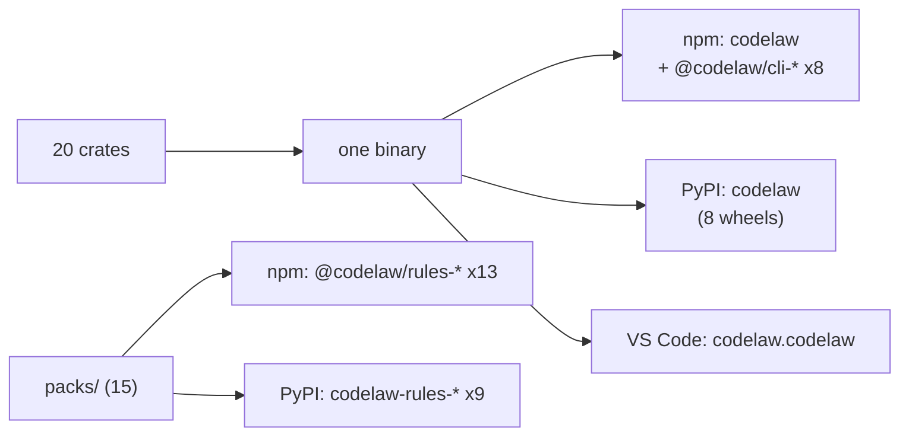

# SR-PACKAGES — what goes into which package: 20 internal crates, one engine on npm (with eight @codelaw binaries) and PyPI, seventeen rule packs — fifteen on npm, ten on PyPI, the skills package on both, one editor extension

## §1 — For humans

**The decision in one line.** The engine is **one Rust workspace of 20 internal crates** compiled into **one binary**. That binary is published as **`codelaw` on npm** (with eight `@codelaw/cli-<os>-<arch>` binary packages) and **`codelaw` on PyPI** (eight platform wheels). The rules ship as **seventeen rule packs — fifteen on npm, ten on PyPI** — each built from `packs/<name>/` ([SR-RULE-PACKS](0101_rule-packs.md); the decider's rulings of 2026-10-24, [W-31](../archive/open/W-31-registry-pack-split.md) and [W-32](../archive/open/W-32-redux-and-query-packs.md), of 2026-10-25, [W-53](../work/open/W-53-security-packs-groundwork.md), and of 2026-10-26, W-62's `scss` pack and W-63's npm-only `css-modules` pack). There are also **three npm-only dev-server plugins** (`@codelaw/vite-plugin`, `@codelaw/webpack-plugin` — which Rspack runs too — and `@codelaw/next`; W-49) the **skills package** — every agent-facing file, `@codelaw/skills` on npm and `codelaw-skills` on PyPI, which depends on `codelaw` at exactly its version (decision 3b; W-77, the decider's ruling of 2026-10-27) — and **one editor extension**. Nothing else is published ([L6](0008_LAW-6-python-and-node-packages.md)).

| Published as | Name | Contains |
|---|---|---|
| npm | `codelaw` | launcher, JS API, TypeScript types, config JSON Schema; zero dependencies |
| npm | `@codelaw/cli-<os>-<arch>` × 8 | the native binary for one platform; nothing else |
| PyPI | `codelaw` | 8 platform wheels: the native binary + Python API |
| npm | `@codelaw/vite-plugin`, `@codelaw/webpack-plugin`, `@codelaw/next` | the dev-server plugins: codelaw's findings in Vite's, webpack's, Rspack's and Next.js's overlay and terminal; each spawns the `codelaw` binary and lints nothing itself |
| npm | `@codelaw/rules-<name>` × 13 | a rule pack (`js`, `ts`, `react`, `node`, `stencil`, `html`, `css`, `data`, `tanstack-query`, `redux-toolkit`, `security-js`, `security-ts`, `security-html`): rules, presets, data tables; no code, no dependencies |
| PyPI | `codelaw-rules-<name>` × 9 | a rule pack (`js`, `react`, `html`, `css`, `python`, `data`, `security-js`, `security-html`, `security-python`) as one pure `py3-none-any` wheel; a pack on npm too holds the same files as there |
| npm | `@codelaw/rules-<name>-fux-index` × 12 | an optional Fux index of one pack's rules (decision 14): data only, never installed by default; the four security packs get theirs with their first rule |
| PyPI | `codelaw-rules-<name>-fux-index` × 7 | the same, as one pure `py3-none-any` wheel |
| npm | `@codelaw/skills` | every agent file codelaw writes — `templates/agents/` byte for byte and `codelaw-skills.json`; one dependency, `codelaw` at exactly its version (decision 3b) |
| PyPI | `codelaw-skills` | the same files as one pure `py3-none-any` wheel (`codelaw_skills/`); `Requires-Dist: codelaw==<version>` |
| VS Code Marketplace + Open VSX | `codelaw.codelaw` | LSP client ([SR-EDITOR](0114_editor.md)) |



<details>
<summary><b>ASCII twin</b></summary>

```text
   20 crates --> one binary --+--> npm  codelaw + @codelaw/cli-* (x8)
                              +--> PyPI codelaw (8 wheels)
                              +--> VS Code / Open VSX extension
   packs/ (15) ---------------+--> npm  @codelaw/rules-* (x13)
                              +--> PyPI codelaw-rules-* (x9)
```

</details>

---

## §2 — For agents

### Context

The decider asked for a record of what goes into which package, under the naming law L6 decision 10.

### Decision

1. **Internal crates (never published).** They form one Cargo workspace under `crates/`. Each depends only on crates in a layer above it ([SR-ARCHITECTURE](0108_architecture.md) decision 1).

   | Layer | Crate | Contains |
   |---|---|---|
   | foundation | `codelaw-core` | Diagnostic, TextEdit, FixClass, Severity, Language, Range |
   | foundation | `codelaw-cache` | [SR-CACHE](0109_cache.md) |
   | inputs | `codelaw-config` | [SR-CONFIG](0110_config.md) |
   | inputs | `codelaw-lang` | the [L3](0005_LAW-3-languages.md) grammars, language detection, embedded regions ([SR-LINTER](0106_linter.md) decision 3) |
   | inputs | `codelaw-rules` | the rule-file parser and loader ([SR-RULE-FORMAT](0112_rule-format.md)); pack resolution and manifests ([SR-RULE-PACKS](0101_rule-packs.md) decision 4); load-time checks for [L4](0006_LAW-4-every-rule-has-a-fix.md); the engine's own rules' entries, `graph/no-deprecated-usage` among them |
   | engines | `codelaw-semantic` | the per-file semantic model: scopes, bindings, references, imports and exports for JS/TS and Python ([SR-ARCHITECTURE](0108_architecture.md) decision 15a) |
   | engines | `codelaw-match` | file-scope rules on `ast-grep-core`, with the semantic-model predicates |
   | engines | `codelaw-native` | the Rust implementations behind `native:` rules ([SR-ARCHITECTURE](0108_architecture.md) decision 15b) |
   | engines | `codelaw-fix` | edit primitives, the apply loop, the verifier |
   | engines | `codelaw-format` | the formatter engines ([SR-FORMATTER](0105_formatter.md)) |
   | engines | `codelaw-graph` | [SR-PROJECT-GRAPH](0103_project-graph.md) |
   | engines | `codelaw-baseline` | the baseline files, what each finding becomes under them, the ratchet and the deprecations registry ([SR-BASELINE](0104_baseline-and-deprecations.md)); it reads no clock and runs no `git`: `codelaw-engine` hands it the as-of date and the change set, and runs `graph/no-deprecated-usage` on the graph |
   | engines | `codelaw-adapters` | optional external linters run as programs: manifests, runner, output mapping ([SR-LINTER](0106_linter.md) decision 2); `codelaw-engine` runs them |
   | orchestration | `codelaw-engine` | the check, fix and format pipelines |
   | orchestration | `codelaw-report` | text, JSON, SARIF and agent output; exit codes |
   | orchestration | `codelaw-test` | the rule tester and `codelaw bench` ([SR-RULE-AUTHORING](0113_rule-authoring.md), [L8](0010_LAW-8-performance-budgets.md)) |
   | surfaces | `codelaw-cli` | the `codelaw` binary's entry point and commands ([SR-CLI-MCP](0115_cli-and-mcp.md)) |
   | surfaces | `codelaw-mcp` | the MCP server: a hand-written JSON-RPC loop over stdio ([SR-CLI-MCP](0115_cli-and-mcp.md) decision 5) |
   | surfaces | `codelaw-lsp` | the language server ([SR-EDITOR](0114_editor.md)) |
   | surfaces | `codelaw-agents` | hook mode, `sync-agents`, and the skill sources from `templates/agents/skills/` ([SR-AGENT-SURFACES](0102_agent-surfaces.md)) |

   The workspace's `Cargo.toml` may carry a `[patch.crates-io]` for two reasons only: to replace a transitive crate that fails [L2](0004_LAW-2-foss-dependencies.md) with a permissive stand-in kept under `crates/`, or to put a grammar fork the decider ruled for, kept under `crates/codelaw-lang/grammars/`, in place of the pinned grammar. The record that takes in the dependency that pulls it names it. Today there are two: `option-ext`, for Biome ([SR-FORMATTER](0105_formatter.md) decision 2), and `tree-sitter-css`, codelaw's CSS grammar fork ([SR-ARCHITECTURE](0108_architecture.md) decision 3). Neither is a workspace member, so neither is one of the crates above.

2. **The binary** links every crate. A single `codelaw` executable serves the CLI, `codelaw lsp`, `codelaw mcp`, `codelaw hook` and `codelaw sync-agents`, with no second executable. **It carries no agent file:** the skills and every other file of `templates/agents/` ship in the skills package (decision 3b; [SR-AGENT-SURFACES](0102_agent-surfaces.md) decision 8), which `init --agents` and `sync-agents` read from disk.
3. **npm `codelaw`** contains:
   - `bin/codelaw.js`: picks the right `@codelaw/cli-*` package for the platform and runs the binary;
   - `index.js` and `index.d.ts`: `check`, `fix`, `format`, `rulesFor`, each returning the `--format json` shape of `check`, `fix`, `format` and `rules --for <path>` ([SR-CLI-MCP](0115_cli-and-mcp.md) decision 4), unchanged; options are the flags (`lang`, `rule`, `threads`, `noCache`; `unsafe` and `dryRun` on `fix`; `check` on `format`). `crates/codelaw-cli/tests/api.rs` runs this API and decision 5's against the binary and requires the same JSON from both;
   - `codelaw.schema.json`: the config schema ([SR-CONFIG](0110_config.md));
   - `optionalDependencies` on the eight binary packages, and no other dependency.
3a. **npm dev-server plugins, three packages (W-49; the decider's ruling of 2026-10-25: *"Dev server plugin for RSpack, Vite, Webpack, Next.js"*).** `@codelaw/vite-plugin`, `@codelaw/webpack-plugin` and `@codelaw/next`, npm only, each `@codelaw/<name>` as [L6](0008_LAW-6-python-and-node-packages.md) requires, each at the one version, each with **no dependency of any kind** (decision 9's check enforces it) and `engines.node >=22`. Proven on the real hosts (W-70): `examples/dev-servers/` holds one app per host (Vite, webpack, Rspack, Next.js) and `run.mjs`; CI's `dev-servers` job installs the host on the runner in a temp directory — a host is in no manifest or lockfile of this repo ([L11](0013_LAW-11-no-dependencies.md)) — and checks that a saved `debugger` shows within a second. Rspack loads `@codelaw/webpack-plugin` unchanged.
   - **They never lint.** Each spawns the `codelaw` binary — `CODELAW_BINARY`, else the project's own `codelaw` package, else `codelaw` on `PATH` — so a finding is byte-identical to the CLI's ([L5](0007_LAW-5-no-model-in-the-engine.md)). Dev runs `codelaw check --watch --format json --profile local` ([SR-CLI-MCP](0115_cli-and-mcp.md) decision 2a) and reads its lines; a build runs one `codelaw check --format json --profile ci`, and an `error` finding fails it (`failOnError`, default on).
   - **Rspack** runs `@codelaw/webpack-plugin` unchanged (it uses only hooks and `compilation.errors`/`warnings` both have), so there is no fourth package. **Next.js** under webpack adds the same plugin to the client compile; under Turbopack, which has no webpack-plugin API, `next dev` runs the watcher beside the server and prints to the terminal, and `next build` runs the `ci` check first.
   - **One source, copied.** `packaging/npm/dev-core/core.js` (spawn, parse, de-duplicate) is the shared source; `scripts/package.py sync-dev-core` copies it into each package as `core.js` (and the webpack plugin into `next/plugin.js`), and `package.py assemble` and `check` refuse a copy that differs — a plugin has no dependency to share it through. The manifests are generated like every other, from the one version.
   - **Tested** by `packaging/npm/dev-core/test/plugins.test.js` against the real binary (`crates/codelaw-cli/tests/dev_plugins.rs` runs it): each host is a small fake of the API the plugin uses, because the hosts are third-party code ([L11](0013_LAW-11-no-dependencies.md)); an example app per real host is the one thing not built.
3b. **The skills package, one on each registry (W-77; the decider's ruling of 2026-10-27: *"I want a separate package to be created just for skills, and it will have a hard dependency on code law."*).** `@codelaw/skills` on npm and `codelaw-skills` on PyPI ([L6](0008_LAW-6-python-and-node-packages.md) decision 13).
   - **What it holds:** `templates/agents/` byte for byte — the skills, the steering and instruction files, the custom agent, the hook and MCP registrations, the trigger evals — plus `codelaw-skills.json` (`{"name": "codelaw-skills", "version": "<the Cargo version>"}`, the file the engine reads its version from), `LICENSE` and `README.md` (`packaging/npm/skills/README.md`, used for both). npm adds `package.json`; the wheel holds the folder as `codelaw_skills/` (no `__init__.py`) and adds its `*.dist-info/`. **The same files on both registries.**
   - **The one runtime dependency any codelaw package has:** `"dependencies": { "codelaw": "<version>" }` on npm and `Requires-Dist: codelaw==<pep440 version>` on PyPI, both exact. Decision 11's check refuses any other dependency on it, and any dependency on every other package. Ratified by name in [DEPENDENCIES.md](../DEPENDENCIES.md) ([L11](0013_LAW-11-no-dependencies.md)).
   - **Built** by `scripts/package.py` (`stage_skills`, then the same deterministic tarball and wheel writers as the packs, `data_tarball` and `data_wheel`); the manifests are generated from the one version like every other. `package.py stage-skills <dir>` writes the folder alone, for a local `CODELAW_SKILLS`.
   - **Found** by the engine on disk only ([L5](0007_LAW-5-no-model-in-the-engine.md)): `CODELAW_SKILLS`; `node_modules/@codelaw/skills` from the project root upwards; `codelaw_skills/` in the site-packages the rule packs are searched in (`CODELAW_SITE_PACKAGES`, else `$VIRTUAL_ENV`, else `.venv/`); then the binary's own environment, so a `pipx` or `uvx` codelaw finds a skills package installed beside it. A copy at another version is passed over, and named in the refusal when no copy matches.
   - **Published after `codelaw`** on npm, since it depends on it (decision 11's npm order).
4. **npm `@codelaw/cli-<os>-<arch>`, eight packages:**
   - `darwin-arm64`, `darwin-x64`;
   - `linux-x64-gnu`, `linux-arm64-gnu`, `linux-x64-musl`, `linux-arm64-musl`;
   - `win32-x64`, `win32-arm64`.

   Each holds only the binary, with `os`, `cpu` and `libc` fields so npm installs exactly one.
5. **PyPI `codelaw`:**
   - eight platform wheels, built with maturin's `bin` bindings;
   - each wheel holds the binary, a `codelaw` Python module (`check`, `fix`, `format`, `rules_for`; the same calls and JSON as decision 3, options as keyword arguments) and `py.typed`;
   - no sdist ([L6](0008_LAW-6-python-and-node-packages.md) decision 7).
6. **The editor extension `codelaw.codelaw`** (source: `packaging/vscode`) is published as platform-specific packages. It runs the project's own codelaw first (`node_modules/.bin`, then `.venv/bin`) and falls back to a bundled binary ([SR-EDITOR](0114_editor.md)).
7. **One version for everything:** every crate, both registries' engine packages, the seventeen rule packs, the skills package and the extension carry the same version from one file ([L6](0008_LAW-6-python-and-node-packages.md) decision 9).
   - `scripts/version.py --set` writes every copy that is not generated — the pack manifests, `Cargo.lock`'s workspace crates and the extension's `packaging/vscode/package.json` and `package-lock.json` — and `--check` fails when any one drifts (W-27).
8. **Not in any package:**
   - adapters (external tools);
   - third-party rule packs;
   - user config;
   - anything downloaded at runtime.

   codelaw never fetches code after install ([L5](0007_LAW-5-no-model-in-the-engine.md) decision 3).
9. **The seventeen rule packs:** npm `@codelaw/rules-<name>` for `js`, `ts`, `react`, `node`, `stencil`, `html`, `css`, `scss`, `css-modules`, `data`, `tanstack-query`, `redux-toolkit`, `security-js`, `security-ts` and `security-html`; PyPI `codelaw-rules-<name>` for `js`, `react`, `html`, `css`, `scss`, `python`, `data`, `security-js`, `security-html` and `security-python` ([L6](0008_LAW-6-python-and-node-packages.md) decision 11).
   - **A wheel's Python package is `codelaw_rules_<name>` with every `-` as `_`** (`codelaw_rules_security_js`), and so is its file name (PEP 427): `scripts/package.py`'s `pack_module`, the engine's `FirstPartyPack::module` and the site-packages search agree (W-53, 2026-10-25; before it no PyPI pack had a `-` in its name).
   - **Which pack is on which registry** is `FIRST_PARTY_PACKS` in `crates/codelaw-rules/src/pack.rs`; `scripts/package.py` reads that table (and refuses when it and `packs/` name different packs), so the engine's resolution and the release's names are one list.
   - **Built** from `packs/<name>/` in the source repo by the release job (`scripts/package.py assemble`, decision 11), through **one pack builder** in `scripts/package.py`: `stage_pack` (the folder plus `LICENSE`), `pack_tarball` (the npm tarball, written in Python with deterministic entries and npm's fixed mtime, not by `npm pack`) and `wheel_for_pack` (W-27). Every published copy holds the folder's files — so a pack on both registries holds the same files in its npm tarball and its wheel's `codelaw_rules_<name>/` package data; the only additions are each registry's own metadata (`package.json`, `*.dist-info/`).
   - **`scripts/build-packs.py`** runs that builder locally, with no engine binary and no npm: it calls `stage_pack`, `pack_tarball` and `wheel_for_pack` itself, so each tarball and wheel it writes is byte-for-byte the one `assemble` puts in `dist/`, at the same PEP 440 version (`pep440`: `0.2.0-beta.1` is the wheel `0.2.0b1`). It adds checks, never a second way to build.
   - It refuses a pack whose manifest version differs from `Cargo.toml`, a version PyPI cannot take, and, with `--release`, a pack without `LICENSE`; it checks every artefact against the folder byte for byte; `--verify <codelaw>` installs each registry's packs in its own layout, requires identical `codelaw check` output from the packs on both, and requires each layout to load every pack it has.
   - **No dependencies,** and neither `codelaw` package depends on a pack. `codelaw init` adds them to the consumer ([SR-RULE-PACKS](0101_rule-packs.md) decisions 3 and 6).
10. **Licence: MIT,** for the repository and every package it publishes — both engine packages, the eight binaries, the rule packs and the extension. **Ruled by Arpit, 2026-10-20** (MIT only; it supersedes `MIT OR Apache-2.0`, recorded the same day on the release-pipeline branch).
    - The skills package is MIT like the rest.
    - The root `LICENSE` holds the MIT text and the line `SPDX-License-Identifier: MIT`.
    - Every npm package and every wheel carries `LICENSE` and declares `MIT` (`license` in `package.json`, `License-Expression` in the wheel's metadata); `scripts/package.py check` refuses one that doesn't.
    - Each pack folder carries its own copy as `packs/<name>/LICENSE` (SR-RULE-PACKS §2 layout).
11. **Built once, in CI; published as built.** The release job of [L6](0008_LAW-6-python-and-node-packages.md) decision 9 is two workflows.
    - **`ci.yml`, every push:** one maturin wheel per platform (decision 5). The npm binary is **taken out of that wheel**, so both registries ship the same bytes for a platform.
    - **`scripts/package.py assemble`** builds the npm tarballs, the pack wheels and the skills package's tarball and wheel from those binaries, `packs/` and `templates/agents/`; nothing is compiled there. With the eight engine wheels that is **47 files** (npm 28 tarballs: eight binaries, `codelaw`, three dev-server plugins, fifteen packs and the skills package; PyPI 19 wheels: eight engine wheels, ten packs and the skills package) — docs count packages, and say files when they mean files.
    - **`scripts/package.py check`** refuses the set unless it is exactly §1's names, at one version, with zero runtime dependencies but the skills package's exact `codelaw` (decision 3b), licensed (decision 10), one binary per platform on both registries, every published pack its `packs/` folder byte for byte (so a pack on both is equal on both), the skills package `templates/agents/` plus its manifest at the release version on both, and `SHA256SUMS` listing exactly its files with their digests.
    - **The install smoke** (`scripts/smoke.sh`, [L6](0008_LAW-6-python-and-node-packages.md) §How L6 is enforced) runs on each of the eight platforms in `ci.yml`'s `smoke` job, the musl two in a clean Alpine container.
    - **It installs from a staging index (W-18, 2026-10-22).** `scripts/staging-index.py` serves a throwaway npm registry and a PyPI simple index on `127.0.0.1` only, from the Python standard library, so it adds no dependency ([L2](0004_LAW-2-foss-dependencies.md)). The smoke publishes every file of the set to it — `npm publish` for each tarball, `uv publish` for each wheel — then installs `codelaw` and a pack **by name**, as a user does: `npm i` (npm picks `@codelaw/cli-<key>` itself), `npx`, `pip install` (the staging index is pip's only index) and `uvx`. Every npm and uv cache and config it uses is its own, so each install downloads from the index, and the smoke fails unless the index served those downloads. It never publishes to any other registry; TestPyPI is not used. The index binds without `HTTPServer`'s reverse-DNS lookup of its own address, which stalled it past the smoke's wait on the macOS runners (W-24, 2026-10-24).
    - **It installs the skills package by name on both registries (W-77, 2026-10-27):** `fixtures/skills-consumer` is copied beside the npm install and the PyPI install, `codelaw sync-agents` runs in each, and the two agent trees must be byte-identical and pass `sync-agents --check`.
    - **It runs a watch on every platform (W-44, 2026-10-25):** `codelaw check --watch --format json` in the PyPI project, a line added to `SMOKE.md`, and the second run must name `SMOKE.md` as changed and report more findings in it than the first; on Windows the watch's process tree is ended with `taskkill /T` ([SR-ARCHITECTURE](0108_architecture.md) decision 22a: a watch runs in its own process, so Windows has it too).
    - **Its build tool is `uv`** (`MIT OR Apache-2.0`, no dependencies), pinned in `smoke.sh` and declared with its licence in `crates/codelaw-cli/tests/licences.rs`.
    - **On `main`, `ci.yml` attests every file of the set** (a build-provenance attestation over `SHA256SUMS`).
    - **`ci.yml`'s `perf` job is [L8](0010_LAW-8-performance-budgets.md)'s gate (W-19):** a release build runs `codelaw bench --budgets perf/budgets.toml` ([SR-CLI-MCP](0115_cli-and-mcp.md) decision 10) on `ubuntu-24.04`, L8's reference machine (never `ubuntu-latest`), with the three pinned real repos fetched by `scripts/corpus.py fetch --repo` and passed as `--repo`, on every push that changed what it times, writes the runner's CPU, memory and load and the report to the job summary, and uploads the JSON. It fails only when a p95 is over a budget the decider set; while every budget is `unset` it reports and passes. Because `publish.yml` releases only a commit on which `ci.yml` succeeded, a commit over a set budget is never released.
    - **`scripts/law-gate.py`** refuses a release whose binary has no `format`, `mcp` or `lsp` command ([L7](0009_LAW-7-linter-and-formatter.md); [L6](0008_LAW-6-python-and-node-packages.md) decision 3). `publish.yml`'s gate runs it and stops; `ci.yml`'s `package` job runs it on every push and fails, so `main` learns the day the binary loses one, not release day (W-24, 2026-10-24); the decider runs it before the one-time hand publish (`RELEASING.md`).
    - **`publish.yml`, a published GitHub Release, or a run by hand on a `v*` tag that publishes npm only** ([L6](0008_LAW-6-python-and-node-packages.md) decision 9, ruled 2026-10-25): it refuses a commit on which `ci.yml` did not succeed on `main`, downloads **that run's** checked set, checks it again, verifies every file against `ci.yml`'s attestation for the release commit on `main`, and uploads it; each upload job re-checks its download against the gate's `SHA256SUMS`. Trusted publishing (OIDC) on both registries; no token exists.
    - **Only a `v*` tag may deploy** to the `npm` and `pypi` environments (a deployment rule the decider sets in GitHub; `RELEASING.md`): a trusted publisher checks repository, workflow and environment, not the ref.
    - **Hardening (W-18):** every `run:` is `bash -eo pipefail`; every action is pinned by commit SHA; the OIDC jobs install an exact npm version; no checkout keeps its credentials.
    - **Nothing is written until npm trusts the workflow for every package:** a preflight job makes npm's OIDC exchange per package, and both registry jobs wait on it.
    - **npm order:** the eight binaries, then the fifteen npm packs, then `codelaw`, then `@codelaw/skills` — so a failure leaves the previous `codelaw` as `latest`, and the skills package never reaches npm before the engine it depends on. A version already published is skipped, so a failed job is re-run, not re-released.
    - **npm dist-tag:** a pre-release goes to `next`; a version older than `codelaw`'s current `latest` (a backport) to `release-<major>.<minor>`; any other to `latest`.
    - **The one version** is `Cargo.toml`'s; `scripts/version.py` writes and checks every copy.
12. **A half-published release is withdrawn by the decider.** A CI OIDC token may publish but not deprecate, and PyPI has no yank API.
    - `publish.yml`'s `half-published` job lists what reached a registry and fails.
    - `scripts/withdraw.sh <version>` deprecates it on npm and names each PyPI yank page; a deprecation that fails makes it exit non-zero.
13. **One pinned Rust toolchain:** `rust-toolchain.toml` names the exact release (1.99.1 today) that builds, tests and releases codelaw. **Ruled by Arpit, 2026-10-20.**
    - Measured the same day: GitHub's runners carried rustc 1.99.0 and 1.99.1 at once, so a build cache keyed by the floating compiler missed on one platform and rebuilt it.
    - It is bumped in a commit of its own. The MSRV stays `Cargo.toml`'s `rust-version`.
    - **The MSRV is the dependencies' floor, and informational:** `rust-version = "1.97"` because the pinned `ruff_*` 0.0.18 crates declare 1.97 (the highest `rust-version` in `Cargo.lock`; `cargo` refuses an older compiler). It promises `cargo install` users a compiler that builds codelaw; no release input reads it. `ci.yml`'s `msrv` job runs `cargo +<rust-version> check --workspace --all-targets --locked`, so the number stays true. Raise it whenever a dependency raises its own (W-27, 2026-10-24; it said 1.85 before, which no build could pass).

14. **The optional Fux index packages** ([L6](0008_LAW-6-python-and-node-packages.md) decision 12; W-34). One per pack that holds rules, on the registries the pack is on: twelve npm tarballs and seven wheels today. **Built by `scripts/fux-index.py`, in CI only,** after `package.py assemble`:
    - **Fux is pinned** (`FUX_VERSION`, `fux-engine`, MIT; [DEPENDENCIES.md](../DEPENDENCIES.md)) and the script refuses any other `fux`; CI installs exactly that version in a throwaway venv. Nothing in codelaw's engine, its packages or its tests imports or runs Fux.
    - **A segment is built from `packs/<name>/rules/`** in a scratch repository whose root is the pack's (`fux setup`, `fux ingest --no-fetch`, `fux pack`), so a rule's id is `file:rules/<path>`, a path inside the installed pack and the one Fux reads in place. It is **built twice, in two fresh folders, and the build fails if the two differ.**
    - **Packed with `package.py`'s own builders** (`pack_tarball`, `wheel_for_pack`, which take the `-fux-index` suffix): an npm package holds the segment at its root, a wheel holds it as the import package `codelaw_rules_<name>_fux_index` (no `__init__.py`), each with `LICENSE` and a `README.md`. The manifest's `content` names the pack on the registries it is on.
    - **Output is `dist/fux-index/{npm,pypi,SHA256SUMS}`, never `dist/npm` or `dist/pypi`:** `publish.yml` uploads those two folders whole and its npm preflight demands a trusted publisher for every tarball, so an index package that is not reserved yet would stop the release. `package.py check` does not know them; `scripts/fux-index.py check dist` refuses a wrong name, version or dependency, a manifest that disagrees with its shards or with the pack it indexes, differing npm and PyPI copies, and one in the release set. `ci.yml`'s `package` job runs both and uploads `fux-index/` as its own artifact; `publish.yml` does not touch it until the decider reserves the names (`RELEASING.md`).

### Consequences

- **One binary is larger than a modular install,** but there's nothing to mismatch and nothing to download later.
- **Twenty crates add some build-graph overhead,** but they make the layering checkable and keep compile times incremental.
- **Twenty-five pack packages publish with every release** (fifteen on npm, ten on PyPI), built by one job from `packs/`.
- **A release costs one CI run, not a rebuild** (decision 11): `publish.yml` only uploads, so a release takes as long as its slowest upload. The price is that a release can only be cut from a commit whose `ci.yml` run still holds its `dist` artifact (30 days).
- **Nineteen index packages ride along unpublished** (decision 14) until the decider reserves their names; the release does not wait on them and does not upload them.
- **Two more names to publish by hand once (W-77):** `@codelaw/skills` and `codelaw-skills`, each then bound to its trusted publisher (`scripts/npm-trust.sh` and PyPI's form). Until npm trusts `publish.yml` for `@codelaw/skills`, the preflight stops the release before anything is uploaded — the decider's step ([RELEASING.md](../RELEASING.md)).
- **Withdrawal is manual** (decision 12), so L6 decision 9's *"everything already published is yanked or deprecated"* depends on one person acting — not ungated, but not automatic.
- **CI's `test` job sets `CODELAW_REQUIRE_NETWORK_FENCE=1`,** so on its Linux runner the L5 network fence ([SR-LAW-5](0007_LAW-5-no-model-in-the-engine.md)) fails instead of skipping when no fence can be raised. Its `lint` job runs the work-system checks (`scripts/check-open-work-inbox.py`, `scripts/check-work-system.py`), so a malformed queue row or a lost `W-nn` fails CI ([SR-WORK-OPEN-QUEUE](0051_WORK-open-queue.md)).
- **The first npm publish of each package is by hand,** because npm binds a trusted publisher only to a package that exists ([`RELEASING.md`](../RELEASING.md)). The split of 2026-10-24 adds four such names (`@codelaw/rules-ts`, `-react`, `-node`, `-stencil`) and one PyPI project (`codelaw-rules-react`), and removes `@codelaw/rules-python` from npm ([W-31](../archive/open/W-31-registry-pack-split.md)); W-32 adds two more npm names, `@codelaw/rules-tanstack-query` and `@codelaw/rules-redux-toolkit`, each published by hand once and then bound to trusted publishing (`scripts/npm-trust.sh`); W-53 adds three, `@codelaw/rules-security-js`, `-security-ts` and `-security-html`, the same way.
- **The first PyPI publish of each `codelaw-rules-*` project is by hand too,** because PyPI allows one pending publisher per repository · workflow · environment and `codelaw` holds it: the pack wheels go up once with the decider's account token — the first six by W-38, and W-53's three (`codelaw-rules-security-js`, `-security-html`, `-security-python`) the same way — then each project gets a trusted publisher; `codelaw` itself is created by `publish.yml` (the decider, 2026-10-25; [W-30](../work/open/W-38-pypi-0-2-0-by-hand.md)).

### Alternatives considered

- **Separate npm/PyPI packages per feature** (`codelaw-mcp`, `codelaw-lsp`): rejected. Version skew, and L6 allows only `codelaw` unscoped.
- **Agent files embedded in the binary** (decision 2 until 2026-10-27): superseded by the decider's ruling of 2026-10-27 (W-77) — the skills package (decision 3b) upgrades on its own and cannot run against another engine version.
- **Built-in rules embedded in the binary** (crate `codelaw-rules-builtin`): superseded by the decider's ruling of 2026-10-19 ([SR-RULE-PACKS](0101_rule-packs.md)).
- **A few large crates:** rejected. Layer violations can't be checked, and incremental builds are slower.

### Reference (required)

- [L6](0008_LAW-6-python-and-node-packages.md) decisions 2, 7, 9, 10 and 11: registries, naming, one version, the rule packs.
- [`docs/DESIGN.md`](../docs/DESIGN.md) §3.1: why one Rust binary.
- The decider's rulings of 2026-10-20 — the licence (decision 10), building in CI and publishing what CI built (decision 11), and pinning the toolchain (decision 13) — worklog entry of that date.
- [npm trusted publishing](https://docs.npmjs.com/trusted-publishers) · [PyPI trusted publishers](https://docs.pypi.org/trusted-publishers/) · [maturin `bin` bindings](https://www.maturin.rs/bindings.html#bin).

### Veto condition

**Reopen this decision if:** a published package exists outside §1's table, a package other than the skills package has a runtime dependency, the skills package's is anything but `codelaw` at its exact version, or a crate depends on a crate in a lower layer.

**How to check it:** `python3 scripts/package.py check dist` (every `ci.yml` run, and again in `publish.yml`) refuses any name outside §1; `npm search @codelaw` and PyPI show only those names; `crates/codelaw-cli/tests/layers.rs` refuses a dependency edge against the layer order.

---

## References

*Every source this record cites, gathered in one place. An archived document is never listed here.*

**Records** — [SR-RULE-PACKS](0101_rule-packs.md) · [SR-AGENT-SURFACES](0102_agent-surfaces.md) · [SR-PROJECT-GRAPH](0103_project-graph.md) · [SR-BASELINE](0104_baseline-and-deprecations.md) · [SR-FORMATTER](0105_formatter.md) · [SR-LINTER](0106_linter.md) · [SR-ARCHITECTURE](0108_architecture.md) · [SR-CACHE](0109_cache.md) · [SR-CONFIG](0110_config.md) · [SR-RULE-FORMAT](0112_rule-format.md) · [SR-RULE-AUTHORING](0113_rule-authoring.md) · [SR-EDITOR](0114_editor.md) · [SR-CLI-MCP](0115_cli-and-mcp.md)

**Work items** — [W-77](../work/open/W-77-skills-package.md)

**Project docs** — [`docs/DESIGN.md`](../docs/DESIGN.md) · [`RELEASING.md`](../RELEASING.md)
