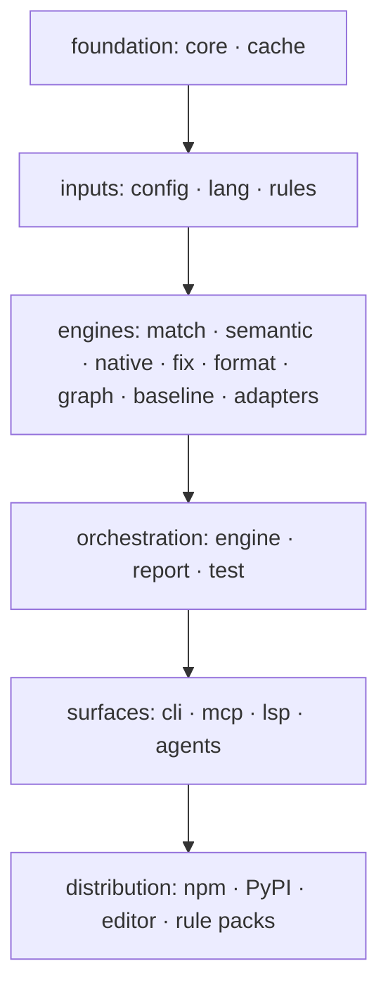

# SR-ARCHITECTURE — the architecture: six layers, one parse per file, parallel per file, warm processes, and every cross-cutting rule the other records left open

## §1 — For humans

**The decision in one line.** Six layers, each depending only on the ones above it. **Every file is read and parsed once per run** and shared by every rule and the formatter. Work is **parallel per file**. Long-lived processes keep everything warm and advertise a socket that one-shot runs can use. Results are **merged and sorted deterministically** ([L5](0007_LAW-5-no-model-in-the-engine.md)), and **a crash in one rule never takes down a run**.

**Speed is designed in ([L8](0010_LAW-8-performance-budgets.md)):** skip before reading, hash before parsing, parse once, compile rules once, dispatch by node kind, cache everything pure ([SR-CACHE](0109_cache.md)), and never start cold when a warm process is up.

**What this record settles that no other record did:** file encoding and line endings, generated and oversized files, symlinks, how git is read, safe writes, position encodings, the external-fixer contract, the adapter contract, the daemon's lifecycle, memory bounds in the editor, what happens when a rule panics, and the semantic model, native rules and pack data that porting real presets needs.



<details>
<summary><b>ASCII twin</b></summary>

```text
   foundation --> inputs --> engines --> orchestration --> surfaces --> distribution
   (core,cache)   (config,    (match,      (engine,report,  (cli,mcp,    (npm, PyPI,
                   lang,rules) semantic,    test)            lsp,agents)  editor,
                               native,fix,                                rule packs)
                               format,graph,
                               baseline,adapters)
```

</details>

---

## §2 — For agents

### Context

The decider asked for the architecture to be designed and its gaps filled. The feature records each described their own piece; the cross-cutting rules (I/O, errors, processes, contracts) belonged to none of them, and some of those gaps would have become inconsistencies the first week of building.

### Decision

#### A. Structure

1. **Layers.** Six layers: **five hold crates** — foundation, inputs, engines, orchestration, surfaces, whose crates are [SR-PACKAGES](0107_packages.md) decision 1 — and the sixth, **distribution** (the npm and PyPI packages, the editor extension, the rule packs), holds no crate: it is built from the binary and `packs/` ([SR-PACKAGES](0107_packages.md) decisions 3–9). A crate depends only on crates in its own layer or the layers above it, with no cycles inside a layer. The layer order of the five crate layers is checked in CI by `crates/codelaw-cli/tests/layers.rs`.
2. **Everything is a library; surfaces are thin.** `codelaw-engine` exposes `check`, `fix`, `format`, `rules_for`, `explain` and the debug queries as functions over typed inputs. The rule queries (`list_rules`, `rules_for`, `find_rule`, `rule_why`, `check_snippet`, `fix_snippet`) live in `codelaw-engine`'s `query` module and their JSON in `codelaw-report`; a rule card carries the rule's `tags:` and `security:` metadata, which `rules --tag` and `--security-coverage` filter and group on (W-53, 2026-10-25). The CLI, MCP, LSP and hook crates only translate between their protocol and those functions ([SR-CLI-MCP](0115_cli-and-mcp.md) decision 6, [SR-EDITOR](0114_editor.md) decision 3). For an editor's unsaved text, `entry_for` says whether `check` would check the file and `check_document` checks the text through the same skips and rules, the format check included; neither reads nor writes the file. `format_source` formats a text in memory, verified, as `codelaw format` would write it. `check_snippet` and `fix_snippet` are `check` and `fix` on one text: the first adds the format check, the second ends with the format step. `check_source` and `fix_source` run the rules alone, for the rule tester and the editor's fix-all.
3. **Pinned grammars and engines.** Every tree-sitter grammar and every formatter engine is vendored at a pinned version in `Cargo.lock`; the grammar and engine versions are part of every cache key ([SR-CACHE](0109_cache.md) decision 2). So are a file's resolved format options, because its `.editorconfig` layer ([SR-FORMATTER](0105_formatter.md) decision 5) is not in the config fingerprint; the engine reads each folder's `.editorconfig` once per run.
   - **SCSS is a fork too, built on the CSS fork.** `crates/codelaw-lang/grammars/tree-sitter-scss` is `tree-sitter-scss` 1.0.0 (MIT, commit `5da5ba7`) with codelaw's own `bindings/rust` (on `tree-sitter-language`, like the CSS fork's); `Language::Scss` parses with it. Since `1.0.0+codelaw.2` (W-62, 2026-10-27) its `grammar.js` extends the in-tree CSS fork's — not the npm `tree-sitter-css` 0.20 upstream builds on, which is no dependency of codelaw's — and reads the Sass module system (`@use … as … with (…)`, `@forward … show/hide/as`), `!default` and `!global`, maps, `@if not` / `and` / `or`, empty and rest parameters, namespaced `@include … using`, interpolated property names, placeholders, pseudo-elements and media features, nested properties, signed variables and `if(sass(…): …; else: …)`; its scanner skips `#{…}` and takes a colon followed by a space as a declaration's. `src/` is regenerated with `tree-sitter-cli` 0.25.10 (L11's list D-36) and committed; the folder's `README.md` lists every change. On Bootstrap's SCSS (5.3.8 and `main` at `d793f28`, 236 files) 1.0.0 parsed 52 files without an error and the fork parses 233; every tree 1.0.0 parsed without an error still parses without one. *(Arpit, 2026-10-26, B-047: "Own grammar / tree-sitter-scss"; W-62; L11's list D-33.)* Biome stays the SCSS formatter only.
   - **A scanner's character classes are the "C" locale's on every platform.** An external scanner asks `<wctype.h>` whether a character is a space or a letter, and C libraries disagree (MSVC's `iswspace` says yes to U+00A0, musl's to U+2028 and U+3000), which would make output differ by platform (L6). So both in-tree grammars' `bindings/rust/build.rs` force-include `bindings/rust/c_locale_wctype.h`, which pins `iswspace`, `iswalpha`, `iswdigit` and `iswalnum` to ASCII as macOS and glibc answer in the "C" locale; `src/` is untouched, and the change is the CSS fork's `+codelaw.2` and the SCSS copy's `1.0.0+codelaw.1` in the fingerprint. A `codelaw-lang` unit test fails on any platform when a scanner calls a class the shim does not pin. *(W-44, 2026-10-27: `css/no-irregular-whitespace`'s SCSS example failed only on the win32 legs.)*
   - **One grammar is a fork.** CSS is codelaw's in-tree fork of `tree-sitter-css` 0.25.0 (MIT), in `crates/codelaw-lang/grammars/tree-sitter-css`. The workspace's `[patch.crates-io]` puts it in place of the crates.io crate `ast-grep-language` pulls in ([SR-PACKAGES](0107_packages.md) decision 1).
   - **What it adds:** range media features (`(400px <= width <= 700px)`), `layer` / `layer(name)` in `@import`, and fractional keyframe percentages (`12.5%`), which 0.25.0 parses as `ERROR`. On 564 real stylesheets, every tree 0.25.0 parsed without an error came out unchanged (W-21, 2026-10-22). **`+codelaw.3` (W-62, 2026-10-27)** adds `supports(…)` in `@import`, a name before an at-rule's query (`@container sidebar (…)`, `@custom-media --small (…)`, `@font-feature-values Font One`), page selectors (`@page :first`), named-range keyframe selectors (`entry 0%`), a custom property holding a block (`--x: { … }`, a `block` under the `declaration`) and `!ie`-style annotations (`important_value`); its scanner reads `&` after a descendant space (`.b &`) and a colon followed by a space as a declaration's. On 738 stylesheets (Bootstrap, Bulma, normalize.css, animate.css, Pico, Open Props, every CSS example in `packs/` and `docs/`) the files without an error went from 586 to 723, and every tree `+codelaw.2` parsed without an error is byte-identical.
   - **How it stays honest:** only `grammar.js` (and its highlight query) is edited by hand; `src/` is regenerated with tree-sitter-cli 0.25.10 by a manual step its README documents, never by the build. Its version is `0.25.0+codelaw.N`, bumped with every grammar change and every change to how `src/` compiles, and `codelaw_lang::GRAMMARS_FINGERPRINT` names it, so a grammar change invalidates the cache; a unit test checks the two agree and that the fork parses the three forms.
   - **It is temporary.** The same change is prepared as an upstream patch, and the fork is dropped when an upstream release carries it. *(Arpit, 2026-10-22: fork in-tree + upstream patch; drop the fork when upstream releases. W-21.)* The patch and the pull-request text are in the fork's `upstream/`; on upstream's `v0.25.0` tag the patch applies and upstream's corpus passes with it (W-21, 2026-10-24). Filing it on upstream's repository is the decider's.

#### B. The pipelines

4. **`check`:**
   1. Load config ([SR-CONFIG](0110_config.md)), resolve the rule packs ([SR-RULE-PACKS](0101_rule-packs.md) decision 4) and load the compiled rule set (cached).
   2. Discover files (decision 7).
   3. In parallel, per file: read once, hash, and on a cache hit reuse the results; otherwise parse once, split embedded regions, build the semantic model if an active rule needs it (decision 15a), run file rules (`native:` ones included, decision 15b) and the format check, and extract graph facts.
   4. Link the graph and run project rules ([SR-PROJECT-GRAPH](0103_project-graph.md)). The graph reads every file of the project root, including those `[files]` or `languages` leave out, so their uses count; project-rule findings are reported only in files step 3 would check. The engine's own graph rules run here on the same linked graph: `graph/no-deprecated-usage` and, when the project turns them on, the test rules of new code (`crates/codelaw-engine/src/new_code.rs`, which reads the change set's base copies, `.codelawignore` and an lcov report through `lcov.rs`; [SR-PROJECT-GRAPH](0103_project-graph.md) decision 9). Off, step 4 builds no graph for them.
   5. Run adapters (decision 19).
   6. Apply suppressions ([SR-LINTER](0106_linter.md) decision 6; another tool's line suppressions map to codelaw ids through a `ported_from:` table the project builds once at load, when the config names an alias) and the baseline ([SR-BASELINE](0104_baseline-and-deprecations.md)), then each file's `remap` ([SR-CONFIG](0110_config.md) decision 11) — once, last, never to `codelaw/*`. `fix`, MCP's `check_snippet` and the editor's checks end with the same `remap`. The profile ([SR-CONFIG](0110_config.md) decision 10) is chosen in step 1, before anything keys on the config, so it is part of every cache key.
   7. Merge, dedupe (same file, range, rule) and sort by path, line, column, rule.
   8. Report ([SR-CLI-MCP](0115_cli-and-mcp.md) decision 4).
5. **`fix`** per file: run all rules → collect `auto` edits (and `suggest` edits with `--unsafe`) → drop overlapping edits → apply → re-parse → repeat until no edits, at most 10 passes → format ([SR-FORMATTER](0105_formatter.md)) → verify (parses, idempotent, no new rule fires) → write (decision 12). Two rules whose fixes alternate are detected by a repeated file hash and both are reported as `manual` with a `fix-conflict` note.
   - **What verify checks:** *parses* counts syntax errors in the host and in every embedded region (a `<script>`, a Markdown fence), and a fix may not add one; *idempotent* is the fixpoint, since the loop ends only when the result offers no more fixes; *no new rule fires* compares the rules with a finding on the result against the original, engine diagnostics aside. A rule whose fixes make a new rule fire is refused (`manual`, note `fix-verify-failed`) and the loop runs again without it.
   - **One loop, traced in place:** `codelaw-fix`'s `fix_loop_with` is the only loop; `fix_loop` and `fix_loop_traced` (host grammar only, for the rule tester) call it. `fix --trace` records the passes of the very run whose result `fix` keeps — the engine's, with its embedded-region error count — plus the rules verify refused and whether the format step changed the layout ([SR-CLI-MCP](0115_cli-and-mcp.md) decision 4). It is the same run as `fix`, so it writes what `fix` writes, and nothing with `--dry-run`.
6. **`format`** is the fix pipeline with the rule steps skipped.

#### C. Files and I/O

7. **Discovery.** The walk uses the `ignore` crate (MIT / Unlicense): `.gitignore`, `.ignore`, then `include` and `exclude` from config. Files are skipped **by extension and ignore rules before they are read**. Symlinks are not followed unless `[files] follow_symlinks = true`. Paths are normalised to forward slashes in every output and cache key, so Windows and Unix runs agree.
   - **Never entered, before any config:** `.git/`, `node_modules/`, `.venv/` and `.codelaw/cache/`.
   - **The user's global gitignore is not read**, so two machines checking one commit agree ([L5](0007_LAW-5-no-model-in-the-engine.md)). Nor is any ignore file above the project root, except the folders between it and the root of the git repository it sits in (that repository's `.gitignore`, `.ignore` and `.git/info/exclude`); with no repository, nothing above the project root is read. A requested sub-folder is walked from the project root, so the ignore files between them apply.
   - **Nested configs** are found for every file checked, whether walked or named on the command line: the folders from the project root down to it are searched ([SR-CONFIG](0110_config.md) decision 2).
   - **With `follow_symlinks`,** a file reached by several paths is checked and written once, under the first path in sort order.
   - **Paths are relative to the project root,** a file outside it with `../`.
   - **A file named on the command line** skips the ignore files, but not `include` and `exclude`.
8. **Encoding.** Files are read as UTF-8. A UTF-8 BOM is preserved on write, and the byte offsets a diagnostic or edit reports count it, so they are offsets into the file as it is on disk. A file that isn't valid UTF-8 gets one `codelaw/not-utf8` info diagnostic and is skipped; it's never rewritten.
9. **Line endings.** The dominant line ending of a file (`\n` or `\r\n`) is detected once and preserved by every fix. Only the formatter changes it, and only when `[format] end_of_line` is set.
10. **Generated and oversized files.**
    - A file whose first 1,024 bytes contain `@generated` (or a `[files] generated_markers` entry) is skipped with an info diagnostic unless `[files] lint_generated = true`.
    - A file above `[files] max_file_size` (default 1 MiB) is skipped with a `codelaw/file-too-large` info diagnostic. Formatting such a file is refused, never attempted.
11. **Glob base.** Every glob in config and in rule frontmatter is relative to the directory of the file that declares it: the config file's directory for `include`, `exclude` and every `[scope.<name>]`; the repo root for a rule's `files`.
12. **Safe writes.** A fixed or formatted file is written to a temp file in the same directory, synced, and renamed into place; a symlink is written through, so the file it points to is replaced and the link stays a link. Right before the rename, the file's hash is compared with the hash read at the start of the run; if it changed, the write is skipped and reported (`codelaw/file-changed-during-run`, `warn`). A write that fails (permissions, a read-only or full disk) is `codelaw/write-failed`, an `error`, so the run fails. Either way the file is reported as it is on disk — its original findings, never the post-fix ones — and it is not printed as fixed. Permissions are preserved. The LSP never writes files itself; it returns `WorkspaceEdit`s and the editor writes ([SR-EDITOR](0114_editor.md)).
13. **Positions.** (The `template` module of this crate is SR-LAW-10's: the renderer and the registry test.) Internally, offsets are bytes. Text and JSON output use 1-based line and column, in characters. The LSP crate converts to 0-based UTF-16 at the boundary. SARIF uses its own 1-based scheme. The conversion is tested on files with multi-byte and astral characters.
14. **Git.** codelaw shells out to the `git` on `PATH` for exactly six things: the merge base and diff for `--changed-since`, the index for `--staged`, the `HEAD` commit date for the as-of default ([SR-BASELINE](0104_baseline-and-deprecations.md) decision 4), the baseline files at the merge base for `baseline check` (decision 5), the commits and baseline files of the history for `baseline history` (decision 10), and the author of an exception's `added_by` (decision 9: `git config user.email`, the changed lines of `git diff -U0`, and `git blame --porcelain` on those lines under `--changed-since` only). It also reads one file at a revision (`git show <rev>:./<path>`, `git::file_at`: the base copy of each changed JS, TS or Python file, so `codelaw debug changed-functions` and the test-for-new-code rules can tell a new or edited function from an untouched one, W-71; the merge base under `--changed-since`, `HEAD` under `--staged`). It links no git library; `crates/codelaw-engine/src/git.rs` is the one place that runs it, and only when one of those is asked for, a baseline or the deprecations registry is in play, or a `codelaw-ignore` carries a date. With no `git`, those five features report their absence plainly and everything else runs.

#### D. Rules and regions

15. **Compile once, dispatch by kind.** Rule files are compiled at load into matchers whose kind filters are indexed. Each file is walked once, and every node is handed only to the rules whose filter matches it. A `target:` rule ([SR-RULE-FORMAT](0112_rule-format.md) decision 3e) matches no node: it runs once per JSON, YAML or TOML file on the data tree, built once for all of them; a data tree that panics fails each of those rules (decision 25), and their fixes are verified as 3e says before decision 5's loop applies them. The compiled set is cached by the hash of every active rule file plus the config ([SR-CACHE](0109_cache.md)); the key also carries each loaded rule's default severity and options, which the compiled set copies — without it, `codelaw test` on a one-rule pack reused the set it had compiled with the rule off (found by W-103's `spell` pack, 2026-10-27).

15a. **Semantic model.** For JS/TS (JSX and TSX included) and Python, each file gets scopes, bindings, references, imports and exports.
  - **How it's built:** from the same syntax tree, in one pass after parsing (crate `codelaw-semantic`), and only when at least one active rule needs it.
  - **How rules use it:** `match:` rules query it through the predicates of [SR-RULE-FORMAT](0112_rule-format.md) decision 3a, written under `where:`; native rules read it directly.
  - **Shared with the graph:** its imports and exports are the per-file facts the project graph links, so they're computed once ([SR-PROJECT-GRAPH](0103_project-graph.md)).
  - **Python specifics** (W-17): PEP 695 type parameters live in an annotation scope around their `def`, `class` or `type` statement — annotations, bases, the body and methods see them, defaults and the enclosing scope don't. An `__all__` the model can read (lists, tuples, `+`, `+=`, `.extend()`, `.append()` of string literals) is the export list; one with any other part (`sub.__all__`, a call) is unknowable, and every public module-level name, imports included, counts as exported — a deliberate false negative over a false `unused-import`.
  - **JS/TS specifics** (W-17): `export { Name }` exports every namespace of the name (a value and a type merged under one name); enum members are declared in the enum's own scope and never unused; the head of `NS.T` in a type is a type reference.
  - **No type information** ([L3](0005_LAW-3-languages.md)).
  - **Where the approach comes from:** `oxc_semantic` (MIT) for JS/TS and Ruff's semantic model (MIT) for Python. Taking either as a dependency needs its own record.
  - **Cached** with the file's results ([SR-CACHE](0109_cache.md)).

15b. **Native rules.** A rule whose `codelaw` block is `native: <id>` runs a Rust implementation registered under that id in `codelaw-native`. It's for checks a pattern can't express: control flow (`no-unreachable`), hook order (`rules-of-hooks`), dependency lists (`exhaustive-deps`).
  - **The Markdown file is still the rule.** It carries the docs, fix class, options and examples, and `codelaw test` runs them unchanged.
  - **An unknown id refuses the rule at load,** naming the pack's `min_codelaw`.
  - **Same discipline as every rule:** a native rule declares the node kinds it needs (decision 15), is isolated on panic (decision 25) and is deterministic ([L5](0007_LAW-5-no-model-in-the-engine.md)).
  - **What it reads:** the file, its semantic model, the rule's options and the pack's data tables (decision 15c).
  - **What it sees of the file beyond its text:** its project-relative path, its bytes as they are on disk (a byte-order mark included, which the text never holds), and a read-only view of the project's files — whether a path exists or is a folder, a file's text, a folder's listing. Paths are `/`-separated and relative to the project root; a path with a `..`, `.` or empty segment answers "no", so nothing outside the root is read. An embedded region sees its host file. `check_files` and `codelaw test` answer from the in-memory set, never the disk.
  - **Cached results stay honest:** every question a rule asks about another file is stored with a hash of its answer in the file's cached result, and the result is reused only while every answer still holds ([SR-CACHE](0109_cache.md) §1), so a link checked against a missing file is checked again once the file exists. *(W-21, 2026-10-22.)*
  - **The as-of date is a question too:** a native rule may ask for it (`FileContext::as_of`, `YYYY-MM-DD` or none: [L5](0007_LAW-5-no-model-in-the-engine.md) decision 2's date, never the clock); it is read only when asked, recorded like a file's answer, and a cached result is reused only on the same date. *(W-52, 2026-10-25.)*
  - **A config section as options, and graded findings:** a native rule may name one root config section (`NativeRule::config_section`); its keys reach the rule as options, under the rule's own `[rules]` options. A rule may also grade its findings (`NativeRule::severity_of`): a graded finding takes its grade's severity, and the rule's severity only turns the rule on or off. The dependency rules use both, with `[deps]` ([SR-RULE-PACKS](0101_rule-packs.md) decision 15). *(W-52, 2026-10-25.)*
  - **Structured data on a finding:** a native rule may attach facts to a finding (`NativeRule::data_of`, which sees the finding and the rule's options); they travel as `Diagnostic::data` into `--format json` and SARIF ([SR-CLI-MCP](0115_cli-and-mcp.md) decision 4). The size rules (`js/max-lines`, `js/max-lines-per-function`, `js/max-params` and their `py/` twins, `crates/codelaw-native/src/size.rs`) carry the measured value and the limit: `{ "lines": 412, "max": 300 }`. *(W-58, 2026-10-26.)*
  - **SCSS and CSS Modules are modes of that reader** (W-62, W-63, 2026-10-26): in SCSS mode `//` comments are blanked (same offsets), `#{}` is one unit, Sass at-rules and nested-property blocks are `Other` statements and `&-suffix` is one nesting selector; in module mode (`*.module.css`, `*.module.scss`, or `[css] modules`, which every `css/*` rule receives as a config section) `@value`, `composes:`, `:export {}` and `:import() {}` are `Other` statements and `:global` and `:local` are known pseudo-classes. **A `css/*` rule reads an SCSS file with its `//` comments blanked** (the same offsets; a fix whose edit would overwrite one is dropped, its finding kept), and **a Sass at-rule's block (`@include x { … }`, `@if`, a mixin's body) is a context of its own** when rules compare selectors, as an `@media` block is; a declaration under a mixin or an `@include` is in a rule (W-62, 2026-10-27: false positives the pinned Bootstrap corpus showed). A native CSS rule runs on the file's root, once, even when the grammar cannot recover and the root is an `ERROR` node (the SCSS fork still does not read every form: decision 3). `crates/codelaw-native/src/css_modules.rs` holds the `css-modules/*` rules that read one stylesheet; the two that join stylesheets with the JS and TS that import them are graph queries ([SR-PROJECT-GRAPH](0103_project-graph.md) decision 8).
  - **The CSS rules read text, not the tree.** Every `css/*` native rule declares `stylesheet` and reads the stylesheet's text with `codelaw-native`'s own reader (`css_syntax.rs`). The forms that kept them off the tree — a custom property holding a block, a nesting selector after a compound (`.b &`), `@page :first`, `@container name (…)`, `@custom-media`, `@import … supports(…)`, `@font-feature-values`, `!ie`-style annotations and named-range keyframe selectors (`entry 0%`) — parse since the CSS fork's `+codelaw.3`, and the SCSS fork reads modern Sass (decision 3; W-62, 2026-10-27); the move onto the trees is W-62's next step and has not been made. Several rules exist to report CSS the grammar rejects (`css/media-query-no-invalid`, `css/at-rule-prelude-no-invalid`), so they keep reading text on any tree. The grammar still verifies every fix those rules make (decision 5). *(W-21, 2026-10-24.)*
  - **The library packs' rules** (`tanstack-query/*` in `tanstack_query.rs`, `redux-toolkit/*` in `redux_toolkit.rs`) read option objects and call sites on the JS tree and the semantic model, and share `js_ast.rs`'s helpers: the function around a node, a parameter's name, a `const`'s initialiser and where an identifier was imported from. The `tanstack-query/*` hook rules and `redux-toolkit/object-shorthand-mapdispatch` fire only on a callee imported from the library, so a same-named local function is not reported; the other `redux-toolkit/*` rules key on the shape of `createSlice`, reducer and selector code. *(W-32, 2026-10-25.)*
    - **W-42's six `tanstack-query/*` rules** share one reader, `option_objects`: the option object literals a TanStack import (`useQuery`, `useSuspenseQuery`, `useMutation`, `queryOptions`, `useQueries`' `queries`, …) or `new QueryClient({ defaultOptions })` takes, each tagged query, suspense or mutation, plus the first argument of the QueryClient query methods (`fetchQuery`, `prefetchQuery`, …), which are matched by name since the client's type is not known. `object-syntax`, `array-query-key` and `no-mutating-set-query-data` read call sites the same way: imports for hooks, names for methods. *(W-42, 2026-10-25.)*
  - **The `stencil/*` rules** (`stencil.rs`) read a `@Component` class body: its members and their decorators, and for `enforce-slot-jsdoc` the class's JSDoc `@slot` tags against the `<slot>` elements it renders. `stencil/ban-side-effects` is the exception: it reads every call and walks up to the nearest function, class or `export` declaration, so it checks any TS or TSX file outside a test file, component or not. *(W-33, 2026-10-25.)*
  - **`react/no-context`** (`react.rs`) reports a call only when its callee is `createContext` or `useContext` imported from `react` — named under any alias, or a member of the default or namespace import — read from the semantic model's imports, so a local `useContext` is not reported. *(W-41, 2026-10-25.)*
  - **The React Compiler and @eslint-react hooks rules** (`react_hooks.rs`) decide from one file's tree and semantic model: a component is a PascalCase function that renders JSX, calls a hook or is wrapped in `memo` / `forwardRef`; a hook is a `use…` function; a state setter is the second element of a `useState` pattern and a ref a `useRef` result, each recognised at its declaration in the same function; a global is a name no declaration binds, or one declared at the module's top level. Only the component's or hook's own body counts as render — a nested function (an effect, a handler, an initializer) does not — and nothing is followed through calls or aliases. *(W-43, 2026-10-25.)*
  - **Only first-party packs** and ejected copies of their rules may use `native:` ([SR-RULE-PACKS](0101_rule-packs.md) decision 10).

15c. **Rule packs and data tables.** Rules come from the packs resolved by [SR-RULE-PACKS](0101_rule-packs.md) decision 4, plus local rules. The engine embeds only its own (`codelaw/*` diagnostics, `graph/no-deprecated-usage`, and the opt-in `graph/untested-function` and `graph/function-coverage`).
  - **Data tables:** a pack's `data/` tables (CSS properties, HTML elements and attributes, JSON Schemas) are read at load, parsed once, and shared read-only by every rule that names them.
  - **Caching:** their hashes join the compiled rule set's cache key (decision 15).
  - **Nothing is fetched** (decision 27).

16. **Embedded regions** ([SR-LINTER](0106_linter.md) decision 3) are parsed lazily: a `<script>` is parsed only if JavaScript or TypeScript is enabled and at least one rule or the format check applies to it. A language switched off in `languages` is off inside host files too.
17. **Monorepo scope.** One graph and one baseline per **project root**: the topmost config, or a nested config with `root = true` ([SR-CONFIG](0110_config.md) decision 2). A `root = true` package is a separate project with its own graph; cross-root imports are resolved as external.

#### E. Contracts with code codelaw doesn't own

18. **External fixers** (`fix: { external: "<command>" }`, [SR-RULE-FORMAT](0112_rule-format.md) decision 3).
    - Run only for local rules, or for packs listed in `allow_pack_fixers` ([SR-RULE-PACKS](0101_rule-packs.md) decision 12).
    - Input on stdin, one JSON object: `{ "schema": 1, "rule", "file", "language", "source", "matches": [{ "range", "captures" }] }`.
    - Output on stdout: `{ "edits": [{ "range", "text" }] }`, byte offsets into `source`. A range is `{ "start", "end" }` in the request; the answer may give `{ "start", "end" }` or `[start, end]`.
    - The command runs through `sh -c` (`cmd /C` on Windows).
    - Timeout 5 s per file (`[fix] external_timeout`), no network expected, run with the repo root as the working directory.
    - Both stdout and stderr are drained as it runs, so a chatty fixer never blocks; the last stderr line is quoted when it fails. On Unix the fixer leads its own process group, and the whole group is killed at the timeout and once the fixer exits, so a process it started can neither outlive it nor hold its output open (`codelaw_core::process::kill_group`, the one copy the adapter runner shares, through `libc`, MIT / Apache-2.0).
    - The result goes through the same verifier as a built-in fix (decision 5). A fixer that fails or times out reports the instance as `manual` with the rule's steps.
19. **Adapters** ([SR-LINTER](0106_linter.md) decision 2).
    - Each adapter has a manifest in the codelaw source (`crates/codelaw-adapters/adapters/<name>.toml`, compiled into the binary): the binary name, the lookup order (`node_modules/.bin`, `.venv/bin` — `Scripts` on Windows — then `PATH`), the command line for JSON output, a tested version range, the tool's licence, its config files, and the parser that maps its output to codelaw diagnostics and fix classes ([L4](0006_LAW-4-every-rule-has-a-fix.md) decision 9). Each tested range starts at the version its fixtures (`crates/codelaw-adapters/tests/fixtures/`) were captured from.
    - Adapters run only in `check` and `fix` from the CLI and CI, **never in hook, LSP or MCP mode** ([L8](0010_LAW-8-performance-budgets.md) `fix_one_file`): `EngineOptions::adapters` is set by the CLI alone, and cleared by `--no-adapters`.
    - An adapter outside its tested version range runs with a warning; a missing adapter named in config is a warning, not an error; a default adapter that is not installed is skipped quietly.
    - **How it runs:** once per adapter over every checked file it handles (in batches of 200), the adapters side by side, after project rules (decision 4); the program is executed directly, with no shell, the project root as its working directory, stdin closed, both outputs drained as it runs, and on Unix as the leader of its own process group, killed whole at `[adapters] timeout` ([SR-LINTER](0106_linter.md) decision 2) through `codelaw_core::process::kill_group` (decision 18's copy; `libc`, MIT / Apache-2.0). A non-zero exit is how the tools say they found something, so only a report the parser can't read, a failure to start or a timeout fails a run; a failed run is a warning in the report, never a silent gap (decision 26).
    - Adapter results are cached like file results, per file, keyed additionally by the adapter's reported version, its command line and the content of its config files (the manifest's `config_files`, looked for in every folder from the file's up to the project root), except where that config content names the manifest's `uncached_when` key: oxlint's `typeAware` (W-107) checks a file against the whole program's types, which no per-file key covers, so those results are never cached and every run asks the tool again.
    - **In `fix`:** the adapters run after codelaw's own fixes are written, so they see those files; their `auto` edits (and `suggest` with `--unsafe`) are applied once per file, whole fixes in file order, one that overlaps an earlier one left for the next run. The result passes decision 5's verifier — it adds no syntax error and no codelaw rule fires that did not — or the file is left alone and those findings are `manual` with the note `fix-verify-failed`. Then the changed files are checked again. With `--dry-run` nothing is applied and the findings are those of the files on disk.
    - Adapter rule ids are namespaced `adapter/<name>/<rule>` so they never collide with codelaw rules; a diagnostic's `source` is `<name>@<version>`.

#### F. Concurrency, processes and memory

20. **Concurrency:** a work-stealing pool (`rayon`, MIT / Apache-2.0) across files, sized to the CPU count (`--threads`). Matching inside one file is single-threaded. Project linking runs after all files, in parallel by package. Results are collected per file and merged in sorted order, so scheduling never shows in the output ([L5](0007_LAW-5-no-model-in-the-engine.md)).
21. **Warm processes.** Any long-lived codelaw process (`lsp`, `mcp`, `daemon`) registers a socket at `.codelaw/cache/run/<pid>.sock` with its version. `codelaw hook` and any command run with `--prefer-warm` connect to the newest live socket **whose version equals their own**; otherwise they run in-process. A stale socket (dead pid) is removed on discovery.
    - **How it is built** (W-15, `crates/codelaw-cli/src/warm.rs`): a Unix domain socket in the project's cache folder, beside a `<pid>.json` naming its version, kind and folder, written after the socket is bound. Nothing listens on a network port ([L5](0007_LAW-5-no-model-in-the-engine.md) decision 3). A process registers only inside a codelaw project (a config was found); the socket is bound by its name relative to the run folder, so a deep project path does not hit the platform's socket-path limit.
    - **Discovery** reads every registration, newest first, and connects to each: a socket nobody accepts on (its process died or was killed) is removed with its registration, as is a registration that does not parse or has no socket. Sockets of another version are never sent a command.
    - **What is served:** `check`, `fix` and `format` with `--prefer-warm`. The client sends its command line, folder, terminal (colour) and environment (`CODELAW_CACHE_DIR`, `CODELAW_SITE_PACKAGES`, `VIRTUAL_ENV`); the warm process runs the very function the command runs in-process with those, never its own, and returns stdout, stderr and the exit code, so the output is byte-identical (`crates/codelaw-cli/tests/warm.rs` checks every L3 fixture). `lsp` and `mcp` serve clients in their own folder; the daemon serves any folder of its project, one request at a time. Every request loads the project afresh; the compiled rule set is reused from memory while its inputs are unchanged (decision 15).
    - **Declined, so run in-process:** another version, another folder (`lsp`, `mcp`), a command that is not served, a `fix` that may start an external fixer (decision 18; it would inherit the warm process's environment), and a run that panics. A warm process that dies mid-request leaves the command to the client.
    - **Unix only — on Windows every command is one-shot.** No warm socket is registered and named pipes are not built: `lsp` and `mcp` serve their stdio clients but nothing else, `codelaw hook` and `--prefer-warm` run in-process, and every `codelaw daemon` action exits 2 with ``error: `codelaw daemon` needs Unix domain sockets; on this system every command runs in its own process``. Output is unchanged, because a warm run's bytes are the in-process run's; only the warm speed-up is missing. This is the one documented gap in [L6](0008_LAW-6-python-and-node-packages.md)'s identical behaviour across platforms, and `scripts/smoke.sh` checks it on both `win32-*` legs of `ci.yml`'s `smoke` job: the `daemon status` message and exit code, and `check --prefer-warm` byte-equal to `check` (W-27).
22. **Daemon lifecycle.** `codelaw daemon start` is optional and never automatic. It exits after 30 minutes idle (`[daemon] idle_timeout`, a duration, root config only), on a version mismatch with the binary on disk, or on `daemon stop`. It reads the config, rules and baseline afresh for every request, so a change to any of them is served at once. It watches nothing itself; watching files is decision 22a's, in the process that asked for it.
    - `daemon start` starts `codelaw daemon run` in its own process group, detached, and waits for its socket; a second `start` reports the running one. `daemon stop` stops this project's daemons; `daemon status` lists every warm process of the project (kind, pid, version, requests served) and exits 1 when there is none. Outside a codelaw project each refuses with exit 2.
    - A binary on disk is checked every 2 s: when its size or modification time changed and `--version` reports another version (or it is gone), the daemon exits. The idle and binary checks read the process's monotonic timer and file metadata; no verdict depends on them ([L5](0007_LAW-5-no-model-in-the-engine.md)).
22a. **Watch mode** (`check --watch`, `fix --watch`, [SR-CLI-MCP](0115_cli-and-mcp.md) decision 2; W-44, 2026-10-25). Decision 22 once read "with no watcher dependency"; a watch is now built, still with none.
    - **In the process that runs it,** never the daemon and never a warm socket, so it works the same on Windows (decision 21's gap does not apply).
    - **What it looks at** (`codelaw-engine`'s `Watch` and `Snapshot`): every file of the project root decision 7's walk finds (the graph's walk, `[files]` and `languages` not applied), the config files, every loaded rule file, each walked folder's `.editorconfig`, `.gitignore`, `.ignore` and `setup.cfg`, and the folders that hold them.
    - **How:** it polls their metadata — length, modification time and, on Unix, the inode — every 100 ms, and a folder's names when its own metadata moves. A path is watched, never an inode, so an editor's save by rename is a change. Only the names the engine reads count in a folder, so a swap or temporary file is not one. No file-event library: `notify`, the obvious one, is CC0-1.0, which is not OSI-approved ([L2](0004_LAW-2-foss-dependencies.md) decision 1). The metadata is a trigger only; no verdict reads it ([L5](0007_LAW-5-no-model-in-the-engine.md)).
    - **Settling:** a change is acted on once a look 100 ms later sees nothing new, or after 2 s of continuous change, so a burst is one run.
    - **What it redoes:** a change to the config, a rule, the baseline or anything under `.codelaw/`, an `.editorconfig` or an ignore file, a `codelaw.toml`, `pyproject.toml` or `package.json`, or more than 256 files at once (a `git checkout`), loads the project again and runs in full, as the daemon reads them afresh. A file added or removed walks the project again: when the set of files is unchanged the run is incremental. A saved file is checked again, with every file whose rules' questions about other files ([SR-CACHE](0109_cache.md) §1) no longer hold, the as-of date among them (decision 15b, as the cache asks it); its graph facts are read again and the project rules run over the whole graph; the adapters run on it again.
    - **The same verdict:** a run keeps decision 4's parts — each file's result, the graph's sources and facts, the adapters' findings — and puts the report together through the same function as `check` (`assemble`, then the baseline, `remap` and the profile), so each run's report is `check`'s for the same files. `crates/codelaw-cli/tests/watch.rs` compares them object for object. `--changed-since` and `--staged` are asked of git again each run; the as-of date is read when the project is loaded.
    - **`fix --watch`** fixes the saved files the run checks, then checks; the files it wrote are taken as seen, so its own write never starts another run. A change that reloads the project is checked, not fixed.
    - **A config that no longer loads** is reported and the last good state kept; the next change loads it again.
    - **Speed:** [SR-CLI-MCP](0115_cli-and-mcp.md) decision 10's `watch_rerun` and `watch_save_to_print` rows, context for [L8](0010_LAW-8-performance-budgets.md).
23. **Incremental in warm processes.** An edit re-parses incrementally (tree-sitter's edit API), re-runs only that file's rules, and relinks only its graph edges ([SR-PROJECT-GRAPH](0103_project-graph.md) decision 5). Project rules re-run on save or after 300 ms idle ([SR-EDITOR](0114_editor.md) decision 2).
    - **Built for the editor** (W-15): `codelaw-engine`'s `DocumentTree` keeps a document's host tree, `DocumentTree::edit` re-parses through `codelaw-lang`'s `reparse`, and `Project::check_document_tree` checks it. A tree of any other text or language is never used, so the diagnostics are those of a fresh parse. Embedded regions are re-parsed from the host each time. The graph half waits for project rules in the editor.
24. **Memory bounds.** A warm process keeps compiled rules and graph facts for every file, but syntax trees only for open files plus an LRU of the 256 most recently touched (`[lsp] tree_cache`, a non-negative integer, root config only; `0` keeps no closed file's tree). `peak_memory_10k` is an [L8](0010_LAW-8-performance-budgets.md) budget.
    - **As built (W-15):** the language server is the one warm process that keeps trees; `mcp` and the daemon load each request afresh and keep none. An open document keeps its tree; on close the tree goes to `codelaw-engine`'s `TreeCache`, one per project, bounded by that project's `[lsp] tree_cache` and re-bounded when the config reloads. "Touched" is closed: the least recently closed tree is dropped first. A reopened file takes its tree back, and uses it only when its text is the reopened text, so the diagnostics are those of a fresh parse (`codelaw-lsp`'s `closed_trees_are_an_lru_bounded_by_tree_cache`). The compiled rule sets a process keeps are bounded at 8, most recently used first.

#### G. Failure, safety and privacy

25. **A rule failure is isolated.** A panic or error inside one rule on one file is caught, reported as `codelaw/internal-error` naming the rule and file, and the run continues. Internal errors make the exit code 2 at the end, after every other result is printed.
    - The diagnostic is the engine's, never the failing rule's: the rule's severity, a `codelaw-ignore` of the rule and the cache cannot hide it, and a suppression of a rule that failed is not reported unused.
    - A semantic model that panics fails every rule on that file that needs it; the other rules still run.
    - The panic fixture is the `test/panic` native rule, compiled only with `codelaw-native`'s `fault-injection` feature, which only the engine's and the CLI's tests enable.
26. **Partial results are never silently partial.** If any file was skipped (encoding, size, read error) or any rule failed, the summary line says so and `--format json` carries a `skipped[]` list. A folder the walk could not enter (permission denied, a symlink loop) is in `skipped[]` too.
27. **No network, no model, no clock, no telemetry.** The engine makes no network calls, calls no model, reads no wall clock ([L5](0007_LAW-5-no-model-in-the-engine.md)) and sends no usage data anywhere, ever. Nothing is downloaded after install ([L6](0008_LAW-6-python-and-node-packages.md) decision 3).
28. **What may execute.** codelaw runs only: itself, the `git` binary (decision 14), the adapters config enables, by name or as [SR-LINTER](0106_linter.md) decision 2's defaults, and only from the CLI (decision 19), external fixers under the allowlist (decision 18), `[format] format_after` commands the user wrote, the package manager `codelaw init` runs to install rule packs ([SR-RULE-PACKS](0101_rule-packs.md) decision 6), and Node running codelaw's own type helper over the project's installed TypeScript, for the type-aware rules alone ([SR-TYPES](0117_types.md); not built yet, W-105). Nothing in a rule file, pack or cache is ever executed.

#### H. Targets until [L8](0010_LAW-8-performance-budgets.md)'s budgets are set

29. Design targets, not law: `check_warm_10k` < 2 s · `check_cold_10k` < 20 s · `fix_one_file` < 100 ms warm, < 300 ms cold · `lsp_after_edit` < 50 ms · `startup` < 20 ms · `peak_memory_10k` < 1 GiB. `W-19` turns them into measurements.
30. **Performance rules for contributors:** no rule may re-parse; no regex over a whole file when a kind filter exists; no allocation per node in a hot loop without a benchmark; every new step runs `codelaw bench` before merge.

### Consequences

- **The `[files]`, `[daemon]` and `[lsp]` config sections are this record's** and are added to the schema ([SR-CONFIG](0110_config.md) decision 3).
- **Shelling out to `git`** keeps the binary small and matches what every CI image has, at the cost of three features being absent without it.
- **Adapters are excluded from hook and LSP mode,** so an agent sees adapter findings only in CI. Deliberate, for `fix_one_file`.
- **Warm-process discovery adds a socket file under the cache;** stale-socket cleanup is tested (`crates/codelaw-cli/tests/warm.rs` and `warm.rs`'s unit tests, W-15).
- **The semantic model is in the hot path** for every JS/TS and Python file that a scope-aware rule touches; it's built lazily and measured by `check_warm_10k` ([L8](0010_LAW-8-performance-budgets.md)).
- **Not decided yet, by design:** a JavaScript rule API (DESIGN P4), and SCSS/Vue/Svelte. Each needs its own record before any work. **Type-aware rules are decided** (2026-10-27, W-104): their record is [SR-TYPES](0117_types.md), and [L3](0005_LAW-3-languages.md) decision 9 takes them into the core.

### Alternatives considered

- **One crate, one big module tree:** rejected. Layering can't be checked, and incremental compiles are slower.
- **Parallelism per rule:** rejected. Each rule would walk the tree again; walking once and dispatching by kind is less work.
- **An always-on background daemon:** rejected. A surprise process; it stays opt-in, and the LSP doubles as the warm process.
- **A linked git library (`gix`):** rejected for now. More binary, more surface, for three features the `git` binary already provides.
- **Following symlinks by default:** rejected. Cycles and duplicate findings in monorepos.

### Reference (required)

- [SR-PACKAGES](0107_packages.md): the crates in each layer.
- [SR-CACHE](0109_cache.md): what the warm paths reuse.
- [tree-sitter](https://tree-sitter.github.io/tree-sitter/): incremental re-parsing on edit.
- [`ignore` crate](https://docs.rs/ignore): gitignore-aware parallel walking (from ripgrep).
- [`rayon`](https://docs.rs/rayon): the work-stealing pool.
- [tree-sitter-css](https://github.com/tree-sitter/tree-sitter-css) and the fork's [`README.md`](../crates/codelaw-lang/grammars/tree-sitter-css/README.md): decision 3's CSS fork, what it changes and how it is regenerated.
- [`oxc_semantic`](https://docs.rs/oxc_semantic) and [Ruff's semantic model](https://github.com/astral-sh/ruff/tree/main/crates/ruff_python_semantic): the approaches decision 15a ports.

### Veto condition

**Reopen this decision if:** a crate depends on a crate in a lower layer, a rule re-parses a file, a rule failure aborts a run, or the engine performs any network, model, clock or telemetry call. **Reopen decision 3's CSS fork if:** a released `tree-sitter-css` parses range media features, `layer()` in `@import` and fractional keyframe percentages (drop the fork), or `Cargo.lock` no longer resolves `tree-sitter-css` to the in-tree `+codelaw` version (the patch stopped applying, e.g. `ast-grep-language` moved off 0.25).

**How to check it:** the layer check (`crates/codelaw-cli/tests/layers.rs`), `codelaw check --timings` showing one parse per file, the rule-panic fixture (`W-17`), and the network fence from SR-LAW-5. For the fork: `cargo test -p codelaw-lang` (`modern_css_parses`, `fingerprint_names_the_css_fork`) and `cargo search tree-sitter-css` against the upstream release notes.

---

## References

*Every source this record cites, gathered in one place. An archived document is never listed here.*

**Records** — [SR-RULE-PACKS](0101_rule-packs.md) · [SR-PROJECT-GRAPH](0103_project-graph.md) · [SR-BASELINE](0104_baseline-and-deprecations.md) · [SR-FORMATTER](0105_formatter.md) · [SR-LINTER](0106_linter.md) · [SR-PACKAGES](0107_packages.md) · [SR-CACHE](0109_cache.md) · [SR-CONFIG](0110_config.md) · [SR-RULE-FORMAT](0112_rule-format.md) · [SR-EDITOR](0114_editor.md) · [SR-CLI-MCP](0115_cli-and-mcp.md) · [SR-TYPES](0117_types.md)

**Project docs** — [`docs/DESIGN.md`](../docs/DESIGN.md) · [`crates/codelaw-lang/grammars/tree-sitter-css/README.md`](../crates/codelaw-lang/grammars/tree-sitter-css/README.md)

**External** — [tree-sitter-css](https://github.com/tree-sitter/tree-sitter-css)
