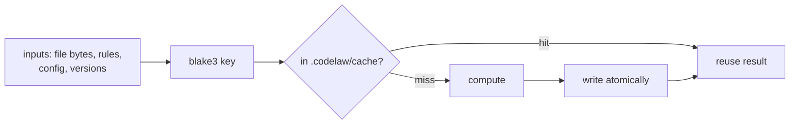

# SR-CACHE — caching: content-addressed, versioned, safe to delete, never changes output

## §1 — For humans

**The decision in one line.** Everything pure is cached, **keyed by the hash of every input that can change its result**. The cache lives in `.codelaw/cache/` (gitignored), is safe to delete at any time, and **a warm run's output is byte-identical to a cold run's** ([L5](0007_LAW-5-no-model-in-the-engine.md)). It's the main lever for [L8](0010_LAW-8-performance-budgets.md)'s warm budgets.

| Cache | Key | Value |
|---|---|---|
| compiled rule set | hash of every active rule file + config + codelaw version | compiled matchers |
| file facts | file hash + language + grammar version + codelaw version | graph facts (exports, imports, references) |
| file lint results | file hash + compiled-rule-set hash + resolved-config hash | file-scope diagnostics |
| format state | file hash + format-config hash + engine versions | "already formatted" or the formatted bytes' hash |
| project results | hash of every fact the rule read + rule-set hash | project-scope diagnostics |



<details>
<summary><b>ASCII twin</b></summary>

```text
   inputs --> blake3 key --> in cache? --hit--> reuse
                                  |
                                  +--miss--> compute --> write atomically --> reuse
```

</details>

---

## §2 — For agents

### Context

The decider made performance a law (L8) and asked for a caching record. Caches were mentioned in several records (graph, linter, formatter) without one owner, one key scheme or one safety rule.

### Decision

1. **The five caches and their keys** are the §1 table. A key covers **every** input that can change the value. If an input is missing from a key, that's a correctness bug, and the cold/warm test (decision 7) exists to catch it.
2. **Hashing:** `blake3` over the raw bytes (CC0-1.0 / Apache-2.0; [L2](0004_LAW-2-foss-dependencies.md)). Versions are part of every key, so upgrading codelaw invalidates the cache without any extra step.
3. **Location:** `.codelaw/cache/` in the repo root, gitignored ([SR-CONSUMER-LAYOUT](0111_consumer-layout.md)). It can be overridden with `CODELAW_CACHE_DIR` or `[cache] dir`. In CI the folder can be restored between runs (for example with `actions/cache`), keyed by the codelaw version.
4. **Format on disk:**
   - one file per entry, in subfolders by the first two key bytes;
   - a versioned header, then a compact binary body (`postcard`, MIT / Apache-2.0).
5. **Safe under concurrency and crashes:**
   - writes go to a temp file and are renamed into place (atomic);
   - readers never see half an entry;
   - concurrent runs may compute the same entry twice, and the result is identical either way;
   - an unreadable or corrupt entry is ignored, recomputed and overwritten, and never fails a run;
   - entries aren't fsynced: the rename makes an entry whole or absent, and a lost one is recomputed.
6. **Size limit:** 512 MB by default (`[cache] max_size`). When a run ends over the limit, the least-recently-used entries are removed. `codelaw cache stats` and `codelaw cache clean` manage it by hand.
7. **The cache never changes output ([L5](0007_LAW-5-no-model-in-the-engine.md)).** A test runs every fixture cold, then warm, then after random entries are deleted, and requires byte-identical output each time.
8. **In-memory tier.** The long-lived modes ([SR-ARCHITECTURE](0108_architecture.md) decisions 21–24) keep trees, compiled rules and the graph in memory. The disk cache is the floor, not the ceiling.
   - **The compiled rule set lives only here.** Compiled matchers hold parser state with no on-disk form, so the §1 table's first row is kept in memory, per process, keyed by the rule set's fingerprint (every rule file, its source and default, every pack's data tables), the config's, the grammars and the version, plus each rule's path, `enabled_by`, shadows and fixer permission (`codelaw-engine`'s `compile` module, W-15). A one-shot run compiles once; a warm process compiles once per distinct key, keeping the 8 most recent.
9. **Off switch:** `--no-cache` and `[cache] enabled = false`. Correct either way, slower without.

### Consequences

- **Disk use grows with the repo**, bounded by `max_size`.
- **A key that misses an input gives stale results;** decision 7's test is the guard (`crates/codelaw-engine/tests/engine.rs`, `cold_warm_and_partial_cache_agree`).

### Alternatives considered

- **Timestamps (mtime) as keys:** rejected. Not reproducible across machines and checkouts, and wrong after `git checkout`.
- **One big cache database file:** rejected. Concurrent writers contend, and corruption takes out everything.
- **A shared remote cache:** rejected for now. It needs the network ([L5](0007_LAW-5-no-model-in-the-engine.md) decision 3).

### Reference (required)

- [BLAKE3](https://github.com/BLAKE3-team/BLAKE3): licence and speed.
- [SR-ARCHITECTURE](0108_architecture.md): where each cache is read in the pipeline.
- [L8](0010_LAW-8-performance-budgets.md): the warm budgets this record serves.

### Veto condition

**Reopen this decision if:** a warm or partially deleted cache ever produces output different from a cold run.

**How to check it:** `cargo test -p codelaw-engine --test engine cold_warm_and_partial_cache_agree` passes.

---

## References

*Every source this record cites, gathered in one place. An archived document is never listed here.*

**Records** — [SR-ARCHITECTURE](0108_architecture.md) · [SR-CONSUMER-LAYOUT](0111_consumer-layout.md)

**Project docs** — [`docs/DESIGN.md`](../docs/DESIGN.md)
