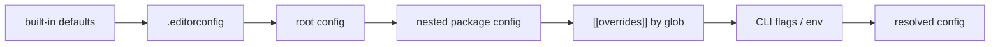

# SR-CONFIG — the configuration file: one file, three homes, every key validated, every value traceable

## §1 — For humans

**The decision in one line.** Configuration is **one TOML document** that lives in **one of three homes**: `codelaw.toml`, `[tool.codelaw]` in `pyproject.toml`, or `"codelaw"` in `package.json`. Every key is validated against a shipped JSON Schema, and `codelaw config --print` shows the final value of every key **and where it came from**.

```toml
#:schema ./node_modules/codelaw/codelaw.schema.json
extends   = ["codelaw:js/recommended", "codelaw:ts/recommended", "codelaw:py/recommended"]
languages = ["javascript", "jsx", "typescript", "tsx", "python", "json", "yaml", "toml", "css", "html", "markdown"]
include   = ["src/**", "packages/*/src/**"]
exclude   = ["dist/**", "**/*.generated.*"]

[rules]                       # severity and options per rule
"py/no-print" = "off"

[[overrides]]                 # per-glob exceptions
files = ["src/components/**/*.tsx"]
rules = { "js/exports-at-end" = "off" }

[format]   # SR-FORMATTER      [lint]     # SR-LINTER
[graph]    # SR-PROJECT-GRAPH [baseline] # SR-BASELINE
[adapters] # SR-LINTER        [agents]   # SR-AGENT-SURFACES
[cache]    # SR-CACHE        [files]    # SR-ARCHITECTURE (discovery, encoding, size)
[daemon]   # SR-ARCHITECTURE  [lsp]      # SR-ARCHITECTURE
[fix]      # SR-ARCHITECTURE  [markdown] # SR-CONFIG (its one key is L3's)
```



<details>
<summary><b>ASCII twin</b></summary>

```text
   defaults --> .editorconfig --> root config --> nested package config --> [[overrides]] --> flags/env --> resolved
```

</details>

---

## §2 — For agents

### Context

Configuration keys were scattered across six records. The decider asked for one record that owns the file itself: where it lives, how it's found, what's valid, and in what order values apply.

### Decision

1. **Three homes, one format.**
   - The homes, in priority order: `codelaw.toml`, then `[tool.codelaw]` in `pyproject.toml`, then the `"codelaw"` key in `package.json`.
   - The JSON form has the same keys as the TOML.
   - If a folder has more than one home, `codelaw.toml` wins, and codelaw warns that the others are ignored.
   - A `pyproject.toml` or `package.json` is a home only if it configures codelaw. One that doesn't parse is a config error only if its text mentions `codelaw`; otherwise it is not a home, so a broken fixture file never stops a run.
2. **Finding it:** walk up from each file to the nearest folder with a home.
   - **Monorepos:** the topmost config is the root. A nested config (for example in `packages/web/`) **inherits** the root and overrides it, unless it sets `root = true`, which makes that folder a separate project with its own graph and baseline ([SR-ARCHITECTURE](0108_architecture.md) decision 17).
   - **Globs** in `include`, `exclude` and `[[overrides]]` are relative to the directory of the config file that declares them ([SR-ARCHITECTURE](0108_architecture.md) decision 11).
   - **Root-only keys:** `extends`, `rules_dir`, `preview`, `allow_pack_fixers`, `[files]`, `[cache]`, `[fix]`, `[lint]`, `[markdown]`, `[daemon]` and `[lsp]` belong to the root config, so a project has one rule set and one cache. A nested config that sets one is a load error naming the root config.
   - **A nested `root = true` project** is checked by running codelaw in its folder; a run from the parent skips its files and says so.
3. **Sections and owners.** The top-level keys belong to this record:
   - `extends`, `languages`, `include`, `exclude`, `rules_dir`;
   - `[rules]` and `[[overrides]]`;
   - `root`, `requires`;
   - `preview` and `allow_pack_fixers`, whose meaning is [SR-RULE-PACKS](0101_rule-packs.md) decisions 9 and 12;
   - `[markdown]`, whose one key `lint_code_blocks` is [L3](0005_LAW-3-languages.md) decision 8's.

   Sizes are bytes or a string such as `"1 MiB"` or `"512MB"`; durations are seconds or a string such as `"5s"` or `"500ms"`.

   `extends` takes first-party presets as `codelaw:<namespace>/<preset>`, resolved from the installed rule pack, and team packs as `npm:`, `pypi:` or `path:` ([SR-RULE-PACKS](0101_rule-packs.md) decisions 4 and 11).

   Each `[section]` belongs to the record named beside it in §1, and that record states its keys. A record adding a key adds it to the schema in the same change. `[adapters]`, `[agents]`, `[daemon]` and `[lsp]` are validated by the loader like `[fix]` and `[lint]`; `[format]`, `[graph]` and `[baseline]` are still read as tables.
4. **Precedence, last wins:**
   1. Built-in defaults.
   2. `.editorconfig` (formatter keys only).
   3. Root config.
   4. Nested config.
   5. `[[overrides]]`, in file order.
   6. Environment (`CODELAW_AS_OF`, `CODELAW_CACHE_DIR`, `CODELAW_LOG`).
   7. Command-line flags.

   Rule sources resolve as in [SR-RULE-PACKS](0101_rule-packs.md) decision 14.
5. **Validation is strict.**
   - An unknown key, a wrong type or an unknown rule id stops the run with exit 2, naming the file, the key and the nearest valid key ("did you mean `line_width`?").
   - `requires = ">=0.4"` refuses to run with an older codelaw.
6. **The schema ships with codelaw.** `codelaw.schema.json` is in the npm package and available as `codelaw config --schema`, so TOML and JSON editors offer completion and validation.
7. **Traceable.** `codelaw config --print [--for <file>]` prints the resolved configuration for a file, with the source of each value (default, `.editorconfig`, file:line, override #n, env or flag).
8. **Creating it.**
   - `codelaw init` writes a minimal `codelaw.toml`: `extends` with the `recommended` presets of the rule packs it installs for the languages it detects ([SR-RULE-PACKS](0101_rule-packs.md) decision 6), and nothing else; with `--agents`, also the `[agents]` section naming them ([SR-AGENT-SURFACES](0102_agent-surfaces.md) decision 6).
   - `codelaw format --import-config` converts Prettier, Ruff or Black configs ([SR-FORMATTER](0105_formatter.md) decision 5).
9. **Deterministic ([L5](0007_LAW-5-no-model-in-the-engine.md)):** the resolved config is a pure function of the files, environment and flags. Its hash is part of every cache key ([SR-CACHE](0109_cache.md)).

### Consequences

- **Three homes mean three parsers,** and one well-tested resolution order.
- **Strict validation breaks old configs on a key rename,** so renames ship with a deprecation alias for one minor release.

### Alternatives considered

- **JavaScript config files** (`codelaw.config.js`): rejected. They need Node to read (breaking [L6](0008_LAW-6-python-and-node-packages.md) completeness), and executable config isn't deterministic.
- **YAML config:** rejected. TOML is already the Python standard and is easier to read.
- **Lenient validation** (warn on unknown keys): rejected. Typos silently disable rules.

### Reference (required)

- [SR-RULE-PACKS](0101_rule-packs.md) decisions 4 and 14: pack resolution and rule-source precedence.
- [SR-FORMATTER](0105_formatter.md) decision 5: the `[format]` keys.
- [Taplo `#:schema` directive](https://taplo.tamasfe.dev/configuration/directives.html): schema-driven TOML completion.

### Veto condition

**Reopen this decision if:** a key is accepted that no record defines, or `config --print` can't name a value's source.

**How to check it:** the schema test, `cargo test -p codelaw-config --test schema`: every key in `codelaw.schema.json` is defined in exactly one record, every record-defined key is in the schema, and the schema and the loader accept the same keys. It compiles the schema with `boon` (MIT OR Apache-2.0), a dev-dependency only, taken in for this test and SR-CLI-MCP's SARIF check.

---

## References

*Every source this record cites, gathered in one place. An archived document is never listed here.*

**Records** — [SR-RULE-PACKS](0101_rule-packs.md) · [SR-FORMATTER](0105_formatter.md) · [SR-CACHE](0109_cache.md)

**Project docs** — [`docs/DESIGN.md`](../docs/DESIGN.md)
