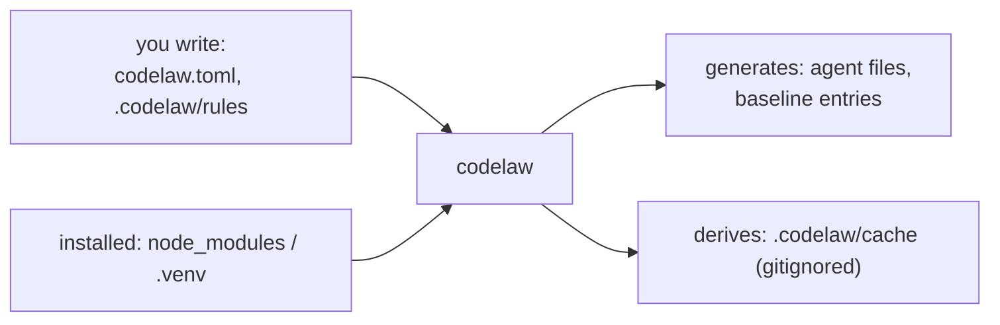

# SR-CONSUMER-LAYOUT — the consumer repo: two things you write, everything else generated or installed

## §1 — For humans

**The decision in one line.** A consumer writes **two things**: the config ([SR-CONFIG](0110_config.md)) and `.codelaw/` content (rules, fixers, baselines, deprecations). Everything agent-facing is **generated** by `codelaw sync-agents` and never edited by hand. The engine and the rule packs are **installed** by npm or pip. The only thing gitignored is `.codelaw/cache/`.

```text
my-app/
├─ codelaw.toml                      you write    (or [tool.codelaw] / package.json "codelaw")
├─ .codelaw/
│  ├─ rules/<namespace>/<name>.md    you write    local rules (SR-RULE-FORMAT)
│  ├─ rules/<namespace>/<name>.cases.md you write edge cases (SR-RULE-AUTHORING)
│  ├─ fixers/                        you write    optional external fixers
│  ├─ baseline/<rule-id>.toml        codelaw writes, you review (SR-BASELINE)
│  ├─ deprecations.toml              you write    (SR-BASELINE)
│  └─ cache/                         derived      gitignored (SR-CACHE)
├─ AGENTS.md · CLAUDE.md             generated    marker blocks only (SR-AGENT-SURFACES)
├─ .claude/ .kiro/ .github/ .mcp.json generated   agent files (SR-AGENT-SURFACES)
├─ .vscode/extensions.json           generated    recommends the codelaw extension (SR-EDITOR)
├─ node_modules/codelaw  or  .venv/  installed    the engine (SR-PACKAGES)
├─ node_modules/@codelaw/rules-*  or  .venv/…/codelaw_rules_*
│                                    installed    the rule packs init added (SR-RULE-PACKS)
└─ src/ …                            your code    linted and formatted
```



<details>
<summary><b>ASCII twin</b></summary>

```text
   you write (config, .codelaw/rules) --> codelaw --+--> generates: agent files, baseline entries
   installed (node_modules / .venv)   -->          +--> derives:   .codelaw/cache (gitignored)
```

</details>

---

## §2 — For agents

### Context

The decider asked for a record of what the consumer directory looks like. It was only a diagram on the blueprints page.

### Decision

1. **The tree** is §1. Every path in it has exactly one class: *you write*, *codelaw writes, you review*, *generated*, *derived* or *installed*.
2. **Committed:** everything except `.codelaw/cache/`. Baselines and deprecations are committed and reviewed ([SR-BASELINE](0104_baseline-and-deprecations.md) decision 5).
3. **Gitignored:** `.codelaw/cache/` only. `codelaw init` adds that line to `.gitignore` and nothing else.
4. **Generated files are never hand-edited.**
   - Shared files (AGENTS.md, CLAUDE.md) carry `<!-- codelaw:begin --> … <!-- codelaw:end -->` blocks, and text outside the markers belongs to the team.
   - `codelaw sync-agents --check` fails CI on drift ([SR-AGENT-SURFACES](0102_agent-surfaces.md) decision 1).
5. **No agents, no agent files.** With no `[agents] targets`, none of the generated agent paths exist ([L5](0007_LAW-5-no-model-in-the-engine.md) decision 4).
6. **Local rules live under `rules_dir`** (default `.codelaw/rules/`). The subfolders are namespaces for ids (`.codelaw/rules/acme/no-moment.md` → `acme/no-moment`); a rule's `languages:` field, not its folder, decides where it applies ([SR-RULE-FORMAT](0112_rule-format.md)).
7. **Monorepos:** one `.codelaw/` at the root. A package may add its own `codelaw.toml` and `.codelaw/rules/`, which inherit from the root ([SR-CONFIG](0110_config.md) decision 2).
8. **`codelaw init`** adds the rule packs for the detected languages as dev dependencies ([SR-RULE-PACKS](0101_rule-packs.md) decision 6), and creates `codelaw.toml`, `.codelaw/rules/` (empty, with a README pointing at `codelaw new-rule`) and the `.gitignore` line. With `--agents`, it also writes the agent files.

### Consequences

- **A repo gains one folder (`.codelaw/`) and one config;** agent files only on request.
- **Baselines and deprecations add reviewable files;** that's deliberate ([SR-BASELINE](0104_baseline-and-deprecations.md)).

### Alternatives considered

- **Rules inside the config file:** rejected. Rules are documents for people and agents, not config values ([SR-RULE-FORMAT](0112_rule-format.md)).
- **A hidden global folder (`~/.codelaw`):** rejected. Not reviewable, not shared with the team, not reproducible.

### Reference (required)

- [SR-AGENT-SURFACES](0102_agent-surfaces.md) decision 2: every generated agent path.
- [SR-CONFIG](0110_config.md): the config file.
- [SR-BASELINE](0104_baseline-and-deprecations.md): the baseline and deprecations files.

### Veto condition

**Reopen this decision if:** codelaw writes a path in a consumer repo that §1's tree doesn't list, or gitignores anything but `.codelaw/cache/`.

**How to check it:** `codelaw init --agents claude,copilot,codex,kiro` in an empty fixture repo, with `git status` compared against §1 (`W-20`).

---

## References

*Every source this record cites, gathered in one place. An archived document is never listed here.*

**Records** — [SR-AGENT-SURFACES](0102_agent-surfaces.md) · [SR-BASELINE](0104_baseline-and-deprecations.md) · [SR-CONFIG](0110_config.md) · [SR-RULE-FORMAT](0112_rule-format.md) · [SR-RULE-PACKS](0101_rule-packs.md)

**Project docs** — [`docs/DESIGN.md`](../docs/DESIGN.md)
