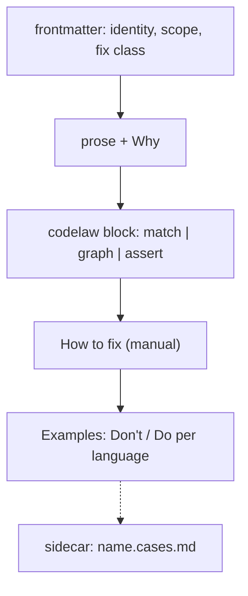

# SR-RULE-FORMAT — the rule-file template: one Markdown file, four parts, a fixed frontmatter schema

## §1 — For humans

**The decision in one line.** A rule is **one Markdown file**, `<namespace>/<name>.md`, with **four parts in fixed order**: frontmatter, prose, a `codelaw` block, and examples. Edge cases go in a `<name>.cases.md` sidecar. codelaw lints its own rule files against this template.

````markdown
---
id: <namespace>/<name>                 # required; matches the path
title: <one line>                      # required
languages: [typescript, tsx]           # required; L3 names
scope: file                            # file | project        (default file)
files: ["src/**/*.{ts,tsx}"]           # optional glob filter
exclude: ["**/*.d.ts"]                 # optional
severity: error                        # error | warn | info   (default error)
fix: auto                              # required: auto | suggest | manual  (L4)
fix_reason: "<why not auto>"           # required unless fix: auto
fix_skill: codelaw-fix                 # optional; the skill that carries a manual fix (L4 decision 10)
stability: stable                      # stable | preview      (default preview)
host: html                             # optional: only inside regions embedded in this host
invariant: exports-unchanged           # optional; checked by codelaw test
options: { internal: { type: "string[]", default: [] } }   # optional, typed
tags: [modules]
since: 0.1.0
---

One paragraph: what the rule requires.

**Why:** the reason, in one or two sentences.

```codelaw
match: …            # scope: file  → an ast-grep rule
# graph: …          # scope: project → a graph query (SR-PROJECT-GRAPH)
# target/assert: …  # structured files → path assertions
message: "…$NAME…"
fix: [ … ]          # edit primitives, or { external: "…" }
```

## How to fix
1. …                # required when fix: manual

## Examples
### TypeScript
#### Don't
```ts
…
```
#### Do
```ts
…
```
````



<details>
<summary><b>ASCII twin</b></summary>

```text
   frontmatter --> prose + Why --> codelaw block --> How to fix (manual) --> Examples (Don't/Do per language)
                                                                              :
                                                                   sidecar  name.cases.md
```

</details>

---

## §2 — For agents

### Context

The decider asked for a record of the rule-file template. The format so far existed only as examples in chat, the design doc and SR-RULE-PACKS.

### Decision

1. **Path and id.** The file is `<rules_dir>/<namespace>/<name>.md`, and its `id` must equal `<namespace>/<name>`. Built-in namespaces (`js`, `ts`, `react`, `stencil`, `py`, `json`, `yaml`, `toml`, `md`, `css`, `html`, `graph`, `format`) are reserved for codelaw's own rules.
2. **Frontmatter schema** is §1's template, every field typed.
   - **Required:** `id`, `title`, `languages`, `fix`, plus `fix_reason` unless `fix: auto` ([L4](0006_LAW-4-every-rule-has-a-fix.md)).
   - **Unknown fields are a load error.**
3. **The `codelaw` block takes exactly one of three forms:**
   - `match:` (an ast-grep rule with relational clauses; `scope: file`);
   - `graph:` ([SR-PROJECT-GRAPH](0103_project-graph.md) decision 6; `scope: project`);
   - `target:` + `assert:` (path assertions on JSON, YAML or TOML).

   Then `message:` (with `$CAPTURE` interpolation) and `fix:` (edit primitives, conditional `when`/`else` branches, or `{ external: "<command>" }`, whose stdin/stdout contract is [SR-ARCHITECTURE](0108_architecture.md) decision 18).
4. **Body sections, in this order:**
   1. One summary paragraph.
   2. `**Why:**`
   3. The `codelaw` block.
   4. `## How to fix` (required for `manual`; optional otherwise).
   5. `## Examples`.

   Any other section is allowed after `## Examples` and ignored by the engine.
5. **Examples.** Under `## Examples` there's one `### <Language>` per declared language, each with at least one `#### Don't` and one `#### Do`, and an optional `#### Fixed` when the fixed output differs from the Do. Multi-file examples use a `files` fence (`// path` sections; [SR-PROJECT-GRAPH](0103_project-graph.md) decision 6).
6. **The sidecar `<name>.cases.md`** holds edge cases. Each `### case: <title>` has an input fence, an `expect` fence (`line:col rule-id` lines, or `(none)`) and an optional `fixed` fence ([SR-RULE-AUTHORING](0113_rule-authoring.md) decision 4).
7. **Self-check.** `codelaw rules lint` validates every rule file against this template (the schema, the section order, an example for each language, the id matching the path). It runs inside `codelaw test` and on every built-in rule in CI.
8. **Scaffold.** `codelaw new-rule <id> --lang <list> [--scope project] [--fix manual]` writes this template with every required field filled and empty examples.
9. **Determinism ([L5](0007_LAW-5-no-model-in-the-engine.md)).** A rule file is data. Nothing in it executes, except an `external` fixer, which runs only under [SR-RULE-PACKS](0101_rule-packs.md) decision 7's rules.

### Consequences

- **Authors write more than a bare pattern;** the examples and steps are what make a rule readable by agents and testable.
- **A strict schema means template changes need a migration** (`codelaw rules migrate`) when fields are renamed.

### Alternatives considered

- **YAML-only rules (ast-grep style):** rejected. No place for prose, why, steps or examples that agents read.
- **Rules as code (ESLint style):** rejected. Not readable by agents, not portable across npm and PyPI, and not deterministic data.
- **Tests in a separate folder:** rejected for the core examples (they document the rule); kept for edge cases as the sidecar.

### Reference (required)

- [ast-grep rule configuration](https://ast-grep.github.io/reference/rule.html): the `match` grammar.
- [L4](0006_LAW-4-every-rule-has-a-fix.md): fix classes and `fix_skill`.
- [SR-RULE-PACKS](0101_rule-packs.md): where rule files come from.

### Veto condition

**Reopen this decision if:** a rule file loads that violates decision 2–5, or `codelaw new-rule` writes a file that `codelaw rules lint` rejects.

**How to check it:** `codelaw rules lint` over `rules/**` and a freshly scaffolded rule (`B-024`).

---

## References

*Every source this record cites, gathered in one place. An archived document is never listed here.*

**Records** — [SR-RULE-PACKS](0101_rule-packs.md) · [SR-PROJECT-GRAPH](0103_project-graph.md) · [SR-RULE-AUTHORING](0113_rule-authoring.md)

**Project docs** — [`docs/DESIGN.md`](../docs/DESIGN.md)
