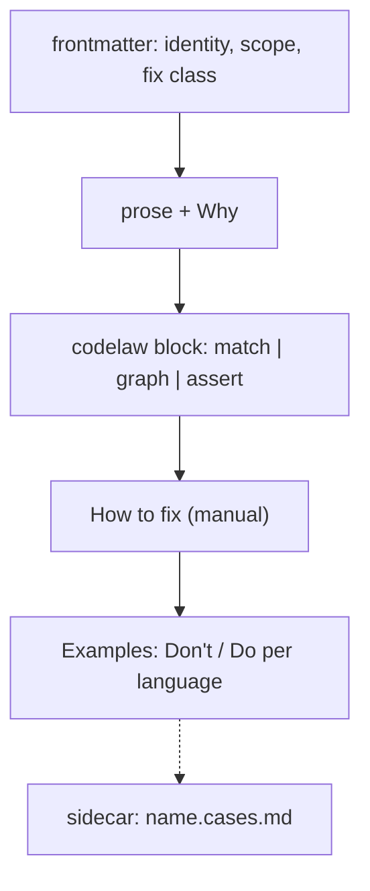

# SR-RULE-FORMAT — the rule-file template: one Markdown file, four parts, a fixed frontmatter schema

## §1 — For humans

**The decision in one line.** A rule is **one Markdown file**, `<namespace>/<name>.md`, with **four parts in fixed order**: frontmatter, prose, a `codelaw` block, and examples. Edge cases go in a `<name>.cases.md` sidecar. codelaw lints its own rule files against this template.

````markdown
---
id: <namespace>/<name>                 # required; matches the path
title: <one line>                      # required
languages: [typescript, tsx]           # required; L3 names
scope: file                            # file | project        (default file)
files: ["src/**/*.{ts,tsx}"]           # optional glob filter
exclude: ["**/*.d.ts"]                 # optional
severity: error                        # error | warn | info   (default error)
fix: auto                              # required: auto | suggest | manual  (L4)
fix_reason: "<why not auto>"           # required unless fix: auto
fix_skill: codelaw-fix                 # optional; the skill that carries a manual fix (L4 decision 10)
stability: stable                      # stable | preview      (default preview)
host: html                             # optional: only inside regions embedded in this host
invariant: exports-unchanged           # optional; checked by codelaw test
options: { internal: { type: "string[]", default: [] } }   # optional, typed
ported_from: [eslint/no-dupe-keys]     # optional; the source rules this one reimplements
tags: [modules]
since: 0.1.0
---

One paragraph: what the rule requires.

**Why:** the reason, in one or two sentences.

```codelaw
match: …            # scope: file  → an ast-grep rule
# graph: …          # scope: project → a graph query (SR-PROJECT-GRAPH)
# target/assert: …  # structured files → path assertions
# native: <id>      # first-party packs only → a Rust implementation in the engine
message: "…$NAME…"
fix: [ … ]          # edit primitives, or { external: "…" }
```

## How to fix
1. …                # required when fix: manual

## Examples
### TypeScript
#### Don't
```ts
…
```
#### Do
```ts
…
```
````



<details>
<summary><b>ASCII twin</b></summary>

```text
   frontmatter --> prose + Why --> codelaw block --> How to fix (manual) --> Examples (Don't/Do per language)
                                                                              :
                                                                   sidecar  name.cases.md
```

</details>

---

## §2 — For agents

### Context

The decider asked for a record of the rule-file template. The format so far existed only as examples in chat, the design doc and SR-RULE-PACKS.

### Decision

1. **Path and id.** The file is `<rules_dir>/<namespace>/<name>.md`, and its `id` must equal `<namespace>/<name>`. First-party namespaces (`js`, `ts`, `react`, `node`, `stencil`, `py`, `json`, `yaml`, `toml`, `md`, `data`, `css`, `html`, `tanstack-query`, `redux-toolkit`, `graph`, `format`, `codelaw`) are reserved for the first-party rule packs and the engine ([SR-RULE-PACKS](0101_rule-packs.md)); each language or library namespace belongs to exactly one of the eleven packs (SR-RULE-PACKS decision 4: `ts` to `rules-ts`, `react` to `rules-react`, `node` to `rules-node`, `stencil` to `rules-stencil` since 2026-10-24; `tanstack-query` to `rules-tanstack-query` and `redux-toolkit` to `rules-redux-toolkit` by the decider's W-32 ruling). The engine's own rules have no rule file; `crates/codelaw-rules`' `ENGINE_RULES` table gives each one's title, severity, fix class and steps, so `explain` and `--rule` know them. `format/` holds two: `format/unformatted` (`warn`, `auto`) and `format/failed` (`info`, `manual`) ([SR-FORMATTER](0105_formatter.md) decisions 1 and 4). `graph/no-deprecated-usage` (`error`, `manual`) and `codelaw/stale-baseline` (`error`, `manual`: `codelaw baseline prune` or `codelaw fix` lowers the entry) are [SR-BASELINE](0104_baseline-and-deprecations.md)'s, and so are the four dated-exception rules of its decision 9: `codelaw/expiring-exception` (`warn`), `codelaw/expired-exception`, `codelaw/exception-without-expiry` and `codelaw/exception-author` (`error`), all `manual`.
2. **Frontmatter schema** is §1's template, every field typed.
   - **Required:** `id`, `title`, `languages`, `fix`, plus `fix_reason` unless `fix: auto` ([L4](0006_LAW-4-every-rule-has-a-fix.md)).
   - **`ported_from:`** (optional) lists `<tool>/<rule>` ids, for example `[eslint/no-dupe-keys, ruff/F601]`: the source rules this one reimplements ([SR-RULE-PACKS](0101_rule-packs.md) decision 7). `codelaw-migrate` maps existing configs through it ([SR-AGENT-SURFACES](0102_agent-surfaces.md)).
   - **Unknown fields are a load error.**
   - **`options:`** declares each option's type and default; a config value for one — in `[rules]`, an `[[overrides]]` entry or any `[profiles.<name>]`, not only the profile in use ([SR-CONFIG](0110_config.md) decision 10) — is checked against it at load, so a typo fails on a laptop as it would in CI.
3. **The `codelaw` block takes exactly one of four forms:**
   - `match:` (an ast-grep rule with relational clauses and the semantic-model predicates of [SR-ARCHITECTURE](0108_architecture.md) decision 15a; `scope: file`);
   - `graph:` ([SR-PROJECT-GRAPH](0103_project-graph.md) decision 6; `scope: project`);
   - `target:` + `assert:` (path assertions on JSON, YAML or TOML);
   - `native: <id>` (a Rust implementation in the engine, [SR-ARCHITECTURE](0108_architecture.md) decision 15b; accepted only in first-party packs and in an ejected copy of one of their rules).

   Then `message:` (with `$CAPTURE` interpolation) and `fix:` (edit primitives, conditional `when`/`else` branches, or `{ external: "<command>" }`, whose stdin/stdout contract is [SR-ARCHITECTURE](0108_architecture.md) decision 18).
3a. **What goes with `match:`.** Only beside `match:`: ast-grep's own `constraints:` and `utils:`, and `where:`, the semantic-model predicates.
   - **`where:` maps a capture to a predicate.** The key is a capture (`$NAME`) or the matched node itself (`$$MATCH`); a key `match:` doesn't capture is a load error, and so is a list capture (`$$$NAME`), since a predicate is about one node. Only JavaScript, TypeScript and Python have a semantic model, so `where:` in a rule for any other language is a load error rather than a rule that silently matches nothing.
   - **The predicates:** `unused`; `undeclared` (optionally `{ globals: [<name>…], tables: [<data table>…] }`); `shadowed` (optionally `{ builtins: true }`); `reassigned`; `imported-from` (a module, a list of modules, or `{ module, name }`); `write` (assigned to here); `declaration` (declares a name); `redeclared` (declares a name its scope already declared); `binding` (names a symbol declared as one of the given kinds: `var`, `let`, `const`, `function`, `class`, `param`, `import`, `catch-param`, `interface`, `type-alias`, `enum`, `namespace`, `type-param`, `variable`); `builtin` (one of the language's own globals, undeclared in the file).
   - **Combining them:** a list means all of them; `not`, `all` and `any` take predicates.
   - **Node kinds across languages:** a rule object whose `kind` a grammar doesn't have matches nothing in that grammar, so one rule can span JavaScript and TypeScript. A `kind` that none of the rule's grammars has is a load error.
3b. **Interpolation.** A message or template replaces `$NAME` with the capture's text, `$$$NAME` with the source a multi-capture spans, and `$$MATCH` with the matched text.
3c. **The edit primitives.** `fix:` is a template that replaces the match, or a list of primitives, each acting on the match or on a capture (`target:`):
   - `replace`, `insert-before`, `insert-after`;
   - `remove`: takes a separating comma with the node, and the whole line when the node is alone on it;
   - `strip-export-keyword`;
   - `collect-into-block`: `block` with `$$$NAMES`, `type_block` with `$$$TYPE_NAMES`, and `position`; computed once over every match in the file, so each diagnostic carries the whole edit set;
   - `move-to`: `end-of-file`, `start-of-file` or `after-imports`;
   - `rename-symbol-local`: renames a symbol and its references in the file, and is refused for an exported symbol;
   - `sort-keys` and `ensure-key` (for `target:` rules) and `when`/`else` branches; a `target:` rule's `replace` and `remove` act on its target (decision 3e).
3d. **YAML 1.2.** The frontmatter and the `codelaw` block are read as YAML 1.2, as ast-grep reads its rules: `on`, `n` and `yes` are strings. A key written twice in one mapping is a load error.
3e. **`target:` + `assert:` rules** (W-12; `crates/codelaw-match` `data`, `target` and `schema`, `crates/codelaw-fix` `structured`). They read the **data tree** of a JSON, YAML or TOML file: its values, each with the span it was written at, built from the syntax tree already parsed. YAML is read as YAML 1.2, an alias as its anchor's value and a `<<` key as a merge; TOML dates and times are strings. A rule for any other language is a load error. The rule runs once per file, not per node; inside another file's region (front matter, a code block) it runs only when its `host:` names that file's language.
   - **`target:`** is a path or a list of them: keys separated by `.` (`compilerOptions.strict`), a quoted key (`"a.b"`, `["a.b"]`), an index (`steps[0]`) and `*` or `[*]` for every member or item. `$` is the document's root. Each YAML document is checked on its own. A path that stops at a missing key, with only keys after it, is still a target, so `present: true` can fail there. A place two paths reach is checked once.
   - **`assert:`** is a map of checks, all of which must hold: `present` (`true`/`false`), `type` (a JSON type name or a list; an integer is a number), `equals`, `one-of`, `matches` (a regular expression, on strings), `sorted` (`true`, or `{ first: [<key>…] }` to put those keys first; object keys, or an array whose items are all strings, by code point), `schema: <data table>` (below), `path: { <path>: <assertion> }` (below the target, or from the root with `$.`), and `not`, `all`, `any`. Every check but `present: true` holds where the value is missing. An unknown check is a load error.
   - **`schema:`** validates against a JSON Schema (draft-07) in the pack's `data/`. Nothing is fetched ([L5](0007_LAW-5-no-model-in-the-engine.md)): a `$ref` to another file accepts any value. Three departures, each toward fewer false reports: `oneOf` holds when at least one branch does; a `pattern` the `regex` crate can't compile (look-around, back-references) accepts; a YAML key with no value isn't checked. `format` is an annotation, as draft-07 allows. Each schema error is its own diagnostic, at the key or value it is about.
   - **Where it reports:** the key of the member the target is, else the value's first character; for a missing key, its deepest existing parent.
   - **`message:`** interpolates `$PATH` (`jobs.build.steps[0]`), `$KEY` (the last key), `$VALUE` (the value as written) and `$ERROR` (a schema's reason).
   - **`fix:`** is a list of steps: `sort-keys` (takes `sorted:`'s argument), `ensure-key: { key?, value }` (gives the target, or the key path below it, that value: written in with any missing parents where absent, replaced where different), `replace: <template>`, `remove` (the target with its key and separator), and `when: <assertion>` with `then:` and/or `else:` steps. The steps run in order, each on the text the one before left, so `[ensure-key, sort-keys]` sorts the key it wrote; a step with nothing to do (a sort already in order, a value already equal) is skipped, and nothing after `remove` may act on the target. The fix is one edit. `external` is not a `target:` fix.
   - **What a fix keeps:** every byte outside its edit; a line item moves with the comment lines directly above it at its indentation; a bracketed container with a comment between its items is not sorted (the comment would be left behind), and the diagnostic is `manual` with the reason in its note.
   - **Verified before it is offered,** beyond decision 5 of [SR-ARCHITECTURE](0108_architecture.md): the file has no more syntax errors than before, the assertion now holds at the target, and the data outside the paths the steps changed is equal (a sort only reorders). A fix that fails any of these is not offered.
4. **Body sections, in this order:**
   1. One summary paragraph.
   2. `**Why:**`
   3. The `codelaw` block.
   4. `## How to fix` (required for `manual`; optional otherwise).
   5. `## Examples`.

   Any other section is allowed after `## Examples` and ignored by the engine.
5. **Examples.** Under `## Examples` there's one `### <Language>` per declared language, each with at least one `#### Don't` and one `#### Do`, and an optional `#### Fixed` when the fixed output differs from the Do. Multi-file examples use a `files` fence (`// path` sections; [SR-PROJECT-GRAPH](0103_project-graph.md) decision 6).
   - **A fence's info string is `<tag> [path=<file>]`.** With `path=`, the example is checked as that file, so the rule's `files:` and `exclude:` apply. Without it the file is `example.<ext>` and they don't.
6. **The sidecar `<name>.cases.md`** holds edge cases. Each `### case: <title>` has an input fence, an `expect` fence (`line:col rule-id` lines, or `(none)`) and an optional `fixed` fence ([SR-RULE-AUTHORING](0113_rule-authoring.md) decision 4).
7. **Self-check.** `codelaw rules lint` validates every rule file against this template (the schema, the section order, an example for each language, the id matching the path). It runs inside `codelaw test` and on every first-party pack rule in CI.
8. **Scaffold.** `codelaw new-rule <id> --lang <list> [--scope project] [--fix manual]` writes this template with every required field filled and empty examples. The id's namespace and name are each one plain path segment (letters, digits, `-`, `_`, `.`, not starting with `.`), so the file always lands inside the rules folder.
9. **Determinism ([L5](0007_LAW-5-no-model-in-the-engine.md)).** A rule file is data. A `native:` rule names engine code; it doesn't carry it. Nothing in a rule file executes, except an `external` fixer, which runs only under [SR-RULE-PACKS](0101_rule-packs.md) decision 12's rules.

### Consequences

- **Authors write more than a bare pattern;** the examples and steps are what make a rule readable by agents and testable.
- **A strict schema means template changes need a migration** (`codelaw rules migrate`) when fields are renamed.

### Alternatives considered

- **YAML-only rules (ast-grep style):** rejected. No place for prose, why, steps or examples that agents read.
- **Rules as code (ESLint style):** rejected. Not readable by agents, not portable across npm and PyPI, and not deterministic data.
- **Tests in a separate folder:** rejected for the core examples (they document the rule); kept for edge cases as the sidecar.

### Reference (required)

- [ast-grep rule configuration](https://ast-grep.github.io/reference/rule.html): the `match` grammar.
- [L4](0006_LAW-4-every-rule-has-a-fix.md): fix classes and `fix_skill`.
- [SR-RULE-PACKS](0101_rule-packs.md): where rule files come from.

### Veto condition

**Reopen this decision if:** a rule file loads that violates decision 2–5, or `codelaw new-rule` writes a file that `codelaw rules lint` rejects.

**How to check it:** `codelaw rules lint` over `rules/**` and a freshly scaffolded rule (`W-20`).

---

## References

*Every source this record cites, gathered in one place. An archived document is never listed here.*

**Records** — [SR-RULE-PACKS](0101_rule-packs.md) · [SR-PROJECT-GRAPH](0103_project-graph.md) · [SR-RULE-AUTHORING](0113_rule-authoring.md) · [SR-AGENT-SURFACES](0102_agent-surfaces.md) · [SR-ARCHITECTURE](0108_architecture.md)

**Project docs** — [`docs/DESIGN.md`](../docs/DESIGN.md)
