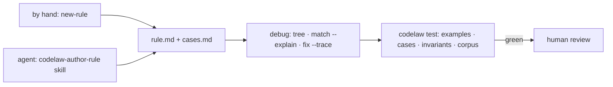

# SR-RULE-AUTHORING — writing rules: by hand or with an agent skill, and always debuggable and testable

## §1 — For humans

**The decision in one line.** A rule can be written **by hand** or **by an AI agent through a skill**. Either way it lands as the same Markdown file ([SR-RULE-FORMAT](0112_rule-format.md)), and it's **accepted only by the deterministic test runner**, never by the agent's own judgement ([L5](0007_LAW-5-no-model-in-the-engine.md)).

| Path | Start | Iterate | Done when |
|---|---|---|---|
| By hand | `codelaw new-rule <id> --lang …` | `codelaw tree`, `codelaw match --explain`, `codelaw test --watch` | `codelaw test <id>` is green and a human reviews the PR |
| With an agent | "make a rule that …" triggers the `codelaw-author-rule` skill (or its subagent) | the agent uses the same commands, through the CLI or MCP | the same: `codelaw test <id>` green, then human review |



<details>
<summary><b>ASCII twin</b></summary>

```text
   by hand (new-rule) --+
                        +--> rule.md + cases.md --> debug (tree, match --explain, fix --trace)
   agent (skill)     ---+                       --> codelaw test --green--> human review
```

</details>

---

## §2 — For agents

### Context

The decider asked that rules can be written manually or by an AI agent with a skill, and be debuggable and testable. The commands and test levels were described in chat but not owned by any record.

### Decision

1. **Hand-written.** `codelaw new-rule` scaffolds the template ([SR-RULE-FORMAT](0112_rule-format.md) decision 8), and the author iterates with the debugging tools (decision 3) until `codelaw test` is green.
2. **Agent-written.**
   - The `codelaw-author-rule` skill, and its context-isolated subagent `codelaw-rule-author` ([SR-AGENT-SURFACES](0102_agent-surfaces.md)), follows a fixed loop:
     1. Write a failing Don't example from the convention described.
     2. Inspect its tree (`codelaw tree`, MCP `dump_tree`).
     3. Write the matcher.
     4. Choose the fix class ([L4](0006_LAW-4-every-rule-has-a-fix.md)).
     5. Write a Do/Don't pair for every declared language ([L3](0005_LAW-3-languages.md)).
     6. Add edge cases.
     7. Run `codelaw test` until green.
   - The agent proposes; the test runner decides; a human merges. An agent never marks its own rule as passing ([L5](0007_LAW-5-no-model-in-the-engine.md) decision 6).
   - **Ported from another tool** (W-140, 2026-10-30, on Arpit's ask of that day: *"this is a rule that is in ESLint, or this is a rule that is there in PyLint, and any tool, and I want it in code law. So write a rule for it."*). The `codelaw-port-rule` skill and its subagent `codelaw-rule-porter` ([SR-AGENT-SURFACES](0102_agent-surfaces.md) decision 11) run this loop with the source rule as its input, after checking no rule's `ported_from:` already names it. The source's documentation and tests are **read, never run** ([L5](0007_LAW-5-no-model-in-the-engine.md)); its invalid cases become the Don'ts, its valid cases the Dos, its edge cases the `.cases.md` — **written fresh**, never pasted from a copyleft source such as Pylint (GPL-2.0, [L2](0004_LAW-2-foss-dependencies.md)); its autofix suggests `auto` or `suggest`, none means `manual`. The rule is a project rule (`codelaw new-rule`'s template, a project namespace), `ported_from: [<tool>/<rule>]`, `stability: preview`, and counts only when `codelaw test` is green; its `**Why:**` says to delete it once a first-party pack ships the same `ported_from:`. Three ports are kept green in CI as the loop's evidence: ESLint `no-nested-ternary`, Pylint `global-statement` and stylelint `declaration-no-important`, in `fixtures/port-rule/` (`crates/codelaw-cli/tests/port_rule.rs`).
     - **Who wants which port** is counted by `scripts/ported-rule-demand.py`, maintainer-run with `gh`, never in CI or the engine: public `.codelaw/rules/` files by `ported_from:` (`gh search code`) and the issues the skill's opt-in share prompt opens on `arpitarya/codelaw` (title `port: <tool>/<rule>`, label `ported-rule`); one row per source rule with repositories, issues and first seen, `--format json` for the same as data, `--from-json` and `--self-test` offline. The most wanted are candidates for the first-party packs (W-139).
   - **From review comments** (W-133, 2026-10-30). The `codelaw-rules-from-reviews` skill ([SR-AGENT-SURFACES](0102_agent-surfaces.md) decision 10) hands each rule the decider approved to this loop, with the review evidence as its input: the reviewers' point, restated as one sentence, is the convention; the diff hunks they commented on are the first Don't examples, and the code as merged after the comment, where it changed, the first Do. The loop is unchanged: `codelaw test` green, `stability: preview`, then today's violations frozen with `codelaw baseline add --rule <id>` so only new code must obey. The rule file's `**Why:**` may link the pull requests; it names no reviewer.
3. **Debuggable.** Every tool is available both in the CLI and over MCP:

   | Question | Command |
   |---|---|
   | Is this rule active for this file, and from which source? | `codelaw rules --why <id> --for <file>` |
   | What does the code look like to the engine? | `codelaw tree <file> [--line n]` · `codelaw tree --lang ts -e "<code>"` |
   | Which clause matched or failed, and what was captured? | `codelaw match <id> <file> --explain` |
   | What did the fix do, and why was it accepted or rejected? | `codelaw fix --dry-run --trace <file>` |
   | Why is this symbol "unused"? | `codelaw graph why-unused <symbol>` · `codelaw graph refs <symbol>` |
   | Which rule is slow? | `codelaw check --timings` |
   | Engine internals | `CODELAW_LOG=debug` |

4. **Testable at four levels.** `codelaw test [id] [--case <title>] [--watch]` runs them:

   | Level | Source | Checks |
   |---|---|---|
   | examples | the rule's `## Examples` (a fence may carry `options=<json>`, SR-RULE-FORMAT decision 5: the example runs with those options, and the compiled rule set is kept per options) | Don't fires · Do passes · fix(Don't) = Do (or Fixed) · fixpoint, for each language · tokens(Don't) ≠ tokens(Do) and tokens(Fixed): a Don't with the same token stream as a Do or Fixed makes the rule a layout rule, refused with the message *"a layout rule: it has the same tokens as the Do (line N), so the two differ only in layout, and layout belongs to the formatter (SR-FORMATTER decision 3)"*; a Don't the formatter (default options) lays out identically to a Do or Fixed whose tokens differ draws a warning naming the engine and B-045, never a failure ([SR-FORMATTER](0105_formatter.md) decision 3) |
   | cases | `<name>.cases.md` | exact diagnostics (`line:col rule`) and exact fixed output, per case |
   | invariants | frontmatter `invariant:` plus the built-ins | still parses · only the fix's range changed · deterministic · isolated across languages · rule-specific (e.g. `exports-unchanged`) |
   | corpus | `codelaw test --corpus` (codelaw's CI) | real pinned repos: invariants hold, every fix re-parses and is a fixpoint, finding counts are snapshotted |

   A snippet checked as a set of files runs with its fence's `options=` too, as a one-file snippet does (W-130, 2026-10-30: the flag rules' examples name their accessors so).

   A file-scope rule's snippet whose first line names a file (`// path`, `# path` or `<!-- path -->`) is checked as a set of files too, so a native rule that reads the files around it (path, bytes, neighbours: [SR-ARCHITECTURE](0108_architecture.md) decision 15b) is tested on a virtual repo; "still parses" then counts each file in its own language. *(W-21, 2026-10-22.)*

   A type rule ([SR-TYPES](0117_types.md)) is checked at the examples, cases and corpus levels only when a type program can answer: the TypeScript `CODELAW_TYPESCRIPT` names, with Node on `PATH`; without one it is reported as a warning, never a pass or a failure (W-105).

   - **A multi-file example may name a plain-text config file** (W-132; [L3](0005_LAW-3-languages.md) decision 10): a `// CODEOWNERS` section (any name in `codelaw_core::TEXT_CONFIG_FILES`) is a file of the virtual repo, so a rule that reads one can be tested; the file is never linted.
5. **Bugs become cases first.** A false positive or negative is fixed by adding the failing case, then changing the rule. The `codelaw-debug-rule` skill enforces that order.
6. **Lifecycle.** A new rule starts `stability: preview` and becomes `stable` after a corpus run with no unexpressible false positives ([SR-RULE-PACKS](0101_rule-packs.md) decision 9).
   - **6a. The promotion criterion — RATIFIED 2026-10-27 as proposed** (the decider, 2026-10-27 (voice docket): *"Ratify."*; W-100). Decision 6 names no number and no evidence of a false positive; these four values are its measure, and `scripts/corpus.py promote --write` applies them. A preview rule passes when, on the corpus run that has just held its count:
     1. **Breadth:** at least **3** of its pack's pinned repos hold a file it reads (its `languages:` by extension, within its `files:` and outside its `exclude:`), and those repos hold at least **10** such files (`min_repos`, `min_files`).
     2. **No false positive:** a rule with findings has a review in `scripts/corpus.json`'s `promotion.reviewed` — a person's verdict on every finding, `false_positives = 0` — taken at the count the corpus gives now (a moved count voids it); a rule with **0** findings passes this clause (`zero_findings_is_evidence`: zero findings is zero false positives, but no proof the rule fires).
     3. **Its fix:** level 4 held — every fix it made on the corpus re-parses, is a fixpoint and keeps its `invariant:` (already a failure of the run).
     4. **Time:** its `since:` has shipped in at least **1** published release as preview (`min_releases_in_preview`).
     - The values live in `promotion.criterion`; the decider's ruling is written to `promotion.ratified` as its date and words. `promote --write --run <CI run URL>` then sets `stability: stable` on each passing rule and records the run in `promotion.promoted` — the rule's promotion history. Each promotion batch is a minor release ([SR-RULE-PACKS](0101_rule-packs.md) decision 9): a stable rule runs without `preview = true`.
     - **Agreement with the source tool** (the rule's `ported_from:` tool run over the same corpus) is the stronger evidence for clause 2 and replaces the human review once that tool runs in CI, which needs its ratification under [L11](0013_LAW-11-dependencies.md) — the same ruling as W-99's bench.
     - **On the 2026-10-27 corpus at these values:** 326 of the 620 preview rules in the 14 corpus packs pass, every one through a zero-finding count; 190 rules with findings wait for a review; stencil (one corpus repo) and the rules since 0.3.0 pass nothing. With `zero_findings_is_evidence = false`, none passes until a review lands.

### Consequences

- **Every rule carries tests by construction,** so writing one takes longer than a bare pattern.
- **Agent-written rules are only as good as their examples;** human review of the examples is the real gate.
- **Level 4 today:** `codelaw test [target] --corpus <dir>` runs levels 1–3 and then every rule over every file under `<dir>` the engine reads: two runs agree, and each fix still parses, is a fixpoint and keeps the rule's `invariant:`. `--snapshot <file>` compares each rule's finding count with a `[findings]` TOML table, and a count that moved or is missing fails; `--update-snapshot` writes it. A pack's counts live in `packs/<pack>/corpus.toml`, and `crates/codelaw-cli/tests/promotion.rs` refuses a pack rule marked `stable` whose id has no count there (decision 6), in every folder under `packs/` — as many as `FIRST_PARTY_PACKS` names, nine since 2026-10-24. **SCSS is in the corpus since 2026-10-27 (W-62):** Bootstrap 5.3.8 (`25aa8cc`, MIT) runs the `css` and `scss` packs and djangoproject.com the `scss` pack too, so fifteen packs have a corpus (`css-modules` waits on W-63's repository). **The spell pack is in the corpus since 2026-10-28 (W-103):** eleven of the fourteen repositories run `spell` (SR-SPELL decision 9 *the pinned corpus*), so sixteen packs have a corpus.
- **Built (W-100, 2026-10-27): the promotion report.** `scripts/corpus.py promote [--pack P] [--rules]` reads each preview rule's front matter, its count in `packs/<pack>/corpus.toml`, the fetched repos and `scripts/corpus.json`'s `promotion` block, and prints per pack how many rules pass decision 6a and why each other one is held; `--self-test` checks the block and the verdict. CI's `corpus` job writes that report to its summary after the counts hold. The criterion is ratified (2026-10-27). **The first batch is promoted (W-100, 2026-10-28):** `promote --pack css --write --run https://github.com/arpitarya/codelaw/actions/runs/40622778075` set `stability: stable` on the 42 `css` rules that pass, every one through a zero-finding count, and recorded each with that run in `promotion.promoted`; the other 30 `css` rules have findings no one has reviewed and stay `preview`.
- **Built (W-20, 2026-10-24):** the pinned corpus (`scripts/corpus.json`: 11 repositories at full commits, every one of the nine packs covered), the CI job that checks them out and runs `--corpus`, and each pack's `packs/<pack>/corpus.toml` snapshot. The corpus row's "the repo still builds and passes its own tests after fixes" was dropped by the decider, 2026-10-24 (W-20): CI installs no corpus repo's dependencies, which [L2](0004_LAW-2-foss-dependencies.md) decision 4 would bring into scope; level 4's re-parse, fixpoint and invariant checks stand. Until then the gate stops a `stable` rule without a count, and a count is only as good as the run that wrote it. No pack rule was `stable` until W-100's first batch (2026-10-28, above). `corpus.py fetch --repo <name>` checks out only the named repos — the `perf` job's three ([L8](0010_LAW-8-performance-budgets.md) decision 2).
  - **The four security packs joined the corpus with empty snapshots (W-53, 2026-10-25):** `security-js` on `full-stack-fastapi-template`, `html5-boilerplate` and `bulletproof-react`; `security-ts` on `full-stack-fastapi-template`, `ionic-framework` and `bulletproof-react`; `security-html` on `flask`, `html5-boilerplate` and `djangoproject.com`; `security-python` on `flask`, `starlette`, `full-stack-fastapi-template` and `djangoproject.com`. A pack folder with no rules yet passes `codelaw test` with `0 rules · 0 checks · 0 failed`; a project or an id with none is still a usage error.
  - **`tanstack-query` joined the corpus (W-42, 2026-10-25):** `full-stack-fastapi-template`, `bulletproof-react` and TanStack Query's own repository (examples, docs and tests, MIT) run its rules, so the pack's new rules are counted before any enters `tanstack-query/recommended`. 13 repositories; `redux-toolkit` has no corpus yet.

### Alternatives considered

- **Let the agent judge its own rule:** rejected by [L5](0007_LAW-5-no-model-in-the-engine.md).
- **A separate test framework per language:** rejected. One runner, one format, every language.

### Reference (required)

- [SR-RULE-FORMAT](0112_rule-format.md): the file the tools act on.
- [SR-AGENT-SURFACES](0102_agent-surfaces.md): the authoring and debugging skills.
- [ESLint RuleTester](https://eslint.org/docs/latest/integrate/nodejs-api#ruletester): prior art for valid/invalid cases.

### Veto condition

**Reopen this decision if:** a rule can reach `stable` without passing all four levels, or an agent-written rule merges without a green `codelaw test`.

**How to check it:** `cargo test -p codelaw-cli --test promotion` (level 4 runs, and no `stable` pack rule lacks a corpus count); the CI job that runs all four levels over the pinned corpus is still owed (`W-20`).

---

## References

*Every source this record cites, gathered in one place. An archived document is never listed here.*

**Records** — [SR-RULE-PACKS](0101_rule-packs.md) · [SR-AGENT-SURFACES](0102_agent-surfaces.md) · [SR-FORMATTER](0105_formatter.md) · [SR-RULE-FORMAT](0112_rule-format.md)

**Project docs** — [`docs/DESIGN.md`](../docs/DESIGN.md)
