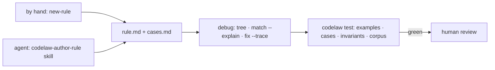

# SR-RULE-AUTHORING — writing rules: by hand or with an agent skill, and always debuggable and testable

## §1 — For humans

**The decision in one line.** A rule can be written **by hand** or **by an AI agent through a skill**. Either way it lands as the same Markdown file ([SR-RULE-FORMAT](0112_rule-format.md)), and it's **accepted only by the deterministic test runner**, never by the agent's own judgement ([L5](0007_LAW-5-no-model-in-the-engine.md)).

| Path | Start | Iterate | Done when |
|---|---|---|---|
| By hand | `codelaw new-rule <id> --lang …` | `codelaw tree`, `codelaw match --explain`, `codelaw test --watch` | `codelaw test <id>` is green and a human reviews the PR |
| With an agent | "make a rule that …" triggers the `codelaw-author-rule` skill (or its subagent) | the agent uses the same commands, through the CLI or MCP | the same: `codelaw test <id>` green, then human review |



<details>
<summary><b>ASCII twin</b></summary>

```text
   by hand (new-rule) --+
                        +--> rule.md + cases.md --> debug (tree, match --explain, fix --trace)
   agent (skill)     ---+                       --> codelaw test --green--> human review
```

</details>

---

## §2 — For agents

### Context

The decider asked that rules can be written manually or by an AI agent with a skill, and be debuggable and testable. The commands and test levels were described in chat but not owned by any record.

### Decision

1. **Hand-written.** `codelaw new-rule` scaffolds the template ([SR-RULE-FORMAT](0112_rule-format.md) decision 8), and the author iterates with the debugging tools (decision 3) until `codelaw test` is green.
2. **Agent-written.**
   - The `codelaw-author-rule` skill, and its context-isolated subagent `codelaw-rule-author` ([SR-AGENT-SURFACES](0102_agent-surfaces.md)), follows a fixed loop:
     1. Write a failing Don't example from the convention described.
     2. Inspect its tree (`codelaw tree`, MCP `dump_tree`).
     3. Write the matcher.
     4. Choose the fix class ([L4](0006_LAW-4-every-rule-has-a-fix.md)).
     5. Write a Do/Don't pair for every declared language ([L3](0005_LAW-3-languages.md)).
     6. Add edge cases.
     7. Run `codelaw test` until green.
   - The agent proposes; the test runner decides; a human merges. An agent never marks its own rule as passing ([L5](0007_LAW-5-no-model-in-the-engine.md) decision 6).
3. **Debuggable.** Every tool is available both in the CLI and over MCP:

   | Question | Command |
   |---|---|
   | Is this rule active for this file, and from which source? | `codelaw rules --why <id> --for <file>` |
   | What does the code look like to the engine? | `codelaw tree <file> [--line n]` · `codelaw tree --lang ts -e "<code>"` |
   | Which clause matched or failed, and what was captured? | `codelaw match <id> <file> --explain` |
   | What did the fix do, and why was it accepted or rejected? | `codelaw fix --dry-run --trace <file>` |
   | Why is this symbol "unused"? | `codelaw graph why-unused <symbol>` · `codelaw graph refs <symbol>` |
   | Which rule is slow? | `codelaw check --timings` |
   | Engine internals | `CODELAW_LOG=debug` |

4. **Testable at four levels.** `codelaw test [id] [--case <title>] [--watch]` runs them:

   | Level | Source | Checks |
   |---|---|---|
   | examples | the rule's `## Examples` | Don't fires · Do passes · fix(Don't) = Do (or Fixed) · fixpoint, for each language |
   | cases | `<name>.cases.md` | exact diagnostics (`line:col rule`) and exact fixed output, per case |
   | invariants | frontmatter `invariant:` plus the built-ins | still parses · only the fix's range changed · deterministic · isolated across languages · rule-specific (e.g. `exports-unchanged`) |
   | corpus | `codelaw test --corpus` (codelaw's CI) | real pinned repos: invariants hold, finding counts are snapshotted, and the repo still builds and passes its own tests after fixes |

5. **Bugs become cases first.** A false positive or negative is fixed by adding the failing case, then changing the rule. The `codelaw-debug-rule` skill enforces that order.
6. **Lifecycle.** A new rule starts `stability: preview` and becomes `stable` after a corpus run with no unexpressible false positives ([SR-RULE-PACKS](0101_rule-packs.md) decision 4).

### Consequences

- **Every rule carries tests by construction,** so writing one takes longer than a bare pattern.
- **Agent-written rules are only as good as their examples;** human review of the examples is the real gate.

### Alternatives considered

- **Let the agent judge its own rule:** rejected by [L5](0007_LAW-5-no-model-in-the-engine.md).
- **A separate test framework per language:** rejected. One runner, one format, every language.

### Reference (required)

- [SR-RULE-FORMAT](0112_rule-format.md): the file the tools act on.
- [SR-AGENT-SURFACES](0102_agent-surfaces.md): the authoring and debugging skills.
- [ESLint RuleTester](https://eslint.org/docs/latest/integrate/nodejs-api#ruletester): prior art for valid/invalid cases.

### Veto condition

**Reopen this decision if:** a rule can reach `stable` without passing all four levels, or an agent-written rule merges without a green `codelaw test`.

**How to check it:** the CI job that promotes a rule to `stable` runs all four levels (`B-024`).

---

## References

*Every source this record cites, gathered in one place. An archived document is never listed here.*

**Records** — [SR-RULE-PACKS](0101_rule-packs.md) · [SR-AGENT-SURFACES](0102_agent-surfaces.md) · [SR-RULE-FORMAT](0112_rule-format.md)

**Project docs** — [`docs/DESIGN.md`](../docs/DESIGN.md)
