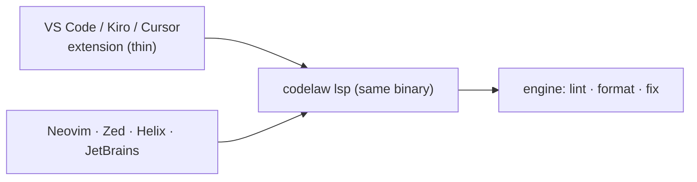

# SR-EDITOR — the editor: an LSP server in the binary and a thin VS Code extension

## §1 — For humans

**The decision in one line.** The editor experience is **`codelaw lsp`**, a language server inside the same binary, plus a **thin VS Code extension** that only starts it and adds commands. Any LSP-capable editor (Neovim, Zed, Helix, JetBrains via LSP4IJ) works with the server alone.

| The editor shows | Comes from |
|---|---|
| Underlined problems, as you type | LSP diagnostics: file rules on edit, project rules on save |
| Quick fixes | LSP code actions: `auto` and `suggest` fixes, "Explain rule", "Ignore here with reason" |
| Format document / selection, format on save | LSP formatting ([SR-FORMATTER](0105_formatter.md)) |
| Rule docs on hover | the rule file's summary, Why and Do/Don't ([SR-RULE-FORMAT](0112_rule-format.md)) |



<details>
<summary><b>ASCII twin</b></summary>

```text
   VS Code / Kiro / Cursor extension --+
                                       +--> codelaw lsp (same binary) --> engine
   Neovim / Zed / Helix / JetBrains  --+
```

</details>

---

## §2 — For agents

### Context

The decider asked for a VS Code extension as well as an LSP. Earlier records named the LSP only in passing (P3).

### Decision

1. **`codelaw lsp`** speaks LSP over stdio from the same binary ([SR-PACKAGES](0107_packages.md) decision 2). It is the crate `codelaw-lsp` on [`lsp-server`](https://crates.io/crates/lsp-server) (rust-analyzer's scaffold, MIT OR Apache-2.0) and [`lsp-types`](https://crates.io/crates/lsp-types) (MIT) — [L2](0004_LAW-2-foss-dependencies.md). `--stdio` is accepted (editors pass it) and is the only transport.
   - **Positions:** UTF-16 (`positionEncoding: utf-16`), converted from the engine's bytes in one module of the crate ([SR-ARCHITECTURE](0108_architecture.md) decision 13).
   - **Never writes:** fixes and formatting are `WorkspaceEdit`s and `TextEdit`s; the editor writes ([SR-ARCHITECTURE](0108_architecture.md) decision 12). The server's own checks read no cache and write none. The socket `codelaw lsp` registers as a warm process, and any `--prefer-warm` command it serves through it (cache included), are [SR-ARCHITECTURE](0108_architecture.md) decision 21's and live in `codelaw-cli`, so this crate still opens nothing for writing.
   - **Which project:** the config nearest the file, as `codelaw check <file>` finds it; with none, the workspace folder that holds the file.
   - **Diagnostics:** pull and push, with codes linking to rule docs.
   - **Code actions:** `quickfix` for `auto` and `suggest` fixes (`auto` preferred), plus `source.fixAll.codelaw` (the text `codelaw fix` would write, as one edit) and `source.organizeImports` where a rule provides it.
   - **Formatting:** document and range ([SR-FORMATTER](0105_formatter.md)). Document formatting is built: the whole document comes back as one `TextEdit` holding what `codelaw format` would write, with no edits when it is already formatted. When the text cannot be formatted the request returns nothing, and `format/failed` is among the document's diagnostics. Range formatting is built: `documentRangeFormattingProvider` is advertised, and the edits are the selection's lines of that same formatting, as [SR-FORMATTER](0105_formatter.md) decision 8 says.
   - **The same findings as `check`:** an editor's unsaved text gets `format/unformatted` as `check` gives it for the file on disk.
   - **Hover:** on a diagnostic.
   - **Workspace diagnostics:** for project rules.
   - **Watched files:** config, rules and baseline changes reload live; so does a saved `.editorconfig`, the base layer of the format options ([SR-FORMATTER](0105_formatter.md) decision 5).
2. **Incremental.**
   - An edit re-parses incrementally and re-runs that file's rules.
   - Project rules (the graph) re-run on save, or after 300 ms idle.
   - Everything stays warm in memory, within the tree-cache bound of [SR-ARCHITECTURE](0108_architecture.md) decision 24.
   - **Built (W-15):** incremental sync (`TextDocumentSyncKind::INCREMENTAL`). Each open document keeps its tree as a `DocumentTree`; an edit re-parses through tree-sitter's edit API; a whole-text change, or an edit that moves the byte-order mark, drops the tree; closing the document hands it to the closed files' tree cache of [SR-ARCHITECTURE](0108_architecture.md) decision 24 (its `[lsp] tree_cache` bound), and reopening the same text takes it back. Diagnostics equal a fresh parse's. Graph re-linking waits for project rules in the editor.
   - `lsp_after_edit` is an [L8](0010_LAW-8-performance-budgets.md) budget.
3. **Same verdicts as the CLI ([L5](0007_LAW-5-no-model-in-the-engine.md)).** The server calls the same engine functions; the editor never shows a result that `codelaw check` wouldn't.
   - **A person's editor runs the `local` profile** ([SR-CONFIG](0110_config.md) decision 10), whether or not `CI` is set in its environment, unless `CODELAW_PROFILE` names another: its verdicts are `codelaw check --profile local`'s.
4. **The VS Code extension `codelaw.codelaw`:**
   - **Source:** `packaging/vscode`, TypeScript. **Contents:** an LSP client (`vscode-languageclient`, MIT; its tree is MIT and ISC), a status-bar item, and the commands *Fix all*, *Format*, *Explain rule* (runs `codelaw explain`), *Restart server* and *Show output* and *Copy debug info*. Its build and test tools (`typescript`, Apache-2.0; `@types/*`, MIT) are dev-only; `crates/codelaw-cli/tests/licences.rs` checks its lockfile.
   - **Settings:** `codelaw.enable`, `codelaw.path`, `codelaw.fixOnSave`, `codelaw.formatOnSave`, `codelaw.logLevel`, `codelaw.trace.server`.
   - **Choosing a binary:**
     1. `codelaw.path`;
     2. the workspace's `node_modules/.bin/codelaw`;
     3. `.venv/bin/codelaw` (or the selected Python interpreter's);
     4. the bundled binary of its platform-specific package.

     The project's own version wins, so the editor agrees with CI.
   - **Published to** the VS Code Marketplace and Open VSX, so Kiro, Cursor and VSCodium get it too.
     **Packaged, not yet published (W-95):** CI builds the eight platform `.vsix` files and checks them ([SR-PACKAGES](0107_packages.md) decision 6); the listing waits on the Marketplace publisher `codelaw` and the Open VSX namespace `codelaw`, which only the decider can create. The README is the listing page, so its links are absolute.
5. **Other editors:** the docs give setup snippets for Neovim (`nvim-lspconfig`), Zed, Helix and JetBrains (LSP4IJ). No other first-party plugins are written.
6. **The repo recommends it.** `codelaw init` adds `codelaw.codelaw` to `.vscode/extensions.json` ([SR-CONSUMER-LAYOUT](0111_consumer-layout.md)).
7. **The log (W-74).** The output channel is one VS Code `LogOutputChannel` (timestamps and levels, no dependency) carrying the extension's lines and the server's `window/logMessage`s; stdout is the transport, so the server never prints.
   - **Levels:** `codelaw.logLevel` is `error`, `warn`, `info` (default) or `debug`. The extension passes it as `initializationOptions.logLevel` and changes it live with `workspace/didChangeConfiguration` (`settings.codelaw.logLevel`); the server sends nothing above it. A debug line reaches the channel at its info level behind `[debug]`, so it shows without raising VS Code's own log level. `codelaw.trace.server` (the raw protocol) is unchanged.
   - **At `info`:** the extension and VS Code versions, OS and architecture, workspace folders, every binary candidate with its verdict, the one chosen, and the server's version; per project the config and root it loaded and its rule count; per file the project that checks it, or why it gets nothing (no covered language, excluded or outside `include`, enabled languages, a config or project that does not load), each **once per file per reload**; every reload and what caused it. **At `debug`:** one line per check (file, language, rule count, diagnostics, milliseconds) and a request that returned nothing.
   - **Failures are always logged** (`error`): a request (method, file, error), a config or project that does not load (also shown once as a popup), `client.start()` rejecting, the server's exit (code, signal, last stderr lines), *Explain rule* with no binary.
   - **Never source text, never environment variables:** paths, rule ids, counts and timings only. *Copy debug info* puts the versions, binary and its source, the candidates, workspace folders, settings and the last 200 log lines on the clipboard.

### Consequences

- **A bundled binary makes the extension larger** (one platform per package). The project's own binary is still preferred.
- **Project rules update on save, not per keystroke;** that's the price of keeping `lsp_after_edit` small.

### Alternatives considered

- **Logic in the extension (TypeScript):** rejected. It would be a second engine and break the CLI/editor parity in decision 3.
- **No extension, LSP only:** rejected. VS Code users expect an installable extension, and binary discovery needs one.
- **A JetBrains-native plugin:** deferred. LSP4IJ covers it.

### Reference (required)

- [Language Server Protocol](https://microsoft.github.io/language-server-protocol/)
- [Open VSX](https://open-vsx.org/): the registry for Kiro, Cursor and VSCodium.
- [SR-ARCHITECTURE](0108_architecture.md) decisions 21–24: the warm-process model.

### Veto condition

**Reopen this decision if:** the editor shows a diagnostic or fix that `codelaw check` on the same file doesn't, or the extension contains lint or format logic.

**How to check it:** the LSP parity test (`crates/codelaw-lsp/tests/server.rs`: `check` vs LSP over every L3 fixture) and a review of the extension's source size (`W-09`).

---

## References

*Every source this record cites, gathered in one place. An archived document is never listed here.*

**Records** — [SR-FORMATTER](0105_formatter.md) · [SR-PACKAGES](0107_packages.md) · [SR-ARCHITECTURE](0108_architecture.md) · [SR-CONSUMER-LAYOUT](0111_consumer-layout.md) · [SR-RULE-FORMAT](0112_rule-format.md)

**Project docs** — [`docs/DESIGN.md`](../docs/DESIGN.md)
