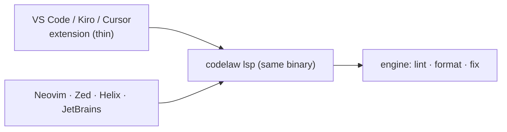

# SR-EDITOR — the editor: an LSP server in the binary and a thin VS Code extension

## §1 — For humans

**The decision in one line.** The editor experience is **`codelaw lsp`**, a language server inside the same binary, plus a **thin VS Code extension** that only starts it and adds commands. Any LSP-capable editor (Neovim, Zed, Helix, JetBrains via LSP4IJ) works with the server alone.

| The editor shows | Comes from |
|---|---|
| Underlined problems, as you type | LSP diagnostics: file rules on edit, project rules on save |
| Quick fixes | LSP code actions: `auto` and `suggest` fixes, "Explain rule", "Ignore here with reason" |
| Format document / selection, format on save | LSP formatting ([SR-FORMATTER](0105_formatter.md)) |
| Rule docs on hover | the rule file's summary, Why and Do/Don't ([SR-RULE-FORMAT](0112_rule-format.md)) |



<details>
<summary><b>ASCII twin</b></summary>

```text
   VS Code / Kiro / Cursor extension --+
                                       +--> codelaw lsp (same binary) --> engine
   Neovim / Zed / Helix / JetBrains  --+
```

</details>

---

## §2 — For agents

### Context

The decider asked for a VS Code extension as well as an LSP. Earlier records named the LSP only in passing (P3).

### Decision

1. **`codelaw lsp`** speaks LSP over stdio from the same binary ([SR-PACKAGES](0107_packages.md) decision 2).
   - **Diagnostics:** pull and push, with codes linking to rule docs.
   - **Code actions:** `quickfix` for `auto` and `suggest` fixes, plus `source.fixAll.codelaw` and `source.organizeImports` where a rule provides it.
   - **Formatting:** document and range ([SR-FORMATTER](0105_formatter.md)).
   - **Hover:** on a diagnostic.
   - **Workspace diagnostics:** for project rules.
   - **Watched files:** config, rules and baseline changes reload live.
2. **Incremental.**
   - An edit re-parses incrementally and re-runs that file's rules.
   - Project rules (the graph) re-run on save, or after 300 ms idle.
   - Everything stays warm in memory, within the tree-cache bound of [SR-ARCHITECTURE](0108_architecture.md) decision 24.
   - `lsp_after_edit` is an [L8](0010_LAW-8-performance-budgets.md) budget.
3. **Same verdicts as the CLI ([L5](0007_LAW-5-no-model-in-the-engine.md)).** The server calls the same engine functions; the editor never shows a result that `codelaw check` wouldn't.
4. **The VS Code extension `codelaw.codelaw`:**
   - **Contents:** an LSP client (`vscode-languageclient`, MIT), a status-bar item, and the commands *Fix all*, *Format*, *Explain rule*, *Restart server* and *Show output*.
   - **Settings:** `codelaw.enable`, `codelaw.path`, `codelaw.fixOnSave`, `codelaw.formatOnSave`, `codelaw.trace.server`.
   - **Choosing a binary:**
     1. `codelaw.path`;
     2. the workspace's `node_modules/.bin/codelaw`;
     3. `.venv/bin/codelaw` (or the selected Python interpreter's);
     4. the bundled binary of its platform-specific package.

     The project's own version wins, so the editor agrees with CI.
   - **Published to** the VS Code Marketplace and Open VSX, so Kiro, Cursor and VSCodium get it too.
5. **Other editors:** the docs give setup snippets for Neovim (`nvim-lspconfig`), Zed, Helix and JetBrains (LSP4IJ). No other first-party plugins are written.
6. **The repo recommends it.** `codelaw init` adds `codelaw.codelaw` to `.vscode/extensions.json` ([SR-CONSUMER-LAYOUT](0111_consumer-layout.md)).

### Consequences

- **A bundled binary makes the extension larger** (one platform per package). The project's own binary is still preferred.
- **Project rules update on save, not per keystroke;** that's the price of keeping `lsp_after_edit` small.

### Alternatives considered

- **Logic in the extension (TypeScript):** rejected. It would be a second engine and break the CLI/editor parity in decision 3.
- **No extension, LSP only:** rejected. VS Code users expect an installable extension, and binary discovery needs one.
- **A JetBrains-native plugin:** deferred. LSP4IJ covers it.

### Reference (required)

- [Language Server Protocol](https://microsoft.github.io/language-server-protocol/)
- [Open VSX](https://open-vsx.org/): the registry for Kiro, Cursor and VSCodium.
- [SR-ARCHITECTURE](0108_architecture.md) decisions 21–24: the warm-process model.

### Veto condition

**Reopen this decision if:** the editor shows a diagnostic or fix that `codelaw check` on the same file doesn't, or the extension contains lint or format logic.

**How to check it:** the LSP parity test (CLI vs LSP over every fixture) and a review of the extension's source size (`W-08`).

---

## References

*Every source this record cites, gathered in one place. An archived document is never listed here.*

**Records** — [SR-FORMATTER](0105_formatter.md) · [SR-PACKAGES](0107_packages.md) · [SR-ARCHITECTURE](0108_architecture.md) · [SR-CONSUMER-LAYOUT](0111_consumer-layout.md) · [SR-RULE-FORMAT](0112_rule-format.md)

**Project docs** — [`docs/DESIGN.md`](../docs/DESIGN.md)
