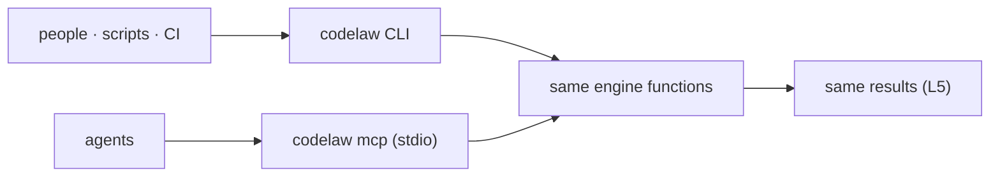

# SR-CLI-MCP — the CLI and the MCP server: one engine, two doors, same answers

## §1 — For humans

**The decision in one line.** **The CLI is for people, scripts and CI. The MCP server is for agents.** Both are the same binary calling the same engine functions ([L5](0007_LAW-5-no-model-in-the-engine.md)), and both are complete without the other.

| Need | CLI | MCP tool |
|---|---|---|
| Find problems | `codelaw check` | `check_paths`, `check_snippet` |
| Fix + format | `codelaw fix` · `codelaw format` | `fix_paths`, `format_snippet` |
| What rules apply here? | `codelaw rules --for <path>` | `rules_for_path` |
| What is specific to this repo here? | `codelaw brief --for <path>…` | `brief_for_task` |
| Explain a rule | `codelaw explain <id>` | `explain_rule` |
| List rules | `codelaw rules` | `list_rules` |
| Debug | `codelaw tree` · `match --explain` · `fix --trace` | `dump_tree`, `trace_rule` |



<details>
<summary><b>ASCII twin</b></summary>

```text
   people, scripts, CI --> codelaw CLI --------+
                                               +--> same engine functions --> same results (L5)
   agents              --> codelaw mcp (stdio) +
```

</details>

---

## §2 — For agents

### Context

The decider asked for an SR stating that codelaw has both an MCP server and a CLI. The command list existed only in chat and the design doc.

### Decision

1. **Commands:**

   | Group | Commands |
   |---|---|
   | everyday | `check [--watch]` · `fix [--watch]` · `format` · `explain` |
   | rules | `rules [--for <path>] [--why <id>] [--tag <tag>…] [--security-coverage]` · `brief --for <path>…` (decision 14) · `new-rule` · `rules eject` · `rules lint` · `test [--case <title>] [--corpus <dir> [--snapshot <file> [--update-snapshot]]]` (SR-RULE-AUTHORING decision 4) |
   | debug | `tree` · `match <id> <file> [--explain] [--line N]` · `fix --trace` · `graph refs` · `graph why-unused` |
   | project | `init [--agents …] [--git-hooks [pre-commit,post-commit]] [--ci github\|gitlab --autofix daily\|weekly [--unsafe]] [--no-install] [--registry npm|pypi]` · `sync-agents [--check]` · `config --print [--for <file>]` · `config --schema` |
   | baseline | `baseline add --rule <id> [--file …] [--expires \| --until] [--warn-from] [--warn-days] [--on-touch] [--reason] [--added-by]` · `baseline prune [paths]` · `baseline check --since <ref>` · `baseline history [--since <date\|90d\|ref>] [--by commit\|day\|week] [--rule <id>] [--format text\|json\|csv\|markdown]` · `exceptions [--expiring <N>d] [--expired] [--mine] [--rule] [--path] [--group-by added_by\|rule\|file\|expires-month] [--format text\|json\|csv\|markdown] [--fail-if-expiring <N>d] [--as-of]` · `deprecate <symbol> [--replacement] [--expires \| --until] [--warn-from] [--warn-days] [--on-touch] [--reason] [--added-by]` ([SR-BASELINE](0104_baseline-and-deprecations.md) decisions 5, 6, 9, 10 and 11; `--added-by` defaults to `git config user.email`; the MCP twins are unchanged) |
   | servers | `lsp [--stdio]` ([SR-EDITOR](0114_editor.md)) · `mcp` · `daemon start/stop/status` ([SR-ARCHITECTURE](0108_architecture.md) decision 22) · `hook [paths]` · `hook --pre [--agent <name>] [--timeout-ms N]` ([SR-AGENT-SURFACES](0102_agent-surfaces.md) decisions 6 and 9) |
   | maintenance | `cache stats` · `cache clean` · `bench` |
   | dependencies | `deps refresh [--as-of <date>] [--jobs N]` — the one command that uses the network ([L5](0007_LAW-5-no-model-in-the-engine.md) decision 3) |

   - **`deps refresh`** reads every `package.json` and `pyproject.toml` the project's discovery finds and their lockfiles, asks npm and the Python index about each dependency (through `curl`, `--jobs` requests at a time, 8 by default), and writes `.codelaw/deps-snapshot.json` with `fetched` set to `--as-of` or today in UTC; what it reads, sends and writes is [SR-RULE-PACKS](0101_rule-packs.md) decision 15. It prints `wrote .codelaw/deps-snapshot.json: <n> npm and <m> PyPI package(s), fetched <date>` and a `warning:` per package its registry does not have, and exits `0`; a request that fails, a registry that refuses the token, or a bad `--as-of` exits `2` and writes nothing (`crates/codelaw-cli/src/deps_cmd.rs`; W-52, 2026-10-25). It has no MCP twin: the MCP server stays offline (decision 5).
   - **`init --agents` and `sync-agents` need the skills package** (W-77, 2026-10-27): the agent files come from `@codelaw/skills` / `codelaw-skills` at this binary's version; with none, or another version, both exit 2 with the install lines and write nothing ([SR-AGENT-SURFACES](0102_agent-surfaces.md) decision 8). `init --agents` adds the skills package to what it installs.
   - **`init` picks the packs** from the repo's languages and `package.json`, by [SR-RULE-PACKS](0101_rule-packs.md) decision 6: `react`, `stencil`, `tanstack-query` (`@tanstack/react-query` or `react-query`) and `redux-toolkit` (`@reduxjs/toolkit` or `redux`) join when the repo depends on that library (`crates/codelaw-cli/src/init.rs`; W-32, 2026-10-25). `scss` (with `css`) joins for `.scss` files or a `sass`, `sass-embedded` or `node-sass` dependency (W-62), and `css-modules` for a `*.module.css` or `*.module.scss` file (W-63, 2026-10-26).

   - **`rules --tag <tag>`** (repeatable; a rule must have every one) keeps the rules with that tag: `security`, `cwe:<n>`, `owasp:<category>` (`owasp:A05` matches `A05:2025`) from the rule's `security:` metadata ([SR-RULE-FORMAT](0112_rule-format.md) decision 2a), or one of its `tags:`. It lists rules across every pack the project loads. **`rules --security-coverage`** prints each OWASP Top 10:2025 category with the security rules mapped to it (id and CWE ids), how many of the ten are covered, and the security rules mapped to no 2025 category; `--format json` gives `owasp[]` (`id`, `name`, `rules[]`) and `unmapped[]`. Both apply after `--for` (W-53, 2026-10-25).

2. **Common flags:**
   - `--lang <list>`, `--rule <id>`;
   - `--changed-since <ref>`, `--staged`, `--as-of <date>`;
   - `--coverage <path>`: the lcov report `graph/function-coverage` reads; it wins over `[coverage] report` ([SR-PROJECT-GRAPH](0103_project-graph.md) decision 9). When the test rules of new code run, `text` and `agent` output opens with `new code: …` (`new code: 3 new, 1 edited functions since <base>`, or `new code: no change set; test rules not evaluated`) and, when the coverage rule runs, `coverage: <report> (N files)` or `coverage: none; not evaluated`; `json` carries them as `new_code: { change_set, coverage }`, and each finding of the two rules carries `data` (`function`, `change`; the coverage rule also `covered`, `lines`, `pct`, `min`);
   - `--profile <name>`: the `[profile.<name>]` to run with; without it, `CODELAW_PROFILE`, then `ci` when `CI` is set, else `local` ([SR-CONFIG](0110_config.md) decision 10). `codelaw hook` and `config --print` take it too;
   - `--format text|json|sarif|agent|github|gitlab|junit|checkstyle`; on `check` and `fix` without it, `CODELAW_FORMAT`, else `agent` inside a coding agent, else `text` (decision 4a);
   - `--unsafe` (apply `suggest` fixes), `--dry-run`;
   - `--no-adapters` on `check` and `fix`: don't run the installed external linters those two commands run otherwise ([SR-LINTER](0106_linter.md) decision 2);
   - `--watch` on `check` and `fix` (W-44, 2026-10-25): keep running and run again on every save, until Ctrl-C, which exits `0` (a second Ctrl-C exits at once). How it watches is [SR-ARCHITECTURE](0108_architecture.md) decision 22a.
     - Its profile is `local` unless `--profile` or `CODELAW_PROFILE` names another, whatever `CI` says: the person at the keyboard ([SR-CONFIG](0110_config.md) decision 10).
     - Every run prints the report the command prints, from the same report as `check` on the same files. `text` clears the screen first when stdout is a terminal and ends with `watching <n> files · run <k> · <file> changed · Ctrl-C to stop` (`<file> and <m> more changed`; `project reloaded` when the config, rules or file set changed). `json` is one object per run on one line (NDJSON): `check`'s object plus `watch: { run, watched, changed[], reloaded }`, and with `fix --watch` `fixed[]`; a run that could not be made is `{ schema_version, codelaw_version, watch, error }`, the message also on stderr. `sarif` is one SARIF log per line; `agent` its lines per run; `github`, `gitlab`, `junit` and `checkstyle` each run's report as `check` prints it.
     - `fix --watch` prints a warning first: it writes each file you save, and an editor that also fixes or formats on save can fight it. It does not take `--trace`.
     - A watch runs in its own process: `--prefer-warm` does not apply and a warm process never serves one. A usage, config or rule error before the first run exits `2`.
   - `--threads N`, `--no-cache`, `--timings`, `--max-warnings N`, `--prefer-warm` (use a running `lsp`/`mcp`/`daemon` of the same version; [SR-ARCHITECTURE](0108_architecture.md) decision 21). Every command with the common flags accepts it; `check`, `fix` and `format` are served warm, the rest run in-process; output is printed at the end, stdout then stderr.
3. **Exit codes:** `0` no errors · `1` errors remain · `2` config, rule or usage error.
   - **`hook --pre` fails open** ([SR-AGENT-SURFACES](0102_agent-surfaces.md) decision 9): it exits `0` on every verdict and on every failure of its own — a bad payload, a config or rule error, a panic, its timeout — with the reason on stderr; its refusal is the JSON on stdout. A refusal to Kiro or Windsurf, which read no JSON, is exit `2` with the reason on stderr.
   - **`format [paths] [--check] [--diff] [--format text|json|github|gitlab|junit|checkstyle] [--import-config]`:** `0` every file is formatted, or was just formatted. `1` with `--check` or `--diff` when a file is not formatted, or when any file could not be formatted or written (`format/failed`, `codelaw/write-failed`). `2` as above. `--check` prints `would format <file>` per file; `--diff` prints a unified diff; neither writes. `--import-config` (not with `--check` or `--diff`) formats nothing: it writes the `[format]` keys read from Prettier's, Ruff's and Black's configs into the project's config, printing `wrote`, `kept` and `not imported` lines, and exits `0`, or `2` when a config cannot be read or written ([SR-FORMATTER](0105_formatter.md) decision 5).
4. **Output formats:**
   - `text`: grouped, coloured on a TTY, plain otherwise.
   - `json`: one versioned object (`schema_version`, `codelaw_version`, `summary`, `diagnostics[]` with rule, severity, file, range, message, fix class and edits or steps, `skipped[]` for files not checked and why, and `warnings[]`). A diagnostic's range carries line, column and byte offset; an edit's range is byte offsets. A diagnostic whose rule attaches structured facts has `data` (a size rule's `{ "lines": 412, "max": 300 }`, `{ "parameters": 6, "max": 3 }` or `{ "positional": 5, "max": 4 }`); SARIF carries it under the result's `properties.data`; a diagnostic with none has no `data` key ([SR-ARCHITECTURE](0108_architecture.md) decision 15b; W-58, 2026-10-26). `fix` adds `fixed[]`: each changed file, the fixes applied per rule, and whether it was written; and `pruned[]`, the baseline files it lowered, when there are any. When a baseline or the deprecations registry is in play, `as_of: { date, source }` gives the date deadlines were judged on, and `text` and `agent` output open with the same `as-of …` line ([SR-BASELINE](0104_baseline-and-deprecations.md) decision 4). When the config defines a profile, `profile: { name, source }` names the one the run used, and `text` and `agent` output open with `profile <name> (<source>)`, before any `as-of` line ([SR-CONFIG](0110_config.md) decision 10). Text output prints a file as `fixed` only once the disk holds the fixed text (`not written` otherwise, `would fix` with `--dry-run`), and the summary counts only those.
   - `sarif`: SARIF 2.1.0 for code scanning.
   - `agent`: compact, token-budgeted lines for hooks.
   - `github`, `gitlab`, `junit`, `checkstyle`: what CI platforms read, so findings show inline on a pull request without a SARIF upload. On `check`, `fix` (what is left) and `format` (with `--check`, each file that would change is a `format/unformatted` warn, as `check` reports it; `--diff` takes none of them). Exit codes are the text run's.
   - **A security rule's finding names its CWE** in `text` and `agent` output, after the rule id: `sec-js/no-child-process-shell (CWE-78)` (W-53).

   - **4a. The default format follows the environment** (W-96, 2026-10-27; W-36 gap G4). On `check` and `fix` (`--watch` included), in order: `--format`, which always wins; `CODELAW_FORMAT` (any of the eight; an unknown name is exit `2`); `agent` when a coding agent's own variable says it ran the command; else `text`. `crates/codelaw-report/src/agent_env.rs` (`AGENT_VARS`, `resolve_format`).
     - **The variables**, each named by that agent's own documentation or source; a variable none names is not detected:

       | variable | agent | source |
       |---|---|---|
       | `CLAUDE_CODE_CHILD_SESSION` | Claude Code | set in the Bash and PowerShell tools and hook commands; IDE extensions do not set it ([env vars](https://code.claude.com/docs/en/env-vars)) |
       | `CLAUDECODE` | Claude Code | set in every subprocess, **and in its IDE extensions' integrated terminals**, so it counts only when stdout is not a terminal (same page) |
       | `CODEX_THREAD_ID`, `CODEX_SANDBOX`, `CODEX_SANDBOX_NETWORK_DISABLED` | Codex | injected into a shell tool call's environment (`codex-rs/core/src/exec_env.rs`, `spawn.rs`) |
       | `GEMINI_CLI` | Gemini CLI | set in the shell tool's subprocess ([shell tool](https://geminicli.com/docs/tools/shell/)) |

       Empty, `0` and `false` count as unset. Not detected, because no agent's own source named them when this was built: `CURSOR_AGENT` (Cursor), `COPILOT_CLI` (Copilot CLI), `OPENCODE`, `JUNIE_DATA`/`JUNIE_SHIM_PATH`, `AI_AGENT`, `CLAUDE_CODE` — all from oxlint's `apps/oxlint/src/agent_detection.rs`. Its substring guesses (`TERM_PROGRAM` holding `kiro`, `EDITOR` holding `devin`, `PATH` holding `.pi/agent`) and `REPL_ID` (Replit) are left out on purpose: each is also true in a terminal a person types in.
     - **CI and a person are not an agent:** `CI`, `GITHUB_ACTIONS`, `GITLAB_CI` and `TERM_PROGRAM` are not in the list, so a pipeline prints `text` unless it asks. An agent running inside CI still gets `agent`: the reader is the agent.
     - **An input like any flag** ([L5](0007_LAW-5-no-model-in-the-engine.md)): the same variables give the same bytes. A warm process uses its client's variables and terminal, never its own ([SR-ARCHITECTURE](0108_architecture.md) decision 21). `config --print` shows the default as the value `format` with its source: `--format` is not read there, so `CODELAW_FORMAT`, `CLAUDECODE=1 (Claude Code)` or `default`.
     - The other commands keep their own `--format` default; `codelaw hook` and the MCP tools have their own output ([SR-AGENT-SURFACES](0102_agent-surfaces.md) decision 6; decision 5 here). This repo's `.cargo/config.toml` sets `CODELAW_FORMAT=text` so its tests, often run inside an agent, see `text`; `crates/codelaw-cli/tests/agent_format.rs` clears it and tests each variable.

   Every format carries the [L4](0006_LAW-4-every-rule-has-a-fix.md) fix fields.

   - **`sarif`'s mapping:** one run; `tool.driver.rules[]` holds each rule that reported, and a result's `ruleIndex` points into it; `error`/`warn`/`info` are SARIF `error`/`warning`/`note`; an `auto` or `suggest` fix is a SARIF `fixes[]` entry with its replacements, and every result carries `properties` `fixClass`, `steps`, `note` and `source`; a rule with `security:` metadata has, in its `tool.driver.rules[]` descriptor's `properties`, GitHub code scanning's `tags` (`security`, `external/cwe/cwe-<n>`, `external/owasp/<category>`, then the rule's own `tags:`) and `security-severity` (high `8.0`, medium `5.0`, low `2.0`), plus `cwe` and `owasp` (W-53); a file not checked is a `toolExecutionNotifications` note (and, when it has one, its `codelaw/*` diagnostic a result). `fix --format sarif` is what is left after fixing. `crates/codelaw-cli/tests/debug.rs` validates both against the vendored SARIF 2.1.0 schema with `boon` (MIT OR Apache-2.0; a dev-dependency only, decided here and in [SR-CONFIG](0110_config.md) for its schema test).

   - **The CI formats' mapping** (W-45; `crates/codelaw-report/src/ci.rs`). Where the shape has room for a fix, it carries it; where it has only a message, the message ends `[fix: <class>]` (`[fix: manual — <steps>]` for a manual fix), so the fix class is never lost (L4).
     - `github`: one workflow command per finding, `::error|warning|notice file=…,line=…,col=…,endLine=…,endColumn=…,title=<rule>::<message> [fix: …]` for `error|warn|info`, with the `%`, CR, LF (and in properties `:` and `,`) escaping GitHub specifies; the run's warnings as bare `::warning::`; a skipped file as a `::notice`; a plain summary line last, because Actions shows only about ten annotations of each kind inline.
     - `gitlab`: Code Quality, a JSON array, one object per finding: `description`, `check_name` (the rule), `fingerprint`, `severity` (`error`→`major`, `warn`→`minor`, `info`→`info`), `location.path` and `location.lines.begin|end`, and `content.body` carrying the fix class, note and numbered steps.
     - `junit`: `<testsuites>` in the Ant/Jenkins shape; a `<testsuite>` per file with findings, a `<testcase>` per finding named `<rule>:<line>:<column>`, `classname` the file. `error` and `warn` are a `<failure type=<rule>>`, `info` a `<skipped>`; the text holds the location, message, fix class and steps. Timestamp, host and times are constants, because a report that varied with the clock or the host would not be byte-identical (L5).
     - `checkstyle`: `<checkstyle version>` with a `<file>` per file with findings and an `<error line column severity message source>` per finding (`source` the rule; severity `error|warning|info`).
     - **Fingerprints** (`gitlab`): a hash (BLAKE3, first 128 bits, hex) of the rule, the file, the message and the occurrence's index among that rule's findings in that file, in report order. Never the line, so moving code does not re-open a finding; two findings of one rule with one message in one file still differ.
     - **Tests:** `crates/codelaw-cli/tests/ci_formats.rs` validates `gitlab` with `boon` against GitLab's own Code Quality schema and the fields its documentation requires, and `junit` and `checkstyle` with `xmllint --schema` (libxml2; the test says so and skips when it is absent) against the JUnit XSD (Windy Road's, Apache-2.0) and a Checkstyle XSD written from Checkstyle's format description, which publishes no schema. The schemas are vendored in `crates/codelaw-report/tests/`. No new dependency: `blake3` is the cache's already.

   `rules [--for <path>] [--why <id>]`, `explain`, `tree`, `match`, `config --print` and `format` take `--format text|json` too. Their JSON objects carry `schema_version` and `codelaw_version` like `check`'s: `rules` gives `for` and `rules[]` (id, severity, fix, title, source, preview, and for a security rule `security` with `cwe`, `owasp`, `severity` and `security_severity`); `rules --why` gives the rule's source, path, shadows, `enabled_by`, default and, with `--for`, `for` (file, `set_by[]`, `applies`, effective severity, and the rule's `diagnostics[]` in that file); `explain` gives summary, why, languages, severity, `fix` (class, reason, skill, steps), `ported_from`, source, path and the Do/Don't `examples[]`; `tree` gives `language`, `line` and nested `nodes[]` (kind, field, range, `text` on leaves, `error`/`missing` flags, children); `match` gives `rule`, `file`, `language` and `nodes[]`, every candidate node of a `match:` rule (kind, range, `matched`, `clauses[]` and `predicates[]` each with `clause`, `holds` and `error`, `constraints`, `captures`); `config --print` gives `file`, `config_files[]` and `values[]` (key, value, source: default, `.editorconfig`, file:line, override #n, env, flag or the preset that enables a rule); `format` gives `check`'s object plus `check` (the flag) and `formatted[]` (file, written). `rules --why … --for` adds `for.match`, `match`'s `nodes[]`, for a `match:` rule on an existing file.

   **The debug flags.**
   - `fix --trace` adds, per file whose loop offered a fix or whose layout the format step changed, a trace: each pass's events (`offered`, `duplicate`, `deferred` behind a rule, `applied`, `refused` with why), how the loop ended (`fixpoint`, `conflict`, `did-not-converge`), the rules verify refused, and whether the format step changed the layout. JSON: `trace[]` (file, changed, end, passes, `verify_refused`, `formatted`); text: after the report on stdout; `sarif` and `agent`: on stderr. It traces the run `fix` makes ([SR-ARCHITECTURE](0108_architecture.md) decision 5), so it writes exactly what `fix` would.
   - `--timings` on `check`, `fix` and `format`: wall time, threads, each phase's summed time and count (`parse` counts one per file checked), cache hits and misses, and the slowest rules. JSON: a `timings` field; any other format: on stderr, so stdout stays parseable.
5. **The MCP server.**
   - `codelaw mcp` speaks MCP over **stdio only**: offline, local, nothing listening on a port ([L5](0007_LAW-5-no-model-in-the-engine.md) decision 3).
   - **Tools:** `rules_for_path`, `brief_for_task` (decision 14), `explain_rule`, `list_rules`, `check_snippet`, `check_paths`, `fix_paths` (applies `auto`; returns `suggest` fixes as diffs to accept), `format_snippet`, `dump_tree`, `trace_rule`, `list_exceptions`.
   - Results use the same JSON shapes as `--format json`.
   - **The `ci` profile:** every tool runs with `ci` unless `CODELAW_PROFILE` names another ([SR-CONFIG](0110_config.md) decision 10), so an agent gets CI's verdict; a tool's CLI twin below is the command with `--profile ci`.
   - **No adapters:** MCP never runs the external linters ([SR-ARCHITECTURE](0108_architecture.md) decision 19), so an agent sees their findings in CI only; the twins below carry `--no-adapters`.
   - **Protocol:** JSON-RPC 2.0, one message per line on stdin and stdout; `initialize` (revisions `2025-06-18`, `2025-03-26`, `2024-11-05`; the client's when it is one of these), `ping`, `tools/list`, `tools/call`, and empty `resources/list` / `prompts/list`. A hand-written loop in `codelaw-mcp`, no SDK: it adds no dependency beyond `serde_json` ([L2](0004_LAW-2-foss-dependencies.md)). Stdout carries protocol messages only.
   - **Each tool and its CLI twin** — the tool result's text is the twin's stdout without its final newline, and its `structuredContent` is the same object; a tool error (`isError`) is the twin's message after `error: `:

     | tool | CLI twin |
     |---|---|
     | `rules_for_path {path}` | `rules --for <path> --format json` |
     | `brief_for_task {paths}` | `brief --for <path>… --format json` |
     | `explain_rule {id}` | `explain <id> --format json` |
     | `list_rules {}` | `rules --format json` |
     | `check_snippet {path, code}` | `check <path> --format json` on a file holding `code` |
     | `check_paths {paths, rule, lang, as_of, changed_since, staged, coverage}` | `check [paths] [--rule] [--lang] [--as-of] [--changed-since] [--staged] [--coverage] --no-adapters --format json` |
     | `fix_paths {paths, unsafe, dry_run, rule, lang, as_of, changed_since, staged, coverage}` | `fix … --no-adapters --format json` |
     | `format_snippet {path, code}` | the bytes `fix <path>` writes, format step included, without writing them ([SR-FORMATTER](0105_formatter.md) decision 4) |
     | `dump_tree {path \| code+lang, line}` | `tree … --format json` |
     | `list_exceptions {expiring, expired, mine, rule, path, group_by, as_of}` | `exceptions … --format json` ([SR-BASELINE](0104_baseline-and-deprecations.md) decision 11) |
     | `trace_rule {id, path}` | `rules --why <id> --for <path> --format json`; for a `match:` rule its `for.match` is `match --explain`'s matcher-level trace |

   - The server loads the project per call, so an edited config or rule is seen on the next call; the compiled rule set is reused from memory while it is unchanged ([SR-ARCHITECTURE](0108_architecture.md) decision 21). `mcp` and `lsp` register as warm processes for their folder; the socket thread never writes to stdout.
6. **Parity ([L5](0007_LAW-5-no-model-in-the-engine.md)).** A test runs every fixture through the CLI and through MCP and requires identical diagnostics and fixed bytes: `crates/codelaw-cli/tests/mcp_parity.rs` runs each `fixtures/l3` language alone and all together through every tool of decision 5 and its twin, byte for byte, and compares the files `fix`, `fix_paths` and `codelaw hook` (run on each file in turn, as an agent edits) write. No logic lives in either surface; both are thin adapters over `codelaw-engine` ([SR-PACKAGES](0107_packages.md)).
7. **Agent-friendly by design.**
   - Every MCP tool's description says when to call it.
   - `rules_for_path` returns rule cards under about 60 tokens each, with detail on demand ([SR-AGENT-SURFACES](0102_agent-surfaces.md) decision 3).
   - Errors name the fix ("unknown rule `js/expots-at-end`; did you mean `js/exports-at-end`?").
8. **Speed ([L8](0010_LAW-8-performance-budgets.md)).** `startup`, `mcp_rules_for_path`, `hook_pre` and `check_*` are budgeted operations. The MCP server stays warm for the session ([SR-ARCHITECTURE](0108_architecture.md) decision 21).
9. **Stable interfaces.** Command names, flags, exit codes, JSON fields and MCP tool names are public API. Removing or renaming one needs a deprecation cycle of one minor release.
10. **`codelaw bench`** is [L8](0010_LAW-8-performance-budgets.md)'s measurement and its gate (`crates/codelaw-cli/src/bench/`, W-19).
    - **The workload.** It generates the reference workload ([L8](0010_LAW-8-performance-budgets.md) decision 2) into `--workload <dir>` (a temporary folder by default) from `--seed` and `--files` (10,000), with `codelaw.toml` extending every pack's `recommended` presets with `preview = true`, and every first-party pack of `--packs <dir>` (the repo's `packs/`, found above the current folder) installed where its home registry puts it: `node_modules/@codelaw/rules-*`, and `.venv/lib/python3.12/site-packages/codelaw_rules_python` for the PyPI-only pack (each measured run drops `VIRTUAL_ENV` and `CODELAW_SITE_PACKAGES`, so that `.venv` is the one searched). A folder whose marker names the same digest and the same pack count is reused; a folder that is neither empty nor a workload is refused. Generation is offline and seeded; `workload::REFERENCE_DIGEST` pins the reference bytes, and a test fails when they change.
    - **What it times** — this binary, spawned as a user, an editor or an agent runs it, spawn to exit: `startup` (`--version`); `check_cold_10k` (`check`, a fresh empty `CODELAW_CACHE_DIR` per run, no warm process) and `peak_memory_10k` (its `wait4` `ru_maxrss`; Unix only); `check_warm_10k` and `format_warm_10k` (`check` and `format --check`, with `--prefer-warm` served by a `codelaw daemon` over a primed cache — the bench fails when the daemon served fewer runs than it timed); `fix_one_file` (`codelaw hook <file>` after rewriting one TypeScript file with a formatting fault, primed cache); `lsp_after_edit` (an incremental `didChange` to the next `publishDiagnostics` for that file in one `codelaw lsp` session); `mcp_rules_for_path` (one `tools/call` round trip to `codelaw mcp`); `hook_pre` (`codelaw hook --pre --agent claude` with a Claude Code `Edit` payload on stdin that adds a `debugger` statement to the same TypeScript file, primed cache, spawn to exit: the refusal included). Context rows, never gated: `check_warm_10k_no_daemon` and `fix_one_file_cold`; `watch_rerun` (one file saved with a first comment line no run has seen, then `Watch::rerun` timed in the bench's own process from the poll that saw the save to its report, primed cache: the engine's part of `check --watch`) and `watch_save_to_print` (a running `check --watch --format json`, the save to its run's line, polling and settling included; W-44); and, for each `--repo <dir>` (repeatable; L8 decision 2's three pinned real repos, checked out by `scripts/corpus.py fetch --repo <name>`), `check_cold_repo` and `check_warm_repo` (`check` in its own process, empty then primed cache) on a copy of the repo beside the workload — without its `.git`, `node_modules`, `.venv` or `codelaw.toml` — carrying the workload's `codelaw.toml` and packs. Adapters are off (`--no-adapters`); caches live beside the workload, never in it.
    - **Runs:** `--runs N` (10) per operation; the first is discarded; the report gives median, p95 (nearest rank), min and max. `--only <ops>` narrows it.
    - **Output:** `--format text|json`; `--output <file>` also writes the JSON report (`schema_version`, `codelaw_version`, `workload {seed, files, digest, reference}`, `runs`, `repos[]` with `name`, `files`, `path`, `operations[]` with `repo` (a repo row's name; `null` on the workload), `samples`, `median`, `p95`, `min`, `max`, `budget`, `proposed`, `verdict`).
    - **Exit codes:** `0` measured, nothing over a set budget · `1` a p95 over a budget the decider set (`--budgets <file>`) · `2` a usage error, a malformed budgets file, or an operation that failed to run.

11. **Git hooks: `init --git-hooks [pre-commit,post-commit]`** (W-50, 2026-10-25). `crates/codelaw-cli/src/git_hooks.rs`; the two POSIX `sh` scripts are `templates/git-hooks/pre-commit` and `post-commit` ([L10](0012_LAW-10-consumer-templates.md), moved there by W-60). The hooks need no agent and no Node ([L5](0007_LAW-5-no-model-in-the-engine.md) decision 4).
    - **Where it writes:** the folder git itself resolves for hooks (`git rev-parse --git-path hooks`: `core.hooksPath`, else `.git/hooks`, a linked worktree included). In a repo `codelaw.toml` already configures, `--git-hooks` installs only the hooks; in an unconfigured one it runs the rest of `init` first. Outside a git repository it exits `2` and writes nothing.
    - **Never overwrites:** a hook of ours (its second line is `# codelaw-hook: <name>`) is rewritten to the current script, or reported `already installed`. Any other hook is renamed to `<name>.pre-codelaw` and the new one runs it first; an earlier pre-commit's failure blocks, an earlier post-commit's does not. When `<name>.pre-codelaw` exists too, `init` exits `2` and changes nothing. Uninstalling is deleting the file.
    - **`pre-commit` blocks.** It takes the staged files (added, copied, modified, renamed). The ones with no unstaged change run `codelaw fix --staged -- <files>` and are re-staged with `git add`; a **partly staged file is checked and never fixed**, so an unstaged hunk is never committed or overwritten. Then `codelaw check --staged -- <all staged files>`; its exit code is the hook's (`1` blocks the commit, warnings do not). `check` reads the working-tree text of a partly staged file, not the index's. `CODELAW_HOOK_ARGS` adds flags to both commands (a team sets `--profile ci` there once W-39 lands; until then the profile is whatever the run detects). Without `codelaw` on `PATH` the hook prints a note and lets the commit through.
    - **`post-commit` never blocks.** It runs every executable in `.codelaw/hooks/post-commit.d/` in name order and always exits `0`. Before the steps it prints two reminders itself (W-50, 2026-10-26): `codelaw exceptions --mine --expiring 7d` ([SR-BASELINE](0104_baseline-and-deprecations.md) decision 11) when it lists anything, and the `total` row of `codelaw baseline history --since 30d` (decision 10) as one line; each is silent when it has nothing, no `user.email`, no baseline or no git history. `.codelaw/hooks/post-commit.d/` stays the extension point for a team's own steps.
    - **The pre-commit framework, husky and lefthook** need no installer: `.pre-commit-hooks.yaml` at the repository root defines hooks `codelaw-check` and `codelaw-fix` (`language: system`, so `codelaw` must be on `PATH`), and [USAGE.md](../USAGE.md) carries the husky and lefthook recipes. The framework stashes unstaged changes itself, so its fix hook has no partly-staged hazard.

12. **A scheduled auto-fix PR: `init --ci github|gitlab --autofix daily|weekly [--unsafe]`** (W-51, 2026-10-26). `crates/codelaw-cli/src/ci.rs`; the text is the template under `templates/ci/<provider>/` ([L10](0012_LAW-10-consumer-templates.md)): slots `cron`, `version` (this codelaw's version, so the job runs the release that wrote it) and `suggest_job`.
    - **Where it writes:** GitHub `.github/workflows/codelaw-autofix.yml`; GitLab `.gitlab/codelaw-autofix.yml`, which the repo's `.gitlab-ci.yml` includes and a pipeline schedule runs (GitLab cannot declare a schedule in YAML, so `init` prints the cron). In a repo `codelaw.toml` already configures, `--ci` writes only the workflow; in an unconfigured one it runs the rest of `init` first. `--ci` needs `--autofix` and the reverse. A file there that is not ours (it does not name `codelaw-autofix.yml`) is never overwritten: exit `2`. Writing the same text again reports `already up to date`.
    - **The job:** checkout, install the repo's dependencies, `npm install --global codelaw@<version>`, then `codelaw fix --as-of "$(date +%F)" --format json` (the `auto` class only; exit `1` means errors remain and is tolerated, `2` fails the job), `codelaw format`, `codelaw baseline prune`. No diff: no branch, no PR, job green. A diff: commit to `codelaw/autofix`, force-push, and `gh pr create`, or `gh pr edit` the open one, so there is never more than one PR (GitLab: the same through the merge-request API with `CODELAW_AUTOFIX_TOKEN`). Permissions: `contents: write` and `pull-requests: write`, nothing else. It can only lower baseline counts ([SR-BASELINE](0104_baseline-and-deprecations.md) decision 5); a raised count fails the PR's own CI.
    - **The PR body** is written from `fix --format json` (fixes per rule and file, baseline files lowered), `baseline history --since 7d --by day --format markdown` (the week's burn-down), and `exceptions --expiring 30d --as-of "$(date +%F)" --format markdown` (W-46; unconditional, the job installs the release that has it). The deps-snapshot diff section is not written: the job runs no networked command ([L5](0007_LAW-5-no-model-in-the-engine.md)), so the snapshot cannot change in it.
    - **`--unsafe`** adds a second job that runs `fix --unsafe` and `format` on the default branch and opens its own PR from `codelaw/autofix-suggest`, so riskier fixes never share a PR with safe ones.
    - **Hazards, stated in the file's header and by `init`:** a PR opened with `GITHUB_TOKEN` does not trigger other workflows, so the job uses the secret `CODELAW_AUTOFIX_TOKEN` (a GitHub App token or fine-grained PAT) when set, else the PR's CI is started by hand; branch protection must allow force-push to `codelaw/autofix`.
13. **`codelaw debug changed-functions [--changed-since <ref> | --staged] [--format text|json]`** (W-71 step 1, 2026-10-26). `crates/codelaw-cli/src/debug_cmd.rs`; the answer is `Project::changed_functions` ([SR-LINTER](0106_linter.md) decision 1's `functions` / `classify`): per changed file, each function as `new`, `edited` or `untouched` with its lines and whether it is public. The change set is an explicit input ([L5](0007_LAW-5-no-model-in-the-engine.md)); with none, nothing is judged and the text output says `new code: no change set; test rules not evaluated`.

14. **`codelaw brief --for <path>… [--format text|json]` and MCP `brief_for_task {paths}`** (W-93, 2026-10-27). **Ruled by Arpit, 2026-10-27 (W-05, R2):** *"Yes to all three."* — brief by what is specific to this repo, not by syntax construct (the construct plan covered 3 % of the rules). `crates/codelaw-report/src/brief.rs`; both surfaces call it, so the bytes are the same ([L5](0007_LAW-5-no-model-in-the-engine.md)).
    - **What it lists**, for the rules that apply to any of the paths (`rules --for`'s, severity not `off`; a path need not exist, its extension picks the language), in this order, each rule once, in the first group it belongs to, by id within a group:
      1. `own` — the repo's own rules (`.codelaw/rules/`, source `local`);
      2. `configured` — pack rules whose options a config layer for the path sets (`[rules]`, a scope or the profile), with those options: a choice the model cannot guess;
      3. `exceptions` — rules with an exception covering a file at or under a path ([SR-BASELINE](0104_baseline-and-deprecations.md) decision 11's list: baseline entries, deprecations, inline `codelaw-ignore`, `.codelawignore`), with how many of each kind and the uses they cover: what this code has actually got wrong;
      4. `security` — rules with `security:` metadata whose fix is `manual`;
      5. `standard` — how many applying rules are left, and the tools they are ported from (`ported_from:`, the part before `/`, sorted): one closing line, *the other N rules are standard (eslint, ruff, …); `codelaw hook --pre` refuses a write that breaks one, with its fix*.
    - **JSON:** `schema_version`, `codelaw_version`, `for[]`, `own[]`, `configured[]` (each card plus `options`), `exceptions[]` (each card plus `kinds` and `uses`), `security[]`, `standard {count, ported_from[]}`; a card is `rules --for`'s. **Text:** a heading per non-empty group, one line per rule (`id  severity  fix  title`, plus the options, the exception counts or the CWE ids), then the closing line.
    - **Deterministic:** the same files and config give the same bytes; there is no ranking and no free text. `constructs` is not built: no rule declares `constructs:` yet, and the ruling bars tagging the pack rules in bulk.
    - **Errors:** a path with no [L3](0005_LAW-3-languages.md) extension, or no `--for`, exits `2` (`isError` on MCP).

### Consequences

- **Two front doors to keep in sync,** made cheap by keeping both thin and testing parity.
- **Stdio-only MCP** means remote agents need a local process. Deliberate ([L5](0007_LAW-5-no-model-in-the-engine.md)).

### Alternatives considered

- **MCP only, no CLI:** rejected. CI, pre-commit and people need a CLI, and codelaw must work with no agent ([L5](0007_LAW-5-no-model-in-the-engine.md) decision 4).
- **CLI only, agents shell out:** rejected. No discovery, no typed tools, no warm process.
- **MCP over HTTP:** rejected for now. It opens a port and needs network handling ([L5](0007_LAW-5-no-model-in-the-engine.md) decision 3).

### Reference (required)

- [Model Context Protocol](https://modelcontextprotocol.io/): the server protocol.
- [GitHub workflow commands](https://docs.github.com/en/actions/reference/workflows-and-actions/workflow-commands) · [GitLab Code Quality](https://docs.gitlab.com/ci/testing/code_quality/) · [Checkstyle XML](https://checkstyle.org/cmdline.html): the CI formats.
- [SARIF 2.1.0](https://docs.oasis-open.org/sarif/sarif/v2.1.0/sarif-v2.1.0.html): the code-scanning format.
- [SR-AGENT-SURFACES](0102_agent-surfaces.md): how agents are pointed at the MCP server.

### Veto condition

**Reopen this decision if:** the CLI and MCP give different results for the same input, or either surface contains engine logic.

**How to check it:** the CLI/MCP parity test over every fixture, `cargo test -p codelaw-cli --test mcp_parity`.

---

## References

*Every source this record cites, gathered in one place. An archived document is never listed here.*

**Records** — [SR-AGENT-SURFACES](0102_agent-surfaces.md) · [SR-BASELINE](0104_baseline-and-deprecations.md) · [SR-PACKAGES](0107_packages.md) · [SR-ARCHITECTURE](0108_architecture.md) · [SR-RULE-PACKS](0101_rule-packs.md)

**Project docs** — [`docs/DESIGN.md`](../docs/DESIGN.md)
