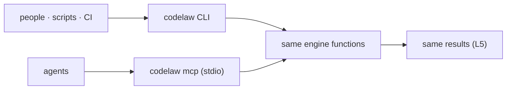

# SR-CLI-MCP — the CLI and the MCP server: one engine, two doors, same answers

## §1 — For humans

**The decision in one line.** **The CLI is for people, scripts and CI. The MCP server is for agents.** Both are the same binary calling the same engine functions ([L5](0007_LAW-5-no-model-in-the-engine.md)), and both are complete without the other.

| Need | CLI | MCP tool |
|---|---|---|
| Find problems | `codelaw check` | `check_paths`, `check_snippet` |
| Fix + format | `codelaw fix` · `codelaw format` | `fix_paths`, `format_snippet` |
| What rules apply here? | `codelaw rules --for <path>` | `rules_for_path` |
| Explain a rule | `codelaw explain <id>` | `explain_rule` |
| List rules | `codelaw rules` | `list_rules` |
| Debug | `codelaw tree` · `match --explain` · `fix --trace` | `dump_tree`, `trace_rule` |



<details>
<summary><b>ASCII twin</b></summary>

```text
   people, scripts, CI --> codelaw CLI --------+
                                               +--> same engine functions --> same results (L5)
   agents              --> codelaw mcp (stdio) +
```

</details>

---

## §2 — For agents

### Context

The decider asked for an SR stating that codelaw has both an MCP server and a CLI. The command list existed only in chat and the design doc.

### Decision

1. **Commands:**

   | Group | Commands |
   |---|---|
   | everyday | `check` · `fix` · `format` · `explain` |
   | rules | `rules [--for <path>] [--why <id>]` · `new-rule` · `rules eject` · `rules lint` · `test [--case <title>] [--corpus <dir> [--snapshot <file> [--update-snapshot]]]` (SR-RULE-AUTHORING decision 4) |
   | debug | `tree` · `match <id> <file> [--explain] [--line N]` · `fix --trace` · `graph refs` · `graph why-unused` |
   | project | `init [--agents …] [--git-hooks [pre-commit,post-commit]] [--no-install] [--registry npm|pypi]` · `sync-agents [--check]` · `config --print [--for <file>]` · `config --schema` |
   | baseline | `baseline add --rule <id> [--file …] [--expires \| --until] [--warn-from] [--warn-days] [--on-touch] [--reason] [--added-by]` · `baseline prune [paths]` · `baseline check --since <ref>` · `deprecate <symbol> [--replacement] [--expires \| --until] [--warn-from] [--warn-days] [--on-touch] [--reason] [--added-by]` ([SR-BASELINE](0104_baseline-and-deprecations.md) decisions 5, 6 and 9; `--added-by` defaults to `git config user.email`; the MCP twins are unchanged) |
   | servers | `lsp [--stdio]` ([SR-EDITOR](0114_editor.md)) · `mcp` · `daemon start/stop/status` ([SR-ARCHITECTURE](0108_architecture.md) decision 22) · `hook` |
   | maintenance | `cache stats` · `cache clean` · `bench` |

   - **`init` picks the packs** from the repo's languages and `package.json`, by [SR-RULE-PACKS](0101_rule-packs.md) decision 6: `react`, `stencil`, `tanstack-query` (`@tanstack/react-query` or `react-query`) and `redux-toolkit` (`@reduxjs/toolkit` or `redux`) join when the repo depends on that library (`crates/codelaw-cli/src/init.rs`; W-32, 2026-10-25).

2. **Common flags:**
   - `--lang <list>`, `--rule <id>`;
   - `--changed-since <ref>`, `--staged`, `--as-of <date>`;
   - `--format text|json|sarif|agent`;
   - `--unsafe` (apply `suggest` fixes), `--dry-run`;
   - `--no-adapters` on `check` and `fix`: don't run the installed external linters those two commands run otherwise ([SR-LINTER](0106_linter.md) decision 2);
   - `--threads N`, `--no-cache`, `--timings`, `--max-warnings N`, `--prefer-warm` (use a running `lsp`/`mcp`/`daemon` of the same version; [SR-ARCHITECTURE](0108_architecture.md) decision 21). Every command with the common flags accepts it; `check`, `fix` and `format` are served warm, the rest run in-process; output is printed at the end, stdout then stderr.
3. **Exit codes:** `0` no errors · `1` errors remain · `2` config, rule or usage error.
   - **`format [paths] [--check] [--diff] [--format text|json] [--import-config]`:** `0` every file is formatted, or was just formatted. `1` with `--check` or `--diff` when a file is not formatted, or when any file could not be formatted or written (`format/failed`, `codelaw/write-failed`). `2` as above. `--check` prints `would format <file>` per file; `--diff` prints a unified diff; neither writes. `--import-config` (not with `--check` or `--diff`) formats nothing: it writes the `[format]` keys read from Prettier's, Ruff's and Black's configs into the project's config, printing `wrote`, `kept` and `not imported` lines, and exits `0`, or `2` when a config cannot be read or written ([SR-FORMATTER](0105_formatter.md) decision 5).
4. **Output formats:**
   - `text`: grouped, coloured on a TTY, plain otherwise.
   - `json`: one versioned object (`schema_version`, `codelaw_version`, `summary`, `diagnostics[]` with rule, severity, file, range, message, fix class and edits or steps, `skipped[]` for files not checked and why, and `warnings[]`). A diagnostic's range carries line, column and byte offset; an edit's range is byte offsets. `fix` adds `fixed[]`: each changed file, the fixes applied per rule, and whether it was written; and `pruned[]`, the baseline files it lowered, when there are any. When a baseline or the deprecations registry is in play, `as_of: { date, source }` gives the date deadlines were judged on, and `text` and `agent` output open with the same `as-of …` line ([SR-BASELINE](0104_baseline-and-deprecations.md) decision 4). Text output prints a file as `fixed` only once the disk holds the fixed text (`not written` otherwise, `would fix` with `--dry-run`), and the summary counts only those.
   - `sarif`: SARIF 2.1.0 for code scanning.
   - `agent`: compact, token-budgeted lines for hooks.

   Every format carries the [L4](0006_LAW-4-every-rule-has-a-fix.md) fix fields.

   - **`sarif`'s mapping:** one run; `tool.driver.rules[]` holds each rule that reported, and a result's `ruleIndex` points into it; `error`/`warn`/`info` are SARIF `error`/`warning`/`note`; an `auto` or `suggest` fix is a SARIF `fixes[]` entry with its replacements, and every result carries `properties` `fixClass`, `steps`, `note` and `source`; a file not checked is a `toolExecutionNotifications` note (and, when it has one, its `codelaw/*` diagnostic a result). `fix --format sarif` is what is left after fixing. `crates/codelaw-cli/tests/debug.rs` validates both against the vendored SARIF 2.1.0 schema with `boon` (MIT OR Apache-2.0; a dev-dependency only, decided here and in [SR-CONFIG](0110_config.md) for its schema test).

   `rules [--for <path>] [--why <id>]`, `explain`, `tree`, `match`, `config --print` and `format` take `--format text|json` too. Their JSON objects carry `schema_version` and `codelaw_version` like `check`'s: `rules` gives `for` and `rules[]` (id, severity, fix, title, source, preview); `rules --why` gives the rule's source, path, shadows, `enabled_by`, default and, with `--for`, `for` (file, `set_by[]`, `applies`, effective severity, and the rule's `diagnostics[]` in that file); `explain` gives summary, why, languages, severity, `fix` (class, reason, skill, steps), `ported_from`, source, path and the Do/Don't `examples[]`; `tree` gives `language`, `line` and nested `nodes[]` (kind, field, range, `text` on leaves, `error`/`missing` flags, children); `match` gives `rule`, `file`, `language` and `nodes[]`, every candidate node of a `match:` rule (kind, range, `matched`, `clauses[]` and `predicates[]` each with `clause`, `holds` and `error`, `constraints`, `captures`); `config --print` gives `file`, `config_files[]` and `values[]` (key, value, source: default, `.editorconfig`, file:line, override #n, env, flag or the preset that enables a rule); `format` gives `check`'s object plus `check` (the flag) and `formatted[]` (file, written). `rules --why … --for` adds `for.match`, `match`'s `nodes[]`, for a `match:` rule on an existing file.

   **The debug flags.**
   - `fix --trace` adds, per file whose loop offered a fix or whose layout the format step changed, a trace: each pass's events (`offered`, `duplicate`, `deferred` behind a rule, `applied`, `refused` with why), how the loop ended (`fixpoint`, `conflict`, `did-not-converge`), the rules verify refused, and whether the format step changed the layout. JSON: `trace[]` (file, changed, end, passes, `verify_refused`, `formatted`); text: after the report on stdout; `sarif` and `agent`: on stderr. It traces the run `fix` makes ([SR-ARCHITECTURE](0108_architecture.md) decision 5), so it writes exactly what `fix` would.
   - `--timings` on `check`, `fix` and `format`: wall time, threads, each phase's summed time and count (`parse` counts one per file checked), cache hits and misses, and the slowest rules. JSON: a `timings` field; any other format: on stderr, so stdout stays parseable.
5. **The MCP server.**
   - `codelaw mcp` speaks MCP over **stdio only**: offline, local, nothing listening on a port ([L5](0007_LAW-5-no-model-in-the-engine.md) decision 3).
   - **Tools:** `rules_for_path`, `explain_rule`, `list_rules`, `check_snippet`, `check_paths`, `fix_paths` (applies `auto`; returns `suggest` fixes as diffs to accept), `format_snippet`, `dump_tree`, `trace_rule`.
   - Results use the same JSON shapes as `--format json`.
   - **No adapters:** MCP never runs the external linters ([SR-ARCHITECTURE](0108_architecture.md) decision 19), so an agent sees their findings in CI only; the twins below carry `--no-adapters`.
   - **Protocol:** JSON-RPC 2.0, one message per line on stdin and stdout; `initialize` (revisions `2025-06-18`, `2025-03-26`, `2024-11-05`; the client's when it is one of these), `ping`, `tools/list`, `tools/call`, and empty `resources/list` / `prompts/list`. A hand-written loop in `codelaw-mcp`, no SDK: it adds no dependency beyond `serde_json` ([L2](0004_LAW-2-foss-dependencies.md)). Stdout carries protocol messages only.
   - **Each tool and its CLI twin** — the tool result's text is the twin's stdout without its final newline, and its `structuredContent` is the same object; a tool error (`isError`) is the twin's message after `error: `:

     | tool | CLI twin |
     |---|---|
     | `rules_for_path {path}` | `rules --for <path> --format json` |
     | `explain_rule {id}` | `explain <id> --format json` |
     | `list_rules {}` | `rules --format json` |
     | `check_snippet {path, code}` | `check <path> --format json` on a file holding `code` |
     | `check_paths {paths, rule, lang, as_of, changed_since, staged}` | `check [paths] [--rule] [--lang] [--as-of] [--changed-since] [--staged] --no-adapters --format json` |
     | `fix_paths {paths, unsafe, dry_run, rule, lang, as_of, changed_since, staged}` | `fix … --no-adapters --format json` |
     | `format_snippet {path, code}` | the bytes `fix <path>` writes, format step included, without writing them ([SR-FORMATTER](0105_formatter.md) decision 4) |
     | `dump_tree {path \| code+lang, line}` | `tree … --format json` |
     | `trace_rule {id, path}` | `rules --why <id> --for <path> --format json`; for a `match:` rule its `for.match` is `match --explain`'s matcher-level trace |

   - The server loads the project per call, so an edited config or rule is seen on the next call; the compiled rule set is reused from memory while it is unchanged ([SR-ARCHITECTURE](0108_architecture.md) decision 21). `mcp` and `lsp` register as warm processes for their folder; the socket thread never writes to stdout.
6. **Parity ([L5](0007_LAW-5-no-model-in-the-engine.md)).** A test runs every fixture through the CLI and through MCP and requires identical diagnostics and fixed bytes: `crates/codelaw-cli/tests/mcp_parity.rs` runs each `fixtures/l3` language alone and all together through every tool of decision 5 and its twin, byte for byte, and compares the files `fix`, `fix_paths` and `codelaw hook` (run on each file in turn, as an agent edits) write. No logic lives in either surface; both are thin adapters over `codelaw-engine` ([SR-PACKAGES](0107_packages.md)).
7. **Agent-friendly by design.**
   - Every MCP tool's description says when to call it.
   - `rules_for_path` returns rule cards under about 60 tokens each, with detail on demand ([SR-AGENT-SURFACES](0102_agent-surfaces.md) decision 3).
   - Errors name the fix ("unknown rule `js/expots-at-end`; did you mean `js/exports-at-end`?").
8. **Speed ([L8](0010_LAW-8-performance-budgets.md)).** `startup`, `mcp_rules_for_path` and `check_*` are budgeted operations. The MCP server stays warm for the session ([SR-ARCHITECTURE](0108_architecture.md) decision 21).
9. **Stable interfaces.** Command names, flags, exit codes, JSON fields and MCP tool names are public API. Removing or renaming one needs a deprecation cycle of one minor release.
10. **`codelaw bench`** is [L8](0010_LAW-8-performance-budgets.md)'s measurement and its gate (`crates/codelaw-cli/src/bench/`, W-19).
    - **The workload.** It generates the reference workload ([L8](0010_LAW-8-performance-budgets.md) decision 2) into `--workload <dir>` (a temporary folder by default) from `--seed` and `--files` (10,000), with `codelaw.toml` extending every pack's `recommended` presets with `preview = true`, and every first-party pack of `--packs <dir>` (the repo's `packs/`, found above the current folder) installed where its home registry puts it: `node_modules/@codelaw/rules-*`, and `.venv/lib/python3.12/site-packages/codelaw_rules_python` for the PyPI-only pack (each measured run drops `VIRTUAL_ENV` and `CODELAW_SITE_PACKAGES`, so that `.venv` is the one searched). A folder whose marker names the same digest and the same pack count is reused; a folder that is neither empty nor a workload is refused. Generation is offline and seeded; `workload::REFERENCE_DIGEST` pins the reference bytes, and a test fails when they change.
    - **What it times** — this binary, spawned as a user, an editor or an agent runs it, spawn to exit: `startup` (`--version`); `check_cold_10k` (`check`, a fresh empty `CODELAW_CACHE_DIR` per run, no warm process) and `peak_memory_10k` (its `wait4` `ru_maxrss`; Unix only); `check_warm_10k` and `format_warm_10k` (`check` and `format --check`, with `--prefer-warm` served by a `codelaw daemon` over a primed cache — the bench fails when the daemon served fewer runs than it timed); `fix_one_file` (`codelaw hook <file>` after rewriting one TypeScript file with a formatting fault, primed cache); `lsp_after_edit` (an incremental `didChange` to the next `publishDiagnostics` for that file in one `codelaw lsp` session); `mcp_rules_for_path` (one `tools/call` round trip to `codelaw mcp`). Context rows, never gated: `check_warm_10k_no_daemon` and `fix_one_file_cold`; and, for each `--repo <dir>` (repeatable; L8 decision 2's three pinned real repos, checked out by `scripts/corpus.py fetch --repo <name>`), `check_cold_repo` and `check_warm_repo` (`check` in its own process, empty then primed cache) on a copy of the repo beside the workload — without its `.git`, `node_modules`, `.venv` or `codelaw.toml` — carrying the workload's `codelaw.toml` and packs. Adapters are off (`--no-adapters`); caches live beside the workload, never in it.
    - **Runs:** `--runs N` (10) per operation; the first is discarded; the report gives median, p95 (nearest rank), min and max. `--only <ops>` narrows it.
    - **Output:** `--format text|json`; `--output <file>` also writes the JSON report (`schema_version`, `codelaw_version`, `workload {seed, files, digest, reference}`, `runs`, `repos[]` with `name`, `files`, `path`, `operations[]` with `repo` (a repo row's name; `null` on the workload), `samples`, `median`, `p95`, `min`, `max`, `budget`, `proposed`, `verdict`).
    - **Exit codes:** `0` measured, nothing over a set budget · `1` a p95 over a budget the decider set (`--budgets <file>`) · `2` a usage error, a malformed budgets file, or an operation that failed to run.

11. **Git hooks: `init --git-hooks [pre-commit,post-commit]`** (W-50, 2026-10-25). `crates/codelaw-cli/src/git_hooks.rs`; the two POSIX `sh` scripts are in `crates/codelaw-cli/src/hooks/`. The hooks need no agent and no Node ([L5](0007_LAW-5-no-model-in-the-engine.md) decision 4).
    - **Where it writes:** the folder git itself resolves for hooks (`git rev-parse --git-path hooks`: `core.hooksPath`, else `.git/hooks`, a linked worktree included). In a repo `codelaw.toml` already configures, `--git-hooks` installs only the hooks; in an unconfigured one it runs the rest of `init` first. Outside a git repository it exits `2` and writes nothing.
    - **Never overwrites:** a hook of ours (its second line is `# codelaw-hook: <name>`) is rewritten to the current script, or reported `already installed`. Any other hook is renamed to `<name>.pre-codelaw` and the new one runs it first; an earlier pre-commit's failure blocks, an earlier post-commit's does not. When `<name>.pre-codelaw` exists too, `init` exits `2` and changes nothing. Uninstalling is deleting the file.
    - **`pre-commit` blocks.** It takes the staged files (added, copied, modified, renamed). The ones with no unstaged change run `codelaw fix --staged -- <files>` and are re-staged with `git add`; a **partly staged file is checked and never fixed**, so an unstaged hunk is never committed or overwritten. Then `codelaw check --staged -- <all staged files>`; its exit code is the hook's (`1` blocks the commit, warnings do not). `check` reads the working-tree text of a partly staged file, not the index's. `CODELAW_HOOK_ARGS` adds flags to both commands (a team sets `--profile ci` there once W-39 lands; until then the profile is whatever the run detects). Without `codelaw` on `PATH` the hook prints a note and lets the commit through.
    - **`post-commit` never blocks.** It runs every executable in `.codelaw/hooks/post-commit.d/` in name order and always exits `0`. That folder is its extension point: the reminders W-46 (`exceptions --mine --expiring 7d`) and W-47 (a one-line burn-down delta) add land there as steps, not as edits to the script.
    - **The pre-commit framework, husky and lefthook** need no installer: `.pre-commit-hooks.yaml` at the repository root defines hooks `codelaw-check` and `codelaw-fix` (`language: system`, so `codelaw` must be on `PATH`), and [USAGE.md](../USAGE.md) carries the husky and lefthook recipes. The framework stashes unstaged changes itself, so its fix hook has no partly-staged hazard.

### Consequences

- **Two front doors to keep in sync,** made cheap by keeping both thin and testing parity.
- **Stdio-only MCP** means remote agents need a local process. Deliberate ([L5](0007_LAW-5-no-model-in-the-engine.md)).

### Alternatives considered

- **MCP only, no CLI:** rejected. CI, pre-commit and people need a CLI, and codelaw must work with no agent ([L5](0007_LAW-5-no-model-in-the-engine.md) decision 4).
- **CLI only, agents shell out:** rejected. No discovery, no typed tools, no warm process.
- **MCP over HTTP:** rejected for now. It opens a port and needs network handling ([L5](0007_LAW-5-no-model-in-the-engine.md) decision 3).

### Reference (required)

- [Model Context Protocol](https://modelcontextprotocol.io/): the server protocol.
- [SARIF 2.1.0](https://docs.oasis-open.org/sarif/sarif/v2.1.0/sarif-v2.1.0.html): the code-scanning format.
- [SR-AGENT-SURFACES](0102_agent-surfaces.md): how agents are pointed at the MCP server.

### Veto condition

**Reopen this decision if:** the CLI and MCP give different results for the same input, or either surface contains engine logic.

**How to check it:** the CLI/MCP parity test over every fixture, `cargo test -p codelaw-cli --test mcp_parity`.

---

## References

*Every source this record cites, gathered in one place. An archived document is never listed here.*

**Records** — [SR-AGENT-SURFACES](0102_agent-surfaces.md) · [SR-PACKAGES](0107_packages.md) · [SR-ARCHITECTURE](0108_architecture.md) · [SR-RULE-PACKS](0101_rule-packs.md)

**Project docs** — [`docs/DESIGN.md`](../docs/DESIGN.md)
