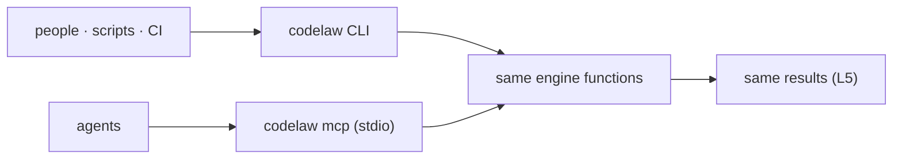

# SR-CLI-MCP — the CLI and the MCP server: one engine, two doors, same answers

## §1 — For humans

**The decision in one line.** **The CLI is for people, scripts and CI. The MCP server is for agents.** Both are the same binary calling the same engine functions ([L5](0007_LAW-5-no-model-in-the-engine.md)), and both are complete without the other.

| Need | CLI | MCP tool |
|---|---|---|
| Find problems | `codelaw check` | `check_paths`, `check_snippet` |
| Fix + format | `codelaw fix` · `codelaw format` | `fix_paths`, `format_snippet` |
| What rules apply here? | `codelaw rules --for <path>` | `rules_for_path` |
| Explain a rule | `codelaw explain <id>` | `explain_rule` |
| List rules | `codelaw rules` | `list_rules` |
| Debug | `codelaw tree` · `match --explain` · `fix --trace` | `dump_tree`, `trace_rule` |



<details>
<summary><b>ASCII twin</b></summary>

```text
   people, scripts, CI --> codelaw CLI --------+
                                               +--> same engine functions --> same results (L5)
   agents              --> codelaw mcp (stdio) +
```

</details>

---

## §2 — For agents

### Context

The decider asked for an SR stating that codelaw has both an MCP server and a CLI. The command list existed only in chat and the design doc.

### Decision

1. **Commands:**

   | Group | Commands |
   |---|---|
   | everyday | `check` · `fix` · `format` · `explain` |
   | rules | `rules [--for <path>] [--why <id>]` · `new-rule` · `rules eject` · `rules lint` · `test` |
   | debug | `tree` · `match --explain` · `fix --trace` · `graph refs` · `graph why-unused` |
   | project | `init [--agents …] [--no-install] [--registry npm|pypi]` · `sync-agents [--check]` · `config --print` · `config --schema` |
   | baseline | `baseline add` · `baseline prune` · `baseline check` · `deprecate` |
   | servers | `lsp [--stdio]` ([SR-EDITOR](0114_editor.md)) · `mcp` · `daemon start/stop/status` · `hook` |
   | maintenance | `cache stats` · `cache clean` · `bench` |

2. **Common flags:**
   - `--lang <list>`, `--rule <id>`;
   - `--changed-since <ref>`, `--staged`, `--as-of <date>`;
   - `--format text|json|sarif|agent`;
   - `--unsafe` (apply `suggest` fixes), `--dry-run`;
   - `--no-adapters` on `check` and `fix`: don't run the installed external linters those two commands run otherwise ([SR-LINTER](0106_linter.md) decision 2);
   - `--threads N`, `--no-cache`, `--timings`, `--max-warnings N`, `--prefer-warm` (use a running `lsp`/`mcp`/`daemon` of the same version; [SR-ARCHITECTURE](0108_architecture.md) decision 21).
3. **Exit codes:** `0` no errors · `1` errors remain · `2` config, rule or usage error.
   - **`format [paths] [--check] [--diff]`:** `0` every file is formatted, or was just formatted. `1` with `--check` or `--diff` when a file is not formatted, or when any file could not be formatted or written (`format/failed`, `codelaw/write-failed`). `2` as above. `--check` prints `would format <file>` per file; `--diff` prints a unified diff; neither writes.
4. **Output formats:**
   - `text`: grouped, coloured on a TTY, plain otherwise.
   - `json`: one versioned object (`schema_version`, `codelaw_version`, `summary`, `diagnostics[]` with rule, severity, file, range, message, fix class and edits or steps, `skipped[]` for files not checked and why, and `warnings[]`). A diagnostic's range carries line, column and byte offset; an edit's range is byte offsets. `fix` adds `fixed[]`: each changed file, the fixes applied per rule, and whether it was written. Text output prints a file as `fixed` only once the disk holds the fixed text (`not written` otherwise, `would fix` with `--dry-run`), and the summary counts only those.
   - `sarif`: SARIF 2.1.0 for code scanning.
   - `agent`: compact, token-budgeted lines for hooks.

   Every format carries the [L4](0006_LAW-4-every-rule-has-a-fix.md) fix fields.

   `rules [--for <path>] [--why <id>]`, `explain` and `tree` take `--format text|json` too. Their JSON objects carry `schema_version` and `codelaw_version` like `check`'s: `rules` gives `for` and `rules[]` (id, severity, fix, title, source, preview); `rules --why` gives the rule's source, path, shadows, `enabled_by`, default and, with `--for`, `for` (file, `set_by[]`, `applies`, effective severity, and the rule's `diagnostics[]` in that file); `explain` gives summary, why, languages, severity, `fix` (class, reason, skill, steps), `ported_from`, source, path and the Do/Don't `examples[]`; `tree` gives `language`, `line` and nested `nodes[]` (kind, field, range, `text` on leaves, `error`/`missing` flags, children).
5. **The MCP server.**
   - `codelaw mcp` speaks MCP over **stdio only**: offline, local, nothing listening on a port ([L5](0007_LAW-5-no-model-in-the-engine.md) decision 3).
   - **Tools:** `rules_for_path`, `explain_rule`, `list_rules`, `check_snippet`, `check_paths`, `fix_paths` (applies `auto`; returns `suggest` fixes as diffs to accept), `format_snippet`, `dump_tree`, `trace_rule`.
   - Results use the same JSON shapes as `--format json`.
   - **No adapters:** MCP never runs the external linters ([SR-ARCHITECTURE](0108_architecture.md) decision 19), so an agent sees their findings in CI only; the twins below carry `--no-adapters`.
   - **Protocol:** JSON-RPC 2.0, one message per line on stdin and stdout; `initialize` (revisions `2025-06-18`, `2025-03-26`, `2024-11-05`; the client's when it is one of these), `ping`, `tools/list`, `tools/call`, and empty `resources/list` / `prompts/list`. A hand-written loop in `codelaw-mcp`, no SDK: it adds no dependency beyond `serde_json` ([L2](0004_LAW-2-foss-dependencies.md)). Stdout carries protocol messages only.
   - **Each tool and its CLI twin** — the tool result's text is the twin's stdout without its final newline, and its `structuredContent` is the same object; a tool error (`isError`) is the twin's message after `error: `:

     | tool | CLI twin |
     |---|---|
     | `rules_for_path {path}` | `rules --for <path> --format json` |
     | `explain_rule {id}` | `explain <id> --format json` |
     | `list_rules {}` | `rules --format json` |
     | `check_snippet {path, code}` | `check <path> --format json` on a file holding `code` |
     | `check_paths {paths, rule, lang}` | `check [paths] [--rule] [--lang] --no-adapters --format json` |
     | `fix_paths {paths, unsafe, dry_run, rule, lang}` | `fix … --no-adapters --format json` |
     | `format_snippet {path, code}` | the bytes `fix <path>` writes, format step included, without writing them ([SR-FORMATTER](0105_formatter.md) decision 4) |
     | `dump_tree {path \| code+lang, line}` | `tree … --format json` |
     | `trace_rule {id, path}` | `rules --why <id> --for <path> --format json`; `match --explain`'s matcher-level trace (W-16) is to return through it |

   - The server loads the project per call, so an edited config or rule is seen on the next call; the warm, cached rule set is [SR-ARCHITECTURE](0108_architecture.md) decision 21's (W-15).
6. **Parity ([L5](0007_LAW-5-no-model-in-the-engine.md)).** A test runs every fixture through the CLI and through MCP and requires identical diagnostics and fixed bytes: `crates/codelaw-cli/tests/mcp_parity.rs` runs each `fixtures/l3` language alone and all together through every tool of decision 5 and its twin, byte for byte, and compares the files `fix` and `fix_paths` write. No logic lives in either surface; both are thin adapters over `codelaw-engine` ([SR-PACKAGES](0107_packages.md)).
7. **Agent-friendly by design.**
   - Every MCP tool's description says when to call it.
   - `rules_for_path` returns rule cards under about 60 tokens each, with detail on demand ([SR-AGENT-SURFACES](0102_agent-surfaces.md) decision 3).
   - Errors name the fix ("unknown rule `js/expots-at-end`; did you mean `js/exports-at-end`?").
8. **Speed ([L8](0010_LAW-8-performance-budgets.md)).** `startup`, `mcp_rules_for_path` and `check_*` are budgeted operations. The MCP server stays warm for the session ([SR-ARCHITECTURE](0108_architecture.md) decision 21).
9. **Stable interfaces.** Command names, flags, exit codes, JSON fields and MCP tool names are public API. Removing or renaming one needs a deprecation cycle of one minor release.

### Consequences

- **Two front doors to keep in sync,** made cheap by keeping both thin and testing parity.
- **Stdio-only MCP** means remote agents need a local process. Deliberate ([L5](0007_LAW-5-no-model-in-the-engine.md)).

### Alternatives considered

- **MCP only, no CLI:** rejected. CI, pre-commit and people need a CLI, and codelaw must work with no agent ([L5](0007_LAW-5-no-model-in-the-engine.md) decision 4).
- **CLI only, agents shell out:** rejected. No discovery, no typed tools, no warm process.
- **MCP over HTTP:** rejected for now. It opens a port and needs network handling ([L5](0007_LAW-5-no-model-in-the-engine.md) decision 3).

### Reference (required)

- [Model Context Protocol](https://modelcontextprotocol.io/): the server protocol.
- [SARIF 2.1.0](https://docs.oasis-open.org/sarif/sarif/v2.1.0/sarif-v2.1.0.html): the code-scanning format.
- [SR-AGENT-SURFACES](0102_agent-surfaces.md): how agents are pointed at the MCP server.

### Veto condition

**Reopen this decision if:** the CLI and MCP give different results for the same input, or either surface contains engine logic.

**How to check it:** the CLI/MCP parity test over every fixture, `cargo test -p codelaw-cli --test mcp_parity`.

---

## References

*Every source this record cites, gathered in one place. An archived document is never listed here.*

**Records** — [SR-AGENT-SURFACES](0102_agent-surfaces.md) · [SR-PACKAGES](0107_packages.md) · [SR-ARCHITECTURE](0108_architecture.md) · [SR-RULE-PACKS](0101_rule-packs.md)

**Project docs** — [`docs/DESIGN.md`](../docs/DESIGN.md)
