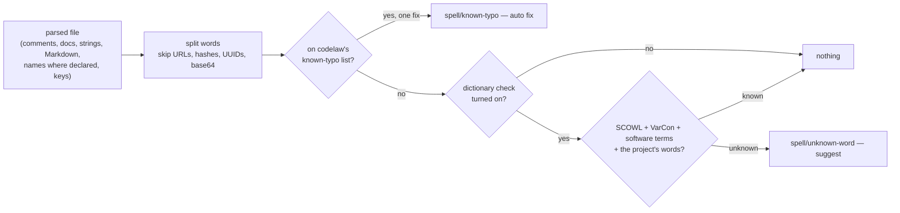

# SR-SPELL — spelling as its own rule pack

## §1 — For humans

codelaw checks spelling the way CSpell does — in comments, docs, strings and
names, split at `camelCase` and `snake_case` — but as a **separate rule pack**,
`spell`, that a team installs on purpose. It does not wrap CSpell: it is
codelaw's own code in the engine, and its words are codelaw's own data in the
pack, built only from sources the decider ratified by name.

Two tiers. **The known-typo check is on once the pack is installed**: it flags
only words on codelaw's own list of known misspellings (`recieve` →
`receive`), so it is almost never wrong and fixes itself. **The dictionary
check is opt-in**: it flags any word no dictionary knows and only suggests,
because unknown words in code are often real names.



<details>
<summary><b>ASCII twin</b></summary>

```text
   parsed file --> split words --> on the known-typo list? --yes--> spell/known-typo (auto)
                                          | no
                                          v
                                  dictionary check on? --no--> nothing
                                          | yes
                                          v
                                  in SCOWL / VarCon / software terms / project words?
                                          | known --> nothing
                                          | unknown --> spell/unknown-word (suggest)
```

</details>

---

## §2 — For agents

### Context

The decider asked (2026-10-27) whether CSpell could be built into codelaw, or
something better. CSpell (MIT, Node) cannot be wrapped: it is a Node package
with a tree of dictionary packages (L11), some of them GPL/LGPL (L2), and it
has no unattended fix (L4). `typos` (Rust) fixes known typos with very few
false positives, but its list traces to Wikipedia's share-alike list, a
question its maintainers left open. The forks and the rulings are in
[the compare doc](../work/compare/spell-checking.compare.md).

### Decision

1. **A first-party pack, `spell`,** namespace `spell`, published on both
   registries: `@codelaw/rules-spell` on npm and `codelaw-rules-spell` on PyPI
   (the decider: *"want it as a separate package"*). Its matchers are `native:`
   rules in the engine ([SR-ARCHITECTURE](0108_architecture.md) decision 15b);
   its word data is in the pack (decision 6). `codelaw init` never adds it,
   as it never adds a security pack: a team chooses it
   ([SR-RULE-PACKS](0101_rule-packs.md) decision 6).
2. **Presets.** `spell/recommended` turns on `spell/known-typo` and
   `spell/known-typo-identifier` — on as soon as a project extends it.
   `spell/strict` extends it and adds `spell/unknown-word`,
   `spell/inconsistent-term` and `spell/suspicious-word`. `spell/locale-variant`
   is in neither: it runs only when `[spell] locale` is set (decision 7).
3. **What text is read** — from the tree the engine already parsed, never by
   regex over the file: comments and docstrings; string literals that are prose
   (no interpolation, not a key, a selector, a path or a format string);
   Markdown text outside code; HTML text and the `alt`, `title`,
   `aria-label` and `placeholder` attributes; JSON, YAML and TOML keys and
   string values; identifiers and CSS class names **where they are declared**,
   never at each use. Each language's selection is a query file the engine
   ships beside its grammars, starting from the grammars' `@spell` captures.
4. **Words.** An identifier splits at case changes (`HTTPServer` → `HTTP`,
   `Server`), `_`, `-`, `.` and digits. A token is skipped when it is a URL,
   an email address, a hex or CSS colour, a UUID, base64, a commit hash, an
   SPDX id, a semver, a file path, or shorter than four letters. Words compare
   after NFC and a simple case fold.
5. **The rules and their fixes** ([L4](0006_LAW-4-every-rule-has-a-fix.md)):

   | rule | reports | fix |
   |---|---|---|
   | `spell/known-typo` | a word on the known-typo list, in prose (decision 3, all but identifiers) | `auto` when the list gives one correction; `suggest` when it gives several |
   | `spell/known-typo-identifier` | the same, in a declared name | `auto` only when every reference is in the same file and the name is not exported; otherwise `suggest`, naming the other files; `manual` for an exported name, a JSON key or a CSS class used elsewhere |
   | `spell/unknown-word` | a word in no word list (decision 6) and not in `[spell] words` | `suggest`: up to three corrections; `manual`: add it to `[spell] words` |
   | `spell/locale-variant` | a spelling of the other locale (`colour` under `en-US`) | `auto` in prose; `suggest` in a name; meaning-dependent pairs (`program`/`programme`, `check`/`cheque`) are never reported |
   | `spell/inconsistent-term` | one word spelled two ways across the project (`canceled` / `cancelled`) | `suggest` the form the project uses most |
   | `spell/suspicious-word` | a `[spell] words` entry that is on the known-typo list, or one edit from a common word | `manual` |

   Each `manual` fix is carried by a skill, as L4 requires.
6. **The word data is codelaw's own, built from ratified sources only**
   ([L11](0013_LAW-11-dependencies.md) §3: D-42 SCOWL, D-43 VarCon, D-44
   software terms), and lives in the pack's `data/spell/`, not in the engine
   (the decider: *"Go with the recommendation"*):
   - **The dictionary** is SCOWL's English word lists (US and British), with
     every inflected form written out, plus the software-terms list.
   - **The locale table** is VarCon's US↔British pairs, one-to-one pairs only.
   - **The known-typo list is generated, not copied** (the decider: *"Let's go
     with B"*): `scripts/spell-data.py` (Python standard library) derives it
     from SCOWL — single-edit variants (a swap, a dropped or doubled letter, a
     neighbouring key) of common words that are not words themselves and have
     exactly one source word — and writes it with the dictionary. The output
     is committed; the same input writes the same bytes. Entries added by
     hand sit in a separate file the script merges.
   - **Never used:** `typos`' word list, codespell's lists and Wikipedia's
     *Lists of common misspellings* (share-alike), and any GPL, LGPL or MPL
     dictionary.
   - The pack's `NOTICE` names each source, its version and its copyright
     notice.
7. **Config — the `[spell]` section** of the root config
   ([SR-CONFIG](0110_config.md) decision 2): `locale` (`en-US`, `en-GB`, or
   unset), `words` (accepted words, checked by `spell/suspicious-word`). The
   rules receive it as their options (SR-ARCHITECTURE decision 15b). A line is
   excused with the existing `codelaw-ignore spell/<rule>: <reason>`; CSpell's
   `cspell:` comments are not read.
8. **Deterministic** ([L5](0007_LAW-5-no-model-in-the-engine.md)): no model,
   no network, no clock. Suggestions rank by edit cost (Damerau-Levenshtein,
   at most two edits), then the word's SCOWL frequency class, then alphabetical
   order; every list in the output is sorted.
9. **Budget** ([L8](0010_LAW-8-performance-budgets.md)): the spell pass reads
   the tree already parsed and caches one verdict per distinct word per run.
   Its budget — the time it adds to `codelaw check` on the pinned corpus, and
   the bytes the data adds to each pack — is set from measurement in W-103 and
   then never loosened.
10. **English only.** Another language needs a word list under a permissive
    licence and its own ratified row.

### Consequences

- A team gets typo fixes that are safe to run unattended, and a strict
  dictionary check only when it asks for one.
- The pack makes eighteen first-party packs, sixteen on npm and eleven on
  PyPI: [L6](0008_LAW-6-python-and-node-packages.md),
  [SR-RULE-PACKS](0101_rule-packs.md) §1 and decision 4's namespace map, and
  [SR-PACKAGES](0107_packages.md) change in W-103's change, on the decider's
  ruling quoted in `ratifies:`.
- The generated typo list starts smaller than `typos`' list, so it catches
  fewer typos at first; hand-added entries grow it.
- Data tables are `data/**/*.json` (SR-RULE-PACKS decision 3). If the measured
  size of the word data in JSON is too large, a compact format amends that
  decision — the decider's call, in W-103.
- Debt: `cspell.json` migration and non-English word lists are in
  [`BACKLOG.md`](../work/BACKLOG.md) (B-054, B-055).

### Alternatives considered

- **Wrap or ship CSpell** — rejected: an npm dependency tree (L11), mixed
  dictionary licences (L2), no unattended fix (L4).
- **`typos`' word list, ratified by name** — rejected by the decider in favour
  of a list codelaw builds itself: its provenance runs back to a share-alike
  list and the question is open upstream.
- **A Hunspell-compatible engine (`spellbook`, `zspell`, hunspell)** —
  rejected: MPL or GPL/LGPL code, and affix rules are not needed when every
  form is written out at build time.
- **The dictionary check on by default** — rejected: too many unknown words in
  code are real names.
- **Spelling in the engine, not a pack** — rejected by the decider: a separate
  package, so only repos that want it carry the words.

### Reference (required)

- [`work/compare/spell-checking.compare.md`](../work/compare/spell-checking.compare.md) — the forks, the research and the rulings.
- [`work/open/W-103-spell-pack.md`](../work/open/W-103-spell-pack.md) — the build.
- [L11 §3](0013_LAW-11-dependencies.md#3--the-list) — D-42, D-43, D-44.

### Veto condition

**Reopen this decision if:** the spell pack carries word data from a source
with no ratified row in L11 §3, or from `typos`, codespell or Wikipedia.

**How to check it:** `grep -rIl -i -e 'codespell' -e 'typos-dict' -e 'wikipedia' packs/spell 2>/dev/null` must print nothing, and every source in `packs/spell/NOTICE` is D-42, D-43 or D-44.

---

## References

*Every source this record cites, gathered in one place. An archived document is never listed here.*

**Records** — [SR-LAW-2](0004_LAW-2-foss-dependencies.md) · [SR-LAW-4](0006_LAW-4-every-rule-has-a-fix.md) · [SR-LAW-5](0007_LAW-5-no-model-in-the-engine.md) · [SR-LAW-6](0008_LAW-6-python-and-node-packages.md) · [SR-LAW-8](0010_LAW-8-performance-budgets.md) · [SR-LAW-11](0013_LAW-11-dependencies.md) · [SR-RULE-PACKS](0101_rule-packs.md) · [SR-PACKAGES](0107_packages.md) · [SR-ARCHITECTURE](0108_architecture.md) · [SR-CONFIG](0110_config.md)

**Project docs**

- [`work/compare/spell-checking.compare.md`](../work/compare/spell-checking.compare.md) · [`work/open/W-103-spell-pack.md`](../work/open/W-103-spell-pack.md) · [`work/BACKLOG.md`](../work/BACKLOG.md)

**External**

- [CSpell configuration](https://cspell.org/docs/Configuration) · [cspell-dicts (per-package licences)](https://github.com/streetsidesoftware/cspell-dicts) · [`@cspell/dict-software-terms`](https://www.npmjs.com/package/@cspell/dict-software-terms)
- [typos — comparison](https://github.com/crate-ci/typos/blob/master/docs/comparison.md) · [typos #44 — the word list's licence](https://github.com/crate-ci/typos/issues/44)
- [Neovim treesitter `@spell` captures](https://neovim.io/doc/user/treesitter/)
