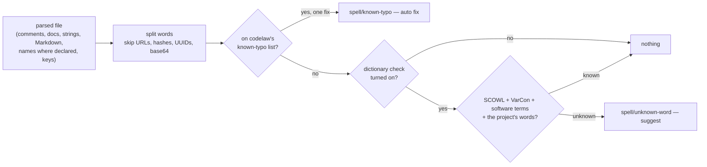

# SR-SPELL — spelling as its own rule pack

## §1 — For humans

codelaw checks spelling the way CSpell does — in comments, docs, strings and
names, split at `camelCase` and `snake_case` — but as a **separate rule pack**,
`spell`, that a team installs on purpose. It does not wrap CSpell: it is
codelaw's own code in the engine, and its words are codelaw's own data in the
pack, built only from sources the decider ratified by name.

Two tiers. **The known-typo check is on once the pack is installed**: it flags
only words on codelaw's own list of known misspellings (`recieve` →
`receive`), so it is almost never wrong and fixes itself. **The dictionary
check is opt-in**: it flags any word no dictionary knows and only suggests,
because unknown words in code are often real names.



<details>
<summary><b>ASCII twin</b></summary>

```text
   parsed file --> split words --> on the known-typo list? --yes--> spell/known-typo (auto)
                                          | no
                                          v
                                  dictionary check on? --no--> nothing
                                          | yes
                                          v
                                  in SCOWL / VarCon / software terms / project words?
                                          | known --> nothing
                                          | unknown --> spell/unknown-word (suggest)
```

</details>

---

## §2 — For agents

### Context

The decider asked (2026-10-27) whether CSpell could be built into codelaw, or
something better. CSpell (MIT, Node) cannot be wrapped: it is a Node package
with a tree of dictionary packages (L11), some of them GPL/LGPL (L2), and it
has no unattended fix (L4). `typos` (Rust) fixes known typos with very few
false positives, but its list traces to Wikipedia's share-alike list, a
question its maintainers left open. The forks and the rulings are in
[the compare doc](../work/compare/spell-checking.compare.md).

### Decision

1. **A first-party pack, `spell`,** namespace `spell`, published on both
   registries: `@codelaw/rules-spell` on npm and `codelaw-rules-spell` on PyPI
   (the decider: *"want it as a separate package"*). Its matchers are `native:`
   rules in the engine ([SR-ARCHITECTURE](0108_architecture.md) decision 15b);
   its word data is in the pack (decision 6). `codelaw init` never adds it,
   as it never adds a security pack: a team chooses it
   ([SR-RULE-PACKS](0101_rule-packs.md) decision 6).
2. **Presets.** `spell/recommended` turns on `spell/known-typo` and
   `spell/known-typo-identifier` — on as soon as a project extends it.
   `spell/strict` extends it and adds `spell/unknown-word`,
   `spell/inconsistent-term` and `spell/suspicious-word`. `spell/locale-variant`
   is in neither: it runs only when `[spell] locale` is set (decision 7).
3. **What text is read** — from the tree the engine already parsed, never by
   regex over the file: comments and docstrings; string literals that are prose
   (no interpolation, not a key, a selector, a path or a format string);
   Markdown text outside code; HTML text and the `alt`, `title`,
   `aria-label` and `placeholder` attributes; JSON, YAML and TOML keys and
   string values; identifiers and CSS class names **where they are declared**,
   never at each use. Each language's selection is a query file the engine
   ships beside its grammars, starting from the grammars' `@spell` captures.
   - **As built (W-103, 2026-10-27):** the selection is a table per language
     in `crates/codelaw-native/src/spell.rs` — node kinds and the parent
     each must have (a JSON string that is a pair's key is a name; a YAML
     scalar under a mapping key is a name; a JS template or Python f-string
     with a substitution is not read) — not query files: the engine hands a
     native rule its nodes by kind (SR-ARCHITECTURE decision 15), and no
     grammar the workspace pins ships `@spell` captures. A string is prose
     only when it holds whitespace. Markdown is the block tree's `inline`
     text with code spans, link targets, autolinks and inline HTML blanked;
     CSS and SCSS give only their comments.
4. **Words.** An identifier splits at case changes (`HTTPServer` → `HTTP`,
   `Server`), `_`, `-`, `.` and digits. A token is skipped when it is a URL,
   an email address, a hex or CSS colour, a UUID, base64, a commit hash, an
   SPDX id, a semver, a file path, or shorter than four letters. Words compare
   after NFC and a simple case fold.
   - **As built for prose (W-103):** a whitespace-separated token is skipped
     when it holds `://`, starts with `www.`, `#`, `@` or `$`, holds a path,
     code or markup character inside it (a slash or backslash, `_`, `=`,
     braces, angle or square brackets, parentheses, a backtick, `#`, `|`, `~`,
     `^`, `*`, `:`, `;` or `,`), a call (`name(`), a dotted name (`a.b`),
     letters and digits together (hashes, UUIDs, base64, ids, versions), or a lower-case letter
     followed by an upper-case one: an identifier written in prose is the
     identifier rule's, where it is declared, not the prose rule's to rename.
     The list is ASCII, so a word with another letter is not looked up; a
     word is fixed in its own case (lower, Capitalised, UPPER), and a word in
     mixed case is reported with no edit.
   - **As built after the corpus review (W-103, 2026-10-28):** template tags
     (``, `{{ … }}`, `{# … #}`) are blanked before words are taken;
     a prose text of three words or more of which fewer than half are
     dictionary words or known typos is not English (decision 10) and is
     not read by `spell/known-typo`, `spell/unknown-word` or
     `spell/locale-variant` — lorem ipsum and translated READMEs gave most
     of the first run's findings. `spell/known-typo-key` skips lockfiles and
     the keys of dependency sections (package names); a name holding `$` is
     a compiler's and is not reported.
5. **The rules and their fixes** ([L4](0006_LAW-4-every-rule-has-a-fix.md)):

   | rule | reports | fix |
   |---|---|---|
   | `spell/known-typo` | a word on the known-typo list, in prose (decision 3, all but identifiers) | `auto` when the list gives one correction; `suggest` when it gives several |
   | `spell/known-typo-identifier` | the same, in a declared name | `auto` only when every reference is in the same file and the name is not exported; otherwise `suggest`, naming the other files; `manual` for an exported name, a JSON key or a CSS class used elsewhere |
   | `spell/unknown-word` | a word in no word list (decision 6) and not in `[spell] words` | `suggest`: up to three corrections; `manual`: add it to `[spell] words` |
   | `spell/locale-variant` | a spelling of the other locale (`colour` under `en-US`) | `auto` in prose; `suggest` in a name; meaning-dependent pairs (`program`/`programme`, `check`/`cheque`) are never reported |
   | `spell/inconsistent-term` | one word spelled two ways across the project (`canceled` / `cancelled`) | `suggest` the form the project uses most |
   | `spell/suspicious-word` | a `[spell] words` entry that is on the known-typo list, or one edit from a common word | `manual` |

   Each `manual` fix is carried by a skill, as L4 requires.
   - **As built (W-103, 2026-10-28):** a rule declares one fix class and
     an `auto` rule's every `Don't` example must fix to its `Do` (L4
     decision 7, SR-RULE-FORMAT decision 5), so the names are two rules.
     `spell/known-typo-identifier` (`auto`) covers JavaScript, JSX,
     TypeScript, TSX and Python, where the semantic model resolves every
     use: it renames the declaration and every use only when the name is
     not exported, not a module-level name of a script or a Python module,
     not a Python parameter (keyword arguments), not a class attribute or
     member, not a shorthand property, the new name is free and not a
     keyword, and every identifier and string in the file that spells the
     name is one of those uses; any other finding carries no edit and is
     reported `manual` with the rule's steps. There is no `suggest` tier
     naming the other files: that needs the project graph. Imports are not
     reported. `spell/known-typo-key` (`manual`, with `## How to fix`
     served by `codelaw-fix`, L4 decision 10) covers what other files read:
     JSON, YAML and TOML keys; CSS and SCSS classes, ids, custom
     properties, `$variables`, mixins and functions; HTML `id`s — once per
     distinct name per file. Markdown declares no names. Both are in
     `spell/recommended`.
   - **As built (W-103, 2026-10-28), the dictionary rules:**
     `spell/unknown-word` reads the prose `spell/known-typo` reads (not
     names), skips a word in capitals (an acronym) and a word on the
     known-typo list, and suggests the nearest dictionary word with the same
     first letter as its edit — one edit per finding, so the message names
     up to three and the edit takes the first. `spell/locale-variant` reads
     the same prose, only while `[spell] locale` is set, and fixes in
     place; names are not read, so it has no `suggest` tier.
     `spell/suspicious-word` reports an entry that is a known typo, or no
     dictionary word but one edit from a word of size class 20 or below.
     `spell/inconsistent-term` is not built: it needs every file's words at
     once, a `scope: project` rule the graph stage would have to carry.
6. **The word data is codelaw's own, built from ratified sources only**
   ([L11](0013_LAW-11-dependencies.md) §3: D-42 SCOWL, D-43 VarCon, D-44
   software terms), and lives in the pack's `data/spell/`, not in the engine
   (the decider: *"Go with the recommendation"*):
   - **The dictionary** is SCOWL's English word lists (US and British), with
     every inflected form written out, plus the software-terms list.
   - **The locale table** is VarCon's US↔British pairs, one-to-one pairs only.
   - **The known-typo list is generated, not copied** (the decider: *"Let's go
     with B"*): `scripts/spell-data.py` (Python standard library) derives it
     from SCOWL — single-edit variants (a swap, a dropped or doubled letter, a
     neighbouring key) of common words that are not words themselves and have
     exactly one source word — and writes it with the dictionary. The output
     is committed; the same input writes the same bytes. Entries added by
     hand sit in a separate file the script merges.
   - **As built (W-103, 2026-10-27):** the source words are SCOWL's
     English, American and British word lists of size 20 and below, four
     letters or more; the variants are two neighbouring letters swapped, a
     letter dropped, a consonant doubled, and — for the size-10 words only —
     a letter replaced by its neighbour on the same keyboard row; the first
     letter is never changed. A variant is kept when it has four letters or
     more, is in no SCOWL word list of size 80 or below, in no SCOWL name,
     abbreviation or contraction list of any size and in no software term,
     and comes from exactly one source word. SCOWL's size-95 word lists are
     left out of the "is a word" test because they hold the commonest
     misspellings (`untill`, `accomodate`, `enviroment`) among their rare
     words. Hand entries are `scripts/spell-typos.txt`: `typo fix` adds a
     typo, `!word` drops a generated variant that is no typo (eight, from
     the corpus review: `axios`, `checkin`, `hsts`, `imag`, `inlines`,
     `addopts`, `attaches`, `rects`), and a contraction's stem (`aren` of
     `aren't`) counts as a word. The
     table is `data/spell/typos.json`: one JSON object whose `entries`
     string holds `typo:fix` pairs sorted by byte, which the rule
     binary-searches in place — still JSON (SR-RULE-PACKS decision 3), with
     no per-entry value to build. The pins are L11 §3's D-42 (SCOWL
     2020.12.07) and D-44 (software terms 5.4.8); VarCon (D-43) is read for
     the locale table (below).
   - **As built, the dictionary and the locale table (W-103, 2026-10-28):**
     `data/spell/words.json` holds SCOWL's English, American, British and
     British `-ize` lists — words, names, upper-case words, abbreviations
     and contractions — of size 60 and below (aspell's default `en`),
     lower-cased, ASCII letters only, a contraction cut at its apostrophe
     (`doesn't` → `doesn`, as the checker splits it), plus the letters of
     every software term; each word keeps its smallest size class, and a
     software term no SCOWL list holds gets class 100. It is one string of
     words per class, sorted by byte and searched in place: **92,758
     words**. `data/spell/locale.json` holds two tables of VarCon's
     one-to-one pairs (a line with one plain `A` and one plain `B`
     spelling): `en-US` maps a British spelling to the American one, kept
     when the British spelling is in no American or English SCOWL word
     list of size 80 or below and the American one in no British or
     English one; `en-GB` the other way, where the British `-ize` lists
     count as British, so `organize` is never reported: **12,587 and
     7,171 pairs**.
   - **Never used:** `typos`' word list, codespell's lists and Wikipedia's
     *Lists of common misspellings* (share-alike), and any GPL, LGPL or MPL
     dictionary.
   - The pack's `NOTICE` names each source, its version and its copyright
     notice.
7. **Config — the `[spell]` section** of the root config
   ([SR-CONFIG](0110_config.md) decision 2): `[spell] locale` (`en-US`,
   `en-GB`, or unset), `[spell] words` (accepted words, checked by
   `spell/suspicious-word`). The
   rules receive it as their options (SR-ARCHITECTURE decision 15b). A line is
   excused with the existing `codelaw-ignore spell/<rule>: <reason>`; CSpell's
   `cspell:` comments are not read.
   - **As built (W-103, 2026-10-28):** the loader refuses a `[spell] locale`
     other than the two and a `[spell] words` entry that is empty or holds
     whitespace; `[spell]` is root-only. Words compare case-insensitively
     and excuse every `spell/*` rule but `spell/suspicious-word`, which
     reads them where they are written: string entries of `[spell] words`
     (or a dotted `spell.words`) in the root `codelaw.toml`.
8. **Deterministic** ([L5](0007_LAW-5-no-model-in-the-engine.md)): no model,
   no network, no clock. Suggestions rank by edit cost (Damerau-Levenshtein,
   at most two edits), then the word's SCOWL frequency class, then alphabetical
   order; every list in the output is sorted.
9. **Budget** ([L8](0010_LAW-8-performance-budgets.md)): the spell pass reads
   the tree already parsed and caches one verdict per distinct word per run.
   Its budget — the time it adds to `codelaw check` on the pinned corpus, and
   the bytes the data adds to each pack — is set from measurement in W-103 and
   then never loosened.
   - **Measured (W-103, 2026-10-27; not yet a budget):** the generated list
     holds **188,151 entries**, 3,531,613 bytes of JSON; the whole pack is a
     625,127-byte npm tarball and a 636,231-byte wheel. Loading it adds about
     **9 ms** to a one-file `codelaw check` (median of 15, release build,
     28.8 → 37.8 ms, on a machine at load 21: read, parse and hash of the
     table). On 1,108 files of this repository's docs and scripts,
     `spell/known-typo` took 3.5% of the rules phase (2.5 s of 71.7 s summed
     over ten threads, same load). The budget waits for three CI `perf` runs
     on `main` with the pack on, put to the decider by L8's method (W-103
     step 6).
   - **The pinned corpus (W-103, 2026-10-28):** `spell` runs on eleven of
     the fourteen repositories (2,500 files). The first run found 1,010
     `spell/recommended` findings, almost all false: lorem ipsum (`elit`,
     `quis`), translated READMEs (`votre`, `diese`), contraction stems
     (`aren`), package names in lockfiles (`axios`, `unist`) and terms of
     the trade (`inlines`, `hsts`). After the changes in decisions 4 and 6
     *as built* the snapshot (`packs/spell/corpus.toml`) holds **125
     `spell/known-typo`, 3 `spell/known-typo-identifier` and 1
     `spell/known-typo-key`**, and 8,948 `spell/unknown-word` (opt-in:
     project names, jargon, the ipsum that is half English). Real typos
     among them: `ancesors`, `ammended`, `overide`, `defaut`, `prefered`,
     `demonstation`, `restriced`, `overlow`; most of the rest are short
     foreign or ipsum texts the English test cannot judge. Every rule stays
     `preview`. The comparison with `typos`' count (the reopen trigger) is
     not made: `typos` is not installed here and is not added (L11).
     **Its time** (release build, ten threads, a copy of the eleven
     repositories, three runs each, on a machine at load 9 to 15, so the
     spread is wide): `spell/recommended` costs 6.2 to 10.3 s of rule time
     summed over threads (`known-typo` about 63%, `known-typo-key` 24%,
     `known-typo-identifier` 12%) and 3.3 to 6.0 s wall, against 1.0 s for
     the same tree with no rules; `spell/strict` adds `unknown-word`, 5.7
     to 9.7 s summed. These are not a budget: three CI `perf` runs are
     (W-103 step 7).
   - **Measured with the dictionary (W-103, 2026-10-28; not yet a
     budget):** `words.json` is 868,386 bytes and `locale.json` 489,307
     (285,570 and 114,680 gzipped); the pack is now a 1,028,518-byte npm
     tarball and a 1,041,014-byte wheel. A one-file `codelaw check` with
     the pack on (release build, median of 45, load 7–9) takes 4.5 ms with
     no data, 7.2 ms with the typo list and 8.2 ms with all three tables:
     the dictionary and the locale table add about **1 ms**, so no split
     and no compact format is proposed. Suggestions are cached per thread
     for the run, keyed by the dictionary and the word.
10. **English only.** Another language needs a word list under a permissive
    licence and its own ratified row.

### Consequences

- A team gets typo fixes that are safe to run unattended, and a strict
  dictionary check only when it asks for one.
- The pack makes eighteen first-party packs, sixteen on npm and eleven on
  PyPI: [L6](0008_LAW-6-python-and-node-packages.md),
  [SR-RULE-PACKS](0101_rule-packs.md) §1 and decision 4's namespace map, and
  [SR-PACKAGES](0107_packages.md) change in W-103's change, on the decider's
  ruling quoted in `ratifies:`.
- The generated typo list starts smaller than `typos`' list, so it catches
  fewer typos at first; hand-added entries grow it.
- Data tables are `data/**/*.json` (SR-RULE-PACKS decision 3). If the measured
  size of the word data in JSON is too large, a compact format amends that
  decision — the decider's call, in W-103.
- Debt: `cspell.json` migration and non-English word lists are in
  [`BACKLOG.md`](../work/BACKLOG.md) (B-054, B-055).

### Alternatives considered

- **Wrap or ship CSpell** — rejected: an npm dependency tree (L11), mixed
  dictionary licences (L2), no unattended fix (L4).
- **`typos`' word list, ratified by name** — rejected by the decider in favour
  of a list codelaw builds itself: its provenance runs back to a share-alike
  list and the question is open upstream.
- **A Hunspell-compatible engine (`spellbook`, `zspell`, hunspell)** —
  rejected: MPL or GPL/LGPL code, and affix rules are not needed when every
  form is written out at build time.
- **The dictionary check on by default** — rejected: too many unknown words in
  code are real names.
- **Spelling in the engine, not a pack** — rejected by the decider: a separate
  package, so only repos that want it carry the words.

### Reference (required)

- [`work/compare/spell-checking.compare.md`](../work/compare/spell-checking.compare.md) — the forks, the research and the rulings.
- [`work/open/W-103-spell-pack.md`](../work/open/W-103-spell-pack.md) — the build.
- [L11 §3](0013_LAW-11-dependencies.md#3--the-list) — D-42, D-43, D-44.

### Veto condition

**Reopen this decision if:** the spell pack carries word data from a source
with no ratified row in L11 §3, or from `typos`, codespell or Wikipedia.

**How to check it:** `grep -rIl -i -e 'codespell' -e 'typos-dict' -e 'wikipedia' --exclude=words.json packs/spell 2>/dev/null` must print nothing (the dictionary, `data/spell/words.json`, holds the English word *wikipedia*, so it is left out of the grep), every source in `packs/spell/NOTICE` is D-42, D-43 or D-44, and `python3 scripts/spell-data.py check` passes: the committed data is what the pinned sources write.

---

## References

*Every source this record cites, gathered in one place. An archived document is never listed here.*

**Records** — [SR-LAW-2](0004_LAW-2-foss-dependencies.md) · [SR-LAW-4](0006_LAW-4-every-rule-has-a-fix.md) · [SR-LAW-5](0007_LAW-5-no-model-in-the-engine.md) · [SR-LAW-6](0008_LAW-6-python-and-node-packages.md) · [SR-LAW-8](0010_LAW-8-performance-budgets.md) · [SR-LAW-11](0013_LAW-11-dependencies.md) · [SR-RULE-PACKS](0101_rule-packs.md) · [SR-PACKAGES](0107_packages.md) · [SR-ARCHITECTURE](0108_architecture.md) · [SR-CONFIG](0110_config.md)

**Project docs**

- [`work/compare/spell-checking.compare.md`](../work/compare/spell-checking.compare.md) · [`work/open/W-103-spell-pack.md`](../work/open/W-103-spell-pack.md) · [`work/BACKLOG.md`](../work/BACKLOG.md)

**External**

- [CSpell configuration](https://cspell.org/docs/Configuration) · [cspell-dicts (per-package licences)](https://github.com/streetsidesoftware/cspell-dicts) · [`@cspell/dict-software-terms`](https://www.npmjs.com/package/@cspell/dict-software-terms)
- [typos — comparison](https://github.com/crate-ci/typos/blob/master/docs/comparison.md) · [typos #44 — the word list's licence](https://github.com/crate-ci/typos/issues/44)
- [Neovim treesitter `@spell` captures](https://neovim.io/doc/user/treesitter/)
