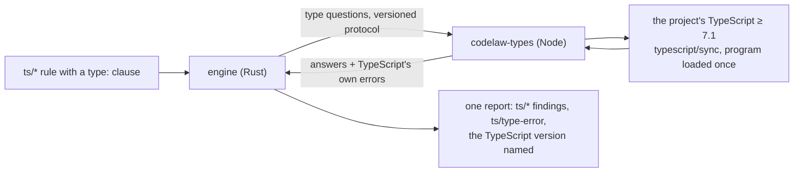

# SR-TYPES — type-aware TypeScript rules: the project's own TypeScript 7.1, asked through a Node helper, a fixed vocabulary of type questions

## §1 — For humans

**The decision in one line.** Some TypeScript checks need types — *is this a Promise nobody awaits?*, *is this value `any`?* tree-sitter has none. So codelaw ships a **small Node helper**, `codelaw-types`, that loads **the project's own TypeScript (≥ 7.1)** once and answers a **fixed set of type questions**. Rules in the existing `ts` pack ask them through a `type:` clause; TypeScript's own errors become `ts/type-error`.

**Why the project's own TypeScript.** The answer to a type question depends on the compiler that asks it. Using the copy the project already compiles with means codelaw and `tsc` agree, codelaw installs nothing, and the version is named in every report so a run can be reproduced ([L5](0007_LAW-5-no-model-in-the-engine.md)).

**What it costs.** Node at run time, for type rules only ([L6](0008_LAW-6-python-and-node-packages.md) decision 3). A project without Node or without TypeScript ≥ 7.1 loses only the type rules, with a note. Hooks never wait for a cold program ([L8](0010_LAW-8-performance-budgets.md) decision 8). The rules ship `preview` on the 7.1 release candidate and become stable only after 7.1 is GA.



<details>
<summary><b>ASCII twin</b></summary>

```text
   ts/* rule (type: clause) --> engine --questions--> codelaw-types (Node) --> project's TypeScript >= 7.1
                                  ^                                               (loaded once)
                                  +---------answers + ts/type-error ------------+
   engine --> one report (type findings, TypeScript version named)
```

</details>

---

## §2 — For agents

### Context

[L3](0005_LAW-3-languages.md) decision 9 takes type-aware TypeScript checks into the core. On 2026-10-27 TypeScript 7.0 (the Go compiler) had no API; 7.1 adds a preview API (`typescript/sync`, `typescript/async`, snapshots) that JavaScript calls — Beta 2026-10-20, RC 2026-11-10, GA 2026-11-24. No Go-library embedding exists, so a helper needs Node. oxlint's `tsgolint` covers type rules today through a private, unversioned protocol; codelaw's oxlint adapter carries it until this record is built (W-107). The research and the rulings are [the proposal](../work/proposals/type-aware-rules.md).

### Decision

1. **Scope.** Type-aware rules for TypeScript and TSX ([L3](0005_LAW-3-languages.md) decision 9), in the **`ts` pack** (`@codelaw/rules-ts`), plus `ts/type-error` (decision 9). JavaScript is not type-checked, and Python's type-aware checks stay with adapters.
2. **The helper, `codelaw-types`.** codelaw's own JavaScript, **carried inside the engine** — the same bytes in the npm and the PyPI package, never a package of its own ([L6](0008_LAW-6-python-and-node-packages.md) decision 3). codelaw starts it with Node and the project's `tsconfig.json`; it loads the program **once** through `typescript/sync` and answers questions until it is closed. It runs locally and fetches nothing ([L5](0007_LAW-5-no-model-in-the-engine.md) decision 3); every snapshot it takes is disposed, because the API leaks on the Go side otherwise. **Its source reaches Node as an argument** (settled by W-105, 2026-10-28): `node --input-type=module --eval <helper> -- <typescript folder>` — nothing is written to disk, and stdin and stdout stay free for the protocol. The source is `crates/codelaw-types/src/helper.mjs`, compiled into the binary; it imports `typescript/sync` and `typescript/ast` by the paths the package's own `exports` map names.
3. **The protocol is codelaw's,** over the helper's stdin and stdout, with a **protocol version** in its first exchange. A helper that answers another version is refused, and the type rules are skipped with a note. The protocol is internal: nothing outside codelaw speaks it.
   - **Protocol 1** (W-105, 2026-10-28): one JSON object per line each way, answered in order. `hello` (`protocol`, `cwd`) → the protocol and the TypeScript version; `check` (`file`, `text`, `questions` of `{start, end, q}`, `diagnostics`) → one answer per question (`true`, `false`, or `null` when no node spans it) and, when asked, TypeScript's diagnostics; `changed` (`files`, `created`, `deleted`) and `refresh` → a warm program re-reads what changed on disk; `close`. Offsets on the wire are UTF-8 bytes into `text`; the helper converts them to TypeScript's UTF-16. The engine's `text` wins over the file on disk (an editor's buffer, a rule's example): the helper reads it from a filesystem layer in a snapshot of its own, disposed after the answer.
4. **The type-question vocabulary is fixed.** A rule asks only these, about one captured node ([SR-RULE-FORMAT](0112_rule-format.md) decision 3f):

   | question | holds when the node's type … |
   |---|---|
   | `promise-like` | is a `Promise` or a type with the same shape |
   | `thenable` | has a callable `then` |
   | `any` | is `any` |
   | `nullable` | includes `null` or `undefined` |
   | `union` | is a union — its members are what an exhaustive check must cover |
   | `deprecated` | names a declaration tagged `@deprecated` |
   | `never` | is `never` |

   The table's names are the contract; W-105 settles each question's exact options here when it builds them. A new question is an amendment of this record, never a rule's own code.
   - **As built (W-105, 2026-10-28), no question takes options.** The node asked about is the deepest TypeScript node spanning exactly the capture, else the smallest one containing it, and its type is the checker's `getTypeAtLocation`. `thenable`: some member of the node's apparent type has a `then` property with a call signature. `promise-like`: `thenable`, where that signature's first parameter is itself callable (the `onfulfilled` callback a `Promise` takes — typescript-eslint's `isThenableType`). `nullable`: some union member is `null`, `undefined` or `void`. `union`: the type is a union. `deprecated`: the node's symbol (through an alias) carries a `@deprecated` JSDoc tag. `any` and `never`: the type's flag. A question no node answers does not hold, even under `not`.
5. **Finding Node and TypeScript.** Node is found as an adapter's binary is ([SR-ARCHITECTURE](0108_architecture.md) decision 19's lookup: the project's `node_modules/.bin` and `.venv/bin`, then `PATH`). TypeScript is the `typescript` package resolved **from the file's folder up to the project root** (`node_modules/typescript`), the copy the project compiles with. Where none is installed, `CODELAW_TYPESCRIPT` may name a `typescript` package folder to ask instead — what codelaw's own rule tester and tests use (W-105); codelaw never fills it in. **codelaw never installs, downloads or pins a TypeScript** ([L11](0013_LAW-11-dependencies.md) decision 2 reads it as no dependency, like an adapter's binary — confirmed by the decider, 2026-10-27 (voice docket), W-104: *"Yes."*, with *"make sure it is as fast as possible"*).
6. **TypeScript ≥ 7.1, or the rules are skipped.** An older TypeScript, none, or no Node: every type rule is skipped, and the summary line and `--format json`'s notes say which and why ([SR-ARCHITECTURE](0108_architecture.md) decision 26) — never a silent gap, never a guess. Every other rule runs.
7. **A tested range, as adapters have.** codelaw names the TypeScript versions its fixtures pass on; outside that range the type rules run with a warning. The range is `>=7.1.0-beta, <7.2.0` (`codelaw_types::TESTED`, W-105). Keeping the range current — a CI matrix with the latest 7.1 blocking and `typescript@next` nightly and reporting only, and a scheduled job that opens a PR widening it or an issue when fixtures break — is W-106's.
8. **The warm model ([L8](0010_LAW-8-performance-budgets.md)).** `check` and CI load the program once per run (`check_types_cold`). The daemon, the LSP and `--watch` keep it warm and update it on change (`snapshot.update`; `check_types_warm`). `codelaw hook` and `hook --pre` use a warm program or skip the type rules with a note (L8 decision 8). **As built (W-105):** a process keeps the helpers it started (up to four, by TypeScript and project root); a later run in the same warm process reuses one after a `refresh`, in which the helper re-reads every file of its programs whose modification time moved; `--watch` tells it the changed files and checks every file a type rule runs on again, since any of them may depend on the change. A hook runs with `no_cold_types`: it uses such a helper or notes the skip. **No new LSP:** the helper is a backend behind codelaw's own LSP, the CLI, the daemon and the hooks; the editor's `tsserver` is never used — it is absent in CI, pre-commit and hooks.
9. **`ts/type-error`** reports TypeScript's own diagnostics for each checked file as findings. Where TypeScript offers a code fix it is the finding's `suggest` fix; otherwise the fix is `manual`, with its steps and a skill that carries them ([L4](0006_LAW-4-every-rule-has-a-fix.md)). **As built (W-105):** the rule is `native: ts-type-error`; it reports the file's syntactic and semantic diagnostics of category error (at the rule's severity) and warning (at `warn`), as `TS<code>: <message>`. TypeScript 7.1's API exposes no code fixes, so every finding is `manual` until it does.
10. **Reported once.** A type rule that reimplements one carries `ported_from: [typescript-eslint/<rule>]`, so it dedupes against the oxlint adapter's finding for that rule as every ported rule does ([SR-LINTER](0106_linter.md) decision 2). No codelaw rule re-checks what `ts/type-error` already reports: `no-misused-promises`' condition check is TypeScript's own TS2801, so it is not a `ts/*` rule.
11. **Preview first.** Every type rule ships `stability: preview` (on only with `preview = true`; [SR-RULE-PACKS](0101_rule-packs.md) decision 9) from the first release on the TypeScript 7.1 RC. None is promoted before TypeScript 7.1 is GA, and then only by [SR-RULE-AUTHORING](0113_rule-authoring.md)'s promotion criterion.
12. **Reproducible.** The report and `--version --json` name the TypeScript version used and the helper's protocol version; the cache key holds both, with the `tsconfig.json` chain's content ([L5](0007_LAW-5-no-model-in-the-engine.md) decision 2). **As built (W-105):** `--format json` carries `types: { protocol, typescript[], notes[] }` and the text summary names the TypeScript (`· TypeScript 7.1.0-beta`) whenever a type rule had a file to check. A file a type rule checks is **not cached while a program answers**: its answers depend on its imports, which no per-file key covers (as the oxlint adapter's `typeAware`, W-107); when no program can answer, the reason is part of its key. `--version --json` does not exist yet (W-105's left list).

### Consequences

- **Built in part (W-105, 2026-10-28):** the helper (`crates/codelaw-types`), protocol 1, the `type:` clause, `ts/type-error`, warm helpers and the hooks' rule, and five first rules in `ts/type-checked` — `no-floating-promises`, `await-thenable`, `no-unsafe-call`, `no-unsafe-member-access`, `no-unsafe-return` — checked on `fixtures/types` under TypeScript 7.1.0-beta with each firing and an oxlint finding it ports shown once. Left: `switch-exhaustiveness-check` (it needs a question about which union members a `switch` leaves out), the rest of the `no-unsafe-*` family, `--version --json`, the `check_types_*` bench, and the release on the 7.1 RC; the version watch is W-106.
- **TypeScript 7.1's API is a preview** and can change between versions; decision 7's tested range and W-106 are the answer. 7.1 GA (2026-11-24) gates only the move from preview to stable.
- **codelaw's own tests and CI need a TypeScript 7.1 to run against** (W-105's fixtures, W-106's matrix). The project's TypeScript is no dependency of codelaw (decision 5), but a copy codelaw's own CI installs is one, in test and CI scope, and has its own row in [L11](0013_LAW-11-dependencies.md) §3: **D-45**, ratified 2026-10-27 (W-104, *"Yes."*); its exact tree is recorded there when W-105 pins it.
- **Until then, oxlint's type-aware mode** fills the gap through the oxlint adapter (W-107).

### Alternatives considered

- **oxlint's `tsgolint` as the backend:** rejected (R1). Its protocol is private and unversioned, and it reaches TypeScript through `go:linkname` shims redone on every TypeScript release; it stays as the adapter that fills the gap.
- **A Go helper on typescript-go, one binary per platform, with a pinned TypeScript** (the 2026-10-25 proposal): rejected. A binary per platform, shims, and a TypeScript that can disagree with the project's (R6).
- **VS Code's `tsserver`, or a new LSP:** rejected (R3). It belongs to the editor and is absent in CI, pre-commit and hooks.
- **Biome's own inference, or `tsrs`:** neither is a checker codelaw can embed today. `tsrs` publishing a stable Rust crate API is the reopen-trigger for a Rust-native route with no Node.

### Reference (required)

- [`work/proposals/type-aware-rules.md`](../work/proposals/type-aware-rules.md): the landscape as read 2026-10-27, the rulings R1–R8, and its sources (TypeScript 7.1 Beta announcement, oxc's type-aware guide, the typescript-go embedding discussion).
- [SR-ARCHITECTURE](0108_architecture.md) decision 19: the adapter lookup and tested-range pattern decisions 5 and 7 follow.

### Veto condition

**Reopen this decision if:** codelaw installs, downloads or pins a TypeScript for a project; a type rule runs without naming the TypeScript version in the report; a hook path loads a cold type program; or TypeScript 7.1's API is withdrawn, or `tsrs` publishes a stable crate API.

**How to check it:** `grep -rln '^type:' packs/ts/rules` lists the type rules (five, W-105) and `ts/type-error` is `native: ts-type-error`, each `stability: preview` until 7.1 GA; and `grep -rnE "npm (i|install).*typescript" crates packaging` finds nothing.

---

## References

*Every source this record cites, gathered in one place. An archived document is never listed here.*

**Records** — [SR-LAW-3](0005_LAW-3-languages.md) · [SR-LAW-5](0007_LAW-5-no-model-in-the-engine.md) · [SR-LAW-6](0008_LAW-6-python-and-node-packages.md) · [SR-LAW-8](0010_LAW-8-performance-budgets.md) · [SR-LAW-11](0013_LAW-11-dependencies.md) · [SR-ARCHITECTURE](0108_architecture.md) · [SR-RULE-FORMAT](0112_rule-format.md) · [SR-LINTER](0106_linter.md) · [SR-RULE-PACKS](0101_rule-packs.md) · [SR-RULE-AUTHORING](0113_rule-authoring.md)

**Project docs** — [`work/proposals/type-aware-rules.md`](../work/proposals/type-aware-rules.md)
